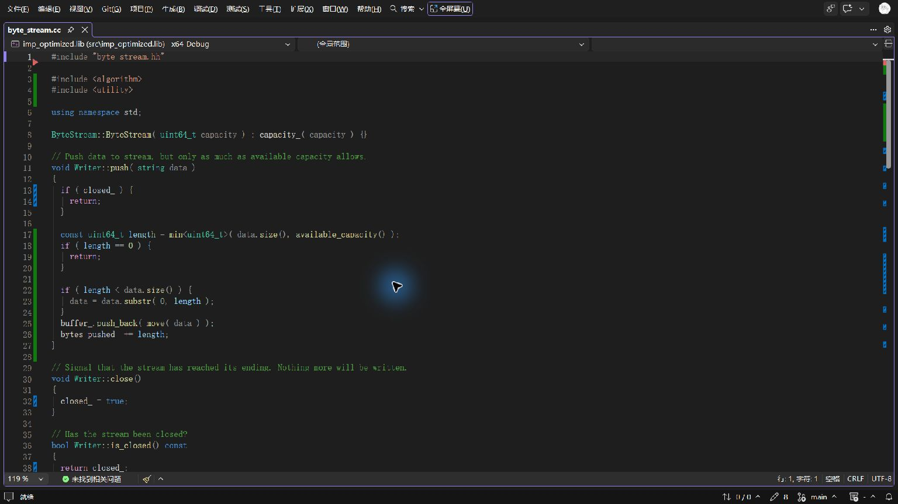
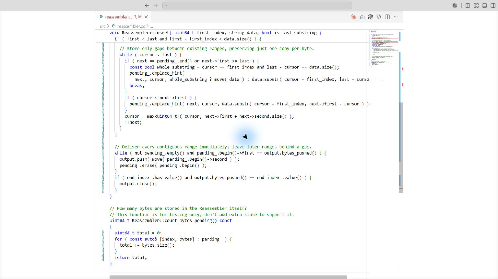
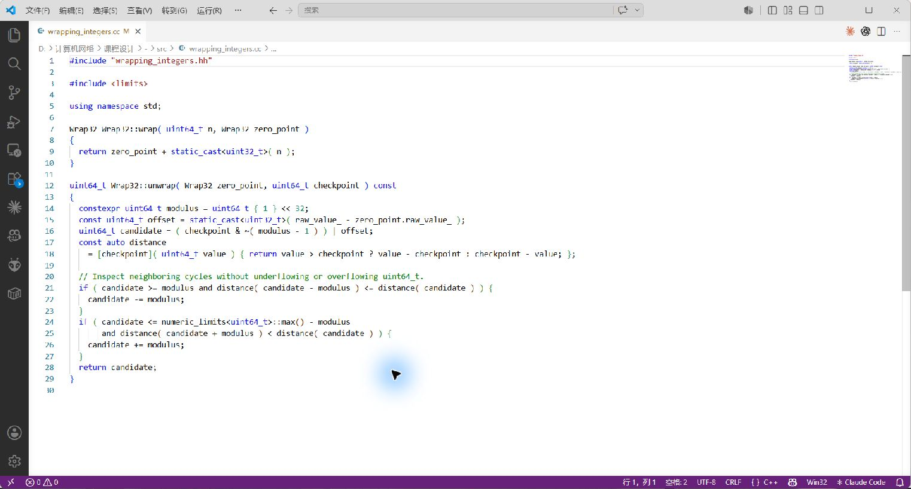
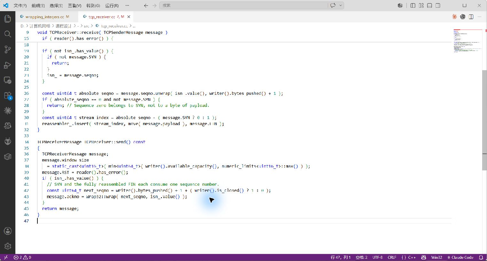

# 从环境配置到 Checkpoint 0、1、2、3 和 4

本文面向计算机网络新手，按照本项目实际开发过程，说明环境怎样配置、
各阶段实验分别解决什么问题、代码怎样验证，以及最后怎样提交到 GitHub。
命令会标明运行位置，阅读时先分清 Windows PowerShell 和 Ubuntu 终端。

记录日期：2026 年 11 月 24 日。

## 1 各阶段实验完成了什么

| 阶段 | 本次编写的模块 | 作用 |
|---|---|---|
| Checkpoint 0 | webget | 连接服务器、发送 HTTP 请求、读取并输出响应 |
| Checkpoint 0 | ByteStream | 在有限容量的内存缓冲区中，按顺序写入和读取字节 |
| Checkpoint 1 | Reassembler | 整理带索引的乱序、重复、重叠子串，交付连续字节 |
| Checkpoint 2 | Wrap32 | 在 32 位 TCP 序号和内部 64 位绝对序号之间换算 |
| Checkpoint 2 | TCPReceiver | 处理收到的 TCP 消息，生成确认号、接收窗口和复位标志 |
| Checkpoint 3 | TCPSender | 按窗口发送数据、处理 ACK，超时重传最早未确认的消息 |
| Checkpoint 4 | 网络测量工具 | 采集 ping，统计交付率、RTT、连续丢失与相关性，生成图表和报告 |

webget 目前使用 Linux 自带的 TCP。ByteStream 和 Reassembler 是我们
实现的基础模块；Checkpoint 2 已将它们接入自己的 TCP 接收端。
Checkpoint 3 又完成了自己的 TCP 发送端；完整实网互操作安排在后续阶段。
TCP 编程部分已完成自动化验证；TCP 实网互操作、手工 SMTP 会话与 TCP 抓包尚未执行。
Checkpoint 4 的实际 ICMP 网络测量另见后文。

“Checkpoint 0/1/2/3/4”是实验阶段名称；命令中的 `check0` 到 `check3` 是
前四个编程阶段的自动检查任务。Checkpoint 4 是测量实验，没有 check4 构建目标。

## 2 先认识开发环境

| 名称 | 负责什么 |
|---|---|
| Windows | 日常桌面、文件管理和编辑器运行环境 |
| WSL2 | 让 Windows 运行 Linux 环境 |
| Ubuntu | 本项目实际进行编译和测试的 Linux 系统 |
| Visual Studio / VS Code | 打开、阅读和编辑源码 |
| g++ | 将 C++ 源码编译成程序 |
| CMake | 读取工程配置，组织源码、库和测试之间的构建关系 |
| make | 按生成的构建规则执行编译任务 |
| clang-format | 统一代码缩进、空格等格式 |
| clang-tidy | 静态分析源码，发现潜在问题和不合理写法 |
| Git | 保存修改历史，获取框架，并把提交同步到 GitHub |

工作方式是：在 Windows 编辑同一份源码，在 Ubuntu 编译和运行。
实验使用 Linux 网络接口和脚本，因此运行结果以 Ubuntu 中的构建、测试为准。
Windows 编辑器中的提示还取决于编辑器自己的编译器与头文件配置。

## 3 检查 WSL 与 Ubuntu

开始工作时，这台电脑已经装有 WSL2 和 Ubuntu，我没有重新安装它们。

在 **Windows PowerShell** 中查看已有环境：

```powershell
wsl --list --verbose
```

当时能看到名为 Ubuntu 的环境，其 WSL 版本为 2。
进入它使用下面的命令：

```powershell
wsl -d Ubuntu
```

进入后，输入的就是 Linux 命令。要退出 Ubuntu、返回原来的 PowerShell，
可以输入 `exit`。

## 4 检查并安装开发工具

在 **Ubuntu 终端** 中检查系统和工具：

```bash
cat /etc/os-release
g++ --version
cmake --version
```

刚开始 Ubuntu 中缺少 g++、CMake 等开发工具，所以我补齐了它们。
实际安装通过 WSL 管理员账户完成；普通用户手动复现时，可使用等价的 sudo 命令：

```bash
sudo apt-get update
sudo apt-get install -y g++ make cmake clang-format clang-tidy-20
```

`sudo` 表示使用 Linux 管理员权限；`apt-get update` 更新可安装软件的目录；
`apt-get install` 安装指定软件；`-y` 表示自动确认安装。
make 等构建工具也在这次环境配置中补齐。
当前电脑已完成安装，下面的版本信息用于核对，无需重复安装。

| 工具或系统 | 本次核对的版本 |
|---|---|
| Ubuntu | 24.04.4 LTS |
| g++ | 13.3.0 |
| CMake | 3.28.3 |
| clang-format | 18.1.3 |
| clang-tidy | 20.1.2 |

仓库要求 C++23 标准，CMake 最低版本为 3.24.2。
C++23 是语言标准编号，g++ 13.3 是编译器版本，两者含义不同。
这些要求分别写在 [编译配置](../etc/cflags.cmake) 和
[主构建文件](../CMakeLists.txt) 中。

## 5 找到工程并理解目录

你已把官方仓库 fork 到自己的账号，并把代码克隆到本地。
Windows 和 Ubuntu 对同一份文件使用不同的路径写法：

| 环境 | 项目路径 |
|---|---|
| Windows | `D:\计算机网络\课程设计\-` |
| Ubuntu | `/mnt/d/计算机网络/课程设计/-` |

其中 `/mnt/d/` 对应 Windows 的 D 盘。
在 **Ubuntu 终端** 中进入工程：

```bash
cd "/mnt/d/计算机网络/课程设计/-"
pwd
ls
```

`cd` 切换目录，`pwd` 显示当前位置，`ls` 列出当前文件。
这里文件夹的名字是单个 `-`。在 Linux 中，单独的 `cd -` 表示返回上一个目录，
所以应使用上面的绝对路径，或在父目录执行 `cd ./-`。

| 路径 | 内容 |
|---|---|
| apps/ | 网页获取等应用程序 |
| src/ | 字节流、重组器等实验实现 |
| util/ | 已提供的套接字、文件描述符等基础设施 |
| tests/ | 官方测试与性能基准 |
| writeups/ | 实验记录、报告、代码截图和测试日志 |
| CMakeLists.txt | 描述工程怎样组织和编译 |
| build/wsl/ | 本机 Linux 编译产物，已被 Git 忽略 |

`.hh` 主要声明类、成员和函数接口；`.cc` 填写这些功能的具体实现。
刚克隆下来的框架中，许多函数只有 `Your code here` 或未实现提示。

## 6 配置和启动构建

下面的命令都在 **Ubuntu 的项目根目录** 中运行：

```bash
cmake -S . -B build/wsl
```

| 参数 | 含义 |
|---|---|
| `-S .` | 源码位于当前目录，`.` 表示当前目录 |
| `-B build/wsl` | 将构建配置和产物放进 build/wsl |

CMake 会检查编译器，读取工程配置，并生成后续编译所需的规则。
配置成功后，可以编译并执行指定阶段的检查：

```bash
cmake --build build/wsl --target check0
cmake --build build/wsl --target check1
cmake --build build/wsl --target check2
```

实际开发时，我还使用了下面的形式，限制并行构建任务数为 4：

```bash
CMAKE_BUILD_PARALLEL_LEVEL=4 cmake --build build/wsl --target check1
```

配置成功说明编译规则已经准备好；编译成功说明代码能生成程序；
测试通过才说明程序在相应测试输入下得到正确结果。

### 当时遇到的换行符问题

首次启动构建时，虽然脚本存在，仍报了 `No such file or directory`。
原因是 Windows 的 CRLF 换行影响了 Linux 对脚本解释器的识别。
我将本地 shell 脚本处理为 LF 换行，并添加了
[.gitattributes](../.gitattributes)：

```gitattributes
*.sh text eol=lf
```

它要求 Git 检出 `.sh` 脚本时使用 LF 换行。
[.gitignore](../.gitignore) 还增加了 `.vs/` 和 `out/`，
避免把 Visual Studio 的本地生成文件提交到仓库。

## 7 Checkpoint 0 的网页获取程序

修改文件：[apps/webget.cc](../apps/webget.cc)。

目标是实现一个简单的 HTTP 客户端：

```text
连接服务器 → 发送 HTTP 请求 → 循环读取响应 → 输出完整内容
```

比如访问 `/hello`，请求的文字内容是：

```http
GET /hello HTTP/1.1
Host: cs144.keithw.org
Connection: close

```

实际发送时，每行以 `\r\n` 结束，并以额外的空行结束请求头。
`GET` 表示获取资源；`Host` 说明目标网站；`Connection: close`
请求服务器在响应结束后关闭连接。

我补上的步骤如下：

1. 创建框架提供的 TCPSocket，作为网络通信的入口。
2. 用 Address 解析目标主机与 HTTP 服务，并建立连接。
3. 使用 write_all 发送完整请求。
4. 循环调用 read，把每次读到的内容输出。
5. 读到 EOF 后结束并关闭套接字。

一次 read 不保证得到整个网页，网络响应可能分多次到达。
这里的 EOF 表示对方已结束发送；循环读取是保证内容完整的关键。
程序会输出服务器的 HTTP 响应头及正文，TCP 传输由 Linux 内核提供。

编译好后，可在 **Ubuntu 项目根目录** 中亲手运行：

```bash
./build/wsl/apps/webget cs144.keithw.org /hello
```

自动化验证实际使用的是 tests/webget_t.sh 中的远端请求与预期结果。

## 8 Checkpoint 0 的内存字节流

修改文件：[src/byte_stream.hh](../src/byte_stream.hh) 和
[src/byte_stream.cc](../src/byte_stream.cc)。

ByteStream 是一个有容量限制的数据缓冲区。一端写入，另一端按顺序读取：

```text
Writer 写入 → ByteStream 暂存 → Reader 读取
```

假设容量为 5，且写入方遵守接口约定：

| 操作 | 当前缓冲内容 | 剩余容量 |
|---|---|---:|
| push("abcdef") | abcde，多出的 f 不被接收 | 0 |
| pop(2)，移除已读取的 ab | cde | 2 |
| push("fg") | cdefg | 0 |
| close() | cdefg，仍然可以读取 | 0 |
| 读完并 pop 剩余 5 字节 | 空，读取结束 | 5 |

容量限制的是某一时刻暂存的字节数，不是整个流的总长度。
读取方持续消费并腾出空间后，小缓冲区也能承载很长的数据流。
push 的返回类型是 void，调用方通过容量和累计写入量等接口判断接收情况。

| 接口 | 本次实现的行为 |
|---|---|
| push(data) | 只接收剩余容量允许的部分；关闭后不再接收 |
| peek() | 返回下一段可读数据的视图，不移除数据 |
| pop(len) | 移除相应数量的已读取字节 |
| close() | 标记写入结束 |
| available_capacity() | 查询剩余可写容量 |
| bytes_pushed()/bytes_popped() | 查询累计写入量与累计移除量 |
| bytes_buffered() | 查询已写入但尚未移除的数据量 |
| is_finished() | 仅当已经关闭且缓冲区为空时返回 true |

内部采用字符串分块队列，用队首偏移标记当前读到哪里。
读完一块再释放它，避免每次 pop 都整体搬移剩余数据。
peek 可以只返回队首块中未读的部分，不保证一次返回全部缓冲内容。

“关闭”和“读完”是两个不同状态：close 后如果还有缓冲数据，
is_finished 仍然是 false，直到这些数据也被读完。



其余代码截图见 [Checkpoint 0 截图目录](check0-screenshots/)。

## 9 获取 Checkpoint 1 框架

Checkpoint 0 完成后，本地还缺少重组器接口、实现模板和专项测试。
我添加官方远程仓库，并获取 check1-startercode：

```bash
git remote add upstream https://github.com/CS144/imp.git
git fetch upstream check1-startercode
git merge --no-commit --no-ff upstream/check1-startercode
```

这些是当时执行的接入步骤，当前工程已经完成合并。
remote add 只需配置一次；现在可通过 `git remote -v` 查看已有设置。
--no-commit 让合并先停下来供检查和继续实现，--no-ff 保留合并记录。

| 远程名称 | 指向哪里 | 用途 |
|---|---|---|
| origin | printf-wt/- | 上传自己的成果 |
| upstream | CS144/imp | 获取官方后续实验框架 |

本次合入的官方提交是 5f35eb9，增加了 Reassembler、七组功能测试、
性能基准、测试驱动与报告模板。已有 ByteStream 和 webget 实现得以保留。

## 10 Checkpoint 1 的乱序重组器

修改文件：[src/reassembler.hh](../src/reassembler.hh) 和
[src/reassembler.cc](../src/reassembler.cc)。

网络传来的数据可能乱序、重复，或与已有数据部分重叠。
Reassembler 根据每段数据的流索引，把它们恢复成连续的字节流。
索引从 0 开始，例如：

```text
原始内容：A B C D E F
流索引：  0 1 2 3 4 5
```

假设容量为 8，应用暂时还没有读取数据：

| 到达的片段 | ByteStream 中的内容 | 重组器暂存内容 |
|---|---|---|
| first_index=3，data="DEF" | 空 | 索引 3 到 5 的 DEF |
| first_index=0，data="AB" | AB | 索引 3 到 5 的 DEF |
| first_index=2，data="CD" | ABCDEF | 空 |

最后一次的 D 已经存在，所以只需保存新收到的 C；空洞补齐后，
即可交付 C 和之前保存的 DEF。不会重复交付 D。

如果第一段 DEF 带有 is_last_substring=true，它表示原始流到这里结束，
不是说这段必须最后到达。重组器先记住结束索引 6，等 ABCDEF 全部连续
交付后再关闭 ByteStream；应用把这 6 字节读完后才到达读取结束状态。

我实现的顺序是：

1. 检查输出是否已关闭，记录结束位置，并防止索引加法溢出。
2. 由已交付位置和下游剩余容量确定接收窗口，裁掉窗口外的数据。
3. 在按索引排序的 map 中查找已有区间，仅保存尚未收到的字节。
4. 如果能保存整个输入子串，就使用移动语义，减少复制。
5. 从最早区间开始，把所有连续数据立即写入 ByteStream。
6. 到达结束位置后关闭输出；待重组字节数由各暂存区间长度累计得到。

容量还要同时考虑“已经重组但未被应用读取”的数据。
窗口右边界等价于“已读出字节数 + 总容量”；不能直接用已交付位置加总容量，
否则会忽略 ByteStream 中尚未读取的数据。

两个模块的关系如下：

```text
带索引的乱序子串 → Reassembler 整理 → ByteStream 暂存 → 应用按顺序读取
```



## 11 Checkpoint 2 的序号换算与 TCP 接收端

### 11.1 为什么还要做接收端

Checkpoint 1 的重组器能够整理数据，但它接收的是“流索引 + 子串”。
真实 TCP 消息携带的却是报文序号、开始标志、结束标志和载荷。
本阶段需要在这两种表示之间衔接，并告诉对方“还缺哪个位置、还能接收多少”。

```text
TCP 消息：seqno、SYN、payload、FIN、RST
                    ↓
TCPReceiver：识别标志，换算数据位置
                    ↓
Reassembler：整理乱序、重复与重叠片段
                    ↓
ByteStream：暂存连续数据，交给应用读取
```

先认识消息中的几个字段：

| 字段 | 可以怎样理解 |
|---|---|
| seqno | 这条消息开头的序号 |
| SYN | 字节流的开始标志，携带初始序号 ISN |
| payload | 真正要交给应用的数据字节 |
| FIN | 字节流的结束标志 |
| RST | 发生错误，要求复位连接的标志 |

TCPReceiver 的 send() 负责生成确认信息对象，实际封装和网络发送由框架上层负责。

### 11.2 当时怎样获取框架

沿用前面已经配置好的 upstream，我在本地工程中执行：

```bash
git fetch upstream check2-startercode
git merge --no-commit --no-ff upstream/check2-startercode
```

这是本次开发时的合入步骤，当前 main 已经包含这些修改。
框架提交是 d4aea19a311753ac47bd074cb1c5bf778191962b，带来了：

- wrapping_integers.hh/.cc：32 位序号包装类型及待实现的换算函数。
- tcp_receiver.hh/.cc：TCP 接收端接口及待实现的处理函数。
- 五组序号测试、七组接收端测试，以及报文结构与适配基础设施。
- 与新报文类型配套的编译开关和 Checkpoint 2 报告模板。

已有字节流和重组器继续使用，官方 tests、util、etc 内容保持合入后的原样。

### 11.3 先分清三种编号

TCP 报文的序号只有 32 位，从 0 数到 4294967295 后会重新回到 0。
而且每条流从一个初始序号 ISN 开始，不固定从 0 开始。

为了便于内部计算，我们还使用从 0 开始的 64 位绝对序号。
Reassembler 使用的流索引则只给数据字节编号，不给 SYN、FIN 编号。

例如，设 ISN=100，原始内容是 ABCDEF：

| 元素 | SYN | A | B | C | D | E | F | FIN |
|---|---:|---:|---:|---:|---:|---:|---:|---:|
| TCP 序号 | 100 | 101 | 102 | 103 | 104 | 105 | 106 | 107 |
| 绝对序号 | 0 | 1 | 2 | 3 | 4 | 5 | 6 | 7 |
| 流索引 | 无 | 0 | 1 | 2 | 3 | 4 | 5 | 无 |

这里最重要的是：SYN 和 FIN 各占一个序号位置，但不属于应用的数据。
因此普通数据的流索引等于其绝对序号减 1。

### 11.4 实现 wrap 和 unwrap

阅读文件：[wrapping_integers.hh](../src/wrapping_integers.hh)、
[wrapping_integers.cc](../src/wrapping_integers.cc)。

wrap 的方向是“绝对序号 → TCP 序号”：

```text
TCP 序号 = (ISN + 绝对序号) 对 2^32 取余
```

“取余”就是保留除法的余数，保证结果落在 32 位范围内。
例如 ISN=4294967294，绝对序号为 3，相加后越过最大值，最后得到序号 1。
实现中通过转换为 32 位无符号数并相加，完成这种回绕。

unwrap 的方向是“TCP 序号 → 绝对序号”，但它还需要一个 checkpoint。
这个 checkpoint 是当前大致走到的位置，用于判断已经绕了几圈。

例如 ISN=100，收到序号 105，它可能对应绝对序号 5，也可能对应 2^32+5：

| checkpoint 靠近哪里 | 应还原出的绝对序号 |
|---|---:|
| 3 | 5 |
| 4294967299，即 2^32+3 | 4294967301，即 2^32+5 |

我的实现先构造当前周期中的候选，再比较相邻周期，选择最近的合法值。
调整周期前检查 64 位上下界，避免下溢或上溢；距离相同时选择较小候选。



### 11.5 实现 receive 接收逻辑

阅读文件：[tcp_receiver.hh](../src/tcp_receiver.hh)、
[tcp_receiver.cc](../src/tcp_receiver.cc)。

我只额外保存一个可选的 isn_ 状态，用于区分“还没收到 SYN”和“已知初始序号”。
其余进度、关闭和错误状态从重组器或字节流查询。

receive 的处理步骤如下：

1. 收到 RST 时，将字节流标记为错误；已处于错误状态时停止继续接收。
2. 第一次收到 SYN 时记录 ISN。还不知道 ISN 的普通数据暂不接收。
3. 以“已连续交付字节数 + 1”为 checkpoint，将 TCP 序号还原为绝对序号。
4. 排除把 SYN 的位置当作普通数据的无效消息，避免错误地减出极大流索引。
5. 根据是否携带 SYN，换算载荷首字节的流索引。
6. 把流索引、载荷和 FIN 标志交给 Reassembler。

例如，普通数据的绝对序号为 4，说明其流索引为 3，应从原始内容的 D 开始。
如果 SYN 和数据在同一条消息中到达，则先跨过 SYN 的位置，再交付数据。
重复到达同一个 SYN 时，已经收到的数据和已记录的 ISN 都不会被重新初始化。

接收端认识 TCP 的标志和编号；乱序、重叠、去重、容量裁剪仍由重组器完成。
这样可以直接复用前一个实验的实现和验证结果。

### 11.6 实现确认号和接收窗口

send() 返回三个字段：

| 字段 | 表达的意思 |
|---|---|
| ackno | 接下来期待的 TCP 序号 |
| window_size | 从确认位置开始还愿意接收的序号范围宽度 |
| RST | 当前字节流是否已经发生错误 |

确认号需要以“连续收齐”为依据。收到后面的片段，但前面仍有空洞时，
确认号应停在第一个缺失的位置。

收到 SYN 后，先计算绝对确认位置：

```text
绝对确认位置 = 已连续交付的数据字节数 + 1（SYN）
             + 1（仅当完整重组到结束位置、需要确认 FIN 时）
```

再通过 wrap 转回 32 位序号。收到 SYN 前，确认号为空。
确认 FIN 使用 Writer 是否关闭来判断；应用暂时还没读完缓冲数据，不影响确认 FIN。

窗口来自 ByteStream 的当前可用容量，并限制到 16 位字段最大值 65535。
缓冲区满时窗口为 0，应用读取并腾出空间后窗口增大。
乱序数据已经位于当前接收序号范围内，不再从窗口宽度中重复扣减。



### 11.7 把三个模块串起来推演

继续设 ISN=100、内容为 ABCDEF、容量为 8。假设应用最初还没有读取：

| 收到的消息或发生的操作 | 连续交付进度 | ackno | 窗口 |
|---|---|---:|---:|
| 刚创建接收端 | 空 | 无 | 8 |
| SYN，seqno=100 | 空 | 101 | 8 |
| DEF+FIN，seqno=104 | 前面有空洞，DEF 暂存 | 101 | 8 |
| AB，seqno=101 | AB 已交付 | 103 | 6 |
| CD，seqno=103 | ABCDEF 全部交付并确认 FIN | 108 | 2 |
| 应用读取全部 6 字节 | 数据已读出 | 108 | 8 |

可以重点观察三个地方：

- DEF+FIN 先到时，确认号仍然是 101，因为还缺 A 开始的数据。
- CD 到达后，C 补齐空洞，D 与已有片段重复，最终连续交付 ABCDEF。
- ACK=108 计入了 SYN、六个数据字节和 FIN；应用读取后，ACK 不变而窗口恢复。

### 11.8 怎样编译和验证本阶段

在 Ubuntu 的项目根目录执行：

```bash
cmake -S . -B build/wsl
CMAKE_BUILD_PARALLEL_LEVEL=4 cmake --build build/wsl --target check2
CMAKE_BUILD_PARALLEL_LEVEL=4 cmake --build build/wsl --target check0
CMAKE_BUILD_PARALLEL_LEVEL=4 cmake --build build/wsl --target tidy
clang-format --dry-run --Werror src/wrapping_integers.hh src/wrapping_integers.cc src/tcp_receiver.hh src/tcp_receiver.cc
python3 writeups/check2-screenshots/boundary-validation.py
```

check2 的 30 项官方检查通过，覆盖旧模块、序号换算、接收端和已有性能基准。
check0 的 11 项回归检查通过，包含远端 HTTP 请求。
补充脚本在临时目录编译实际 Wrap32 实现，运行 10 项 64 位边界检查，
覆盖最大值、非零 ISN、相邻周期和等距候选，也全部通过。

30 项官方检查与 10 项补充检查是两组不同记录，后者没有改动官方测试。
全部 src 实现通过静态分析，本阶段四个源码文件通过格式检查。

阅读代码时，建议先看 wrap，再看 unwrap，然后沿 receive 到 Reassembler 的调用阅读，
最后对照上面的表格，手工算出每次 send() 的确认号和窗口。
更多细节见 [Checkpoint 2 实现报告](check2.md)。

## 12 Checkpoint 3 的 TCP 发送端

### 12.1 这个实验解决什么问题

Checkpoint 2 解决“收到的数据怎样整理”。Checkpoint 3 解决“数据怎样发出去，
以及发出去之后怎样知道对方收到了”。网络可能丢包，也可能让 ACK 丢失，
所以发送端必须保存尚未确认的消息，并在等待超时后再次发送。

```text
应用写入 → ByteStream → TCPSender.push → 消息 → 对方 TCPReceiver
                              ↑                        ↓
                         receive ← ACK 和窗口 ← 接收方状态
                              ↑
                      tick：时间到了就重传
```

push 的 transmit 参数是一个“发送消息的回调函数”。本阶段只负责生成消息，
网络封装由框架完成。tick 由框架告知经过了多少毫秒，不需要在源码中等待。

### 12.2 怎样获取和阅读框架

先保存前一阶段的文档，再获取并合入官方 check3-startercode。
本次 HTTPS 获取遇到超时，改用已配置好的 GitHub SSH 连接完成下载。
以下是在 Windows PowerShell 中实际采用的核心操作：

```powershell
git status
git fetch git@github.com:CS144/imp.git refs/heads/check3-startercode:refs/remotes/upstream/check3-startercode
git merge --no-commit --no-ff upstream/check3-startercode
```

--no-commit 表示暂不生成合并提交，便于把本阶段实现、验证和文档一起提交。
框架提交是 0794b5dd521963bd479d3136080aab3f62fdf7db。
阅读顺序是 tcp_sender.hh、tcp_sender_message.hh、tcp_receiver_message.hh，
然后看 tests 中的 send_connect、send_window、send_ack、send_retx 等测试。

### 12.3 先理解窗口和在途数据

接收端公布 window_size，表示允许发送方在 ACK 位置之后发送多少个序号。
发送后尚未收到累计确认的内容叫“在途数据”。

```text
已经确认的内容 | 已发送、尚未确认的内容 | 窗口内还能新发的内容
              ↑                      ↑
       acknowledged_seqno_       next_seqno_
```

在途数 = next_seqno_ - acknowledged_seqno_。
剩余可发空间 = 窗口 - 在途数；如果在途数已达到或超过窗口，就停止新发送。
SYN 和 FIN 也各占一个位置，不能只统计 payload。

我在头文件中用 deque 保存尚未完整确认的消息，每项还记录消息末尾的下一绝对序号。
只要收到的 ACK 达到这个末尾，就能从队头删除这项。
ByteStream 中的数据被读走后仍保存在这个队列里，以便丢包后重传。

### 12.4 实现 push

1. 初始窗口按 1 处理，第一次通常只发送 SYN。
2. 根据窗口和在途数计算余量，为 SYN 预留空间后再取数据。
3. 每条 payload 最多 1000 字节，这是当前源码 TCPConfig 的值。
4. 应用关闭、所有字节都取完且窗口还空出一个位置时，附加 FIN。
5. 更新序号、保存消息，再通过 transmit 发出；继续循环填充余下窗口。

FIN 发过后不再生成新消息；重传已保存的 FIN 则仍然允许。
空消息不占用序号，也不进入未确认队列。

### 12.5 实现 receive

对方回复的 ACK 是 32 位序号，因此先用上个实验的 unwrap 还原绝对位置。
ACK 如果超过实际已发送的位置，不能接受；否则可能把尚未发送的数据当成已确认。
合法消息先更新窗口，再判断 ACK 是否真的前进。

新 ACK 前进时，回收完整确认的消息，重置超时等待和连续重传次数。
重复 ACK 或旧 ACK 可以带来窗口变化，但不会重置计时器。
部分确认的消息保留整条，超时后允许重传原消息；接收端会去掉重复字节。
收到 RST 时，将输入流标为错误。

### 12.6 实现 tick 和零窗口探测

第一次出现未确认消息时开始计时；队列空了就停止。
累计等待达到 RTO，即“重传超时”，就重传队头消息。
窗口不为零时，连续超时会让 RTO 翻倍，例如 10 → 20 → 40 毫秒。
收到新的确认后恢复最初的 RTO。

零窗口表示对方暂时没有接收空间。发送端允许一个序号的探测，
以便对方重新告诉自己窗口是否打开。探测未确认时不会一直生成新数据。
零窗口期间的重传不增加失败次数，也不让 RTO 翻倍。
代码只在计算可发空间时把 0 临时当成 1，保存的实际窗口仍为 0。

计时采用“本次经过时间与剩余等待时间比较”，避免大整数相加回绕；
翻倍达到 uint64_t 最大值时则保持在上限。

### 12.7 手工推演丢失 ABCDEF 的过程

沿用 ISN=100。应用写入 ABCDEF 后关闭，接收窗口为 8，初始 RTO=10 毫秒。

| 顺序 | 行为 | 发送端在途数 |
|---|---|---|
| 1 | 发送 SYN，seqno=100 | 1 |
| 2 | 收到 ACK=101、窗口 8，确认 SYN | 0 |
| 3 | 发送 seqno=101 的 ABCDEF+FIN，假设丢包 | 7 |
| 4 | 等待满 10 毫秒，重传 ABCDEF+FIN；RTO 变为 20 | 7 |
| 5 | 对方连续收到 6 个数据字节及 FIN，返回 ACK=108 | 7，尚未收到确认 |
| 6 | ACK 抵达发送端，删除未确认消息、停止计时 | 0 |

如果第 5 步的 ACK 丢了，发送端会在重传后再等 20 毫秒，再次重传原消息。
接收端不会重复输出 ABCDEF，而会再次返回累计确认。
这说明可靠传输需要发送端和接收端共同配合。

### 12.8 实际验证与学习材料

在 Ubuntu 的项目根目录执行：

```bash
cmake -S . -B build/wsl
CMAKE_BUILD_PARALLEL_LEVEL=4 cmake --build build/wsl --target check3
CMAKE_BUILD_PARALLEL_LEVEL=4 cmake --build build/wsl --target check0
python3 writeups/check3-screenshots/scenario-validation.py
CMAKE_BUILD_PARALLEL_LEVEL=4 cmake --build build/wsl --target tidy
clang-format --dry-run --Werror src/tcp_sender.hh src/tcp_sender.cc
```

本次 check3 的 37 项官方检查、check0 的 11 项回归检查，以及 6 个补充场景全部通过。
补充场景把发送端和接收端接在内存队列上，模拟丢包、丢 ACK、乱序及序号回绕，
并检查部分确认、零窗口、无效确认和计时上限。
完整实网互操作尚未执行。

- [Checkpoint 3 详细报告与三张主要代码截图](check3.md)
- [验证摘要](check3-screenshots/validation.txt)
- [可亲手重跑的补充场景](check3-screenshots/scenario-validation.py)

## 13 Checkpoint 4 的真实网络测量

### 13.1 为什么这次没有新框架

前四个阶段逐步写出 TCP 的基础部件。Checkpoint 4 转向观察真实网络：
数据来回需要多久，会不会有探测得不到回复，丢失是否连续发生。
官方仓库没有 check4-startercode 分支，工程也没有 check4 检查目标。
本阶段新增 tools/check4 中的 Python 工具，不为得到“通过”而新增空的构建任务。

官方要求长时观察公网路径，并与同学主机路径比较。当前测量范围和真实完成状态
以[本阶段报告](check4.md)为准；本地可达的同学路径应按实际环境描述，
不能写成从未接入的 CS144 专用私网。

### 13.2 认识 ping、RTT 和交付率

ping 发出 ICMP Echo Request，目标允许回复时返回 Echo Reply。
一去一回经过的时间叫 RTT，单位通常是毫秒 ms。
它使用操作系统的网络能力，不是在调用刚完成的 TCPSender。

Ubuntu 中可以先试 4 个探测：

```bash
ping -n -c 4 -W 2 1.1.1.1
```

Windows 的参数不同，不能把 -c 直接照抄过去：

```powershell
ping -n 4 1.1.1.1
```

Linux 的 -n 表示输出数字地址，Windows 的 -n 4 表示发送 4 次。
如果不回复，只能说明在观察期内没收到 Echo Reply；原因可能是网络丢失、
防火墙过滤、设备限速或对方离线，不能直接认定网络中的所有数据都丢了。

### 13.3 怎样准备同学的 Windows 电脑

这次你和同学使用同一局域网。先让同学按 Win+R，输入 cmd，回车，
在命令窗口输入 ipconfig 并再次回车。
找到正在使用的“无线局域网适配器 WLAN”，读取其中的 IPv4 地址。
不用“媒体已断开”的适配器地址，也不用默认网关或物理地址。

得到地址后，从 Windows 与实际采集所在的 Ubuntu 分别短测。
不能回复时，先核对地址和在线状态，再检查防火墙或校园网隔离。
如果需要放行 ICMP，只在同学电脑上添加限定来源地址的 Echo Request 规则，
不需要关闭整机防火墙；测量结束后可删除这条专用规则。

完整步骤、可复制命令和清理方法见[同学主机配置说明](check4-peer-setup.md)。
采集期间同学电脑需保持联网、不休眠；同学不需要编译本项目或运行 TCP 服务器。

### 13.4 开始一小时采集

确认目标可达后，在 Ubuntu 的项目根目录执行：

```bash
python3 tools/check4/collect.py 1.1.1.1 --output build/my-check4/cloudflare --duration 3602
```

这里使用 3602 秒截止时间，普通间隔为 0.2 秒，载荷为 56 字节。
理论上每秒 5 次，一小时约 18,000 次；实际次数以最后汇总为准。
第一次发送与后续调度会影响精确数量，不能只根据目标时长假造发送数。

脚本保存两份关键文件：ping.txt 是原始输出，metadata.json 记录命令、
目标、实际开始/结束时间、真实经过秒数和完成状态。
每个目标使用单独目录；已有数据不能直接覆盖。
人为中断的数据会标记为 interrupted，不能通过最终报告的完整性检查。

一小时等待期间可以编写分析代码，但不能把前几分钟的预览写成完整实验。
预览图会明确标注 PREVIEW，最终报告默认拒绝不足一小时的采集。

本次后来更换了局域网，旧采集不足一小时，已清理，未拼接到正式结果。
重新确认双方地址、更新同学防火墙规则后，从头采集三条路径。
正式数据位于 check4-data/network2，每条实际运行约 3602 秒。
本次共记录约 53,789 个探测：两条公网交付率分别约 94.75%、96.27%，
同学路径约 99.41%。完整计数与图表见本阶段报告。

### 13.5 用序号判断哪些探测没有回复

每个探测带有 icmp_seq。假设最终发送 5 次，只收到序号 1、4、5：

```text
序号： 1    2    3    4    5
结果：成功  失败  失败  成功  成功
```

交付率是 3/5=60%，最长连续成功是 2，最长连续失败也是 2。
首尾缺失同样要统计，所以必须知道最终实际发送数。

-O 打印的 no answer yet 只表示“发下一次之前还没收到”，
迟到的回复之后仍可能出现。代码在采集结束后按唯一成功序号计算，
不会把暂时等待、重复回复或乱序回复算错。
未回复的 RTT 留空，不填 0，因为“没有测到”不等于“往返时间为零”。

### 13.6 理解这几个图

| 图 | 横轴与纵轴 | 用来观察什么 |
|---|---|---|
| RTT 时间图 | 实际回复时刻、RTT 毫秒 | 时延是否稳定，什么时候出现尖峰 |
| RTT 经验 CDF | RTT 毫秒、不超过该值的成功样本比例 | 多数时延落在哪个范围，有没有较长右尾 |
| 条件交付/丢失图 | 序号间隔 k、相同结果的条件概率 | 成功或失败是否聚集出现 |
| 相邻 RTT 散点 | 序号 N 的 RTT、N+1 的 RTT | 连续探测的时延是否一起变化 |
| 短时速率图 | 实际请求载荷速率、实际回复载荷速率 | 本次有限负载下回复速率怎样变化 |

条件丢失概率可以读成：“已知这次没收到回复，下 k 次后那次也没收到的比例”。
在上面的五次探测中，丢失位置为 2、3；它们的下一次只有 2→3 仍丢失，
所以 k=1 时条件丢失概率是 1/2=50%，而无条件丢失率是 2/5=40%。
这种差异可以提示聚集，但有限样本不能直接证明统计显著。

k=0 在有样本时必然为 100%，因为是在拿自己和自己比较。
如果完全没有丢失，条件丢失概率就没有分母，必须写“未定义”，不能写 0。
边缘处没有第 n+k 个探测的组合也不能进入分母。

相邻 RTT 必须真正对应 N、N+1。上例只有 4→5 这一对连续成功，
不能把 1 和 4 拼起来冒充相邻，只有一个有效点时也无法估计 Pearson 相关系数。

### 13.7 短时速率试验与路由观察

在 Ubuntu 中运行三组有界短时探测：

```bash
python3 tools/check4/burst.py 1.1.1.1 --output build/my-check4/cloudflare/bursts
```

三组逐步增加包大小和频率，每组有 8 秒截止时间，最大载荷为 1200 字节。
速率统一用“载荷字节×收发数量×8÷实际总秒数”计算，得到 bit/s。
不包含报文头开销，也不能把最大 ICMP 回复速率称为线路带宽或 TCP 吞吐。

Windows 中用以下命令观察部分路径跳点：

```powershell
tracert -d -h 24 -w 250 1.1.1.1
```

星号只是对应跳点未回复这次探测。私网地址、星号和重复目标地址不足以定位城市，
不能根据一个服务商名称补写出没有证据的地理路线。

### 13.8 分析、生成报告和验证

采集结束后，在 Windows PowerShell 中运行分析；不要把下面命令输到 Ubuntu，
除非也已在 Ubuntu 安装相应 Python 依赖：

```powershell
python -m pip install -r tools/check4/requirements.txt
python tools/check4/test_metrics.py
python tools/check4/analyze.py build/my-check4/cloudflare --output build/my-check4-results/cloudflare
```

两条路径都分析后，可用 build_report.py 一起生成报告。
工具说明中给出了完整命令与 --peer 的用法：它只标注实际采集的同学路径，
不会生成或补齐不存在的数据。

- [各脚本的职责与复现命令](../tools/check4/README.md)
- [实际测量报告](check4.md)
- [中文 PDF](../output/pdf/check4-report.pdf)

统计函数有 10 项边界测试，采集进程另有 2 项真实中断测试；另用短时本机回环探测验证采集到分析的实际流程，
并确认最终报告会拒绝不足一小时的数据。正式图表只使用真实采集日志。

## 14 怎样判断代码正确

官方测试会自动构造输入，并核对输出、容量、结束状态和性能。
测试结果中的一项可能是构建或基准任务，不等于一个单独的网络功能。

| 测试内容 | 要验证的问题 |
|---|---|
| 容量已满 | 是否拒绝继续占用缓冲空间 |
| 数据乱序 | 是否暂存后到的数据并等待空洞补齐 |
| 数据重复或重叠 | 是否只保存和输出一份字节 |
| 提前收到末段 | 是否在连续数据尚未到齐时继续等待 |
| 应用读取数据 | 接收窗口是否随着可用空间增加而移动 |
| 极大索引 | 是否避免索引回绕后错误接收数据 |
| 性能基准 | 是否达到实验要求的吞吐 |

本次记录的验证结果：

- Checkpoint 0 初次实现后，11 项检查全部通过。
- Checkpoint 1 实现后，18 项检查全部通过，其中也包含 ByteStream 回归检查。
- 合入 Checkpoint 1 后，再运行 Checkpoint 0，其 11 项检查也全部通过。
- Checkpoint 2 的 30 项官方检查通过，包含前两阶段的模块回归。
- 合入 Checkpoint 2 后，另跑 Checkpoint 0 的 11 项检查通过，补充边界检查 10 项通过。
- Checkpoint 3 的 37 项官方检查、11 项 HTTP 回归和 6 个补充场景均通过。
- 编译中的 ASan 检查常见内存访问错误，UBSan 检查未定义行为。
- 静态检查曾提示重组器有不必要的数据复制，我增加整块移动处理后重新验证通过。
- 最终通过相关静态分析与格式检查，官方测试内容保持原样。

“回归检查”表示新增功能后，再检查以前的功能是否仍然正常。
check1 本身不包含远端 HTTP 请求，因此另跑 check0 有明确作用。
check2、check3 同样不包含远端 HTTP 请求，因此也另跑 check0。

原始记录：

- [Checkpoint 0 验证摘要](check0-screenshots/validation.txt)
- [Checkpoint 1 验证摘要](check1-screenshots/validation.txt)
- [Checkpoint 1 完整测试日志](check1-screenshots/check1-ctest.log)
- [Checkpoint 0 回归日志](check1-screenshots/check0-regression.log)
- [Checkpoint 1 实现报告](check1.md)
- [Checkpoint 2 验证摘要](check2-screenshots/validation.txt)
- [Checkpoint 2 完整测试日志](check2-screenshots/check2-ctest.log)
- [Checkpoint 2 的 HTTP 回归日志](check2-screenshots/check0-regression.log)
- [Checkpoint 2 补充边界检查](check2-screenshots/boundary-validation.log)
- [Checkpoint 2 实现报告](check2.md)
- [Checkpoint 3 验证摘要](check3-screenshots/validation.txt)
- [Checkpoint 3 官方检查日志](check3-screenshots/check3-ctest.log)
- [Checkpoint 3 补充场景结果](check3-screenshots/scenario-validation.log)
- [Checkpoint 3 实现报告与截图](check3.md)

重组器官方基准的输出使用了不同于实际输入字节数的计算分子。
报告中同时保留原始输出和折算后的有效载荷吞吐，避免混淆两种口径。

## 15 截图、提交与推送

功能验证后，我在 Windows 编辑器中打开主要代码并保存实际截图，
再把源码、报告、截图和测试日志一起纳入 Git。

| 操作 | 含义 |
|---|---|
| Fork | 在 GitHub 上把官方仓库复制到自己的账号 |
| Clone | 把远程仓库下载为本地工程 |
| Fetch | 下载远程的新提交和分支信息 |
| Merge | 将指定分支的修改合入当前分支 |
| Add | 选择本次准备提交的文件，即放入暂存区 |
| Commit | 在本地建立一条带说明的修改记录 |
| Push | 将本地提交上传到远程仓库 |

本次 Git 操作使用 Windows 已有的 Git 与 SSH 认证，
Ubuntu 中的开发工具负责编译和测试。
本地保存文件不会自动更新 GitHub，需要先 commit 再 push。

一次提交的流程是：

1. 用 git status 检查本地修改。
2. 用 git add 明确选择本次要提交的文件。
3. 用 git diff --cached 检查暂存内容。
4. 写清提交标题、文件改动、设计意图和实际验证结果，再执行 git commit。
5. 执行 git push origin main。
6. 比较本地与远端提交，并确认工作区干净。

现在可以查看真实记录：

```bash
git status
git remote -v
git log -1 --format=full
```

## 16 可以亲手复现的最短流程

工具和框架已经配置完成。先在 **Windows PowerShell** 中进入 Ubuntu：

```powershell
wsl -d Ubuntu
```

然后在 **Ubuntu 终端** 中依次执行：

```bash
cd "/mnt/d/计算机网络/课程设计/-"
pwd
g++ --version
cmake --version
cmake -S . -B build/wsl
CMAKE_BUILD_PARALLEL_LEVEL=4 cmake --build build/wsl --target check0
CMAKE_BUILD_PARALLEL_LEVEL=4 cmake --build build/wsl --target check1
CMAKE_BUILD_PARALLEL_LEVEL=4 cmake --build build/wsl --target check2
CMAKE_BUILD_PARALLEL_LEVEL=4 cmake --build build/wsl --target check3
```

先观察每条命令的输出，再读源码。建议顺序为：webget.cc、byte_stream.hh、
byte_stream.cc、reassembler.hh、reassembler.cc、wrapping_integers.hh/.cc、
tcp_receiver.hh/.cc、tcp_sender.hh/.cc，最后阅读 tests 中的测试。

学习时可分别观察四个编程阶段的输出；日常验收时，check3 已覆盖旧模块的回归，
配合 check0 检查 HTTP 即可，不必每次重复运行 check1 和 check2。
网络测量另按第 13 节运行 Python 工具，不执行不存在的 check4 构建目标。

阅读 ByteStream 时，尝试手工计算每次 push/pop 后的剩余容量；
阅读 Reassembler 时，按前面的 ABCDEF 示例画出暂存区间和已交付位置。
阅读 TCPReceiver 时，再加入 SYN、FIN 的序号占用，逐步算出 ACK=101、103、108。
阅读 TCPSender 时，画出未确认队列，计算每次 ACK 和超时后窗口、在途数及 RTO 的变化。

## 17 阶段完成记录

| 提交 | 内容 |
|---|---|
| [c0e5235](https://github.com/printf-wt/-/commit/c0e5235847d6c1ca3eccf1082f93e50b50885dc9) | 完成 Checkpoint 0 的 HTTP 客户端、字节流、截图及验证记录 |
| [2979d12](https://github.com/printf-wt/-/commit/2979d12740c91fc858f2920ca12abc1daae57395) | 合入 Checkpoint 1 框架，完成重组器、报告、截图和测试记录 |
| [5a2442f](https://github.com/printf-wt/-/commit/5a2442f1dc172788c396d2e2d054342284d2f4f8) | 合入 Checkpoint 2 框架，完成序号换算、TCP 接收端及验证记录 |
| [766c7ea](https://github.com/printf-wt/-/commit/766c7ea9b594c1c90ff95a113488154a749f06b2) | 合入 Checkpoint 3 框架，完成发送端、截图与重传验证 |

Checkpoint 4 的实测范围、图表与原始记录见[测量报告](check4.md)。

实现、验证与本文整理由 Codex 按用户请求辅助完成。
