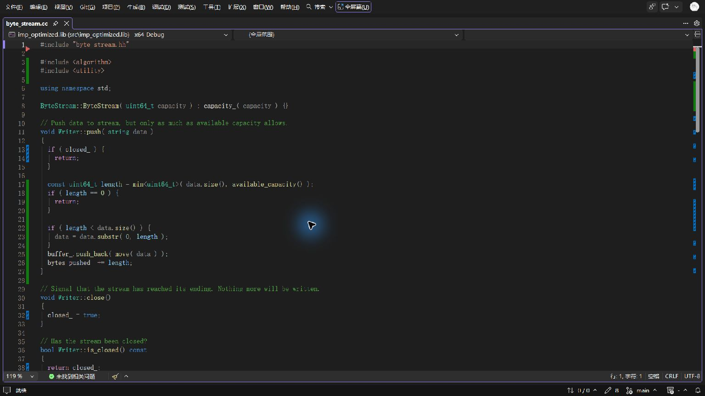
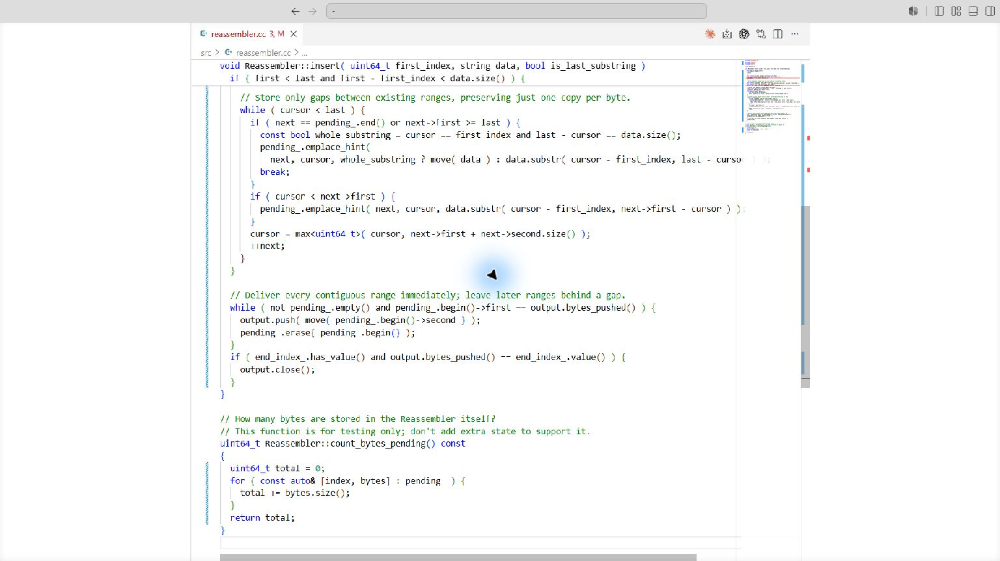

# 从环境配置到 Checkpoint 0 和 Checkpoint 1

本文面向计算机网络新手，按照本项目实际开发过程，说明环境怎样配置、
两个实验分别解决什么问题、代码怎样验证，以及最后怎样提交到 GitHub。
命令会标明运行位置，阅读时先分清 Windows PowerShell 和 Ubuntu 终端。

记录日期：2026 年 11 月 24 日。

## 1 两个实验完成了什么

| 阶段 | 本次编写的模块 | 作用 |
|---|---|---|
| Checkpoint 0 | webget | 连接服务器、发送 HTTP 请求、读取并输出响应 |
| Checkpoint 0 | ByteStream | 在有限容量的内存缓冲区中，按顺序写入和读取字节 |
| Checkpoint 1 | Reassembler | 整理带索引的乱序、重复、重叠子串，交付连续字节 |

webget 目前使用 Linux 自带的 TCP。ByteStream 和 Reassembler 是我们
实现的基础模块；后续实验会把它们接入自己的 TCP 接收端和发送端。
本次已经完成编程和自动化验证，手工联机、SMTP 会话和抓包部分尚未执行。

“Checkpoint 0/1”是实验阶段名称；命令中的 `check0`、`check1` 则是
工程为这些阶段提供的构建与自动检查任务。

## 2 先认识开发环境

| 名称 | 负责什么 |
|---|---|
| Windows | 日常桌面、文件管理和编辑器运行环境 |
| WSL2 | 让 Windows 运行 Linux 环境 |
| Ubuntu | 本项目实际进行编译和测试的 Linux 系统 |
| Visual Studio / VS Code | 打开、阅读和编辑源码 |
| g++ | 将 C++ 源码编译成程序 |
| CMake | 读取工程配置，组织源码、库和测试之间的构建关系 |
| make | 按生成的构建规则执行编译任务 |
| clang-format | 统一代码缩进、空格等格式 |
| clang-tidy | 静态分析源码，发现潜在问题和不合理写法 |
| Git | 保存修改历史，获取框架，并把提交同步到 GitHub |

工作方式是：在 Windows 编辑同一份源码，在 Ubuntu 编译和运行。
实验使用 Linux 网络接口和脚本，因此运行结果以 Ubuntu 中的构建、测试为准。
Windows 编辑器中的提示还取决于编辑器自己的编译器与头文件配置。

## 3 检查 WSL 与 Ubuntu

开始工作时，这台电脑已经装有 WSL2 和 Ubuntu，我没有重新安装它们。

在 **Windows PowerShell** 中查看已有环境：

```powershell
wsl --list --verbose
```

当时能看到名为 Ubuntu 的环境，其 WSL 版本为 2。
进入它使用下面的命令：

```powershell
wsl -d Ubuntu
```

进入后，输入的就是 Linux 命令。要退出 Ubuntu、返回原来的 PowerShell，
可以输入 `exit`。

## 4 检查并安装开发工具

在 **Ubuntu 终端** 中检查系统和工具：

```bash
cat /etc/os-release
g++ --version
cmake --version
```

刚开始 Ubuntu 中缺少 g++、CMake 等开发工具，所以我补齐了它们。
实际安装通过 WSL 管理员账户完成；普通用户手动复现时，可使用等价的 sudo 命令：

```bash
sudo apt-get update
sudo apt-get install -y g++ make cmake clang-format clang-tidy-20
```

`sudo` 表示使用 Linux 管理员权限；`apt-get update` 更新可安装软件的目录；
`apt-get install` 安装指定软件；`-y` 表示自动确认安装。
make 等构建工具也在这次环境配置中补齐。
当前电脑已完成安装，下面的版本信息用于核对，无需重复安装。

| 工具或系统 | 本次核对的版本 |
|---|---|
| Ubuntu | 24.04.4 LTS |
| g++ | 13.3.0 |
| CMake | 3.28.3 |
| clang-format | 18.1.3 |
| clang-tidy | 20.1.2 |

仓库要求 C++23 标准，CMake 最低版本为 3.24.2。
C++23 是语言标准编号，g++ 13.3 是编译器版本，两者含义不同。
这些要求分别写在 [编译配置](../etc/cflags.cmake) 和
[主构建文件](../CMakeLists.txt) 中。

## 5 找到工程并理解目录

你已把官方仓库 fork 到自己的账号，并把代码克隆到本地。
Windows 和 Ubuntu 对同一份文件使用不同的路径写法：

| 环境 | 项目路径 |
|---|---|
| Windows | `D:\计算机网络\课程设计\-` |
| Ubuntu | `/mnt/d/计算机网络/课程设计/-` |

其中 `/mnt/d/` 对应 Windows 的 D 盘。
在 **Ubuntu 终端** 中进入工程：

```bash
cd "/mnt/d/计算机网络/课程设计/-"
pwd
ls
```

`cd` 切换目录，`pwd` 显示当前位置，`ls` 列出当前文件。
这里文件夹的名字是单个 `-`。在 Linux 中，单独的 `cd -` 表示返回上一个目录，
所以应使用上面的绝对路径，或在父目录执行 `cd ./-`。

| 路径 | 内容 |
|---|---|
| apps/ | 网页获取等应用程序 |
| src/ | 字节流、重组器等实验实现 |
| util/ | 已提供的套接字、文件描述符等基础设施 |
| tests/ | 官方测试与性能基准 |
| writeups/ | 实验记录、报告、代码截图和测试日志 |
| CMakeLists.txt | 描述工程怎样组织和编译 |
| build/wsl/ | 本机 Linux 编译产物，已被 Git 忽略 |

`.hh` 主要声明类、成员和函数接口；`.cc` 填写这些功能的具体实现。
刚克隆下来的框架中，许多函数只有 `Your code here` 或未实现提示。

## 6 配置和启动构建

下面的命令都在 **Ubuntu 的项目根目录** 中运行：

```bash
cmake -S . -B build/wsl
```

| 参数 | 含义 |
|---|---|
| `-S .` | 源码位于当前目录，`.` 表示当前目录 |
| `-B build/wsl` | 将构建配置和产物放进 build/wsl |

CMake 会检查编译器，读取工程配置，并生成后续编译所需的规则。
配置成功后，可以编译并执行指定阶段的检查：

```bash
cmake --build build/wsl --target check0
cmake --build build/wsl --target check1
```

实际开发时，我还使用了下面的形式，限制并行构建任务数为 4：

```bash
CMAKE_BUILD_PARALLEL_LEVEL=4 cmake --build build/wsl --target check1
```

配置成功说明编译规则已经准备好；编译成功说明代码能生成程序；
测试通过才说明程序在相应测试输入下得到正确结果。

### 当时遇到的换行符问题

首次启动构建时，虽然脚本存在，仍报了 `No such file or directory`。
原因是 Windows 的 CRLF 换行影响了 Linux 对脚本解释器的识别。
我将本地 shell 脚本处理为 LF 换行，并添加了
[.gitattributes](../.gitattributes)：

```gitattributes
*.sh text eol=lf
```

它要求 Git 检出 `.sh` 脚本时使用 LF 换行。
[.gitignore](../.gitignore) 还增加了 `.vs/` 和 `out/`，
避免把 Visual Studio 的本地生成文件提交到仓库。

## 7 Checkpoint 0 的网页获取程序

修改文件：[apps/webget.cc](../apps/webget.cc)。

目标是实现一个简单的 HTTP 客户端：

```text
连接服务器 → 发送 HTTP 请求 → 循环读取响应 → 输出完整内容
```

比如访问 `/hello`，请求的文字内容是：

```http
GET /hello HTTP/1.1
Host: cs144.keithw.org
Connection: close

```

实际发送时，每行以 `\r\n` 结束，并以额外的空行结束请求头。
`GET` 表示获取资源；`Host` 说明目标网站；`Connection: close`
请求服务器在响应结束后关闭连接。

我补上的步骤如下：

1. 创建框架提供的 TCPSocket，作为网络通信的入口。
2. 用 Address 解析目标主机与 HTTP 服务，并建立连接。
3. 使用 write_all 发送完整请求。
4. 循环调用 read，把每次读到的内容输出。
5. 读到 EOF 后结束并关闭套接字。

一次 read 不保证得到整个网页，网络响应可能分多次到达。
这里的 EOF 表示对方已结束发送；循环读取是保证内容完整的关键。
程序会输出服务器的 HTTP 响应头及正文，TCP 传输由 Linux 内核提供。

编译好后，可在 **Ubuntu 项目根目录** 中亲手运行：

```bash
./build/wsl/apps/webget cs144.keithw.org /hello
```

自动化验证实际使用的是 tests/webget_t.sh 中的远端请求与预期结果。

## 8 Checkpoint 0 的内存字节流

修改文件：[src/byte_stream.hh](../src/byte_stream.hh) 和
[src/byte_stream.cc](../src/byte_stream.cc)。

ByteStream 是一个有容量限制的数据缓冲区。一端写入，另一端按顺序读取：

```text
Writer 写入 → ByteStream 暂存 → Reader 读取
```

假设容量为 5，且写入方遵守接口约定：

| 操作 | 当前缓冲内容 | 剩余容量 |
|---|---|---:|
| push("abcdef") | abcde，多出的 f 不被接收 | 0 |
| pop(2)，移除已读取的 ab | cde | 2 |
| push("fg") | cdefg | 0 |
| close() | cdefg，仍然可以读取 | 0 |
| 读完并 pop 剩余 5 字节 | 空，读取结束 | 5 |

容量限制的是某一时刻暂存的字节数，不是整个流的总长度。
读取方持续消费并腾出空间后，小缓冲区也能承载很长的数据流。
push 的返回类型是 void，调用方通过容量和累计写入量等接口判断接收情况。

| 接口 | 本次实现的行为 |
|---|---|
| push(data) | 只接收剩余容量允许的部分；关闭后不再接收 |
| peek() | 返回下一段可读数据的视图，不移除数据 |
| pop(len) | 移除相应数量的已读取字节 |
| close() | 标记写入结束 |
| available_capacity() | 查询剩余可写容量 |
| bytes_pushed()/bytes_popped() | 查询累计写入量与累计移除量 |
| bytes_buffered() | 查询已写入但尚未移除的数据量 |
| is_finished() | 仅当已经关闭且缓冲区为空时返回 true |

内部采用字符串分块队列，用队首偏移标记当前读到哪里。
读完一块再释放它，避免每次 pop 都整体搬移剩余数据。
peek 可以只返回队首块中未读的部分，不保证一次返回全部缓冲内容。

“关闭”和“读完”是两个不同状态：close 后如果还有缓冲数据，
is_finished 仍然是 false，直到这些数据也被读完。



其余代码截图见 [Checkpoint 0 截图目录](check0-screenshots/)。

## 9 获取 Checkpoint 1 框架

Checkpoint 0 完成后，本地还缺少重组器接口、实现模板和专项测试。
我添加官方远程仓库，并获取 check1-startercode：

```bash
git remote add upstream https://github.com/CS144/imp.git
git fetch upstream check1-startercode
git merge --no-commit --no-ff upstream/check1-startercode
```

这些是当时执行的接入步骤，当前工程已经完成合并。
remote add 只需配置一次；现在可通过 `git remote -v` 查看已有设置。
--no-commit 让合并先停下来供检查和继续实现，--no-ff 保留合并记录。

| 远程名称 | 指向哪里 | 用途 |
|---|---|---|
| origin | printf-wt/- | 上传自己的成果 |
| upstream | CS144/imp | 获取官方后续实验框架 |

本次合入的官方提交是 5f35eb9，增加了 Reassembler、七组功能测试、
性能基准、测试驱动与报告模板。已有 ByteStream 和 webget 实现得以保留。

## 10 Checkpoint 1 的乱序重组器

修改文件：[src/reassembler.hh](../src/reassembler.hh) 和
[src/reassembler.cc](../src/reassembler.cc)。

网络传来的数据可能乱序、重复，或与已有数据部分重叠。
Reassembler 根据每段数据的流索引，把它们恢复成连续的字节流。
索引从 0 开始，例如：

```text
原始内容：A B C D E F
流索引：  0 1 2 3 4 5
```

假设容量为 8，应用暂时还没有读取数据：

| 到达的片段 | ByteStream 中的内容 | 重组器暂存内容 |
|---|---|---|
| first_index=3，data="DEF" | 空 | 索引 3 到 5 的 DEF |
| first_index=0，data="AB" | AB | 索引 3 到 5 的 DEF |
| first_index=2，data="CD" | ABCDEF | 空 |

最后一次的 D 已经存在，所以只需保存新收到的 C；空洞补齐后，
即可交付 C 和之前保存的 DEF。不会重复交付 D。

如果第一段 DEF 带有 is_last_substring=true，它表示原始流到这里结束，
不是说这段必须最后到达。重组器先记住结束索引 6，等 ABCDEF 全部连续
交付后再关闭 ByteStream；应用把这 6 字节读完后才到达读取结束状态。

我实现的顺序是：

1. 检查输出是否已关闭，记录结束位置，并防止索引加法溢出。
2. 由已交付位置和下游剩余容量确定接收窗口，裁掉窗口外的数据。
3. 在按索引排序的 map 中查找已有区间，仅保存尚未收到的字节。
4. 如果能保存整个输入子串，就使用移动语义，减少复制。
5. 从最早区间开始，把所有连续数据立即写入 ByteStream。
6. 到达结束位置后关闭输出；待重组字节数由各暂存区间长度累计得到。

容量还要同时考虑“已经重组但未被应用读取”的数据。
窗口右边界等价于“已读出字节数 + 总容量”；不能直接用已交付位置加总容量，
否则会忽略 ByteStream 中尚未读取的数据。

两个模块的关系如下：

```text
带索引的乱序子串 → Reassembler 整理 → ByteStream 暂存 → 应用按顺序读取
```



## 11 怎样判断代码正确

官方测试会自动构造输入，并核对输出、容量、结束状态和性能。
测试结果中的一项可能是构建或基准任务，不等于一个单独的网络功能。

| 测试内容 | 要验证的问题 |
|---|---|
| 容量已满 | 是否拒绝继续占用缓冲空间 |
| 数据乱序 | 是否暂存后到的数据并等待空洞补齐 |
| 数据重复或重叠 | 是否只保存和输出一份字节 |
| 提前收到末段 | 是否在连续数据尚未到齐时继续等待 |
| 应用读取数据 | 接收窗口是否随着可用空间增加而移动 |
| 极大索引 | 是否避免索引回绕后错误接收数据 |
| 性能基准 | 是否达到实验要求的吞吐 |

本次记录的验证结果：

- Checkpoint 0 初次实现后，11 项检查全部通过。
- Checkpoint 1 实现后，18 项检查全部通过，其中也包含 ByteStream 回归检查。
- 合入 Checkpoint 1 后，再运行 Checkpoint 0，其 11 项检查也全部通过。
- 编译中的 ASan 检查常见内存访问错误，UBSan 检查未定义行为。
- 静态检查曾提示重组器有不必要的数据复制，我增加整块移动处理后重新验证通过。
- 最终通过相关静态分析与格式检查，官方测试内容保持原样。

“回归检查”表示新增功能后，再检查以前的功能是否仍然正常。
check1 本身不包含远端 HTTP 请求，因此另跑 check0 有明确作用。

原始记录：

- [Checkpoint 0 验证摘要](check0-screenshots/validation.txt)
- [Checkpoint 1 验证摘要](check1-screenshots/validation.txt)
- [Checkpoint 1 完整测试日志](check1-screenshots/check1-ctest.log)
- [Checkpoint 0 回归日志](check1-screenshots/check0-regression.log)
- [Checkpoint 1 实现报告](check1.md)

重组器官方基准的输出使用了不同于实际输入字节数的计算分子。
报告中同时保留原始输出和折算后的有效载荷吞吐，避免混淆两种口径。

## 12 截图、提交与推送

功能验证后，我在 Windows 编辑器中打开主要代码并保存实际截图，
再把源码、报告、截图和测试日志一起纳入 Git。

| 操作 | 含义 |
|---|---|
| Fork | 在 GitHub 上把官方仓库复制到自己的账号 |
| Clone | 把远程仓库下载为本地工程 |
| Fetch | 下载远程的新提交和分支信息 |
| Merge | 将指定分支的修改合入当前分支 |
| Add | 选择本次准备提交的文件，即放入暂存区 |
| Commit | 在本地建立一条带说明的修改记录 |
| Push | 将本地提交上传到远程仓库 |

本次 Git 操作使用 Windows 已有的 Git 与 SSH 认证，
Ubuntu 中的开发工具负责编译和测试。
本地保存文件不会自动更新 GitHub，需要先 commit 再 push。

一次提交的流程是：

1. 用 git status 检查本地修改。
2. 用 git add 明确选择本次要提交的文件。
3. 用 git diff --cached 检查暂存内容。
4. 写清提交标题、文件改动、设计意图和实际验证结果，再执行 git commit。
5. 执行 git push origin main。
6. 比较本地与远端提交，并确认工作区干净。

现在可以查看真实记录：

```bash
git status
git remote -v
git log -1 --format=full
```

## 13 可以亲手复现的最短流程

工具和框架已经配置完成。先在 **Windows PowerShell** 中进入 Ubuntu：

```powershell
wsl -d Ubuntu
```

然后在 **Ubuntu 终端** 中依次执行：

```bash
cd "/mnt/d/计算机网络/课程设计/-"
pwd
g++ --version
cmake --version
cmake -S . -B build/wsl
CMAKE_BUILD_PARALLEL_LEVEL=4 cmake --build build/wsl --target check0
CMAKE_BUILD_PARALLEL_LEVEL=4 cmake --build build/wsl --target check1
```

先观察每条命令的输出，再读源码。建议顺序为：webget.cc、byte_stream.hh、
byte_stream.cc、reassembler.hh、reassembler.cc，最后阅读 tests 中的测试。

阅读 ByteStream 时，尝试手工计算每次 push/pop 后的剩余容量；
阅读 Reassembler 时，按前面的 ABCDEF 示例画出暂存区间和已交付位置。

## 14 本次修改记录

| 提交 | 内容 |
|---|---|
| [c0e5235](https://github.com/printf-wt/-/commit/c0e5235847d6c1ca3eccf1082f93e50b50885dc9) | 完成 Checkpoint 0 的 HTTP 客户端、字节流、截图及验证记录 |
| [2979d12](https://github.com/printf-wt/-/commit/2979d12740c91fc858f2920ca12abc1daae57395) | 合入 Checkpoint 1 框架，完成重组器、报告、截图和测试记录 |

实现、验证与本文整理由 Codex 按用户请求辅助完成。
