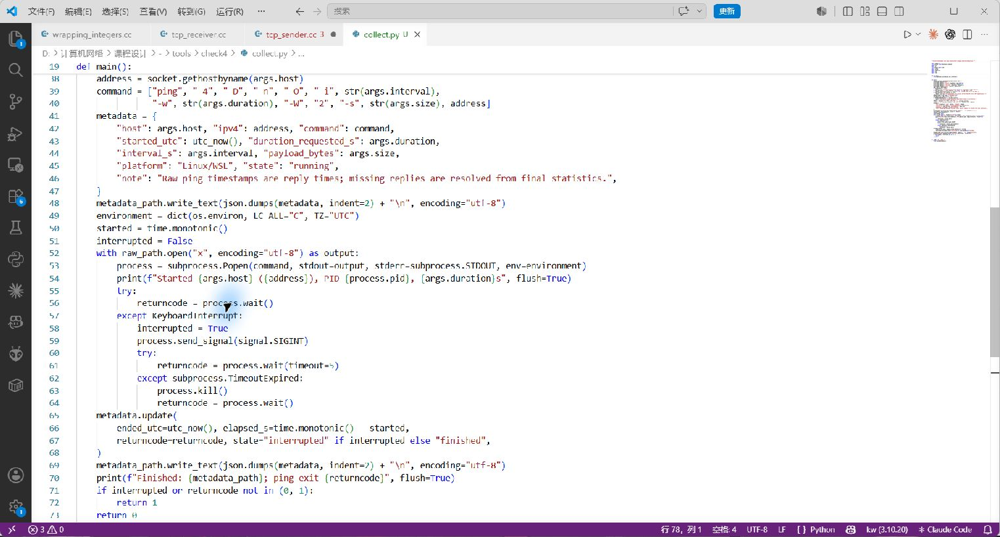
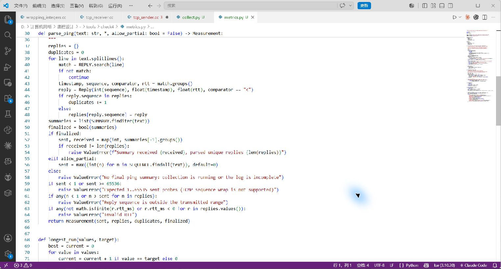
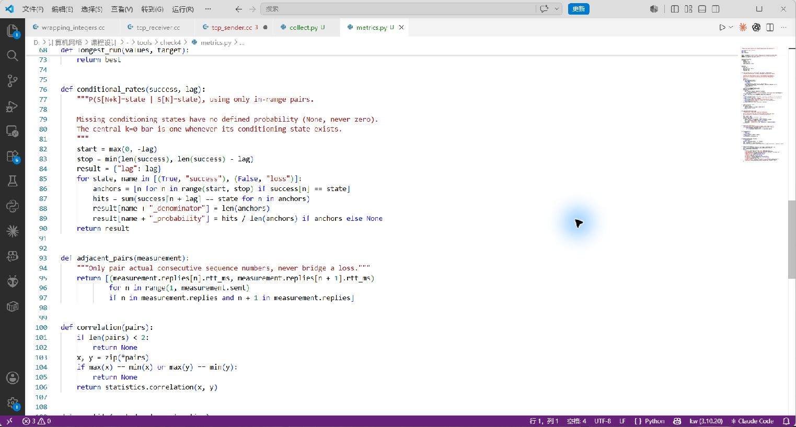

# Checkpoint 0 到 4 源码新手逐步讲解

本文只沿用我们原来的 Checkpoint 0–4 路线，解释这几个阶段实际写过的代码。
你不需要先学完网络协议，也不用一下子读完所有源码。先理解一个模块解决什么问题，
再看变量怎么变化，最后回头读完整函数。

讲解基于提交 `ce81ee4` 中的源码。后续代码继续变化时，应以对应版本为准。
原来的环境指南现已更名为 check0-4beginner-guide.md；附录仍保留基准提交当时的源码。
这份文档由 Codex 按实际实现整理，代码示例中注明“推演”的数据用于学习，
不是新增的实测结果。

原来的[环境配置与操作指南](check0-4beginner-guide.md)回答“怎么配置、编译和运行”；
本文回答“每个文件和函数在干什么，为什么这样写”。

建议第一遍先读第 1–9 节，只理解 C++ 和 TCP；第二遍再读第 10–11 节的 Python 与测试。
第 15 节是查阅用的完整代码，不必从头背诵。
后续已完成的 [Checkpoint 5 网络接口与 ARP 源码讲解](check5-source-code-guide.md)单独续写，
本篇的 0–4 历史源码快照继续保留。

快速跳转：[整体关系](#overview) · [HTTP 客户端](#webget) · [字节流](#byte-stream) ·
[乱序重组](#reassembler) · [序号换算](#wrap32) · [接收端](#receiver) ·
[发送端](#sender) · [完整收发推演](#end-to-end) · [测量脚本](#measurement) ·
[自测问题](#quiz) · [完整源码](#source-snapshots)

<a id="overview"></a>

## 1 先把整个项目放进脑子里

我们做的工作分成三条路径，不能把它们当成一条已经贯通的程序。

```text
路径 A：Checkpoint 0 的网页客户端
webget → 框架提供的 TCPSocket → Linux 内核 TCP → 网页服务器

路径 B：Checkpoint 0–3 逐步实现自己的 TCP 部件
应用待发送的字节
    ↓
发送侧 ByteStream → TCPSender → 消息/框架发送回调
                                      ↓
                           网络，或测试中的消息传递
                                      ↓
应用读取的字节 ← 接收侧 ByteStream ← Reassembler ← TCPReceiver
                                                      ↓
                                            ACK 与窗口反馈给发送端

路径 C：Checkpoint 4 的测量工具
Linux ping → 原始日志 → Python 统计 → CSV/JSON → 图表 → 中文报告
```

路径 B 的发送侧和接收侧各有自己的 ByteStream，不是共享同一个缓冲区。
我们已经验证这些部件在自动测试和内存模拟中配合工作，尚未完成自建 TCP 的实网互操作。
路径 C 调用操作系统提供的 ping，不会调用我们写的 TCPSender。

### 1.1 本文覆盖的代码文件

| 阶段 | 我们写或修改的文件 | 作用 |
|---|---|---|
| 0 | [apps/webget.cc](../apps/webget.cc) | 填写 HTTP 获取函数 |
| 0 | [src/byte_stream.hh](../src/byte_stream.hh)、[src/byte_stream.cc](../src/byte_stream.cc) | 定义字节流状态并实现读写接口 |
| 1 | [src/reassembler.hh](../src/reassembler.hh)、[src/reassembler.cc](../src/reassembler.cc) | 暂存乱序数据、去重、交付连续字节 |
| 2 | [src/wrapping_integers.cc](../src/wrapping_integers.cc) | 32 位和 64 位序号换算 |
| 2 | [src/tcp_receiver.hh](../src/tcp_receiver.hh)、[src/tcp_receiver.cc](../src/tcp_receiver.cc) | 接收 TCP 消息，生成 ACK、窗口与错误标志 |
| 3 | [src/tcp_sender.hh](../src/tcp_sender.hh)、[src/tcp_sender.cc](../src/tcp_sender.cc) | 按窗口发送，保存未确认消息并重传 |
| 4 | [collect.py](../tools/check4/collect.py)、[status.py](../tools/check4/status.py)、[burst.py](../tools/check4/burst.py) | 长时采集、查看进度、短时速率试验 |
| 4 | [metrics.py](../tools/check4/metrics.py)、[analyze.py](../tools/check4/analyze.py)、[build_report.py](../tools/check4/build_report.py) | 解析、统计、画图和生成报告 |
| 4 | [test_metrics.py](../tools/check4/test_metrics.py)、[test_lifecycle.py](../tools/check4/test_lifecycle.py) | 验证统计边界和进程中断 |
| 补充验证 | [boundary-validation.py](check2-screenshots/boundary-validation.py)、[scenario-validation.py](check3-screenshots/scenario-validation.py) | 测试极大序号和收发端配合 |

`.hh` 主要声明“有哪些状态和操作”，`.cc` 主要定义“这些操作具体怎么做”。
官方测试、socket 封装、报文结构和构建脚手架中也有大量源码，很多是合入框架时得到的，
不代表都是我们编写的。第 12 节专门说明这些边界。

## 2 读 C++ 前先认识这些写法

| 写法 | 新手可以先这样理解 |
|---|---|
| `uint64_t` | 64 位无符号整数，适合累计字节数和内部序号 |
| `uint32_t` | 32 位无符号整数，TCP 线上序号使用这个宽度 |
| `uint16_t` | 16 位无符号整数，窗口字段最大为 65535 |
| `Class::method()` | 这是某个类的方法定义 |
| `const` | 这里不允许通过这个访问方式修改对象 |
| `auto& x = ...` | 给已有对象取引用，不复制整个对象 |
| `std::move(x)` | 允许接收方转移 x 的资源，常用于减少字符串复制 |
| `std::deque` | 可方便地在尾部加入、头部移除的队列容器 |
| `std::map` | 按键排序的映射，本项目用起始索引作为键 |
| `std::optional<T>` | 可能有一个 T，也可能还没有值 |
| `std::string_view` | 查看已有字符串的片段，不拥有那份字符存储 |
| `condition ? a : b` | 条件为真取 a，否则取 b |
| `and`、`or`、`not` | 分别对应 `&&`、`||`、`!` |
| `return {}` | 返回该返回类型的空值或默认值，不是固定返回数字零 |
| `[checkpoint](...) { ... }` | 一个小函数，也叫 lambda，能使用捕获的 checkpoint |

`move` 不意味着以后还能继续把原对象当作原字符串使用；
`string_view` 也不能在底层字符串移除、销毁或改变后一直保留着读。
这些规则在我们减少复制时很重要。

文中区间统一用 `[a,b)`：包含 a，不包含 b。例如 `[2,5)` 代表索引 2、3、4。
这样区间长度直接等于 `b-a`，很适合表示字符串片段。

<a id="webget"></a>

## 3 Checkpoint 0 的 webget

### 3.1 我们具体改了哪里

文件中的参数检查、异常捕获和 `main()` 框架已经提供。
我们主要填写 `get_URL(host, path)`，让它真正连接服务器、发送请求和输出响应。

```cpp
TCPSocket socket;
socket.connect( Address { host, "http" } );
socket.write_all( "GET " + path + " HTTP/1.1\r\nHost: " + host
                  + "\r\nConnection: close\r\n\r\n" );
```

第一行创建框架封装的 TCP socket。第二行将主机名和服务名交给框架解析并连接。
第三行发送 HTTP 文本，`write_all` 负责把这份文本完整写出去。
这三行用的是操作系统 TCP，还没用到我们后来实现的 TCPSender。

### 3.2 为什么请求里有那么多 `\r\n`

以主机 `cs144.keithw.org`、路径 `/hello` 为例，发送的字节对应：

```http
GET /hello HTTP/1.1
Host: cs144.keithw.org
Connection: close

```

代码实际使用 CRLF，也就是 `\r\n`，作为每一行的结束。
最后的 `\r\n\r\n` 表示首部结束，其中有一个空行。
`Connection: close` 请求服务端在响应结束后关闭连接，便于客户端通过 EOF 判断读完。

### 3.3 为什么读取必须用循环

```cpp
string response;
while ( not socket.eof() ) {
  socket.read( response );
  cout << response;
}
socket.close();
```

一次 `read` 不保证返回完整网页，可能只拿到一部分响应，所以要继续读到 EOF。
这里的 `response` 是当前一次读到的内容，读到后立刻输出；程序不负责解析 HTML，
也没有把所有响应事先拼成一个大字符串。

`main()` 从命令行拿到 host 和 path 后调用这个函数；异常会交给已有的 `catch`，
打印错误并返回失败状态。理解这个流程就能看懂整个小客户端。

<a id="byte-stream"></a>

## 4 Checkpoint 0 的 ByteStream

### 4.1 它解决的不是网络问题，而是内存中的排队问题

写入方把字节放进去，读取方按原顺序拿出来。缓冲区容量有限，满了只能等读取方腾空间。
它不负责丢包重传，也不知道 TCP 报文是什么。

框架把同一个 ByteStream 的写入操作暴露为 Writer，读取操作暴露为 Reader。
`reader()`、`writer()` 的访问机制由官方辅助文件提供；我们把新增状态放在 ByteStream 基类，
没有给 Reader、Writer 分别放一份互不相干的缓冲区。

### 4.2 头文件里的每个变量

| 变量 | 含义 |
|---|---|
| `capacity_` | 最多允许多少个未读字节 |
| `buffer_` | 分块存放字符串的 deque |
| `front_offset_` | 队头字符串已经消费到哪个偏移 |
| `bytes_pushed_` | 从创建到现在总共成功写入多少字节 |
| `bytes_popped_` | 从创建到现在总共消费多少字节 |
| `closed_` | 写入方是否声明以后不再写入 |
| `error_` | 框架已有的错误状态 |

两个累计计数不会因为缓冲区读空而清零。它们的差才是当前未读数量：

```text
当前未读字节 = bytes_pushed_ - bytes_popped_
剩余容量     = capacity_ - 当前未读字节
```

### 4.3 构造函数和 Writer 的四类操作

构造函数只把用户传入的容量记到 `capacity_`；成员的 `{}` 初始化让计数和状态从零开始。

`Writer::push(data)` 按下面顺序做：

1. 已关闭就直接返回，不再接受新数据。
2. 用 `min(data.size(), available_capacity())` 计算实际能接收多少。
3. 能接收零字节就结束；只能接收前半段时，用 `substr` 留下允许部分。
4. 把字符串移动到队尾，累计写入量增加实际接收长度。

```cpp
const uint64_t length = min<uint64_t>( data.size(), available_capacity() );
buffer_.push_back( move( data ) );
bytes_pushed_ += length;
```

这段是关键逻辑摘录；完整函数还有前面说的关闭、空数据和截断判断。
**当前接口的 push 返回 void，不返回实际写入量。** 想判断接收了多少，
可以比较调用前后的 `bytes_pushed()`。

`close()` 将 `closed_` 设为 true；`is_closed()` 查询这个标志。
`available_capacity()` 使用前面的公式；`bytes_pushed()` 返回累计写入数。
`close()` 不会把已经缓存的数据删除。

### 4.4 Reader 的每个操作

`peek()`：队列为空返回空视图，否则返回队头字符串从 `front_offset_` 开始的视图。
它可能只展示第一块，而不是整个缓冲区；查看本身不会消费字节。

`pop(len)`：先把 len 限制到现有未读量以内，然后循环消费队头。
每一轮消费“不超过这块剩余字节数”的数量，同时更新偏移、累计消费量和剩余 len。
一块全部读完才 `pop_front()`，并将偏移归零。

这样不需要每读一个字节就把后面所有字符向前搬。

`bytes_buffered()` 返回写入减消费；`bytes_popped()` 返回累计消费数。
`is_finished()` 只有在“写端已关闭，而且缓存读空”时才为真。
空缓存和流结束不是一回事：写端还开着时，后面仍可能继续来数据。

### 4.5 手算一次

容量设为 5：

| 操作 | 实际未读内容 | pushed | popped | 未读量 | 可用容量 |
|---|---|---:|---:|---:|---:|
| 初始 | 空 | 0 | 0 | 0 | 5 |
| push("ABCD") | ABCD | 4 | 0 | 4 | 1 |
| pop(2) | CD | 4 | 2 | 2 | 3 |
| push("EFGH") | CDEFG | 7 | 2 | 5 | 0 |
| close() | CDEFG | 7 | 2 | 5 | 0 |
| pop(5) | 空 | 7 | 7 | 0 | 5 |

最后一次 pop 之后才 `is_finished()==true`。
在第二次写入后，底层可以是两块字符串，peek 首次只给你 CD，随后才能看到 EFG。

这里的容量约束是逻辑上的未读字节数，不是进程全部内存占用的精确上限。
容器元数据、字符串分配和尚未退役的队头前缀也会占用实际内存。

<a id="reassembler"></a>

## 5 Checkpoint 1 的 Reassembler

### 5.1 为什么有字节流了还要重组器

ByteStream 只接受顺序到来的数据。网络却可能先给你 DEF，再给你 ABC，
还可能把 CD 发两遍。Reassembler 根据数据携带的索引整理它们，
只把从当前位置开始已经连续的数据写入 ByteStream。

我们增加两个状态：

```cpp
std::map<uint64_t, std::string> pending_ {};
std::optional<uint64_t> end_index_ {};
```

`pending_[3]="DEF"` 表示缓存 `[3,6)` 的数据。
map 按起点排序，方便找到最前面的区间。
`end_index_` 记录整条流结束位置；没有值时表示还不知道 EOF 在哪里。
`optional` 很重要：结束位置可能就是 0，不能拿数字 0 同时表示“不知道”。

### 5.2 insert 的三个参数

```cpp
insert(first_index, data, is_last_substring)
```

例如 `insert(3,"DEF",true)` 的意思是：这串数据从流索引 3 开始，
而且整条流到索引 6 之前结束。它不意味着 ABC 已经收到。

### 5.3 第一步：记录 EOF，处理已经关闭的输出

如果输出已经关闭，直接忽略新的插入。
遇到最后一段，就尝试记录 `first_index + data.size()` 为结束位置。
加法前先检查不会超过 uint64_t 的最大值，避免本应很大的位置回绕成小数字。

记录 EOF 和交付数据是两件事：即使知道最后一个字节在哪里，前面的空洞仍要等。

### 5.4 第二步：算出允许接收的区间

```cpp
const uint64_t next_index = output.bytes_pushed();
```

这里的 next_index 是“下一字节应该写到流的哪个索引”，不是应用已经读到哪里。
可以接收的右边界由 next_index 与输出剩余容量决定，加法也做了溢出保护。
然后对输入做三个裁剪：

- 左边已经交付过的字节不要再次存。
- 右边超出当前接收窗口的字节暂时不要，等待后续重传。
- 已知 EOF 之后的字节不要存。

例如容量 5，累计写入 4，应用读走 2，则输出还缓存 2 字节，剩余容量 3。
重组器此时允许的索引窗口是 `[4,7)`，不是从 0 开始再收任意 5 字节。
输出缓存和乱序数据共享这个容量约束。

### 5.5 第三步：只保存原来没见过的字节

`lower_bound(first)` 找到第一个起点不小于 first 的已有区间。
如果前一个区间跨过了 first，就先把 cursor 推进到前一个区间末尾。
然后向右扫描，遇到空洞才保存输入中对应的片段；已有的字节直接跨过。

假设已有 `[2,4)="CD"`，新收到 `[1,5)="BCDE"`：

```text
原来：     C D
新来：   B C D E
新存：   B     E
```

CD 已有一份，不再存第二份。这份实现保证区间互不重叠，
**没有强制把相邻区间合成一个大字符串**；邻接的小块可在交付时连续处理。
整段都能直接保存时，代码用 move 转移字符串；只有需要裁剪时才构造子串。

### 5.6 第四步：把连续区间立刻交付

```cpp
while ( not pending_.empty()
        and pending_.begin()->first == output.bytes_pushed() ) {
  output.push( move( pending_.begin()->second ) );
  pending_.erase( pending_.begin() );
}
```

队头起点恰好等于下一期待索引，说明前面没有缺口，就能交付。
每写入一块，bytes_pushed 会前进，再检查下一块是否也接上了。
遇到空洞就停，不能跳过空洞把后面的字节塞进顺序流。

已知 EOF 且累计写入量恰好到达 end_index 时，调用 close。
`count_bytes_pending()` 则遍历 map，把暂存字符串长度相加。
它不包括已经交付到 ByteStream 但应用还没读的字节，也没有另存一个容易失配的计数器。

### 5.7 用 ABCDEF 从头推演

容量至少为 6，先调用 `insert(3,"DEF",true)`：
输出仍为空，pending 中有 DEF，结束位置为 6，暂存量为 3。

再调用 `insert(0,"ABC",false)`：
ABC 从 0 开始，先交付 ABC；下一期待位置变为 3，DEF 也能交付。
累计写入变为 6，正好到 EOF，写端关闭。
这时 Reader 仍有 ABCDEF 可以读，不能把“输出关闭”误解成“数据已被应用读完”。

<a id="wrap32"></a>

## 6 Checkpoint 2 的 Wrap32

### 6.1 先分清三种编号

设初始序号 ISN 为 100，数据为 ABC：

| 内容 | 线上 32 位序号 | 内部绝对序号 | 数据流索引 |
|---|---:|---:|---:|
| SYN | 100 | 0 | 无 |
| A | 101 | 1 | 0 |
| B | 102 | 2 | 1 |
| C | 103 | 3 | 2 |
| FIN | 104 | 4 | 无 |

TCP 的 32 位序号像会绕圈的表盘，超过 4294967295 会回到 0。
绝对序号用于内部跟踪转了多少圈；流索引只给数据字节编号，不包含 SYN、FIN。

### 6.2 wrap：从绝对位置得到线上序号

```cpp
return zero_point + static_cast<uint32_t>( n );
```

`static_cast<uint32_t>(n)` 留下绝对位置的低 32 位，再加 ISN 偏移。
效果相当于 `(ISN+n) mod 2^32`。
例如 ISN=4294967294，n=3，线上序号为 1。
这是序号设计需要的回绕，不是程序出错。

### 6.3 unwrap：表盘相同，可能已经转了很多圈

代码先计算线上值相对 ISN 的 32 位偏移 offset。
所有可能的绝对位置都形如：

```text
offset
offset + 2^32
offset + 2×2^32
……
```

所以还需要 checkpoint，表示“答案大概在什么位置附近”。
不要把这里的 checkpoint 参数和课程的 Checkpoint 实验阶段混为一谈。

### 6.4 为什么只看附近几圈

```cpp
constexpr uint64_t modulus = uint64_t { 1 } << 32;
uint64_t candidate = ( checkpoint & ~( modulus - 1 ) ) | offset;
```

`1 << 32` 的意思是 2 的 32 次方，左边先构造成 64 位整数，避免在 32 位宽度里移位 32 位。
`modulus-1` 的低 32 位全为 1。取反、按位与，保留 checkpoint 的高位圈数；
再用按位或填入 offset，得到同一圈的候选。

接着比较这一圈及相邻圈中可表示的候选与 checkpoint 的距离。
`distance` lambda 先比较大小，再用大的减小的，避免无符号减法下溢。
减一圈前检查 candidate 至少有一圈；加一圈前检查不会超过 uint64_t 上限。
距离相同时，当前实现选较小的候选。

学习推演：ISN=100，线上序号=105，checkpoint=2^32+7。
候选是 5、2^32+5、2×2^32+5；中间那个离参考位置最近，所以答案为 2^32+5。

<a id="receiver"></a>

## 7 Checkpoint 2 的 TCPReceiver

### 7.1 它是 TCP 标志与重组器之间的翻译层

重组器只认识“索引、数据、是否结束”。接收端还要认识序号、SYN、FIN、RST。
头文件增加 `optional<Wrap32> isn_`，在第一条有效 SYN 到来前，不知道对方 ISN。

发送方消息结构是官方提供的，定义在 util 目录：

| 字段 | 含义 |
|---|---|
| seqno | 这条消息占用的起始序号 |
| SYN | 开始标志，自己占一个序号 |
| payload | 数据字节 |
| FIN | 结束标志，自己占一个序号 |
| RST | 错误/复位标志，不占序号 |

### 7.2 receive 按什么顺序处理

1. 看到 RST，给输出流设置错误并返回。
2. 流已处于错误状态，也直接返回。
3. 尚无 ISN 时，只接受带 SYN 的消息，并保存该消息的 seqno 为 ISN。
4. 用 unwrap 把 seqno 换成绝对序号，参考位置为 `writer().bytes_pushed()+1`。
5. 不带 SYN 却落在绝对序号 0 的消息忽略，因为 0 是 SYN 的位置。
6. 将绝对序号换成数据流索引，移动 payload 到重组器，FIN 作为结束标记。

关键转换是：

```cpp
const uint64_t stream_index = absolute_seqno - ( message.SYN ? 0 : 1 );
reassembler_.insert( stream_index, move( message.payload ), message.FIN );
```

普通消息的首字节要减去 SYN 占据的一个位置。
带 SYN 的消息中，seqno 指向 SYN，payload 紧接其后，所以流索引直接等于 absolute_seqno。
例如首次 SYN+ABC 的 seqno=100，绝对序号为 0，ABC 应从流索引 0 开始。

### 7.3 send 为什么叫 send，却没调用 socket

`send()` 只构造一个 TCPReceiverMessage，实际发送由框架负责。
它生成三项信息：

- window_size：输出还可以容纳多少字节，最多填 65535。
- RST：当前流是否错误。
- ackno：如果已知 ISN，就计算下一期待序号；否则保持 optional 为空。

```cpp
const uint64_t next_seqno = writer().bytes_pushed() + 1
                            + ( writer().is_closed() ? 1 : 0 );
```

这里的 1 是 SYN；关闭后再加 1，是已经连续收齐的 FIN。
最后用 wrap 把绝对位置转换回线上序号。

例如 ISN=100，只收 SYN 时 ACK=101；连续收到 AB 时 ACK=103；
收齐 ABCDEF 和 FIN 后 ACK=108。
ACK=103 表示“序号小于 103 的内容已连续收到”，不是“我收到 103 这个字节”。

窗口根据应用是否读走输出而变化。它没有简单减去 pending 的字节数：
pending 本来就受相同索引窗口约束，不能把同一空间关系再扣一次。

<a id="sender"></a>

## 8 Checkpoint 3 的 TCPSender

### 8.1 为什么发出后还得保存一份

发送端把数据从 ByteStream 读走后，那份输入缓存已经被消费。
但网络可能丢包，所以尚未确认的消息必须另存，以便超时重传。

| 状态 | 用途 |
|---|---|
| input_ | 应用交给发送端的输入字节流 |
| isn_ | 本端发送流的初始序号 |
| initial_RTO_ms_ | 初始重传等待时间 |
| outstanding_ | 按发送顺序保存未完整确认的消息 |
| next_seqno_ | 下一次新发送的绝对位置 |
| acknowledged_seqno_ | 对方累计确认到的绝对位置 |
| window_size_ | 对方通告的真实窗口，初值为 1 |
| fin_sent_ | 是否已生成 FIN，防止再生成第二个 |
| RTO_ms_ | 当前等待时间，可能已经退避翻倍 |
| elapsed_ms_ | 这一轮已经等了多少毫秒 |
| consecutive_retransmissions_ | 自上次新确认后，非零窗口下连续超时次数 |

队列中的 OutstandingMessage 保存原消息和 `end_seqno`。
end_seqno 是“消息末尾再后一个位置”，不是最后一个数据字节的序号。
一条从绝对位置 1 开始、长度 4 的消息，end_seqno 为 5；ACK 到 5 才完整覆盖它。

构造函数保存输入、ISN 与初始 RTO；队列和累计序号初始为空/零，FIN 初始未发送。

### 8.2 两个查询函数

```cpp
sequence_numbers_in_flight() = next_seqno_ - acknowledged_seqno_;
```

“在途”表示已经发送而尚未确认的序号，不表示物理上仍在某根网线里的字节。
SYN、FIN 也占序号，所以不能只数 payload。
`consecutive_retransmissions()` 直接返回当前连续重传计数。

### 8.3 make_empty_message

生成 seqno 为 `wrap(next_seqno_,isn_)` 的消息，RST 来自输入流错误状态。
默认 SYN/FIN 为 false、payload 为空，所以序号长度为 0。
它不进入未确认队列，也不推进 next_seqno_。
空消息可供框架在需要反馈但没有数据时使用。

### 8.4 push 的第一关：还剩多少窗口

```cpp
const uint64_t effective_window = max<uint64_t>( window_size_, 1 );
if ( sequence_numbers_in_flight() >= effective_window ) {
  break;
}
const uint64_t space = effective_window - sequence_numbers_in_flight();
```

例如窗口为 8，已有 5 个序号未确认，还能新发 3 个。
在途数达到或超过窗口时停下，而不是用无符号数相减得到一个巨大的“剩余空间”。

真实窗口为 0 时，仅在计算本次发送限制时按 1 处理，允许一次探测。
保存在 window_size_ 里的值仍是 0，因为计时器要按真实窗口决定是否退避。
已有一个探测在途时，不会每次调用 push 都继续发一个新字节。

### 8.5 push 的第二关：装入 SYN、数据和 FIN

```cpp
message.SYN = next_seqno_ == 0;
read(reader(), min<uint64_t>(TCPConfig::MAX_PAYLOAD_SIZE,
                            space - (message.SYN ? 1 : 0)), message.payload);
message.FIN = reader().is_finished() and message.sequence_length() < space;
```

首次发送设置 SYN，先为它扣掉一个位置，再读取数据。
`read` 是官方辅助函数：循环 peek 和 pop，取出最多指定长度的数据放进字符串。
当前框架的 MAX_PAYLOAD_SIZE 是 1000，限制的是 payload 字节数。

如果应用已关闭输入、所有待发字节都取完，而且窗口还剩一个位置，就附上 FIN。
同一条消息可以带 SYN、payload、FIN，只要总序号长度不超窗口。
初始窗口只有 1 时，通常只能先发 SYN。

### 8.6 push 的第三关：先记账，再交给发送回调

序号长度为 0 时结束，不制造无意义的新发送。
原先没有在途消息时，把经过时间清零，表示为第一条未确认消息开始计时。
随后推进 next_seqno_、记录是否发过 FIN、保存消息，最后调用 transmit。

`transmit` 是框架传来的函数，不是写死的网卡操作。
测试时它可以只是把消息放进一个 vector；接入框架后，由外层完成封装和发送。

循环持续填充窗口，直到没有空间、没有新消息可发，或者 FIN 已经生成。
fin_sent_ 阻止的是再次生成新 FIN，不妨碍重传队列中已有的 FIN。

### 8.7 receive：收到 ACK 之后改什么

先处理 RST：把输入流标记为错误，交给框架观察这个状态。
其他消息若有 ACK，就用 unwrap 换成绝对位置，参考点为 next_seqno_；
若没有 ACK，就暂用当前累计确认位置，只处理合法窗口更新。

未来 ACK 超过 next_seqno_，说明它确认了根本没发过的内容，整条消息忽略。
否则先更新 window_size_，再判断是否有新确认：

```cpp
if ( ackno <= acknowledged_seqno_ ) {
  return;
}
```

重复/旧 ACK 可以带来窗口变化，但不会重启计时器。
ACK 真正前进后，更新累计确认位置，移除 end_seqno 不大于 ACK 的完整队头消息，
恢复初始 RTO，将 elapsed 和连续重传次数清零。

### 8.8 部分确认为什么还保留整条消息

假设 SYN 已确认，发送 abcd，从绝对位置 1 开始，end_seqno=5。
收到绝对 ACK=3，说明 a、b 已确认，c、d 仍未确认。
在途数现在是 `5-3=2`，但我们仍保存原来的整条 abcd 用于重传。
接收端和重组器会忽略已交付的重复字节。

本实现没有把报文裁成只剩 cd，也没有错误地把整条报文删掉。
这是当前框架允许的做法，要按实际源码理解，不要自行把它读成“收到任意 ACK 就出队”。

### 8.9 tick：时间到了怎么办

框架告诉 tick“又经过了多少毫秒”，发送端不读取电脑时间、不调用 sleep。
队列空，意味着计时器停止，直接返回。

```cpp
if ( ms_since_last_tick < RTO_ms_ - elapsed_ms_ ) {
  elapsed_ms_ += ms_since_last_tick;
  return;
}
```

先算剩余等待时间，再与本次经过时间比较，避免先相加溢出。
没到时间只累计；到时间就复制最早未确认消息，更新 RST 状态，清零经过时间并重传。
每次 tick 最多触发一次重传，即使参数给了很长的时间，也不会在函数内部连续补发很多次。

真实窗口非零时，重传计数加一，RTO 翻倍；达到 uint64_t 上限时停在最大值，
不允许整数回绕变成一个很小的超时。
真实窗口为零时，仍可重传探测消息，但不增加失败计数，不翻倍 RTO。

例如 RTO 初始为 10：tick(9) 不发；再 tick(1) 重传，RTO 变 20；
之后 tick(19) 不发，再 tick(1) 重传，RTO 变 40。
收到新的有效确认后，RTO 又回到 10。

这里没有实现拥塞控制、快速重传，也没有在发送端内部另加“重传次数过多自动断开”的策略。
计数通过接口提供给框架，不能把本模块理解为完整生产级 TCP 的全部行为。

<a id="end-to-end"></a>

## 9 把收发两端串起来推演

设 ISN=100，接收容量为 8，RTO=10 ms，应用写入 ABCDEF 并关闭输入。

| 步骤 | 发生什么 | 关键状态 |
|---|---|---|
| 1 | 发送端初始窗口为 1，发 SYN | seqno=100，在途 1 |
| 2 | 接收端保存 ISN，回 ACK=101、窗口 8 | SYN 被确认，在途归零 |
| 3 | 发送端发 ABCDEF+FIN | seqno=101，长度 7，在途 7 |
| 4 | 假设这条消息丢失 | 队列仍留着原消息 |
| 5 | tick 累计满 10 ms，重传 | 在途仍是 7，RTO 变 20 |
| 6 | 接收端换成流索引 0，重组器写入 6 字节并关闭输出 | 应用可读 ABCDEF |
| 7 | 接收端回 ACK=108 | 包含 SYN、6 个字节、FIN 的确认 |
| 8 | 发送端处理 ACK | 在途归零，队列清空，计时停止 |

重传不会推进 next_seqno_，因为它没有引入新的序号。
若第 7 步 ACK 丢了，发送端会再次重传，接收端仍只交付一份 ABCDEF。

再把第 3 步拆成两条消息：先到 DEF+FIN，后到 ABC。
接收端暂存 DEF 时 ACK 仍为 101；ABC 补齐空洞后，才一次推进到 108。
这就把“累计确认”和“乱序重组”的作用连起来了。

<a id="measurement"></a>

## 10 Checkpoint 4 的 Python 源码

这一阶段没有新增 TCP 核心代码，而是测量真实网络。
先理解调用关系，再分别读文件：

```text
collect.py ──→ ping.txt + metadata.json
     ↑                  ↓
status.py 查看进度    metrics.parse_ping
                        ↓
burst.py → trials.json → metrics.summarize
                        ↓
                    analyze.py
                        ↓
           probes.csv / statistics.json / 图表
                        ↓
                  build_report.py
                        ↓
              Markdown + 中文 PDF
```

图里的 status 实际会读取已有日志，调用同一个解析器，不会启动第二份正式采集。

### 10.1 collect.py：启动采集并记录真实过程

`utc_now()` 返回带 UTC 时区的时间文本，用于说明测量发生在什么时候。
`main()` 负责解析参数、检查环境、运行 ping、记录结束状态。

`argparse` 把命令行参数转成对象。例如：

```bash
python3 tools/check4/collect.py 1.1.1.1 --output build/my-sample --duration 3602
```

host 是目标，output 是输出目录，duration 是计划时长。
interval 默认 0.2 秒，size 默认 56 字节。
代码限制普通采集间隔不小于 0.2 秒，并拒绝单次会话跨越 16 位 ICMP 序号周期。
这里的 ICMP 探测序号和前面 TCP 的 32 位 seqno 不是同一种字段。

输出目录已有 metadata 或 ping 日志就拒绝覆盖。
`socket.gethostbyname` 把域名解析成一个 IPv4 地址，本次会话固定使用这个地址。
命令用字符串列表交给 subprocess，不是把用户输入拼成一条 shell 命令去执行。

| ping 参数 | 本脚本中的意思 |
|---|---|
| -4 | 使用 IPv4 |
| -D | 在输出中带 Unix 时间戳 |
| -n | 不对地址做反向名称解析 |
| -O | 发下一次前，报告上一次尚未回复的情况 |
| -i | 两次发送的计划间隔 |
| -w | 整次运行的截止秒数 |
| -W | ping 在相应等待情形下使用的响应等待参数，不是给每个包独立维护的计时器 |
| -s | ICMP 载荷字节数，不含 IP 和 ICMP 头部 |

`Popen` 启动子进程，stdout 和 stderr 一起写入原始日志。
`LC_ALL=C` 让输出语言固定，便于正则解析；`TZ=UTC` 统一时间环境。
用 `time.monotonic()` 的差值计算经过时间；用 UTC 时间记录起止时刻。
前者适合测量一段时间，后者方便人看日历与钟表。

Ctrl+C 会进入 KeyboardInterrupt 分支：先给 ping 发 SIGINT，让它输出汇总；
等不结束再停止它，并标记 interrupted。
最终状态还会区分 failed、ended_early、finished。
**退出码为 0 不等于已经采满一小时**，所以必须同时核对真实经过时间。

### 10.2 status.py：查看已有采集，不改变它

main 默认查看 `writeups/check4-data/network2`。
它找到每个目标的 metadata，计算已运行和剩余分钟数，再解析当前日志，
显示回复数、观测到的序号范围和最后一次回复距离现在多久。
已完成会话使用记录的 elapsed_s，而不是把结束后的等待也算进采集时长。

运行中的发送数只是根据目前日志得到的预览，最终发送数要以 ping 汇总为准。
日志暂时没完整数据时捕获 ValueError，显示状态，不把采集进程终止。

### 10.3 burst.py：每次只做短时速率试验

main 顺序执行三档 `(size, interval, count)`：

```python
[(56, 0.2, 25), (256, 0.1, 50), (1200, 0.05, 100)]
```

每档有 8 秒 ping 截止时间，外层 subprocess 还有 10 秒超时保护。
保存每档原始日志，用 parse_ping 得到实际收发数，再写进 trials.json。
同时使用 -c 和 -w 时，最终发送数可能不同于配置中的 count，所以不能拿计划数冒充实测数。

```text
实际回复载荷速率 = payload_bytes × 8 × received / elapsed_s
```

例如载荷 100 字节，5 秒收到 40 个回复，速率为 6400 bit/s，即 6.4 kbit/s。
这不是下载带宽，也没有算上报文头；三档小试验不保证已经测到线路容量。

### 10.4 metrics.py 的 Reply 与 Measurement

`@dataclass` 帮助定义保存数据的对象，不是网络协议栈。
Reply 保存一次唯一回复的序号、时间戳、RTT，以及 RTT 是否只是显示的上界。
Measurement 保存发送数、以序号为键的回复字典、重复次数和是否已有最终汇总。

例如 `replies[4]` 表示第 4 次探测的回复。字典按序号查找，避免把接收顺序当成发送顺序。

### 10.5 parse_ping：先找回复，再找最终总数

三个正则分别识别有效回复、最终统计、日志中的序号。
正则中的括号用于提取时间戳、icmp_seq、time 比较符和 RTT 数值。

```python
if reply.sequence in replies:
    duplicates += 1
else:
    replies[reply.sequence] = reply
```

同一序号多次回复只计一次，保留首次 RTT；重复次数另记。
没有 RTT 的“no answer yet”不会进入回复字典，但后来真的收到回复时照常计入。

有最终汇总时，用最后一份汇总的 transmitted 作为总发送数，
并核对 received 与解析到的唯一回复数是否一致。
没有汇总时，默认报错；只有显式允许预览，才用已观察的最大序号暂估范围。

代码还拒绝非法序号、未支持的序号回绕、负数或非有限 RTT。
`time<1` 不是精确测到 1 ms，程序记录数值上界并用 upper_bound 标注。

### 10.6 longest_run：算连续成功与连续丢失

维护 current 和 best：遇到目标结果就给 current 加一，否则 current 归零；
每次更新 best 为二者最大值。

对 `[成功,失败,失败,成功,成功]`，最长成功为 2，最长失败也为 2。
不能只看回复日志里连续出现了多少行，因为未回复的探测可能根本不打印成功行。

### 10.7 conditional_rates：分母也会随 k 改变

这里用从 0 开始的 Python 列表位置表示探测序列。

```python
start = max(0, -lag)
stop = min(len(success), len(success) - lag)
```

这两行保证 n 和 n+k 都在样本范围里。
随后分别以成功、失败为条件，找到符合条件的 anchors，计算其中多少个在 n+k 仍是同样结果。

上面的五次探测中，k=1：失败位置的下一次分别是失败和成功，
所以条件丢失概率为 1/2。无条件丢失率却是 2/5，它们不是同一个分母。
没有任何丢失样本时，这个条件概率是 None，即未定义，不是 0。
k=0 时，有条件样本的概率必然为 1，也不能据此证明有突发性。

### 10.8 adjacent_pairs、correlation、quantile

`adjacent_pairs` 只配对真实序号 n 和 n+1 均成功的 RTT，不能跳过缺失序号配对。
若只收到 1、3、4，只有 3→4 是有效相邻对。

`correlation` 计算这些点的 Pearson 相关系数；不足两个点，或某个坐标完全不变时返回 None。
相关性描述样本一起变化的程度，不直接证明网络问题的原因。

`quantile` 接收已经排序的数列，以 `(样本数-1)×fraction` 找到分位位置，
落在两个位置之间时线性插值。例如 `[10,20,30,40]` 的 50% 分位数为 25。
这是实现选定的一种分位数口径；不同软件可能选择其他口径。

### 10.9 summarize：把各项结果装进一个字典

先对完整的 `1..sent` 范围标记是否成功，再计算交付率、最长连续结果、
RTT 最小/最大/平均/中位/95% 分位、相邻相关性，以及 -10 到 10 的条件概率。
全部未回复时，交付率为 0，但 RTT 最小值等返回 None，不能拿 0 ms 替代缺失测量。

### 10.10 analyze.py：将统计变成文件和图表

| 函数 | 具体职责 |
|---|---|
| save_figure | 同一图保存 PNG 和 PDF，然后关闭图对象释放资源 |
| plot_path | 绘制时间图、经验 CDF、条件成功/失败概率、相邻 RTT 散点 |
| plot_rates | 绘制实际发送/回复载荷速率与相等速率参考线 |
| main | 读取日志和元数据、调用统计、计算哈希、写出 CSV/JSON、调用画图 |

`matplotlib.use("Agg")` 表示不用弹出图形窗口也能在后台出图。
图中用 UTC+8 显示真实回复时刻，不把丢失样本的 RTT 填成零。
CDF 先将成功 RTT 排序，第 i 个样本对应累计比例 i/样本数。
条件概率图把 None 留空，并画出无条件概率的虚线作为比较基线。

main 先以 bytes 读取 ping.txt，计算 SHA-256，再解码文本进行解析。
哈希相当于数据指纹，可以检查后续拿到的文件是否仍与分析时相同。
它不能证明数据来源绝对真实，也不能替代正确的统计逻辑。

probes.csv 为每个发出的序号写一行，未回复的时间戳和 RTT 留空。
conditional.csv 除概率外，还写出每个 k 的分母。
statistics.json 保存汇总和来源指纹，使用 `allow_nan=False` 拒绝输出非标准 NaN 数值。

`--preview` 允许临时分析未完成日志，图中显示 PREVIEW。
普通分析要求会话状态 finished；**完整一小时的硬检查还在报告生成器中执行**，
因此“能生成分析图”和“可以当作最终报告”也不是同一回事。

### 10.11 build_report.py：不重新测量，只组织已有结果

| 函数或局部函数 | 作用 |
|---|---|
| number | 格式化数字；None 显示为“未定义” |
| local_time | 将 UTC 文本转换为 UTC+8 显示 |
| relative_link | 生成 Markdown 与结果文件之间的相对链接 |
| main | 读多个 statistics.json，检查完成状态，组织报告与 PDF |
| h | 同时添加 Markdown 标题与 PDF 标题 |
| p | 同时添加正文段落 |
| table | 同一份数据生成 Markdown 表格与 PDF 表格 |
| figure | 插入已有图像和说明文字 |
| footer | 在 PDF 每页绘制页码和页脚 |

正式报告会拒绝未 finalized、状态不是 finished 或实际时长小于 3600 秒的结果。
`--peer` 指定哪个现有结果属于同学主机；若结果里没有该目标，直接报错，不能凭参数生成数据。

Markdown 用字符串列表积累内容；PDF 用 ReportLab 的 Paragraph、Table、Image 等对象排版。
`escape` 将普通文字中的特殊字符转义，避免被 PDF 段落的标记解析器误解。
中文 TrueType 字体用于实际显示汉字；PageBreak 控制分节，KeepTogether 尽量让图片与说明相邻。

报告从统计结果取数，配上解释性文字；它不会重新运行 ping。
其中网关与路径描述包含本次实验的具体背景，换一套网络再复用时要核对，
不能以为脚本会自动从 IP 推断城市或国家。

### 10.12 test_metrics.py：10 项统计检查

`log()` 生成明确标注的人工测试日志；MetricsTest 里的 10 个方法分别核对：
首尾和内部丢失、重复与乱序、迟到回复、无丢失时条件概率、lag 边界分母、
不能跨丢失配对、全部丢失或单个成功、不完整或矛盾日志、显式预览、RTT 上界。
最后用 unittest.main 执行这些测试。

这是对统计工具的检查，不是给实测图表填入人工数据。

### 10.13 test_lifecycle.py：真实启动进程再中断

main 在 Ubuntu 中启动一个只对 127.0.0.1 探测的临时采集进程。
从启动输出拿到它创建的 ping PID，检查父子进程关系，然后分别测试：

- 停掉 ping 子进程，采集器应标为 ended_early。
- 中断采集器进程，采集器应标为 interrupted。

`try/finally` 确保测试失败时也清理自己启动的进程。
临时目录结束后自动移除，这些回环数据没有混入正式测量。

## 11 另外两份补充验证脚本

### 11.1 Checkpoint 2 的 boundary-validation.py

Python 的 main 找到仓库根目录，在临时目录中写入内嵌 C++ SOURCE，
用 g++ 编译，开启 AddressSanitizer 与 UndefinedBehaviorSanitizer，再执行。

C++ 中的 check 小函数验证条件，失败就抛异常。
10 项检查集中覆盖 Wrap32 在 UINT64_MAX、相邻圈、非零 ISN 和等距候选附近的行为。
因此它不只是重复普通小整数例子，而是检查溢出和候选边界。

### 11.2 Checkpoint 3 的 scenario-validation.py

它同样由 Python 生成临时 C++ 程序、链接当前模块并运行检测器。
C++ 的 require 用于检查条件；Link 保存一个发送端、已发消息的 vector 和 transmit 回调，
connect 辅助完成 SYN 与确认，让每个场景从容易理解的状态开始。

| 场景函数 | 验证什么 |
|---|---|
| loss_and_lost_ack | 丢数据和丢 ACK 后重传，应用最终只读到一份数据 |
| zero_window | 零窗口只允许探测，重传不退避，窗口打开后继续 |
| partial_and_duplicate_ack | 部分确认保留原消息，重复 ACK 不推迟重传 |
| large_timer | 极大 tick 参数和 RTO 翻倍不会回绕 |
| impossible_ack | 未发数据的未来 ACK 不得释放在途数据或打开窗口 |
| wrap_and_reorder | 2500 个二进制字节跨 32 位回绕并倒序交付仍正确 |

这些场景直接传递消息对象，不是跨互联网的真实 TCP 互操作测试。
理解它们时，重点看“消息放进 vector 后，是交给接收端，还是故意丢掉”，
这就是代码里模拟丢包的方法。

## 12 官方框架、工程配置和我们的改动边界

### 12.1 哪些关键源码是框架提供的

| 文件或目录 | 为什么项目里有它 |
|---|---|
| src/byte_stream_helpers.cc | 提供 read 辅助函数和 Reader/Writer 访问机制 |
| src/wrapping_integers.hh | 提供 Wrap32 公开接口，我们填写对应 .cc |
| util/tcp_sender_message.hh、tcp_receiver_message.hh | 定义收发消息字段和序号长度 |
| util/tcp_peer.hh | 将发送端、接收端及反馈消息组合起来 |
| util/socket.hh 等 | 操作系统 socket、地址、文件描述符等封装 |
| apps/tcp_ipv4.cc | Checkpoint 3 框架带来的演示程序 |
| src/tcp_imp_socket.cc | 框架提供的 socket 模板实例化 |
| tests 中的官方 C++ 用例 | 各阶段合入的自动验证框架 |
| apps/ip_raw.cc | 当前仍为官方空模板，不属于已经完成的功能 |

例如 tcp_imp_socket.cc 中的 `template class ...` 是让编译器生成指定模板实例，
不是我们在这个文件里又写了一遍 TCP 协议。
框架合并会让 Git 显示“新增很多文件”，但其中只有前面列出的学生实现区由我们填写。

### 12.2 .gitignore 为什么也改了

我们让构建目录和编辑器缓存不进入 Git，例如 /build、/.vs、/out。
这些是可再生成的本地文件，不是协议实现源码。
这不表示 Git 会自动删除目录，只表示通常不把它们加入新提交。

### 12.3 .gitattributes 为什么关系到实验数据

| 规则 | 原因 |
|---|---|
| `*.sh text eol=lf` | Linux 脚本使用 LF，避免 CRLF 导致解释器找不到 |
| `writeups/check4-data/** -text -whitespace` | 保存原始测量字节和工具输出空白，避免换行转换影响 SHA-256 |
| `*.pdf binary` | PDF 有字节偏移信息，不能按普通文本转换换行 |

原始 tracert 输出末尾有空格，是工具自身的格式；不能为了通过空白检查随意改写原始记录。

### 12.4 requirements.txt

它记录本次绘图与报告实际使用的 matplotlib、reportlab 版本。
它不是网络协议参数，也不会改变前面 C++ 的行为。
metrics、collect、status 等主要使用 Python 标准库；绘图与 PDF 才需要这些额外包。

实验报告、截图、日志、CSV 和 PDF 是说明与验证材料，不是额外的 TCP 算法源码。
清理旧网络未完成日志后，完整实测数据保存在 check4-data/network2。

## 13 新手可以怎样亲手读一遍

按下面顺序，每次只理解一个问题：

1. 打开 webget.cc：请求为什么以空行结束，为什么读取要循环。
2. 打开 byte_stream.hh/.cc：用容量 5 的例子手算计数、偏移和关闭。
3. 打开 reassembler.hh/.cc：画出 DEF 先到、ABC 后到时的 map 和输出。
4. 打开 wrapping_integers.cc：把 2^32 暂时想成一圈，计算最近候选。
5. 打开 tcp_receiver.cc：每收到一段，先算流索引，再算 ACK。
6. 打开 tcp_sender.hh/.cc：画出队列、窗口和计时器，不只盯着单个 if。
7. 打开 metrics.py：用五次探测的小例子手算统计，再读采集、绘图和报告脚本。

可以用这些已有测试验证阅读结果，不需要重新采一小时：

在 Ubuntu 的项目根目录：

```bash
CMAKE_BUILD_PARALLEL_LEVEL=4 cmake --build build/wsl --target check3
python3 writeups/check2-screenshots/boundary-validation.py
python3 writeups/check3-screenshots/scenario-validation.py
python3 tools/check4/test_metrics.py
python3 tools/check4/test_lifecycle.py
```

在 Windows PowerShell 的项目根目录，可以查看已经完成的测量状态：

```powershell
python tools/check4/status.py
```

这些命令的用途不同：check3 检查自己的 C++ 模块，边界/场景脚本做补充验证，
统计测试检查 Python 的算法，status 则只读现有数据。
没有 check4 构建任务，也不要为了读文档就再次运行长时 collect 或短时 burst。

<a id="quiz"></a>

## 14 读懂之后应该能回答的问题

| 自测问题 | 可以用来检查自己的答案 |
|---|---|
| ByteStream 空了，是否表示结束 | 还要看写端有没有 close |
| peek 是否会让 popped 增加 | 不会，pop 才消费 |
| 收到 DEF+FIN 为什么还不能关闭输出 | ABC 空洞还没补齐，尚未连续到 EOF |
| ACK=108 是收到编号 108 吗 | 表示下一期待 108，此前内容已连续收到 |
| 重传为什么不能推进 next_seqno_ | 没有引入新序号，只是再次发送旧消息 |
| 为什么重复 ACK 不能重置计时器 | 否则不断重复的确认可能一直延后重传 |
| 为什么零窗口字段不能直接改成 1 | 发送探测时临时按 1 计算，计时退避仍要知道真实窗口是 0 |
| 完全没丢失时条件丢失概率是多少 | 未定义，没有条件样本，不是 0 |
| 只收到序号 1、3、4，RTT 能组成几对相邻样本 | 只有 3→4 一对 |
| ping 与网页客户端是否验证了自己的 TCP | 当前都使用系统网络能力，不能代替自建 TCP 实网互操作 |

下面附上本文版本的完整源码快照。第一遍阅读可以跳过附录，
需要对照某个函数的上下文时，再展开对应文件。

<a id="source-snapshots"></a>

## 15 完整源码快照

以下快照直接从提交 ce81ee4 读取。保留原代码，未为了讲解更改实现。
每个文件单独折叠，避免初次阅读时被大量代码打断。

### 15.1 apps/webget.cc

源码文件：[apps/webget.cc](../apps/webget.cc)。

<details>
<summary>展开完整源码</summary>

```cpp
#include "socket.hh"

#include <cstdlib>
#include <iostream>
#include <span>
#include <string>

using namespace std;

namespace {
void get_URL( const string& host, const string& path )
{
  TCPSocket socket;
  socket.connect( Address { host, "http" } );
  socket.write_all( "GET " + path + " HTTP/1.1\r\nHost: " + host + "\r\nConnection: close\r\n\r\n" );

  string response;
  while ( not socket.eof() ) {
    socket.read( response );
    cout << response;
  }
  socket.close();
}
} // namespace

int main( int argc, char* argv[] )
{
  try {
    if ( argc <= 0 ) {
      abort(); // For sticklers: don't try to access argv[0] if argc <= 0.
    }

    auto args = span( argv, argc );

    // The program takes two command-line arguments: the hostname and "path" part of the URL.
    // Print the usage message unless there are these two arguments (plus the program name
    // itself, so arg count = 3 in total).
    if ( argc != 3 ) {
      cerr << "Usage: " << args.front() << " HOST PATH\n";
      cerr << "\tExample: " << args.front() << " stanford.edu /class/cs144\n";
      return EXIT_FAILURE;
    }

    // Get the command-line arguments.
    const string host { args[1] };
    const string path { args[2] };

    // Call the student-written function.
    get_URL( host, path );
  } catch ( const exception& e ) {
    cerr << e.what() << "\n";
    return EXIT_FAILURE;
  }

  return EXIT_SUCCESS;
}
```

</details>

### 15.2 src/byte_stream.hh

源码文件：[src/byte_stream.hh](../src/byte_stream.hh)。

<details>
<summary>展开完整源码</summary>

```cpp
#pragma once

#include <cstdint>
#include <deque>
#include <string>
#include <string_view>

class Reader;
class Writer;

class ByteStream
{
public:
  explicit ByteStream( uint64_t capacity );

  // Helper functions (provided) to access the ByteStream's Reader and Writer interfaces
  Reader& reader();
  const Reader& reader() const;
  Writer& writer();
  const Writer& writer() const;

  void set_error() { error_ = true; };       // Signal that the stream suffered an error.
  bool has_error() const { return error_; }; // Has the stream had an error?

protected:
  // Please add any additional state to the ByteStream here, and not to the Writer and Reader interfaces.
  uint64_t capacity_;
  bool error_ {};
  std::deque<std::string> buffer_ {};
  uint64_t front_offset_ {};
  uint64_t bytes_pushed_ {};
  uint64_t bytes_popped_ {};
  bool closed_ {};
};

class Writer : public ByteStream
{
public:
  void push( std::string data ); // Push data to stream, but only as much as available capacity allows.
  void close();                  // Signal that the stream has reached its ending. Nothing more will be written.

  bool is_closed() const;              // Has the stream been closed?
  uint64_t available_capacity() const; // How many bytes can be pushed to the stream right now?
  uint64_t bytes_pushed() const;       // Total number of bytes cumulatively pushed to the stream
};

class Reader : public ByteStream
{
public:
  std::string_view peek() const; // Peek at the next bytes in the buffer -- ideally as many as possible.
  void pop( uint64_t len );      // Remove `len` bytes from the buffer.

  bool is_finished() const;        // Is the stream finished (closed and fully popped)?
  uint64_t bytes_buffered() const; // Number of bytes currently buffered (pushed and not popped)
  uint64_t bytes_popped() const;   // Total number of bytes cumulatively popped from stream
};

/*
 * read: A (provided) helper function thats peeks and pops up to `max_len` bytes
 * from a ByteStream Reader into a string;
 */
void read( Reader& reader, uint64_t max_len, std::string& out );
```

</details>

### 15.3 src/byte_stream.cc

源码文件：[src/byte_stream.cc](../src/byte_stream.cc)。

<details>
<summary>展开完整源码</summary>

```cpp
#include "byte_stream.hh"

#include <algorithm>
#include <utility>

using namespace std;

ByteStream::ByteStream( uint64_t capacity ) : capacity_( capacity ) {}

// Push data to stream, but only as much as available capacity allows.
void Writer::push( string data )
{
  if ( closed_ ) {
    return;
  }

  const uint64_t length = min<uint64_t>( data.size(), available_capacity() );
  if ( length == 0 ) {
    return;
  }

  if ( length < data.size() ) {
    data = data.substr( 0, length );
  }
  buffer_.push_back( move( data ) );
  bytes_pushed_ += length;
}

// Signal that the stream has reached its ending. Nothing more will be written.
void Writer::close()
{
  closed_ = true;
}

// Has the stream been closed?
bool Writer::is_closed() const
{
  return closed_;
}

// How many bytes can be pushed to the stream right now?
uint64_t Writer::available_capacity() const
{
  return capacity_ - ( bytes_pushed_ - bytes_popped_ );
}

// Total number of bytes cumulatively pushed to the stream
uint64_t Writer::bytes_pushed() const
{
  return bytes_pushed_;
}

// Peek at the next bytes in the buffer -- ideally as many as possible.
// It's not required to return a string_view of the *whole* buffer, but
// if the peeked string_view is only one byte at a time, it will probably force
// the caller to do a lot of extra work.
string_view Reader::peek() const
{
  if ( buffer_.empty() ) {
    return {};
  }
  return string_view { buffer_.front() }.substr( front_offset_ );
}

// Remove `len` bytes from the buffer.
void Reader::pop( uint64_t len )
{
  len = min( len, bytes_buffered() );
  while ( len > 0 ) {
    const uint64_t length = min<uint64_t>( len, buffer_.front().size() - front_offset_ );
    front_offset_ += length;
    bytes_popped_ += length;
    len -= length;

    // Retire complete chunks without copying the unread bytes after each pop.
    if ( front_offset_ == buffer_.front().size() ) {
      buffer_.pop_front();
      front_offset_ = 0;
    }
  }
}

// Is the stream finished (closed and fully popped)?
bool Reader::is_finished() const
{
  return closed_ and bytes_buffered() == 0;
}

// Number of bytes currently buffered (pushed and not popped)
uint64_t Reader::bytes_buffered() const
{
  return bytes_pushed_ - bytes_popped_;
}

// Total number of bytes cumulatively popped from stream
uint64_t Reader::bytes_popped() const
{
  return bytes_popped_;
}
```

</details>

### 15.4 src/reassembler.hh

源码文件：[src/reassembler.hh](../src/reassembler.hh)。

<details>
<summary>展开完整源码</summary>

```cpp
#pragma once

#include "byte_stream.hh"

#include <map>
#include <optional>
#include <utility>

class Reassembler
{
public:
  // Construct Reassembler to write into given ByteStream.
  explicit Reassembler( ByteStream&& output ) : output_( std::move( output ) ) {}

  /*
   * Insert a new substring to be reassembled into a ByteStream.
   *   `first_index`: the index of the first byte of the substring
   *   `data`: the substring itself
   *   `is_last_substring`: this substring represents the end of the stream
   *   `output`: a mutable reference to the Writer
   *
   * The Reassembler's job is to reassemble the indexed substrings (possibly out-of-order
   * and possibly overlapping) back into the original ByteStream. As soon as the Reassembler
   * learns the next byte in the stream, it should write it to the output.
   *
   * If the Reassembler learns about bytes that fit within the stream's available capacity
   * but can't yet be written (because earlier bytes remain unknown), it should store them
   * internally until the gaps are filled in.
   *
   * The Reassembler should discard any bytes that lie beyond the stream's available capacity
   * (i.e., bytes that couldn't be written even if earlier gaps get filled in).
   *
   * The Reassembler should close the stream after writing the last byte.
   */
  void insert( uint64_t first_index, std::string data, bool is_last_substring );

  // How many bytes are stored in the Reassembler itself?
  // This function is for testing only; don't add extra state to support it.
  uint64_t count_bytes_pending() const;

  // Access output stream reader
  Reader& reader() { return output_.reader(); }
  const Reader& reader() const { return output_.reader(); }

  // Access output stream writer, but const-only (can't write from outside)
  const Writer& writer() const { return output_.writer(); }

private:
  ByteStream output_;
  // Disjoint byte ranges; overlapping retransmissions never occupy storage twice.
  std::map<uint64_t, std::string> pending_ {};
  std::optional<uint64_t> end_index_ {};
};
```

</details>

### 15.5 src/reassembler.cc

源码文件：[src/reassembler.cc](../src/reassembler.cc)。

<details>
<summary>展开完整源码</summary>

```cpp
#include "reassembler.hh"

#include <algorithm>
#include <iterator>
#include <limits>

using namespace std;

void Reassembler::insert( uint64_t first_index, string data, bool is_last_substring )
{
  auto& output = output_.writer();
  if ( output.is_closed() ) {
    return;
  }

  const uint64_t max_index = numeric_limits<uint64_t>::max();
  if ( is_last_substring and data.size() <= max_index - first_index ) {
    end_index_ = first_index + data.size();
  }

  // Unread output and pending bytes share one capacity-limited index window.
  const uint64_t next_index = output.bytes_pushed();
  const uint64_t window_end = next_index + min( output.available_capacity(), max_index - next_index );
  const uint64_t first = max( first_index, next_index );
  uint64_t last = min( window_end, end_index_.value_or( window_end ) );

  if ( first < last and first - first_index < data.size() ) {
    last = first + min<uint64_t>( data.size() - ( first - first_index ), last - first );
    auto next = pending_.lower_bound( first );
    uint64_t cursor = first;
    if ( next != pending_.begin() ) {
      const auto previous = prev( next );
      cursor = max<uint64_t>( cursor, previous->first + previous->second.size() );
    }

    // Store only gaps between existing ranges, preserving just one copy per byte.
    while ( cursor < last ) {
      if ( next == pending_.end() or next->first >= last ) {
        const bool whole_substring = cursor == first_index and last - cursor == data.size();
        pending_.emplace_hint(
          next, cursor, whole_substring ? move( data ) : data.substr( cursor - first_index, last - cursor ) );
        break;
      }
      if ( cursor < next->first ) {
        pending_.emplace_hint( next, cursor, data.substr( cursor - first_index, next->first - cursor ) );
      }
      cursor = max<uint64_t>( cursor, next->first + next->second.size() );
      ++next;
    }
  }

  // Deliver every contiguous range immediately; leave later ranges behind a gap.
  while ( not pending_.empty() and pending_.begin()->first == output.bytes_pushed() ) {
    output.push( move( pending_.begin()->second ) );
    pending_.erase( pending_.begin() );
  }
  if ( end_index_.has_value() and output.bytes_pushed() == end_index_.value() ) {
    output.close();
  }
}

// How many bytes are stored in the Reassembler itself?
// This function is for testing only; don't add extra state to support it.
uint64_t Reassembler::count_bytes_pending() const
{
  uint64_t total = 0;
  for ( const auto& [index, bytes] : pending_ ) {
    total += bytes.size();
  }
  return total;
}
```

</details>

### 15.6 src/wrapping_integers.cc

源码文件：[src/wrapping_integers.cc](../src/wrapping_integers.cc)。

<details>
<summary>展开完整源码</summary>

```cpp
#include "wrapping_integers.hh"

#include <limits>

using namespace std;

Wrap32 Wrap32::wrap( uint64_t n, Wrap32 zero_point )
{
  return zero_point + static_cast<uint32_t>( n );
}

uint64_t Wrap32::unwrap( Wrap32 zero_point, uint64_t checkpoint ) const
{
  constexpr uint64_t modulus = uint64_t { 1 } << 32;
  const uint64_t offset = static_cast<uint32_t>( raw_value_ - zero_point.raw_value_ );
  uint64_t candidate = ( checkpoint & ~( modulus - 1 ) ) | offset;
  const auto distance
    = [checkpoint]( uint64_t value ) { return value > checkpoint ? value - checkpoint : checkpoint - value; };

  // Inspect neighboring cycles without underflowing or overflowing uint64_t.
  if ( candidate >= modulus and distance( candidate - modulus ) <= distance( candidate ) ) {
    candidate -= modulus;
  }
  if ( candidate <= numeric_limits<uint64_t>::max() - modulus
       and distance( candidate + modulus ) < distance( candidate ) ) {
    candidate += modulus;
  }
  return candidate;
}
```

</details>

### 15.7 src/tcp_receiver.hh

源码文件：[src/tcp_receiver.hh](../src/tcp_receiver.hh)。

<details>
<summary>展开完整源码</summary>

```cpp
#pragma once

#include "reassembler.hh"
#include "tcp_receiver_message.hh"
#include "tcp_sender_message.hh"

#include <optional>
#include <utility>

class TCPReceiver
{
public:
  // Construct with given Reassembler
  explicit TCPReceiver( Reassembler&& reassembler ) : reassembler_( std::move( reassembler ) ) {}

  /*
   * The TCPReceiver receives TCPSenderMessages, inserting their payload into the Reassembler
   * at the correct stream index.
   */
  void receive( TCPSenderMessage message );

  // The TCPReceiver sends TCPReceiverMessages to the peer's TCPSender.
  TCPReceiverMessage send() const;

  // Access the output
  const Reassembler& reassembler() const { return reassembler_; }
  Reader& reader() { return reassembler_.reader(); }
  const Reader& reader() const { return reassembler_.reader(); }
  const Writer& writer() const { return reassembler_.writer(); }

private:
  Reassembler reassembler_;
  std::optional<Wrap32> isn_ {};
};
```

</details>

### 15.8 src/tcp_receiver.cc

源码文件：[src/tcp_receiver.cc](../src/tcp_receiver.cc)。

<details>
<summary>展开完整源码</summary>

```cpp
#include "tcp_receiver.hh"

#include <algorithm>
#include <limits>
#include <utility>

using namespace std;

void TCPReceiver::receive( TCPSenderMessage message )
{
  if ( message.RST ) {
    reader().set_error();
    return;
  }
  if ( reader().has_error() ) {
    return;
  }

  if ( not isn_.has_value() ) {
    if ( not message.SYN ) {
      return;
    }
    isn_ = message.seqno;
  }

  const uint64_t absolute_seqno = message.seqno.unwrap( isn_.value(), writer().bytes_pushed() + 1 );
  if ( absolute_seqno == 0 and not message.SYN ) {
    return; // Sequence zero belongs to SYN, not to a byte of payload.
  }
  const uint64_t stream_index = absolute_seqno - ( message.SYN ? 0 : 1 );
  reassembler_.insert( stream_index, move( message.payload ), message.FIN );
}

TCPReceiverMessage TCPReceiver::send() const
{
  TCPReceiverMessage message;
  message.window_size
    = static_cast<uint16_t>( min<uint64_t>( writer().available_capacity(), numeric_limits<uint16_t>::max() ) );
  message.RST = reader().has_error();
  if ( isn_.has_value() ) {
    // SYN and the fully reassembled FIN each consume one sequence number.
    const uint64_t next_seqno = writer().bytes_pushed() + 1 + ( writer().is_closed() ? 1 : 0 );
    message.ackno = Wrap32::wrap( next_seqno, isn_.value() );
  }
  return message;
}
```

</details>

### 15.9 src/tcp_sender.hh

源码文件：[src/tcp_sender.hh](../src/tcp_sender.hh)。

<details>
<summary>展开完整源码</summary>

```cpp
#pragma once

#include "byte_stream.hh"
#include "tcp_receiver_message.hh"
#include "tcp_sender_message.hh"

#include <deque>
#include <functional>
#include <utility>

class TCPSender
{
public:
  /* Construct TCP sender with given default Retransmission Timeout and possible ISN */
  TCPSender( ByteStream&& input, Wrap32 isn, uint64_t initial_RTO_ms )
    : input_( std::move( input ) ), isn_( isn ), initial_RTO_ms_( initial_RTO_ms )
  {}

  /* Generate an empty TCPSenderMessage */
  TCPSenderMessage make_empty_message() const;

  /* Receive and process a TCPReceiverMessage from the peer's receiver */
  void receive( const TCPReceiverMessage& msg );

  /* Type of the `transmit` function that the push and tick methods can use to send messages */
  using TransmitFunction = std::function<void( const TCPSenderMessage& )>;

  /* Push bytes from the outbound stream */
  void push( const TransmitFunction& transmit );

  /* Time has passed by the given # of milliseconds since the last time the tick() method was called */
  void tick( uint64_t ms_since_last_tick, const TransmitFunction& transmit );

  // Accessors
  uint64_t sequence_numbers_in_flight() const;  // How many sequence numbers are outstanding?
  uint64_t consecutive_retransmissions() const; // How many consecutive retransmissions have happened?
  const Writer& writer() const { return input_.writer(); }
  const Reader& reader() const { return input_.reader(); }
  Writer& writer() { return input_.writer(); }

private:
  Reader& reader() { return input_.reader(); }

  ByteStream input_;
  Wrap32 isn_;
  uint64_t initial_RTO_ms_;

  struct OutstandingMessage
  {
    uint64_t end_seqno {};
    TCPSenderMessage message {};
  };

  std::deque<OutstandingMessage> outstanding_ {};
  uint64_t next_seqno_ {};
  uint64_t acknowledged_seqno_ {};
  uint16_t window_size_ { 1 };
  bool fin_sent_ {};
  uint64_t RTO_ms_ { initial_RTO_ms_ };
  uint64_t elapsed_ms_ {};
  uint64_t consecutive_retransmissions_ {};
};
```

</details>

### 15.10 src/tcp_sender.cc

源码文件：[src/tcp_sender.cc](../src/tcp_sender.cc)。

<details>
<summary>展开完整源码</summary>

```cpp
#include "tcp_sender.hh"
#include "tcp_config.hh"

#include <algorithm>
#include <limits>

using namespace std;

// How many sequence numbers are outstanding?
uint64_t TCPSender::sequence_numbers_in_flight() const
{
  return next_seqno_ - acknowledged_seqno_;
}

// How many consecutive retransmissions have happened?
uint64_t TCPSender::consecutive_retransmissions() const
{
  return consecutive_retransmissions_;
}

void TCPSender::push( const TransmitFunction& transmit )
{
  while ( not fin_sent_ ) {
    // A zero window allows one probe, but its real value is kept for the timer.
    const uint64_t effective_window = max<uint64_t>( window_size_, 1 );
    if ( sequence_numbers_in_flight() >= effective_window ) {
      break;
    }
    const uint64_t space = effective_window - sequence_numbers_in_flight();
    auto message = make_empty_message();
    message.SYN = next_seqno_ == 0;
    read(
      reader(), min<uint64_t>( TCPConfig::MAX_PAYLOAD_SIZE, space - ( message.SYN ? 1 : 0 ) ), message.payload );
    message.FIN = reader().is_finished() and message.sequence_length() < space;
    const uint64_t length = message.sequence_length();
    if ( length == 0 ) {
      break;
    }

    if ( outstanding_.empty() ) {
      elapsed_ms_ = 0; // Start the timer only when the first outstanding message appears.
    }
    next_seqno_ += length;
    fin_sent_ = message.FIN;
    outstanding_.push_back( { next_seqno_, message } );
    transmit( message );
  }
}

TCPSenderMessage TCPSender::make_empty_message() const
{
  return { .seqno = Wrap32::wrap( next_seqno_, isn_ ), .RST = input_.has_error() };
}

void TCPSender::receive( const TCPReceiverMessage& msg )
{
  if ( msg.RST ) {
    writer().set_error();
    return;
  }
  const uint64_t ackno = msg.ackno.has_value() ? msg.ackno->unwrap( isn_, next_seqno_ ) : acknowledged_seqno_;
  if ( ackno > next_seqno_ ) {
    return; // An acknowledgment cannot cover sequence numbers that have not been sent.
  }
  window_size_ = msg.window_size;
  if ( ackno <= acknowledged_seqno_ ) {
    return;
  }

  acknowledged_seqno_ = ackno;
  while ( not outstanding_.empty() and outstanding_.front().end_seqno <= ackno ) {
    outstanding_.pop_front();
  }
  // Partly acknowledged messages remain intact for retransmission.
  RTO_ms_ = initial_RTO_ms_;
  elapsed_ms_ = 0;
  consecutive_retransmissions_ = 0;
}

void TCPSender::tick( uint64_t ms_since_last_tick, const TransmitFunction& transmit )
{
  if ( outstanding_.empty() ) {
    return; // An empty outstanding queue also means that the timer is stopped.
  }
  if ( ms_since_last_tick < RTO_ms_ - elapsed_ms_ ) {
    elapsed_ms_ += ms_since_last_tick;
    return;
  }

  auto message = outstanding_.front().message;
  message.RST = input_.has_error();
  elapsed_ms_ = 0;
  if ( window_size_ != 0 ) {
    ++consecutive_retransmissions_;
    const uint64_t maximum = numeric_limits<uint64_t>::max();
    RTO_ms_ = RTO_ms_ > maximum / 2 ? maximum : RTO_ms_ * 2;
  }
  transmit( message );
}
```

</details>

### 15.11 tools/check4/collect.py

源码文件：[tools/check4/collect.py](../tools/check4/collect.py)。

<details>
<summary>展开完整源码</summary>

```python
"""Collect timestamped Linux ping output without changing network configuration."""

import argparse
from datetime import datetime, timezone
import json
import os
from pathlib import Path
import signal
import socket
import subprocess
import sys
import time


def utc_now():
    return datetime.now(timezone.utc).isoformat()


def main():
    parser = argparse.ArgumentParser(description=__doc__)
    parser.add_argument("host")
    parser.add_argument("--output", type=Path, required=True)
    parser.add_argument("--duration", type=int, default=3602)
    parser.add_argument("--interval", type=float, default=0.2)
    parser.add_argument("--size", type=int, default=56)
    args = parser.parse_args()
    if sys.platform != "linux":
        parser.error("Run this collector inside Ubuntu/WSL (Linux iputils ping required).")
    if args.duration < 1 or args.interval < 0.2 or not 0 <= args.size <= 1400:
        parser.error("Use duration >= 1, interval >= 0.2 seconds, and size in [0, 1400].")
    if args.duration / args.interval >= 65535:
        parser.error("Split the measurement into sessions shorter than the 16-bit ICMP sequence cycle.")
    args.output.mkdir(parents=True, exist_ok=True)
    metadata_path = args.output / "metadata.json"
    raw_path = args.output / "ping.txt"
    if metadata_path.exists() or raw_path.exists():
        parser.error("Output already contains a measurement; choose a new directory.")
    address = socket.gethostbyname(args.host)
    command = ["ping", "-4", "-D", "-n", "-O", "-i", str(args.interval),
               "-w", str(args.duration), "-W", "2", "-s", str(args.size), address]
    metadata = {
        "host": args.host, "ipv4": address, "command": command,
        "started_utc": utc_now(), "duration_requested_s": args.duration,
        "interval_s": args.interval, "payload_bytes": args.size,
        "platform": "Linux/WSL", "state": "running",
        "note": "Raw ping timestamps are reply times; missing replies are resolved from final statistics.",
    }
    metadata_path.write_text(json.dumps(metadata, indent=2) + "\n", encoding="utf-8")
    environment = dict(os.environ, LC_ALL="C", TZ="UTC")
    started = time.monotonic()
    interrupted = False
    with raw_path.open("x", encoding="utf-8") as output:
        process = subprocess.Popen(command, stdout=output, stderr=subprocess.STDOUT, env=environment)
        print(f"Started {args.host} ({address}), PID {process.pid}, {args.duration}s", flush=True)
        try:
            returncode = process.wait()
        except KeyboardInterrupt:
            interrupted = True
            process.send_signal(signal.SIGINT)
            try:
                returncode = process.wait(timeout=5)
            except subprocess.TimeoutExpired:
                process.kill()
                returncode = process.wait()
    elapsed = time.monotonic() - started
    state = "finished"
    if interrupted:
        state = "interrupted"
    elif returncode not in (0, 1):
        state = "failed"
    elif elapsed < args.duration - 0.5:
        state = "ended_early"
    metadata.update(ended_utc=utc_now(), elapsed_s=elapsed,
                    returncode=returncode, state=state)
    metadata_path.write_text(json.dumps(metadata, indent=2) + "\n", encoding="utf-8")
    print(f"Finished: {metadata_path}; ping exit {returncode}", flush=True)
    if state != "finished":
        return 1
    return 0


if __name__ == "__main__":
    raise SystemExit(main())
```

</details>

### 15.12 tools/check4/status.py

源码文件：[tools/check4/status.py](../tools/check4/status.py)。

<details>
<summary>展开完整源码</summary>

```python
"""Show the state of collected paths without stopping or altering any measurement."""

import argparse
from datetime import datetime, timezone
import json
from pathlib import Path

from metrics import parse_ping


def main():
    parser = argparse.ArgumentParser(description=__doc__)
    parser.add_argument("--root", type=Path, default=Path("writeups/check4-data/network2"))
    args = parser.parse_args()
    now = datetime.now(timezone.utc)
    paths = sorted(args.root.glob("*/metadata.json"))
    if not paths:
        parser.error("No metadata.json found beneath the data root")
    for path in paths:
        metadata = json.loads(path.read_text(encoding="utf-8"))
        age = (now - datetime.fromisoformat(metadata["started_utc"])).total_seconds()
        elapsed = metadata.get("elapsed_s", age)
        remaining = max(0, metadata["duration_requested_s"] - elapsed)
        raw = (path.parent / "ping.txt").read_text(encoding="utf-8")
        try:
            measurement = parse_ping(raw, allow_partial=True)
            latest = max((r.timestamp for r in measurement.replies.values()), default=None)
            reply_age = (f"{max(0, datetime.now(timezone.utc).timestamp() - latest):.1f}s ago"
                         if latest else "none observed")
            print(f"{metadata['host']}: {metadata['state']}, "
                  f"elapsed {elapsed / 60:.1f}min, remaining {remaining / 60:.1f}min, "
                  f"{len(measurement.replies)}/{measurement.sent} replies/sequences, latest reply {reply_age}")
        except ValueError as error:
            print(f"{metadata['host']}: {metadata['state']}, data not ready: {error}")


if __name__ == "__main__":
    main()
```

</details>

### 15.13 tools/check4/burst.py

源码文件：[tools/check4/burst.py](../tools/check4/burst.py)。

<details>
<summary>展开完整源码</summary>

```python
"""Run three bounded ICMP rate trials (each <=8 seconds, payload <=1200 bytes)."""

import argparse
from datetime import datetime, timezone
import json
import os
from pathlib import Path
import socket
import subprocess
import sys
import time

from metrics import parse_ping


def main():
    parser = argparse.ArgumentParser(description=__doc__)
    parser.add_argument("host")
    parser.add_argument("--output", type=Path, required=True)
    args = parser.parse_args()
    if sys.platform != "linux":
        parser.error("Run inside Ubuntu/WSL.")
    args.output.mkdir(parents=True, exist_ok=False)
    address = socket.gethostbyname(args.host)
    trials = []
    for size, interval, count in [(56, 0.2, 25), (256, 0.1, 50), (1200, 0.05, 100)]:
        command = ["ping", "-4", "-D", "-n", "-i", str(interval), "-s", str(size),
                   "-c", str(count), "-w", "8", "-W", "1", address]
        start_utc = datetime.now(timezone.utc).isoformat()
        start = time.monotonic()
        result = subprocess.run(command, capture_output=True, text=True,
                                env=dict(os.environ, LC_ALL="C", TZ="UTC"), timeout=10)
        elapsed = time.monotonic() - start
        name = f"ping-{size}bytes-{interval}s.txt"
        (args.output / name).write_text(result.stdout + result.stderr, encoding="utf-8")
        measurement = parse_ping(result.stdout)
        trial = {
            "host": args.host, "ipv4": address, "started_utc": start_utc,
            "payload_bytes": size, "interval_s": interval, "count_requested": count,
            "sent": measurement.sent, "received": len(measurement.replies),
            "elapsed_s": elapsed, "returncode": result.returncode, "command": command,
            "nominal_request_payload_bps": size * 8 / interval,
            "observed_request_payload_bps": size * 8 * measurement.sent / elapsed,
            "observed_reply_payload_bps": size * 8 * len(measurement.replies) / elapsed,
            "raw_log": name,
        }
        trials.append(trial)
        (args.output / "trials.json").write_text(json.dumps(trials, indent=2) + "\n", encoding="utf-8")
        print(f"{args.host}: {size} bytes/{interval}s, "
              f"{len(measurement.replies)}/{measurement.sent} replies, {elapsed:.3f}s", flush=True)


if __name__ == "__main__":
    main()
```

</details>

### 15.14 tools/check4/metrics.py

源码文件：[tools/check4/metrics.py](../tools/check4/metrics.py)。

<details>
<summary>展开完整源码</summary>

```python
"""Parse Linux iputils ping logs and compute sequence-aware path statistics."""

from dataclasses import dataclass
import math
import re
import statistics


REPLY = re.compile(r"^\[(\d+(?:\.\d+)?)\].*?icmp_seq=(\d+).*?time([=<])([\d.]+)\s*ms")
SUMMARY = re.compile(r"(\d+) packets transmitted,\s*(\d+)(?: packets)? received")
SEQUENCE = re.compile(r"icmp_seq[= ](\d+)")


@dataclass(frozen=True)
class Reply:
    sequence: int
    timestamp: float
    rtt_ms: float
    upper_bound: bool = False


@dataclass
class Measurement:
    sent: int
    replies: dict[int, Reply]
    duplicates: int
    finalized: bool


def parse_ping(text: str, *, allow_partial: bool = False) -> Measurement:
    """Use the final sent count, including leading and trailing missing replies.

    A delayed reply supersedes an earlier '-O' outstanding notice. Duplicate
    replies do not inflate delivery; the first observed reply supplies the RTT.
    A time< value is retained as an upper bound and explicitly counted later.
    """
    replies = {}
    duplicates = 0
    for line in text.splitlines():
        match = REPLY.search(line)
        if not match:
            continue
        timestamp, sequence, comparator, rtt = match.groups()
        reply = Reply(int(sequence), float(timestamp), float(rtt), comparator == "<")
        if reply.sequence in replies:
            duplicates += 1
        else:
            replies[reply.sequence] = reply
    summaries = list(SUMMARY.finditer(text))
    finalized = bool(summaries)
    if finalized:
        sent, received = map(int, summaries[-1].groups())
        if received != len(replies):
            raise ValueError(f"Summary received {received}, parsed unique replies {len(replies)}")
    elif allow_partial:
        sent = max((int(n) for n in SEQUENCE.findall(text)), default=0)
    else:
        raise ValueError("No final ping summary: collection is running or the log is incomplete")
    if sent < 1 or sent >= 65536:
        raise ValueError("Expected 1..65535 sent probes (ICMP sequence wrap is not supported)")
    if any(n < 1 or n > sent for n in replies):
        raise ValueError("Reply sequence is outside the transmitted range")
    if any(not math.isfinite(r.rtt_ms) or r.rtt_ms < 0 for r in replies.values()):
        raise ValueError("Invalid RTT")
    return Measurement(sent, replies, duplicates, finalized)


def longest_run(values, target):
    best = current = 0
    for value in values:
        current = current + 1 if value == target else 0
        best = max(best, current)
    return best


def conditional_rates(success, lag):
    """P(S[N+k]=state | S[N]=state), using only in-range pairs.

    Missing conditioning states have no defined probability (None, never zero).
    The central k=0 bar is one whenever its conditioning state exists.
    """
    start = max(0, -lag)
    stop = min(len(success), len(success) - lag)
    result = {"lag": lag}
    for state, name in [(True, "success"), (False, "loss")]:
        anchors = [n for n in range(start, stop) if success[n] == state]
        hits = sum(success[n + lag] == state for n in anchors)
        result[name + "_denominator"] = len(anchors)
        result[name + "_probability"] = hits / len(anchors) if anchors else None
    return result


def adjacent_pairs(measurement):
    """Only pair actual consecutive sequence numbers, never bridge a loss."""
    return [(measurement.replies[n].rtt_ms, measurement.replies[n + 1].rtt_ms)
            for n in range(1, measurement.sent)
            if n in measurement.replies and n + 1 in measurement.replies]


def correlation(pairs):
    if len(pairs) < 2:
        return None
    x, y = zip(*pairs)
    if max(x) == min(x) or max(y) == min(y):
        return None
    return statistics.correlation(x, y)


def quantile(sorted_values, fraction):
    if not sorted_values:
        return None
    position = (len(sorted_values) - 1) * fraction
    lower = int(position)
    upper = min(lower + 1, len(sorted_values) - 1)
    return sorted_values[lower] + (sorted_values[upper] - sorted_values[lower]) * (position - lower)


def summarize(measurement):
    success = [n in measurement.replies for n in range(1, measurement.sent + 1)]
    rtts = sorted(reply.rtt_ms for reply in measurement.replies.values())
    pairs = adjacent_pairs(measurement)
    return {
        "finalized": measurement.finalized, "sent": measurement.sent,
        "received_unique": len(rtts), "duplicates": measurement.duplicates,
        "lost": measurement.sent - len(rtts), "delivery_rate": len(rtts) / measurement.sent,
        "longest_success_run": longest_run(success, True),
        "longest_loss_run": longest_run(success, False),
        "rtt_min_ms": min(rtts) if rtts else None,
        "rtt_max_ms": max(rtts) if rtts else None,
        "rtt_mean_ms": statistics.mean(rtts) if rtts else None,
        "rtt_median_ms": statistics.median(rtts) if rtts else None,
        "rtt_p95_ms": quantile(rtts, 0.95),
        "rtt_upper_bound_count": sum(r.upper_bound for r in measurement.replies.values()),
        "adjacent_rtt_pairs": len(pairs), "adjacent_rtt_pearson": correlation(pairs),
        "conditional": [conditional_rates(success, lag) for lag in range(-10, 11)],
    }
```

</details>

### 15.15 tools/check4/analyze.py

源码文件：[tools/check4/analyze.py](../tools/check4/analyze.py)。

<details>
<summary>展开完整源码</summary>

```python
"""Export sequence-aware metrics, CSV and figures from one collected ping path."""

import argparse
import csv
from datetime import datetime, timedelta, timezone
import hashlib
import json
from pathlib import Path
import textwrap

import matplotlib
matplotlib.use("Agg")
import matplotlib.dates as mdates
import matplotlib.pyplot as plt

from metrics import adjacent_pairs, parse_ping, summarize


LOCAL_TIME = timezone(timedelta(hours=8))
BLUE, ORANGE = "#2463a6", "#be592b"
plt.rcParams.update({"font.family": "DejaVu Sans", "font.size": 10,
                     "axes.spines.top": False, "axes.spines.right": False,
                     "pdf.fonttype": 42, "savefig.dpi": 160})


def save_figure(fig, output, name):
    fig.savefig(output / f"{name}.png", dpi=160)
    fig.savefig(output / f"{name}.pdf")
    plt.close(fig)


def plot_path(measurement, stats, metadata, output):
    title = metadata["host"] + (" - PREVIEW (collection running)" if not stats["finalized"] else "")
    replies = sorted(measurement.replies.values(), key=lambda reply: reply.sequence)
    rtts = sorted(reply.rtt_ms for reply in replies)

    fig, ax = plt.subplots(figsize=(7.4, 2.9), layout="constrained")
    times = [datetime.fromtimestamp(reply.timestamp, LOCAL_TIME) for reply in replies]
    ax.scatter(times, [r.rtt_ms for r in replies], s=3, alpha=0.5, color=BLUE, rasterized=True)
    ax.set(title=f"{title}: RTT over time", xlabel="Reply time (UTC+08:00)", ylabel="RTT (ms)")
    ax.xaxis.set_major_formatter(mdates.DateFormatter("%H:%M", tz=LOCAL_TIME))
    ax.grid(alpha=0.2)
    if not replies:
        ax.text(0.5, 0.5, "No replies: RTT is unavailable", ha="center", transform=ax.transAxes)
    save_figure(fig, output, "rtt-time")

    fig, ax = plt.subplots(figsize=(7.4, 2.9), layout="constrained")
    if rtts:
        # Include the zero-height left edge, so the first empirical jump is visible.
        ax.step([rtts[0]] + rtts, [0] + [(n + 1) / len(rtts) for n in range(len(rtts))],
                where="post", color=BLUE)
    else:
        ax.text(0.5, 0.5, "No replies: empirical CDF is undefined", ha="center", transform=ax.transAxes)
    ax.set(title=f"{title}: empirical RTT CDF", xlabel="RTT (ms)", ylabel="Fraction <= RTT", ylim=(0, 1.02))
    ax.grid(alpha=0.2)
    save_figure(fig, output, "rtt-cdf")

    fig, axes = plt.subplots(2, 1, figsize=(7.4, 4.4), sharex=True, sharey=True, layout="constrained")
    for ax, state, color, baseline in zip(axes, ["success", "loss"], [BLUE, ORANGE],
                                        [stats["delivery_rate"], 1 - stats["delivery_rate"]]):
        rows = stats["conditional"]
        valid = [row for row in rows if row[state + "_probability"] is not None]
        ax.bar([row["lag"] for row in valid], [row[state + "_probability"] for row in valid], color=color)
        ax.axhline(baseline, color="#303b4b", linestyle="--", linewidth=1,
                   label=f"Unconditional {state}: {baseline:.2%}")
        ax.set(ylabel=f"P({state} N+k | {state} N)", ylim=(0, 1.06))
        ax.legend(loc="lower right" if state == "success" else "upper right", fontsize=8)
        if not valid:
            ax.text(0.5, 0.5, f"No {state} anchors: conditional probability undefined",
                    ha="center", fontsize=9, transform=ax.transAxes)
    axes[0].set_title(f"{title}: conditional delivery and loss")
    axes[1].set(xlabel="Sequence offset k (one step is approximately 0.2 seconds)", xticks=list(range(-10, 11, 2)))
    save_figure(fig, output, "conditional")

    pairs = adjacent_pairs(measurement)
    fig, ax = plt.subplots(figsize=(7.4, 3.5), layout="constrained")
    if pairs:
        ax.scatter(*zip(*pairs), s=5, alpha=0.3, color=BLUE, rasterized=True)
    pearson = stats["adjacent_rtt_pearson"]
    label = f"Pearson r = {pearson:.3f}" if pearson is not None else "Pearson r undefined"
    ax.set(title=textwrap.fill(f"{title}: consecutive successful probes ({label})", width=75),
           xlabel="RTT of sequence N (ms)", ylabel="RTT of sequence N+1 (ms)")
    ax.grid(alpha=0.2)
    save_figure(fig, output, "adjacent-rtt")


def plot_rates(trials, title, output):
    fig, ax = plt.subplots(figsize=(7.4, 3.0), layout="constrained")
    x = [trial["observed_request_payload_bps"] / 1000 for trial in trials]
    y = [trial["observed_reply_payload_bps"] / 1000 for trial in trials]
    ax.plot(x, y, "o-", color=BLUE, label="Observed ICMP payload reply rate")
    maximum = max(x, default=1)
    ax.plot([0, maximum], [0, maximum], "--", color="#777777", label="Equal request/reply rate")
    ax.set(title=f"{title}: bounded ICMP rate trials", xlabel="Sent payload / total trial time (kbit/s)",
           ylabel="Reply payload / total trial time (kbit/s)")
    ax.legend(fontsize=8)
    ax.grid(alpha=0.2)
    save_figure(fig, output, "rate-trials")


def main():
    parser = argparse.ArgumentParser(description=__doc__)
    parser.add_argument("data", type=Path)
    parser.add_argument("--output", type=Path, required=True)
    parser.add_argument("--preview", action="store_true", help="Explicitly allow incomplete logs; results are provisional")
    args = parser.parse_args()
    raw = (args.data / "ping.txt").read_bytes()
    metadata = json.loads((args.data / "metadata.json").read_text(encoding="utf-8"))
    measurement = parse_ping(raw.decode("utf-8"), allow_partial=args.preview)
    if not args.preview and metadata["state"] != "finished":
        raise ValueError("Metadata is not finished; do not publish a final report yet")
    stats = summarize(measurement)
    stats.update(host=metadata["host"], source_sha256=hashlib.sha256(raw).hexdigest(),
                 started_utc=metadata["started_utc"], ended_utc=metadata.get("ended_utc"),
                 elapsed_s=metadata.get("elapsed_s"), interval_s=metadata["interval_s"],
                 payload_bytes=metadata["payload_bytes"], collection_state=metadata["state"])
    burst_path = args.data / "bursts/trials.json"
    stats["burst_trials"] = json.loads(burst_path.read_text(encoding="utf-8")) if burst_path.exists() else []
    args.output.mkdir(parents=True, exist_ok=True)
    (args.output / "statistics.json").write_text(json.dumps(stats, indent=2, allow_nan=False) + "\n", encoding="utf-8")
    with (args.output / "probes.csv").open("w", newline="", encoding="utf-8") as stream:
        writer = csv.writer(stream)
        writer.writerow(["sequence", "received", "reply_unix_seconds", "rtt_ms", "rtt_is_upper_bound"])
        for sequence in range(1, measurement.sent + 1):
            reply = measurement.replies.get(sequence)
            writer.writerow([sequence, int(reply is not None), reply.timestamp if reply else "",
                             reply.rtt_ms if reply else "", int(reply.upper_bound) if reply else ""])
    with (args.output / "conditional.csv").open("w", newline="", encoding="utf-8") as stream:
        writer = csv.DictWriter(stream, fieldnames=list(stats["conditional"][0]))
        writer.writeheader()
        writer.writerows(stats["conditional"])
    plot_path(measurement, stats, metadata, args.output)
    if stats["burst_trials"]:
        plot_rates(stats["burst_trials"], metadata["host"], args.output)
    print(json.dumps({key: value for key, value in stats.items() if key not in ("conditional", "burst_trials")}, indent=2))


if __name__ == "__main__":
    main()
```

</details>

### 15.16 tools/check4/build_report.py

源码文件：[tools/check4/build_report.py](../tools/check4/build_report.py)。

<details>
<summary>展开完整源码</summary>

```python
"""Build a source-backed Chinese Markdown and PDF report from analyzed paths."""

import argparse
from datetime import datetime, timedelta, timezone
from html import escape
import json
import os
from pathlib import Path

from reportlab.lib import colors
from reportlab.lib.pagesizes import A4
from reportlab.lib.styles import ParagraphStyle
from reportlab.lib.units import mm
from reportlab.pdfbase import pdfmetrics
from reportlab.pdfbase.ttfonts import TTFont
from reportlab.platypus import (Image, KeepTogether, PageBreak, Paragraph, SimpleDocTemplate,
                               Spacer, Table, TableStyle)


SOURCE_URL = "https://cs144.github.io/assignments/check4.pdf"
PING_URL = "https://man7.org/linux/man-pages/man8/ping.8.html"
LOCAL_TIME = timezone(timedelta(hours=8))


def number(value, digits=3):
    return "未定义" if value is None else f"{value:.{digits}f}"


def local_time(value):
    return datetime.fromisoformat(value).astimezone(LOCAL_TIME).strftime("%Y-%m-%d %H:%M:%S") if value else "采集中"


def relative_link(path, markdown):
    return Path(os.path.relpath(path, markdown.parent)).as_posix()


def main():
    parser = argparse.ArgumentParser(description=__doc__)
    parser.add_argument("results", nargs="+", type=Path)
    parser.add_argument("--output", type=Path, default=Path("writeups/check4.md"))
    parser.add_argument("--pdf", type=Path, default=Path("output/pdf/check4-report.pdf"))
    parser.add_argument("--font", type=Path)
    parser.add_argument("--peer", help="Exact host/IP of the measured classmate path")
    parser.add_argument("--routes", type=Path, default=Path("writeups/check4-data/network2/routes"))
    parser.add_argument("--preview", action="store_true")
    args = parser.parse_args()
    rows = [(path, json.loads((path / "statistics.json").read_text(encoding="utf-8"))) for path in args.results]
    if not args.preview and any(not stats["finalized"] or stats["collection_state"] != "finished"
                                or stats["elapsed_s"] < 3600 for _, stats in rows):
        raise ValueError("A final report requires finished measurements lasting at least one hour")
    if args.peer and not any(stats["host"] == args.peer for _, stats in rows):
        raise ValueError("The declared classmate path must be present in the analyzed results")
    has_peer = args.peer is not None
    args.output.parent.mkdir(parents=True, exist_ok=True)
    args.pdf.parent.mkdir(parents=True, exist_ok=True)
    candidates = ([args.font] if args.font else []) + [
        Path("C:/Windows/Fonts/simhei.ttf"), Path("C:/Windows/Fonts/msyh.ttc"),
        Path("/usr/share/fonts/truetype/wqy/wqy-zenhei.ttc"),
    ]
    font = next((path for path in candidates if path and path.exists()), None)
    if font is None:
        raise ValueError("Provide --font pointing to a Chinese TrueType font (for example simhei.ttf)")
    pdfmetrics.registerFont(TTFont("ReportCJK", str(font)))
    body = ParagraphStyle("CJKBody", fontName="ReportCJK", fontSize=10, leading=16,
                          wordWrap="CJK", spaceAfter=7)
    title_style = ParagraphStyle("CJKTitle", parent=body, fontSize=20, leading=28,
                                 textColor=colors.HexColor("#183c61"), spaceAfter=16)
    heading = ParagraphStyle("CJKHeading", parent=body, fontSize=13, leading=20,
                             textColor=colors.HexColor("#183c61"), spaceBefore=8, spaceAfter=8)
    small = ParagraphStyle("CJKSmall", parent=body, fontSize=8, leading=12)
    markdown = []
    story = []

    def h(text, level=2):
        markdown.append("#" * level + " " + text + "\n")
        story.append(Paragraph(escape(text), title_style if level == 1 else heading))

    def p(text):
        markdown.append(text + "\n")
        story.append(Paragraph(escape(text), body))

    def table(headers, values, widths=None):
        markdown.extend(["| " + " | ".join(headers) + " |", "|" + "---|" * len(headers)])
        markdown.extend("| " + " | ".join(map(str, row)) + " |" for row in values)
        markdown.append("")
        cells = [[Paragraph(escape(str(cell)), small) for cell in row] for row in [headers] + values]
        t = Table(cells, colWidths=widths, repeatRows=1, hAlign="LEFT")
        t.setStyle(TableStyle([
            ("BACKGROUND", (0, 0), (-1, 0), colors.HexColor("#e6eff7")),
            ("VALIGN", (0, 0), (-1, -1), "TOP"),
            ("LINEBELOW", (0, 0), (-1, 0), 0.6, colors.HexColor("#527491")),
            ("LINEBELOW", (0, -1), (-1, -1), 0.4, colors.HexColor("#aab8c4")),
            ("LEFTPADDING", (0, 0), (-1, -1), 6), ("RIGHTPADDING", (0, 0), (-1, -1), 6),
            ("TOPPADDING", (0, 0), (-1, -1), 6), ("BOTTOMPADDING", (0, 0), (-1, -1), 5),
        ]))
        story.extend([t, Spacer(1, 8)])

    def figure(path, caption, height):
        markdown.append(f"})\n")
        story.append(KeepTogether([Image(str(path), width=170 * mm, height=height * mm),
                                   Paragraph(escape(caption), small), Spacer(1, 7)]))

    label = "（采集中预览，不能作为最终结果）" if args.preview else ""
    h("Checkpoint 4：真实网络路径测量" + label, 1)
    p("本阶段测量 ICMP Echo 的交付与往返时间，不修改前面完成的 TCP 源码。"
      "实验、分析脚本和文档由 Codex 按用户请求辅助完成，原始数据随报告保留。")
    if has_peer:
        p(f"测量范围：{len(rows)} 条路径，其中同学主机路径为 {args.peer}。"
          "这条路径采用实际可达的网络环境，与课程 CS144 专用私网不同。")
    else:
        p("当前范围为公网路径测量。同学主机路径尚未完成，因此本报告不声称满足官方第二条路径要求。"
          "已保留追加同学路径的采集、分析及报告接口。")
    p("采集位置为本机 WSL2 Ubuntu，普通测量每 0.2 秒发送一个 56 字节 ICMP 载荷。"
      "图中时间为 UTC+08:00；原始时间戳与元数据使用 UTC。")
    table(["目标", "开始时间（UTC+8）", "采集时长（秒）", "已发 / 已收"],
          [[s["host"], local_time(s["started_utc"]), number(s["elapsed_s"], 2),
            f'{s["sent"]} / {s["received_unique"]}'] for _, s in rows],
          [30 * mm, 65 * mm, 35 * mm, 40 * mm])
    h("统计口径")
    p("交付率使用唯一回复数除以最终发送数；首部、内部和末尾没有回复的序号均计入。"
      "这里的丢失表示测量截止时没有观察到 Echo Reply，可能包含过滤、限速和截止时尚在途的探测，"
      "不能直接等同于 TCP 丢包率。-O 的暂未回复提示不作为最终丢失判据。")
    p("RTT 使用每个成功序号首次收到的回复。相邻 RTT 只配对原始序号 N 与 N+1，"
      "不会跨越丢包拼接。条件概率只使用两端均在样本范围内的序号对，分母同时导出；"
      "条件事件没有样本时记为未定义。k=0 的条件概率为 1，不代表时间相关性证据。")
    p("逐探测 RTT 的精度受 ping 输出位数限制，补齐的小数位不表示测量精度提高。"
      "原始汇总可能保留更多小数位；time<1 之类的记录按显示上界纳入，并单独记录数量。")
    p("每秒 5 次、一小时的理论探测数为 18,000；实际次数以 ping 汇总为准，"
      "会受调度和实际间隔影响。官方说明中的 3,600 次与其给出的频率不相符。")
    table(["目标", "交付率", "最长连续成功 / 失败", "RTT 最小 / 中位 / 最大（ms）"],
          [[s["host"], f'{s["delivery_rate"]:.3%}',
            f'{s["longest_success_run"]} / {s["longest_loss_run"]}',
            f'{number(s["rtt_min_ms"], 1)} / {number(s["rtt_median_ms"], 1)} / {number(s["rtt_max_ms"], 1)}']
           for _, s in rows], [30 * mm, 28 * mm, 46 * mm, 66 * mm])

    for directory, stats in rows:
        story.append(PageBreak())
        h(f'{stats["host"]}：RTT 的时间变化与分布', 1)
        p(f'平均 RTT 为 {number(stats["rtt_mean_ms"])} ms，95% 分位数为 {number(stats["rtt_p95_ms"])} ms。'
          f'最小值 {number(stats["rtt_min_ms"])} ms 是本次样本的最小往返时间，不等于精确传播时延。')
        figure(directory / "rtt-time.png", "RTT 随回复时刻的变化；缺失回复没有 RTT，未填成零。", 66.6)
        figure(directory / "rtt-cdf.png", "经验累计分布：横轴给定 RTT，纵轴是 RTT 不超过它的成功样本比例。", 66.6)
        if stats["rtt_p95_ms"] is not None and stats["rtt_max_ms"] > stats["rtt_p95_ms"] * 1.5:
            p("最大 RTT 明显高于 95% 分位数，说明主体样本之外存在较高时延的右尾。"
              "仅凭 ping 不能把这些尖峰归因于某一个路由器或某一种排队机制。")
        story.append(PageBreak())
        h(f'{stats["host"]}：丢失与 RTT 的相关性', 1)
        figure(directory / "conditional.png", "k 从 -10 到 10；虚线是无条件概率，柱高使用各自有效样本分母。", 101)
        figure(directory / "adjacent-rtt.png", "仅使用连续两个探测均成功的序号对绘制散点。", 80.4)
        loss_next = stats["conditional"][11]
        p(f'P(下一次仍丢失 | 本次丢失) = {number(loss_next["loss_probability"])}，'
          f'分母为 {loss_next["loss_denominator"]}；无条件丢失率为 {1 - stats["delivery_rate"]:.3%}。'
          '有限样本中条件概率高于基线可提示损失聚集，不据此宣称统计显著。')

    story.append(PageBreak())
    h("短时速率实验与路径观察", 1)
    p("每条路径分别进行 56 字节/0.2 秒、256 字节/0.1 秒和 1200 字节/0.05 秒的短时试验。"
      "每组设置 8 秒截止时间。图中速率只计算 ICMP 载荷，不含 IP、ICMP 和链路层头部，"
      "请求和回复均除以该组相同的实际总时长。短时试验与长时采集有重叠，时间记录在 trials.json。")
    for index, (directory, stats) in enumerate(rows):
        rate = directory / "rate-trials.png"
        if index and index % 2 == 0:
            story.append(PageBreak())
            h("短时速率实验与路径观察（续）", 1)
        if rate.exists():
            figure(rate, f'{stats["host"]}：有限三档探测负载下的收发速率。', 62)
        trials = stats.get("burst_trials", [])
        if trials:
            best = max(trials, key=lambda trial: trial["observed_reply_payload_bps"])
            p(f'{stats["host"]} 本次最大观测回复载荷速率为 '
              f'{best["observed_reply_payload_bps"] / 1000:.3f} kbit/s，'
              f'对应 {best["payload_bytes"]} 字节、间隔 {best["interval_s"]} 秒的配置；'
              f'实际收到 {best["received"]}/{best["sent"]} 个回复，总时长 {best["elapsed_s"]:.3f} 秒。')
    p("这三档负载只能比较本次试验中的回复速率；即使没有平台期，也不能认定达到或测出了线路容量。"
      "较高回复速率是已测试配置的观测最大值，不是 TCP 吞吐或下载带宽。")
    p(f"本次 Windows tracert 原始输出保存在 {args.routes.as_posix()}。公网路径从 172.20.10.1 网关出发，"
      "中间可见部分公网跳点，同时有不回复 TTL 探测的跳点。仅凭这些数字地址不能还原完整地理路线，"
      "也不能确认经过的城市或国家；目标 IP 的服务商所在地不能代替实际路径地理证据。")
    if has_peer:
        p("本次同学路径经 Windows tracert 观察为一跳到达目标，与公网路径的输出明显不同。"
          "这一结果描述可观察的 IP 跳点，不表示中间没有交换机、无线设备或其他二层设施。")
    story.append(PageBreak())
    h("路径比较、复现与数据完整性", 1)
    ordered = sorted(rows, key=lambda item: item[1]["rtt_median_ms"] if item[1]["rtt_median_ms"] is not None else float("inf"))
    if len(ordered) > 1:
        p(f'本次中位 RTT 最低的路径为 {ordered[0][1]["host"]}。'
          '不同目标的差异包含出口、远端回复策略以及时段影响，不能只解释为物理距离差异。'
          '共享前段跳点和同机并行采集也意味着这些路径不是完全独立的重复实验。')
    p("采集脚本使用 Linux ping；分析和绘图需要 Python 与 matplotlib；PDF 额外需要 reportlab 和中文 TrueType 字体。"
      "在仓库根目录运行 python tools/check4/test_metrics.py 可验证统计口径。"
      "运行命令、字段含义和添加同学路径的方法见 tools/check4/README.md 与新手指南。")
    for directory, stats in rows:
        p(f'{stats["host"]} 原始 ping.txt 的 SHA-256：{stats["source_sha256"]}')
        markdown.append(f'- [逐探测数据]({relative_link(directory / "probes.csv", args.output)})；'
                        f'[统计 JSON]({relative_link(directory / "statistics.json", args.output)})；'
                        f'[条件概率及分母]({relative_link(directory / "conditional.csv", args.output)})\n')
    h("参考说明")
    p("课程要求与分析项目以官方 Checkpoint 4 说明为依据；命令参数以 iputils ping 手册为依据。"
      "本报告保留原始数据和方法边界，不补造无法从日志确认的地理路线或实验结果。")
    story.append(Paragraph(f'<link href="{SOURCE_URL}" color="#2463a6">CS144 Checkpoint 4</link>', small))
    story.append(Paragraph(f'<link href="{PING_URL}" color="#2463a6">iputils ping manual</link>', small))
    markdown.extend([f'- [CS144 Checkpoint 4]({SOURCE_URL})', f'- [ping 参数说明]({PING_URL})',
                     f'- [PDF 报告]({relative_link(args.pdf, args.output)})', ""])
    markdown.extend([
        '## 实现、配置与代码截图\n',
        '- [测量工具与复现命令](../tools/check4/README.md)',
        '- [同学 Windows 主机配置记录](check4-peer-setup.md)',
        '- [持续更新的新手指南](check0-check1-beginner-guide.md)',
        '- [验证记录](check4-screenshots/validation.txt)\n',
        '\n',
        '\n',
        '\n',
    ])
    args.output.write_text("\n".join(markdown), encoding="utf-8")

    def footer(canvas, doc):
        canvas.saveState()
        canvas.setFont("ReportCJK", 8)
        canvas.setFillColor(colors.HexColor("#526574"))
        canvas.drawString(20 * mm, 12 * mm, "CS144 / Checkpoint 4 / 实测数据报告" + (" / 预览" if args.preview else ""))
        canvas.drawRightString(190 * mm, 12 * mm, str(doc.page))
        canvas.restoreState()

    document = SimpleDocTemplate(str(args.pdf), pagesize=A4, rightMargin=20 * mm, leftMargin=20 * mm,
                                 topMargin=18 * mm, bottomMargin=20 * mm,
                                 title="CS144 Checkpoint 4 网络测量报告", author="Codex-assisted course project")
    document.build(story, onFirstPage=footer, onLaterPages=footer)
    print(f"Wrote {args.output} and {args.pdf}")


if __name__ == "__main__":
    main()
```

</details>

### 15.17 tools/check4/test_metrics.py

源码文件：[tools/check4/test_metrics.py](../tools/check4/test_metrics.py)。

<details>
<summary>展开完整源码</summary>

```python
"""Deterministic parser/statistics regression tests; not measured experiment data."""

import unittest

from metrics import adjacent_pairs, conditional_rates, parse_ping, summarize


def log(sequences, sent, *, received=None):
    lines = [f"[1700000000.{n:06d}] 64 bytes from 192.0.2.1: icmp_seq={n} ttl=64 time={n}.0 ms"
             for n in sequences]
    received = len(set(sequences)) if received is None else received
    return "\n".join(lines + [f"{sent} packets transmitted, {received} received, 0% packet loss"])


class MetricsTest(unittest.TestCase):
    def test_leading_internal_and_trailing_losses(self):
        m = parse_ping(log([2, 3, 6], 8))
        s = summarize(m)
        self.assertEqual((s["sent"], s["lost"], s["longest_success_run"], s["longest_loss_run"]),
                         (8, 5, 2, 2))
        self.assertEqual(s["delivery_rate"], 3 / 8)

    def test_duplicates_and_reordering(self):
        m = parse_ping(log([3, 1, 3, 2], 3))
        self.assertEqual((len(m.replies), m.duplicates), (3, 1))
        self.assertEqual(summarize(m)["lost"], 0)

    def test_outstanding_notice_is_not_final_loss(self):
        m = parse_ping("[1700000000.0] no answer yet for icmp_seq=1\n" + log([1, 2], 2))
        self.assertEqual(summarize(m)["delivery_rate"], 1)

    def test_no_loss_condition_is_undefined(self):
        c = conditional_rates([True] * 5, 0)
        self.assertEqual(c["success_probability"], 1)
        self.assertIsNone(c["loss_probability"])
        self.assertEqual(c["loss_denominator"], 0)

    def test_lag_edges_and_denominators(self):
        flags = [True, False, False, True]
        plus, minus = conditional_rates(flags, 1), conditional_rates(flags, -1)
        self.assertEqual(plus["loss_probability"], 0.5)
        self.assertEqual(minus["loss_probability"], 0.5)
        self.assertEqual(plus["success_denominator"], 1)
        self.assertIsNone(conditional_rates(flags, 10)["success_probability"])

    def test_no_pair_across_missing_sequence(self):
        self.assertEqual(adjacent_pairs(parse_ping(log([1, 3, 4], 4))), [(3.0, 4.0)])

    def test_all_loss_and_single_success(self):
        s = summarize(parse_ping(log([], 4)))
        self.assertEqual(s["longest_loss_run"], 4)
        self.assertIsNone(s["rtt_min_ms"])
        self.assertIsNone(s["adjacent_rtt_pearson"])
        self.assertIsNone(summarize(parse_ping(log([2], 4)))["adjacent_rtt_pearson"])

    def test_incomplete_and_inconsistent_log_rejected(self):
        with self.assertRaises(ValueError):
            parse_ping("[1700000000.0] no answer yet for icmp_seq=3")
        with self.assertRaises(ValueError):
            parse_ping(log([1], 4, received=2))
        with self.assertRaises(ValueError):
            parse_ping(log([5], 4))

    def test_preview_is_explicitly_nonfinal(self):
        m = parse_ping("[1700000000.0] no answer yet for icmp_seq=3", allow_partial=True)
        self.assertFalse(m.finalized)
        self.assertEqual(m.sent, 3)

    def test_less_than_one_ms_is_labelled_upper_bound(self):
        text = "[1700000000.0] 64 bytes from 192.0.2.1: icmp_seq=1 ttl=64 time<1 ms\n"
        text += "1 packets transmitted, 1 received, 0% packet loss"
        s = summarize(parse_ping(text))
        self.assertEqual(s["rtt_upper_bound_count"], 1)


if __name__ == "__main__":
    unittest.main(verbosity=2)
```

</details>

### 15.18 tools/check4/test_lifecycle.py

源码文件：[tools/check4/test_lifecycle.py](../tools/check4/test_lifecycle.py)。

<details>
<summary>展开完整源码</summary>

```python
"""Exercise real collector interruption on loopback in Ubuntu; no experiment data is synthesized."""

import json, os, re, signal, subprocess, sys, tempfile, time
from pathlib import Path

def main():
    if sys.platform != "linux":
        raise SystemExit("Run this lifecycle check inside Ubuntu/WSL.")
    collector=Path("tools/check4/collect.py").resolve()
    for mode, expected in [("child", "ended_early"), ("parent", "interrupted")]:
        with tempfile.TemporaryDirectory(prefix="check4-lifecycle-") as directory:
            proc=subprocess.Popen([sys.executable,str(collector),"127.0.0.1","--duration","30","--output",directory],stdout=subprocess.PIPE,text=True)
            try:
                line=proc.stdout.readline()
                child=int(re.search(r"PID (\d+)",line).group(1))
                time.sleep(0.5)
                target=child if mode=="child" else proc.pid
                if mode=="child":
                    status=Path(f"/proc/{child}/status").read_text()
                    assert int(re.search(r"PPid:\s*(\d+)",status).group(1))==proc.pid
                os.kill(target,signal.SIGINT)
                proc.communicate(timeout=8)
                meta=json.loads((Path(directory)/"metadata.json").read_text())
                assert meta["state"]==expected and proc.returncode==1,meta
                print(f"[PASS] {mode} signal -> {expected}; incomplete session cannot count as finished")
            finally:
                if proc.poll() is None:
                    proc.send_signal(signal.SIGINT)
                    proc.communicate(timeout=8)


if __name__ == "__main__":
    main()
```

</details>

### 15.19 writeups/check2-screenshots/boundary-validation.py

源码文件：[writeups/check2-screenshots/boundary-validation.py](check2-screenshots/boundary-validation.py)。

<details>
<summary>展开完整源码</summary>

```python
"""Run extra Wrap32 uint64 boundary checks in Ubuntu without changing official tests."""

from pathlib import Path
import subprocess
import tempfile


SOURCE = r'''
#include "wrapping_integers.hh"

#include <cstdint>
#include <iostream>
#include <limits>
#include <stdexcept>
#include <string>
#include <string_view>

int main()
{
  try {
    constexpr uint64_t modulus = uint64_t { 1 } << 32;
    constexpr uint64_t maximum = std::numeric_limits<uint64_t>::max();
    constexpr uint32_t raw_maximum = std::numeric_limits<uint32_t>::max();
    constexpr uint64_t last_cycle = maximum - raw_maximum;
    unsigned int passed = 0;
    const auto check = [&passed]( bool condition, std::string_view label ) {
      if ( not condition ) {
        throw std::runtime_error( std::string( label ) );
      }
      ++passed;
    };

    check( Wrap32::wrap( maximum, Wrap32 { 1 } ) == Wrap32 { 0 }, "wrap UINT64_MAX with ISN=1" );
    check( Wrap32 { raw_maximum }.unwrap( Wrap32 { 0 }, maximum ) == maximum, "unwrap exact UINT64_MAX" );
    check( Wrap32 { 0 }.unwrap( Wrap32 { 0 }, maximum ) == last_cycle, "last representable cycle" );
    check( Wrap32 { 0 }.unwrap( Wrap32 { raw_maximum }, maximum ) == last_cycle + 1,
           "nonzero ISN near UINT64_MAX" );
    check( Wrap32 { raw_maximum }.unwrap( Wrap32 { 0 }, 0 ) == raw_maximum,
           "negative absolute candidate must be excluded" );
    check( Wrap32 { 0 }.unwrap( Wrap32 { 0 }, modulus / 2 ) == 0, "lower candidate on a tie" );
    check( Wrap32 { 0 }.unwrap( Wrap32 { 0 }, last_cycle + modulus / 2 ) == last_cycle,
           "candidate above UINT64_MAX must be excluded" );
    check( Wrap32 { raw_maximum }.unwrap( Wrap32 { 0 }, maximum - modulus / 2 ) == maximum - modulus,
           "lower tie near uint64 upper boundary" );
    check( Wrap32 { 17 }.unwrap( Wrap32 { 18 }, maximum ) == maximum,
           "nonzero ISN exact uint64 upper boundary" );
    check( Wrap32::wrap( modulus, Wrap32 { 57 } ) == Wrap32 { 57 }, "one whole sequence cycle" );

    std::cout << passed << " supplementary Wrap32 boundary checks passed with ASan/UBSan.\n";
  } catch ( const std::exception& error ) {
    std::cerr << "Boundary check failed: " << error.what() << '\n';
    return 1;
  }
  return 0;
}
'''


def main():
    root = Path(__file__).resolve().parents[2]
    with tempfile.TemporaryDirectory(prefix="check2-boundary-") as directory:
        scratch = Path(directory)
        source = scratch / "boundaries.cc"
        binary = scratch / "boundaries"
        source.write_text(SOURCE, encoding="utf-8")
        subprocess.run(
            [
                "g++", "-std=c++23", "-O1", "-fsanitize=address,undefined",
                "-fno-sanitize-recover=all", "-I", str(root / "src"),
                str(source), str(root / "src/wrapping_integers.cc"),
                "-o", str(binary),
            ],
            check=True,
        )
        subprocess.run([str(binary)], check=True)


if __name__ == "__main__":
    main()
```

</details>

### 15.20 writeups/check3-screenshots/scenario-validation.py

源码文件：[writeups/check3-screenshots/scenario-validation.py](check3-screenshots/scenario-validation.py)。

<details>
<summary>展开完整源码</summary>

```python
"""Run deterministic sender/receiver scenarios with ASan and UBSan in Ubuntu."""

from pathlib import Path
import subprocess
import tempfile


SOURCE = r'''
#include "tcp_sender.hh"
#include "tcp_receiver.hh"

#include <iostream>
#include <limits>
#include <stdexcept>
#include <string>
#include <vector>

using namespace std;

void require(bool value, const string& label)
{
  if (!value) throw runtime_error(label);
}

struct Link {
  TCPSender sender {ByteStream {8192}, Wrap32 {100}, 10};
  vector<TCPSenderMessage> packets {};
  TCPSender::TransmitFunction transmit = [this](const TCPSenderMessage& message) {
    packets.push_back(message);
  };
  void connect(uint16_t window) {
    sender.push(transmit);
    require(packets.size() == 1 && packets[0].SYN, "initial SYN");
    sender.receive({Wrap32 {101}, window, false});
    packets.clear();
  }
};

void loss_and_lost_ack()
{
  Link link;
  TCPReceiver receiver {Reassembler {ByteStream {8}}};
  link.sender.writer().push("ABCDEF");
  link.sender.writer().close();
  link.sender.push(link.transmit);
  receiver.receive(link.packets.back());
  link.sender.receive(receiver.send());
  link.packets.clear();
  link.sender.push(link.transmit);
  require(link.packets.size() == 1 && link.packets[0].FIN, "data plus FIN");
  link.sender.tick(9, link.transmit);
  require(link.packets.size() == 1, "no early retransmission");
  // Drop the first data packet, then deliver its retransmission.
  link.sender.tick(1, link.transmit);
  require(link.packets.size() == 2, "retransmit after lost data");
  receiver.receive(link.packets.back());
  // Drop the receiver's ACK; the duplicate must not duplicate output.
  link.sender.tick(20, link.transmit);
  require(link.packets.size() == 3, "backoff retransmission after lost ACK");
  receiver.receive(link.packets.back());
  require(receiver.send().ackno == Wrap32 {108}, "cumulative ACK including FIN");
  string output;
  read(receiver.reader(), 6, output);
  require(output == "ABCDEF" && receiver.reader().is_finished(), "exactly-once delivery");
  link.sender.receive(receiver.send());
  require(link.sender.sequence_numbers_in_flight() == 0, "ACK clears flight");
  link.sender.tick(1000, link.transmit);
  require(link.packets.size() == 3, "timer stops after ACK");
}

void zero_window()
{
  Link link;
  link.connect(0);
  link.sender.writer().push("AB");
  link.sender.writer().close();
  link.sender.push(link.transmit);
  require(link.packets.size() == 1 && link.packets[0].payload == "A", "one-byte probe");
  for (size_t i = 0; i < 3; ++i) {
    link.sender.tick(9, link.transmit);
    require(link.packets.size() == i + 1, "zero-window timer not early");
    link.sender.tick(1, link.transmit);
    require(link.packets.size() == i + 2, "zero-window constant RTO");
    require(link.sender.consecutive_retransmissions() == 0, "probes do not count as failures");
  }
  link.sender.receive({Wrap32 {102}, 2, false});
  link.sender.push(link.transmit);
  require(link.packets.back().payload == "B" && link.packets.back().FIN, "window reopens");
  link.sender.receive({Wrap32 {104}, 2, false});
  require(link.sender.sequence_numbers_in_flight() == 0, "probe recovery completes");
}

void partial_and_duplicate_ack()
{
  Link link;
  link.connect(4);
  link.sender.writer().push("abcd");
  link.sender.push(link.transmit);
  link.sender.receive({Wrap32 {103}, 4, false});
  require(link.sender.sequence_numbers_in_flight() == 2, "partial ACK advances flight");
  link.sender.tick(5, link.transmit);
  link.sender.receive({Wrap32 {103}, 4, false});
  link.sender.tick(5, link.transmit);
  require(link.packets.size() == 2 && link.packets.back().payload == "abcd"
          && link.packets.back().seqno == Wrap32 {101}, "duplicate ACK does not delay intact retransmission");
  link.sender.receive({Wrap32 {105}, 4, false});
  link.sender.tick(1000, link.transmit);
  require(link.packets.size() == 2 && link.sender.consecutive_retransmissions() == 0,
          "valid ACK resets retry counter and stops timer");
}

void large_timer()
{
  constexpr uint64_t maximum = numeric_limits<uint64_t>::max();
  TCPSender sender {ByteStream {1}, Wrap32 {0}, maximum - 1};
  vector<TCPSenderMessage> packets;
  auto transmit = [&](const TCPSenderMessage& message) { packets.push_back(message); };
  sender.push(transmit);
  sender.tick(maximum - 2, transmit);
  require(packets.size() == 1, "large timer before expiry");
  sender.tick(1, transmit);
  require(packets.size() == 2, "large first expiry");
  sender.tick(maximum - 1, transmit);
  require(packets.size() == 2, "saturated RTO does not wrap");
  sender.tick(1, transmit);
  require(packets.size() == 3 && sender.consecutive_retransmissions() == 2, "large second expiry");
}

void impossible_ack()
{
  Link link;
  link.connect(4);
  link.sender.writer().push("abcdefgh");
  link.sender.push(link.transmit);
  link.sender.tick(10, link.transmit);
  link.sender.receive({Wrap32 {200}, 65535, false});
  link.sender.push(link.transmit);
  require(link.packets.size() == 2 && link.sender.sequence_numbers_in_flight() == 4,
          "future ACK cannot open window or discard data");
  link.sender.tick(19, link.transmit);
  require(link.packets.size() == 2, "future ACK cannot change backed-off RTO");
  link.sender.tick(1, link.transmit);
  require(link.packets.size() == 3 && link.packets.back().payload == "abcd"
          && link.sender.consecutive_retransmissions() == 2, "future ACK cannot reset retry counter");
}

void wrap_and_reorder()
{
  const Wrap32 isn {numeric_limits<uint32_t>::max() - 1};
  TCPSender sender {ByteStream {4096}, isn, 10};
  TCPReceiver receiver {Reassembler {ByteStream {4096}}};
  vector<TCPSenderMessage> packets;
  auto transmit = [&](const TCPSenderMessage& message) { packets.push_back(message); };
  string input;
  for (size_t i = 0; i < 2500; ++i) input.push_back(static_cast<char>(i % 256));
  sender.writer().push(input);
  sender.writer().close();
  sender.push(transmit);
  receiver.receive(packets.back());
  sender.receive(receiver.send());
  packets.clear();
  sender.push(transmit);
  require(packets.size() == 3 && packets[0].payload.size() == 1000
          && packets[1].payload.size() == 1000 && packets[2].payload.size() == 500
          && packets[2].FIN, "payload segmentation");
  receiver.receive(packets[2]);
  receiver.receive(packets[1]);
  require(receiver.send().ackno == isn + 1, "out-of-order FIN waits for gap");
  receiver.receive(packets[0]);
  require(receiver.send().ackno == Wrap32 {2500}, "ACK wraps across 32-bit boundary");
  sender.receive(receiver.send());
  string output;
  read(receiver.reader(), input.size(), output);
  require(output == input && receiver.reader().is_finished()
          && sender.sequence_numbers_in_flight() == 0, "binary stream delivered after reorder");
}

int main()
{
  try {
    loss_and_lost_ack(); cout << "[PASS] lost data and lost ACK: exactly-once delivery\n";
    zero_window(); cout << "[PASS] zero-window probes and window reopening\n";
    partial_and_duplicate_ack(); cout << "[PASS] partial ACK and duplicate ACK timing\n";
    large_timer(); cout << "[PASS] UINT64 timer boundary and saturated backoff\n";
    impossible_ack(); cout << "[PASS] impossible future ACK rejected\n";
    wrap_and_reorder(); cout << "[PASS] 2500 binary bytes, sequence wrap and reverse delivery\n";
    cout << "6 supplementary scenarios passed with ASan/UBSan.\n";
  } catch (const exception& error) {
    cerr << "[FAIL] " << error.what() << '\n';
    return 1;
  }
}
'''


def main():
    root = Path(__file__).resolve().parents[2]
    with tempfile.TemporaryDirectory(prefix="check3-scenarios-") as directory:
        source = Path(directory) / "scenarios.cc"
        binary = Path(directory) / "scenarios"
        source.write_text(SOURCE, encoding="utf-8")
        sources = ["byte_stream.cc", "byte_stream_helpers.cc", "reassembler.cc",
                   "wrapping_integers.cc", "tcp_receiver.cc", "tcp_sender.cc"]
        subprocess.run(
            ["g++", "-std=c++23", "-O1", "-fsanitize=address,undefined",
             "-fno-sanitize-recover=all", "-I", str(root / "src"), "-I", str(root / "util"),
             str(source), *(str(root / "src" / name) for name in sources), "-o", str(binary)],
            check=True,
        )
        subprocess.run([str(binary)], check=True)


if __name__ == "__main__":
    main()
```

</details>

### 15.21 .gitignore

源码文件：[.gitignore](../.gitignore)。

<details>
<summary>展开完整源码</summary>

```text
/build
/.ccls-cache
/.vscode
*.swp
/.cache
/.vs
/out
```

</details>

### 15.22 .gitattributes

源码文件：[.gitattributes](../.gitattributes)。

<details>
<summary>展开完整源码</summary>

```text
*.sh text eol=lf

# Preserve raw measurement bytes and tool-generated whitespace for SHA-256 verification.
writeups/check4-data/** -text -whitespace

# PDFs contain byte offsets and must never undergo text conversion.
*.pdf binary
```

</details>

### 15.23 tools/check4/requirements.txt

源码文件：[tools/check4/requirements.txt](../tools/check4/requirements.txt)。

<details>
<summary>展开完整源码</summary>

```text
matplotlib==3.11.0
reportlab==4.5.1
```

</details>
