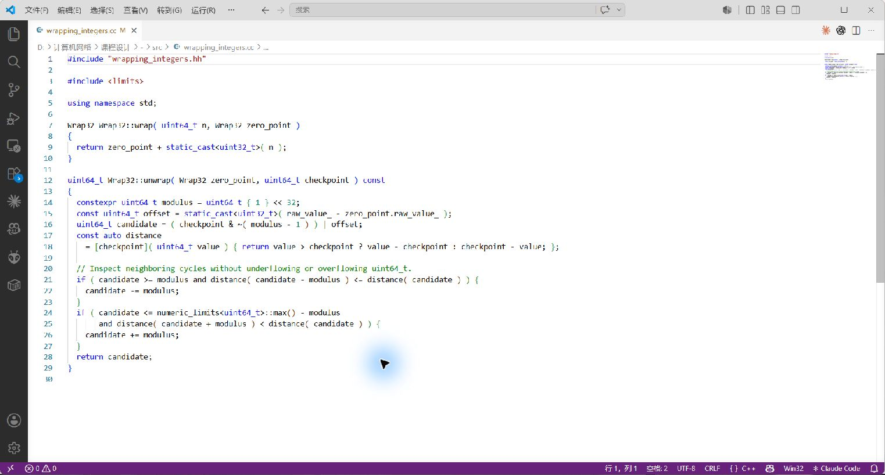
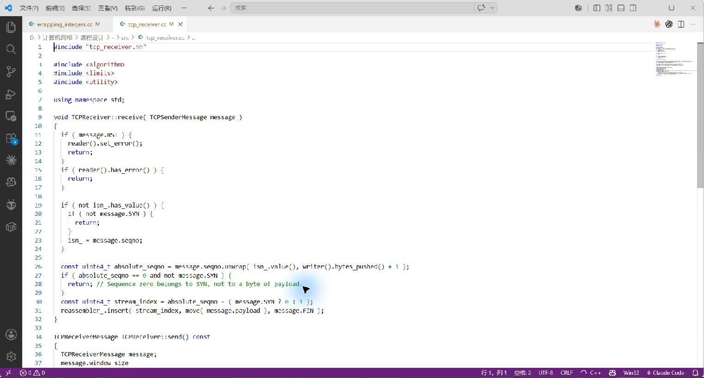
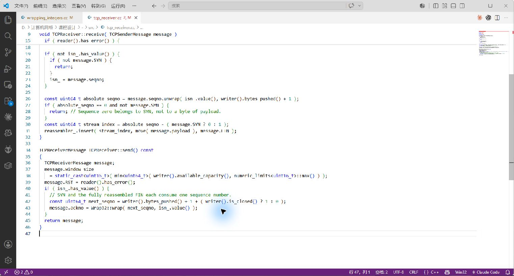

# Checkpoint 2 序号换算与 TCP 接收端

本实验实现 Wrap32 的序号换算与 TCPReceiver，继续复用已经完成的
Reassembler 和 ByteStream。接收端会根据报文恢复有序字节，并生成
确认号、接收窗口和复位标志，供框架上层封装与发送。
本次完成编程、自动化验证和代码截图；TCP 发送端及完整实网互操作属于后续阶段。

记录日期：2026 年 11 月 24 日。

## 1 本次工作顺序

1. 检查工作区干净，获取官方 check2-startercode 分支。
2. 将官方框架合入当前 main，保留 Checkpoint 0 和 1 的实现。
3. 阅读 Wrap32、TCPReceiver 与发送/接收消息的公开接口及官方测试。
4. 实现序号回绕和绝对序号还原，再把 TCP 收到的载荷接入重组器。
5. 生成累计确认号、受 16 位字段限制的窗口和 RST 状态。
6. 运行 Checkpoint 2、HTTP 回归、额外的 64 位边界检查及静态分析。
7. 保存实际代码截图、原始日志与本文，并用详细中文说明提交和推送。

官方框架提交为 d4aea19a311753ac47bd074cb1c5bf778191962b。
引入了四个 src 文件、五组序号测试、七组接收端测试及 TCP 报文相关基础设施。
官方还增加 HAVE_WRAP32 和 HAVE_TCP_SENDER_MESSAGE 编译开关。
官方 tests、util 和 etc 文件保持合入后的原样。

## 2 与前两个实验的关系

```text
TCP 发送方消息（seqno、SYN、payload、FIN、RST）
                        ↓
TCPReceiver：认识 TCP 标志，将序号换成流索引
                        ↓
Reassembler：整理乱序、重复与重叠数据
                        ↓
ByteStream：暂存连续字节，供应用读取
```

TCPReceiver 的 send() 生成确认信息对象，实际封装和网络发送由框架上层负责。
这一阶段重点是接收逻辑，webget 当前仍使用 Linux 提供的 TCP。

## 3 为什么有三种编号

TCP 报文头中的序号只有 32 位，范围是 0 到 4294967295。
超过最大值后会回到 0，类似计数器转完一圈。
此外，每条流从一个初始序号 ISN 开始，而不是固定从 0 开始。

| 编号 | 含义 |
|---|---|
| 32 位序号 seqno | 放进 TCP 报文头，包含 ISN 偏移，会回绕 |
| 64 位绝对序号 | 内部计算的位置，从 SYN 的位置 0 开始 |
| 流索引 stream index | 只对数据字节编号，首字节为 0，不包含 SYN 和 FIN |

例如，ISN=100，内容是 ABCDEF：

| 元素 | SYN | A | B | C | D | E | F | FIN |
|---|---:|---:|---:|---:|---:|---:|---:|---:|
| 报文序号 | 100 | 101 | 102 | 103 | 104 | 105 | 106 | 107 |
| 绝对序号 | 0 | 1 | 2 | 3 | 4 | 5 | 6 | 7 |
| 流索引 | 无 | 0 | 1 | 2 | 3 | 4 | 5 | 无 |

SYN 和 FIN 各占用一个序号位置，但不属于交给应用的数据。
因此，普通载荷的流索引等于其首字节绝对序号减 1。
SYN 与载荷放在同一条消息时，还要跨过 SYN 的位置再交付载荷。

## 4 Wrap32 的实现

源码：[wrapping_integers.hh](../src/wrapping_integers.hh)、
[wrapping_integers.cc](../src/wrapping_integers.cc)。

### wrap 从绝对序号转成报文序号

计算关系是：seqno = (ISN + 绝对序号) mod 2^32。
代码把绝对序号转换为 32 位，再利用无符号加法实现回绕。
例如 ISN=4294967294、绝对序号为 3，结果就是 1。

### unwrap 从报文序号还原绝对序号

一个报文序号可能对应很多圈中的同一个位置。
例如 ISN=100，报文序号 105，可能对应绝对序号 5，也可能对应 2^32+5。
checkpoint 提供当前进度，函数选择距离它最近的合法绝对序号。

本实现先构造 checkpoint 所在周期中的候选，再比较相邻周期。
向前或向后调整前检查边界，避免 64 位无符号数下溢或上溢。
两项候选距离相同时，确定地选择较小者；候选必须落在 uint64_t 范围内。
计算只需要常数次比较，不必逐圈循环。



## 5 TCPReceiver 怎样接收数据

源码：[tcp_receiver.hh](../src/tcp_receiver.hh)、
[tcp_receiver.cc](../src/tcp_receiver.cc)。

只新增一个可选 ISN 状态。已经收齐多少字节、是否关闭、是否出错，
直接从重组器和字节流查询，减少重复维护的状态。

receive() 处理顺序如下：

1. 收到 RST 时，将流标记为错误；错误状态之后不再继续接收数据。
2. 首次收到 SYN 时记录 ISN。尚未收到 SYN 的普通数据暂不接收。
3. 使用已连续交付字节数加 1 作为 checkpoint，调用 unwrap 还原绝对序号。
4. 排除把 SYN 位置当成普通数据的无效序号，避免减法产生极大流索引。
5. 根据是否携带 SYN，换算载荷首字节的流索引。
6. 把载荷和 FIN 结束标志交给 Reassembler，由它处理乱序、重叠及容量。

再次收到同一 SYN 时沿用已有 ISN，不会重置已经收到的数据。
RST 按本实验框架的简化规则处理，完整 TCP 连接状态机属于后续工作。



## 6 确认号和窗口怎样计算

### 确认号 ackno

确认号表示“接下来期待的序号”，只越过已经连续收齐的部分。
收到 SYN 之前 ackno 为空。之后先计算绝对确认位置：

```text
绝对确认位置 = 已连续交付的字节数 + 1（SYN）
             + 1（仅当流已经完整重组并关闭，即确认 FIN）
```

再通过 wrap 转换成报文中的 32 位序号。
这里以 Writer 是否关闭为准；应用还没读完数据，不会阻止接收端确认 FIN。

### 接收窗口 window_size

窗口等于 ByteStream 的当前可用容量，并限制到 16 位字段最大值 65535。
应用读取后，窗口可以增大；缓冲区满时，窗口变为 0。
乱序暂存的字节已经位于接收序号窗口内，不额外从窗口宽度重复扣除。

RST 输出来自字节流错误状态。send() 每次查询当前进度并生成结果，
不额外保存一份可能过时的确认号或窗口。



## 7 从新手角度推演一次乱序接收

继续使用 ISN=100、内容 ABCDEF，假设容量为 8，应用最初还没读取：

| 事件 | 连续交付的数据 | ackno | window_size |
|---|---|---:|---:|
| 刚创建接收端 | 空 | 无 | 8 |
| 收到 SYN，seqno=100 | 空 | 101 | 8 |
| 收到 DEF+FIN，seqno=104 | 空，前面的 ABC 尚未收到 | 101 | 8 |
| 收到 AB，seqno=101 | AB | 103 | 6 |
| 收到 CD，seqno=103 | ABCDEF，重复的 D 不再保存 | 108 | 2 |
| 应用读取全部 6 字节 | ABCDEF 已读出 | 108 | 8 |

最后的确认号是 108，因为 SYN、六个数据字节和 FIN 共占用八个序号位置。
DEF+FIN 可以先到；在空洞补齐之前，接收端仍然期待序号 101。

## 8 编译与验证

环境为 Ubuntu 24.04.4 LTS / WSL2、g++ 13.3、CMake 3.28.3、clang-tidy-20。
在 Ubuntu 的项目根目录中执行：

```bash
cmake -S . -B build/wsl
CMAKE_BUILD_PARALLEL_LEVEL=4 cmake --build build/wsl --target check2
CMAKE_BUILD_PARALLEL_LEVEL=4 cmake --build build/wsl --target check0
CMAKE_BUILD_PARALLEL_LEVEL=4 cmake --build build/wsl --target tidy
clang-format --dry-run --Werror src/wrapping_integers.hh src/wrapping_integers.cc src/tcp_receiver.hh src/tcp_receiver.cc
python3 writeups/check2-screenshots/boundary-validation.py
```

check2 的 30 项官方检查全部通过：

| 类别 | 检查项数 |
|---|---:|
| ByteStream 功能与压力检查 | 6 |
| Reassembler 功能检查 | 7 |
| Wrap32 比较、回绕、还原及随机往返检查 | 5 |
| 接收端建立、传输、窗口、乱序、结束及特殊情形 | 7 |
| 确认没有跳过测试 | 1 |
| 带错误检测及优化模式的构建 | 2 |
| 已有字节流和重组器性能基准 | 2 |
| 合计 | 30 |

另外，check0 的 11 项回归检查通过，包括远端 HTTP 网页获取。
check2 已覆盖旧模块的功能与性能回归，所以没有另行重复运行 check1。
全部 src 实现通过 clang-tidy-20，四个阶段源码文件通过格式检查。

另写了独立的 [边界检查脚本](check2-screenshots/boundary-validation.py)，
在临时目录编译实际 wrapping_integers.cc，运行 10 项补充断言并启用 ASan/UBSan。
补充检查覆盖 UINT64_MAX、非零 ISN、不可表示的相邻周期与等距候选，全部通过。
这些是额外检查，不计入上面的 30 项，也没有修改官方测试。

## 9 验证记录与截图

- [验证摘要](check2-screenshots/validation.txt)
- [Checkpoint 2 原始测试日志](check2-screenshots/check2-ctest.log)
- [Checkpoint 0 回归日志](check2-screenshots/check0-regression.log)
- [补充边界检查输出](check2-screenshots/boundary-validation.log)
- [静态分析输出](check2-screenshots/static-analysis.log)
- [全部代码截图](check2-screenshots/)

截图来自 Windows 编辑器，编译和测试记录来自 Ubuntu。
本次实现与记录由 Codex 按用户请求辅助完成。
