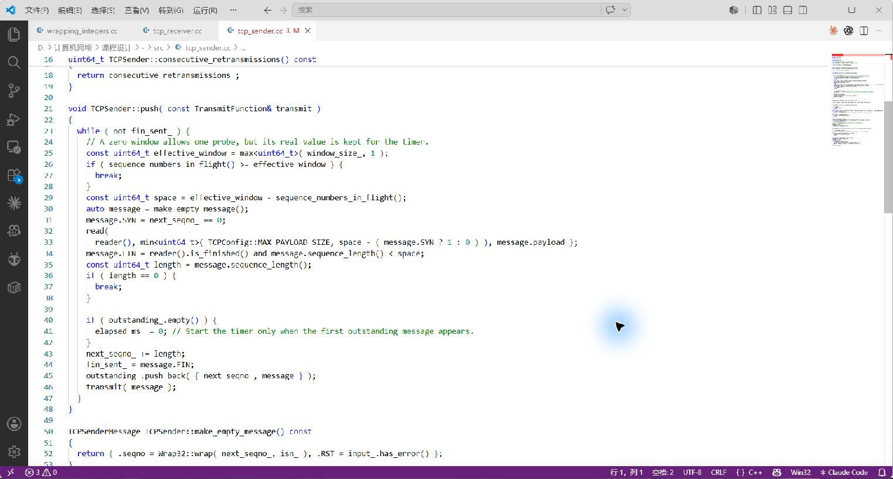
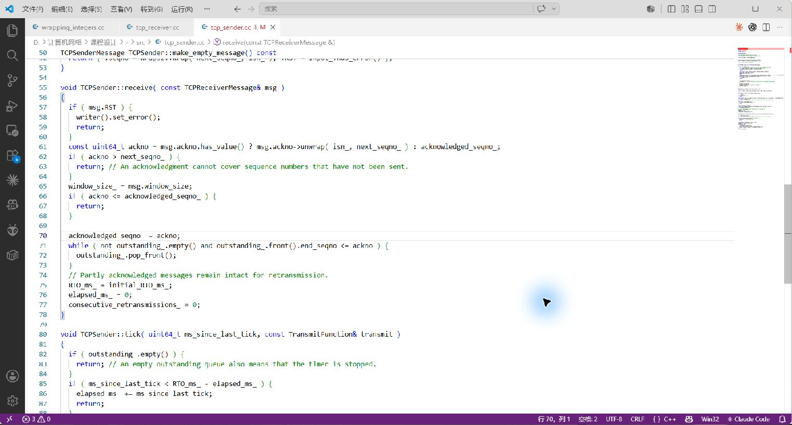
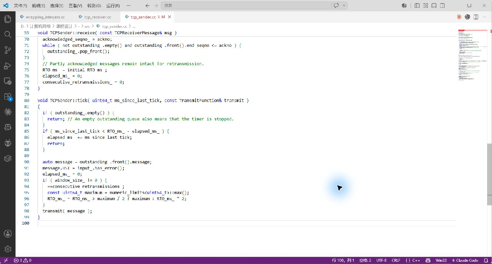

# Checkpoint 3：TCP 发送端

本阶段实现 TCPSender：从 ByteStream 取出数据，按照接收方公布的窗口生成消息，
保存尚未确认的消息，并在超时后重传。它复用 Checkpoint 2 的 Wrap32，
可以和已有 TCPReceiver、Reassembler、ByteStream 在内存中配合传输。

记录日期：2026 年 11 月 24 日。实现、验证和文档由 Codex 按用户请求辅助完成。
完整实网互操作、手工联机与抓包尚未执行。

## 1 框架与工作步骤

1. 确认 main 干净，先提交、推送上一阶段的新手指南补充。
2. 获取官方 check3-startercode，合并时保留此前各阶段实现。
3. 阅读 tcp_sender.hh、两种 TCP 消息结构和七组 send_* 官方测试。
4. 在 tcp_sender.hh 定义未确认消息队列、序号、窗口和计时状态。
5. 在 tcp_sender.cc 实现 push、receive、tick、空消息和两个状态查询。
6. 运行 check3、check0、ASan/UBSan 补充场景，以及静态分析和格式检查。
7. 保存编辑器实际截图，续写原新手指南，并用详细中文提交说明推送。

框架提交：0794b5dd521963bd479d3136080aab3f62fdf7db。
官方引入发送端接口、七组发送端测试、tcp_ipv4 应用和 socket 模板实例化等代码。
本次实现只修改 src/tcp_sender.hh 和 src/tcp_sender.cc；
官方 tests、util 以及本阶段新增或更新的 apps 文件保持框架原样；
此前完成的 webget 保留原实现。

## 2 为什么发送后还要留一份

应用把数据写入 ByteStream。发送端取出数据后，字节流会释放空间，
但网络可能丢包，所以发送端还必须在未确认队列中保存报文。
对方发来累计 ACK，才能删除已全部确认的报文。

```text
应用 → ByteStream → TCPSender.push → transmit 回调 → 框架/网络
                         ↓
                   未确认消息队列
                         ↑
         ACK → receive；经过时间 → tick → 超时重传
```

transmit 是框架传入的回调；发送端只生成消息，不直接调用系统 socket。
同样，tick 的参数来自调用方，不读取电脑时钟，也不使用 sleep。

## 3 需要保存的状态

| 状态 | 含义 |
|---|---|
| next_seqno_ | 下一次新发送使用的绝对序号 |
| acknowledged_seqno_ | 已累计确认到的位置，即下一个尚未确认的绝对序号 |
| outstanding_ | 按发送顺序保存消息及其末尾的下一绝对序号 |
| window_size_ | 对方最近公布的实际窗口，初始为 1 |
| fin_sent_ | 是否已经发送 FIN，防止重复生成结束标志 |
| RTO_ms_ | 当前重传等待时间 |
| elapsed_ms_ | 当前已等待时间 |
| consecutive_retransmissions_ | 自上次新确认后，非零窗口下连续超时的次数 |

在途序号数 = next_seqno_ - acknowledged_seqno_。
SYN、FIN 各占一个序号，payload 每字节占一个；RST 和空消息不占序号。
队列是否为空同时表示计时器是否运行，无须额外保存一个运行标志。

部分确认时保留整条原消息用于重传；在途数量仍按真正未确认的序号差计算。
队列入队、出队均为摊销 O(1)；一次 ACK 删除 k 条完整消息时为 O(k)。
额外数据存储与尚未完整确认的报文总大小成正比。

## 4 push：按照窗口装入数据

1. 用 max(window_size_, 1) 计算本次发送限制，允许零窗口下的一次探测。
2. 扣除已经在途的序号，得到剩余空间；空间不足时停止。
3. 首次消息设置 SYN，并为它预留一个位置。
4. 从 ByteStream 读取 payload，同时受剩余窗口和 MAX_PAYLOAD_SIZE 限制。
5. 如果应用已关闭且所有数据取完，并且还有一个空位，则附加 FIN。
6. 对非空消息更新序号、保存队列，再调用 transmit。
7. 继续循环填充窗口；FIN 一旦生成，后续不再生成新消息。

当前源码 TCPConfig::MAX_PAYLOAD_SIZE 为 **1000 字节**，限制的是 payload。
只要总序号长度不超过窗口，同一条消息可以携带 SYN、数据及 FIN。
初始窗口 1 通常只够先发 SYN，收到确认和新窗口后才能继续。



## 5 receive：处理确认与窗口

RST 会把输入流标为错误。其他消息先通过 unwrap 恢复 ACK 的绝对位置，
使用 next_seqno_ 作为参考。超过已发送范围的 ACK 无效，整条消息忽略。

合法消息可以更新窗口；即使没有 ACK，或 ACK 没有前进，窗口也可能变化。
只有确认了新的序号，才推进 acknowledged_seqno_、删除完整确认的队头报文，
并恢复初始 RTO、清零经过时间及连续重传次数。
重复或旧 ACK 不会重置计时器，否则不断重复的确认可能让丢包永久得不到重传。

空消息采用下一新发送位置作为 seqno，携带当前错误状态作为 RST，
不进入队列、不推进序号、也不启动计时器。



## 6 tick：超时重传

队列为空时直接返回。否则累计经过时间；到达 RTO 后只重传最早未完整确认的消息。
一次 tick 最多触发一次重传，之后从零计时。
实际窗口不为零时，连续重传次数加一，RTO 翻倍，例如 10、20、40 毫秒。
收到新确认后又恢复初始值。

实际窗口为零时仍可重传探测消息，但既不累计失败次数，也不扩大 RTO。
因此实际窗口必须保留 0，不能为了允许探测而直接把字段改成 1。
发送端向框架提供重传计数，本阶段没有额外加入自主断开连接的策略。

计算剩余时间时采用 RTO - elapsed 与本次时间比较，避免先相加溢出。
RTO 翻倍达到 uint64_t 上限时饱和到最大值，避免回绕变成很短的等待。



## 7 亲手推演 ABCDEF

设 ISN=100、初始 RTO=10 毫秒、接收容量为 8，应用写入 ABCDEF 后关闭。

| 步骤 | 发送端/接收端行为 |
|---|---|
| 1 | 初始窗口 1，发送 SYN，seqno=100；在途数为 1 |
| 2 | 接收端返回 ACK=101、窗口 8；SYN 已确认，在途归零 |
| 3 | 发送 ABCDEF+FIN，seqno=101；长度 6+1=7，在途数为 7 |
| 4 | 假设这条消息丢失，接收端还在等待 A，无法返回新的累计确认 |
| 5 | 等待满 10 毫秒后重传相同消息，连续重传次数变为 1，RTO 变为 20 |
| 6 | 接收端交付 ABCDEF 并记录 FIN，返回 ACK=108 |
| 7 | 如果这个 ACK 也丢失，再等 20 毫秒重传；接收端不会重复输出数据 |
| 8 | 发送端收到 ACK=108 后清空在途消息，停止计时，恢复 RTO=10 |

ACK=108 的意思是“序号小于 108 的内容已连续收到”，不是“收到第 108 个字节”。
这里包括 SYN、6 个数据字节和 FIN 共 8 个序号。

## 8 验证结果和复现

运行环境：WSL2 Ubuntu 24.04.4，g++ 13.3，CMake 3.28.3，
clang-format 18.1.3，clang-tidy 20.1.2，C++23。
在 Ubuntu 的项目根目录执行：

```bash
cmake -S . -B build/wsl
CMAKE_BUILD_PARALLEL_LEVEL=4 cmake --build build/wsl --target check3
CMAKE_BUILD_PARALLEL_LEVEL=4 cmake --build build/wsl --target check0
python3 tools/check3/scenario-validation.py
CMAKE_BUILD_PARALLEL_LEVEL=4 cmake --build build/wsl --target tidy
clang-format --dry-run --Werror src/tcp_sender.hh src/tcp_sender.cc
```

| 检查 | 结果 |
|---|---|
| check3 官方任务 | 37/37，通过；含旧模块回归、七组 send_*、构建和性能检查 |
| check0 回归 | 11/11，通过，另覆盖 HTTP 客户端 |
| ASan/UBSan 补充场景 | 6/6，通过，无运行时内存或未定义行为报告 |
| src 静态分析 tidy | 退出码 0，无项目源码诊断 |
| 发送端格式检查 | 退出码 0 |

补充场景包括丢数据包和丢 ACK、零窗口恢复、部分/重复 ACK、
uint64_t 计时上限、无效未来 ACK，以及跨 32 位回绕的 2500 字节二进制乱序传输。
这些测试使用内存消息队列模拟传输，不依赖真实网络。

- [验证摘要](logs/validation.txt)
- [官方检查汇总](logs/check3-build.log)与[CTest 原始日志](logs/check3-ctest.log)
- [HTTP 回归日志](logs/check0-regression.log)
- [补充场景脚本](../../tools/check3/scenario-validation.py)与[结果](logs/scenario-validation.log)
- [静态分析日志](logs/static-analysis.log)
- [从环境配置开始的持续更新指南](../guides/beginner-guide.md)

静态分析原始日志中的 warnings generated 数字包含编译器在系统头文件中产生、
被过滤掉的诊断；日志未出现项目源文件的 warning/error。
截图来自 Windows VS Code 的真实编辑器窗口。编辑器的 Win32 头文件提示
与 Ubuntu 的编译环境不同，构建验收以保存的 Ubuntu 日志为准。

本阶段未发现上述自动检查可复现的剩余错误，实网互操作仍待后续阶段验证。
