# Checkpoint 4：真实网络路径测量

本阶段测量 ICMP Echo 的交付与往返时间，不修改前面完成的 TCP 源码。实验、分析脚本和文档由 Codex 按用户请求辅助完成，原始数据随报告保留。

测量范围：3 条路径，其中同学主机路径为 172.20.10.2。这条路径采用实际可达的网络环境，与课程 CS144 专用私网不同。

采集位置为本机 WSL2 Ubuntu，普通测量每 0.2 秒发送一个 56 字节 ICMP 载荷。图中时间为 UTC+08:00；原始时间戳与元数据使用 UTC。

| 目标 | 开始时间（UTC+8） | 采集时长（秒） | 已发 / 已收 |
|---|---|---|---|
| 1.1.1.1 | 2026-11-24 14:40:32 | 3602.02 | 17926 / 16985 |
| 8.8.8.8 | 2026-11-24 14:40:40 | 3602.01 | 17931 / 17262 |
| 172.20.10.2 | 2026-11-24 14:42:59 | 3602.02 | 17932 / 17827 |

## 统计口径

交付率使用唯一回复数除以最终发送数；首部、内部和末尾没有回复的序号均计入。这里的丢失表示测量截止时没有观察到 Echo Reply，可能包含过滤、限速和截止时尚在途的探测，不能直接等同于 TCP 丢包率。-O 的暂未回复提示不作为最终丢失判据。

RTT 使用每个成功序号首次收到的回复。相邻 RTT 只配对原始序号 N 与 N+1，不会跨越丢包拼接。条件概率只使用两端均在样本范围内的序号对，分母同时导出；条件事件没有样本时记为未定义。k=0 的条件概率为 1，不代表时间相关性证据。

逐探测 RTT 的精度受 ping 输出位数限制，补齐的小数位不表示测量精度提高。原始汇总可能保留更多小数位；time<1 之类的记录按显示上界纳入，并单独记录数量。

每秒 5 次、一小时的理论探测数为 18,000；实际次数以 ping 汇总为准，会受调度和实际间隔影响。官方说明中的 3,600 次与其给出的频率不相符。

| 目标 | 交付率 | 最长连续成功 / 失败 | RTT 最小 / 中位 / 最大（ms） |
|---|---|---|---|
| 1.1.1.1 | 94.751% | 996 / 3 | 193.0 / 275.0 / 2013.0 |
| 8.8.8.8 | 96.269% | 230 / 2 | 230.0 / 249.0 / 2144.0 |
| 172.20.10.2 | 99.414% | 1140 / 3 | 3.2 / 7.9 / 1170.0 |

# 1.1.1.1：RTT 的时间变化与分布

平均 RTT 为 266.177 ms，95% 分位数为 320.000 ms。最小值 193.000 ms 是本次样本的最小往返时间，不等于精确传播时延。

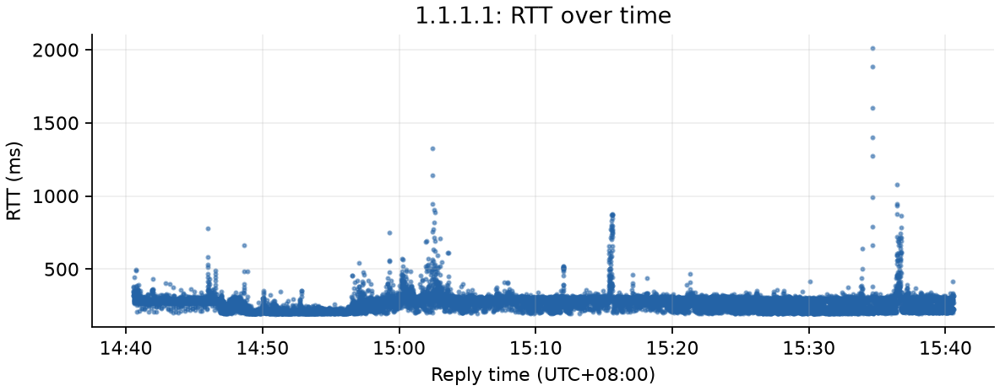

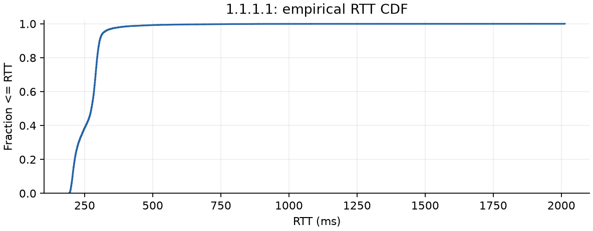

最大 RTT 明显高于 95% 分位数，说明主体样本之外存在较高时延的右尾。仅凭 ping 不能把这些尖峰归因于某一个路由器或某一种排队机制。

# 1.1.1.1：丢失与 RTT 的相关性

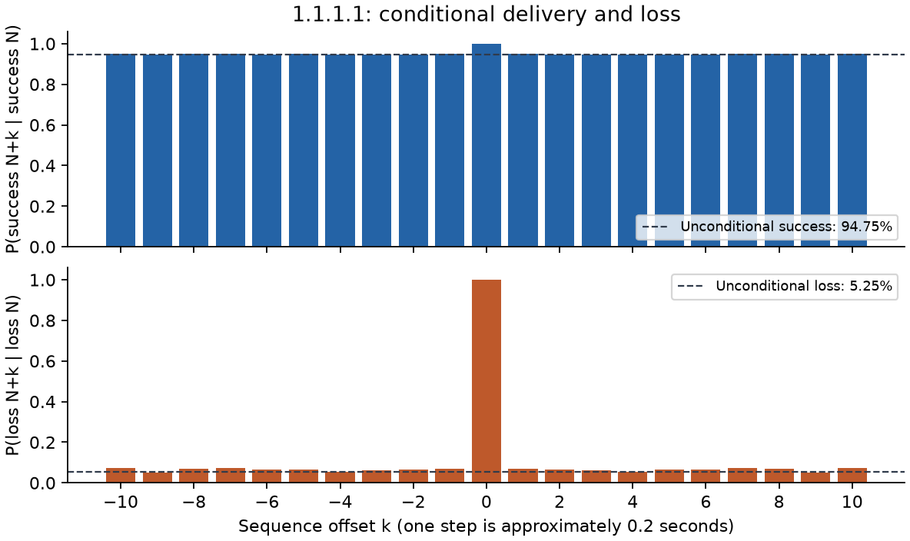

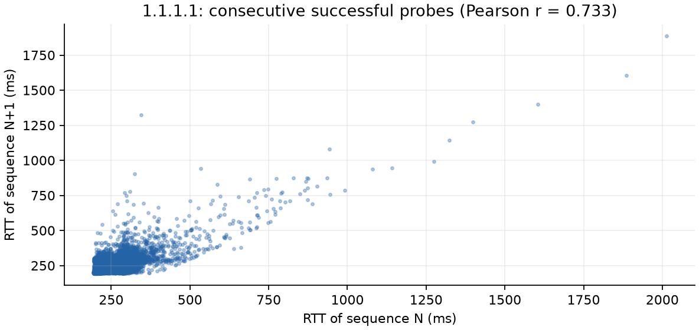

P(下一次仍丢失 | 本次丢失) = 0.069，分母为 940；无条件丢失率为 5.249%。有限样本中条件概率高于基线可提示损失聚集，不据此宣称统计显著。

# 8.8.8.8：RTT 的时间变化与分布

平均 RTT 为 257.239 ms，95% 分位数为 291.000 ms。最小值 230.000 ms 是本次样本的最小往返时间，不等于精确传播时延。

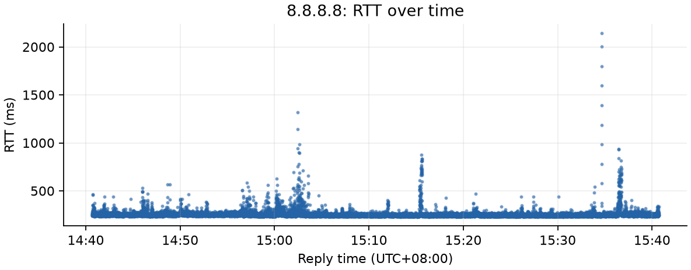

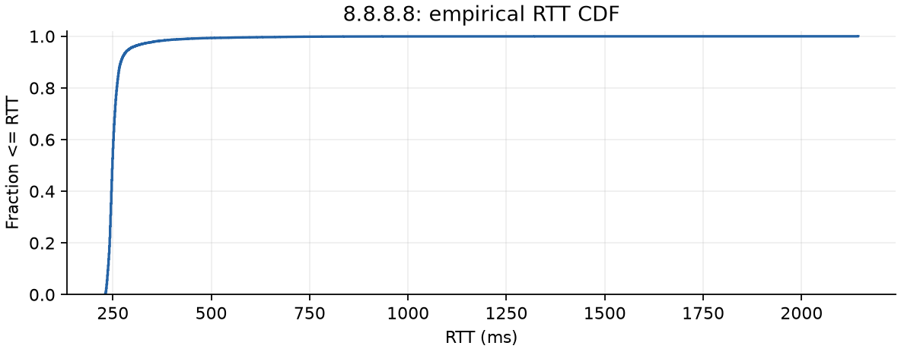

最大 RTT 明显高于 95% 分位数，说明主体样本之外存在较高时延的右尾。仅凭 ping 不能把这些尖峰归因于某一个路由器或某一种排队机制。

# 8.8.8.8：丢失与 RTT 的相关性

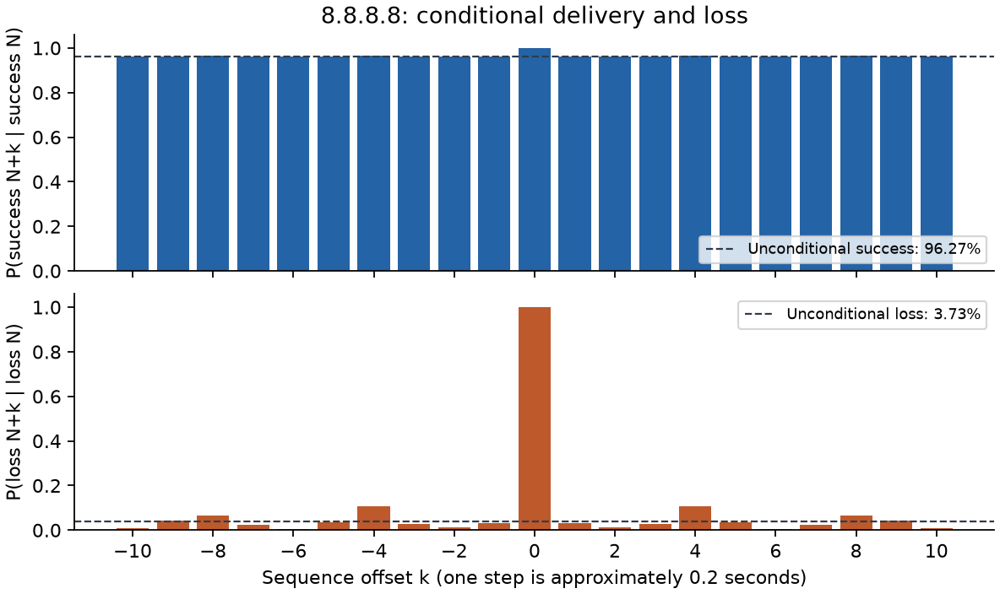

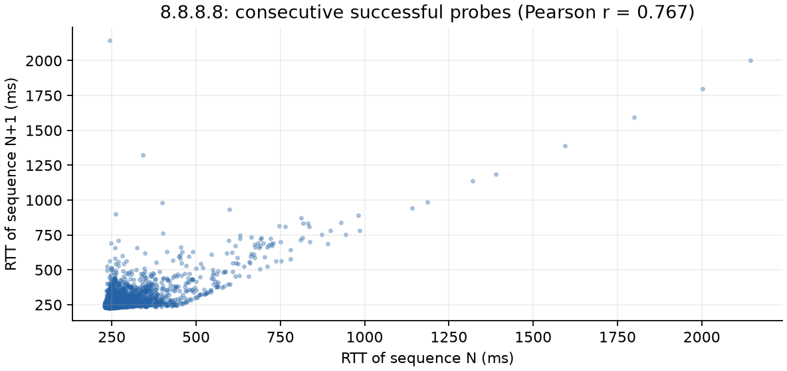

P(下一次仍丢失 | 本次丢失) = 0.031，分母为 668；无条件丢失率为 3.731%。有限样本中条件概率高于基线可提示损失聚集，不据此宣称统计显著。

# 172.20.10.2：RTT 的时间变化与分布

平均 RTT 为 22.631 ms，95% 分位数为 77.600 ms。最小值 3.200 ms 是本次样本的最小往返时间，不等于精确传播时延。

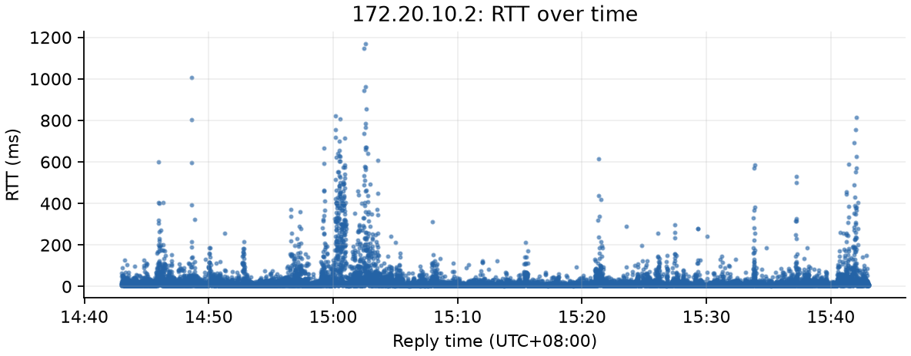

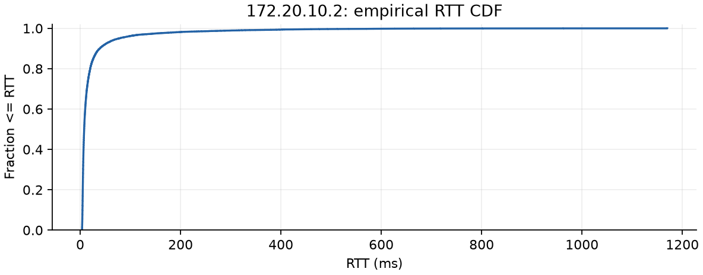

最大 RTT 明显高于 95% 分位数，说明主体样本之外存在较高时延的右尾。仅凭 ping 不能把这些尖峰归因于某一个路由器或某一种排队机制。

# 172.20.10.2：丢失与 RTT 的相关性

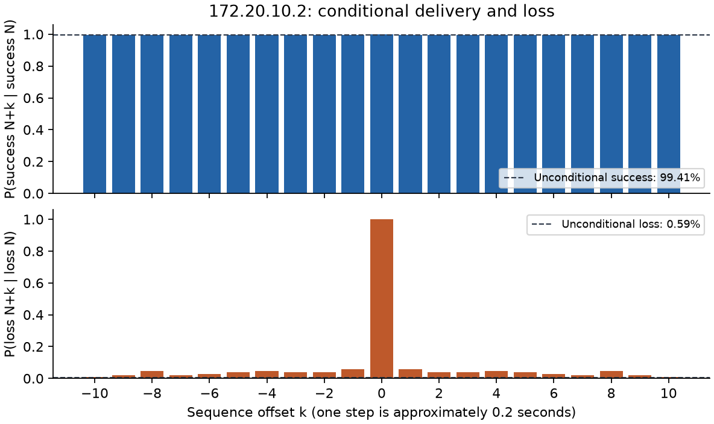

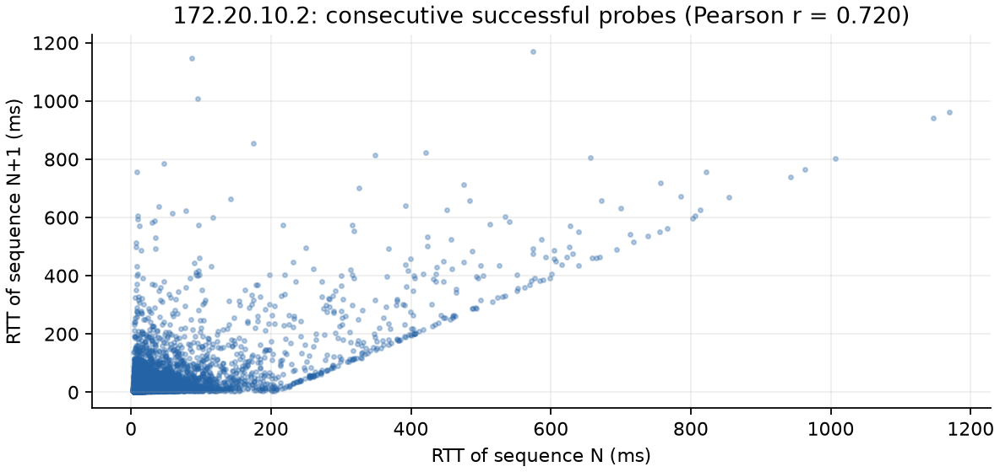

P(下一次仍丢失 | 本次丢失) = 0.057，分母为 105；无条件丢失率为 0.586%。有限样本中条件概率高于基线可提示损失聚集，不据此宣称统计显著。

# 短时速率实验与路径观察

每条路径分别进行 56 字节/0.2 秒、256 字节/0.1 秒和 1200 字节/0.05 秒的短时试验。每组设置 8 秒截止时间。图中速率只计算 ICMP 载荷，不含 IP、ICMP 和链路层头部，请求和回复均除以该组相同的实际总时长。短时试验与长时采集有重叠，时间记录在 trials.json。

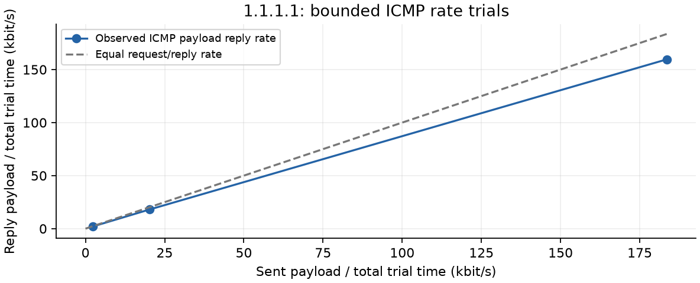

1.1.1.1 本次最大观测回复载荷速率为 159.658 kbit/s，对应 1200 字节、间隔 0.05 秒的配置；实际收到 100/115 个回复，总时长 6.013 秒。

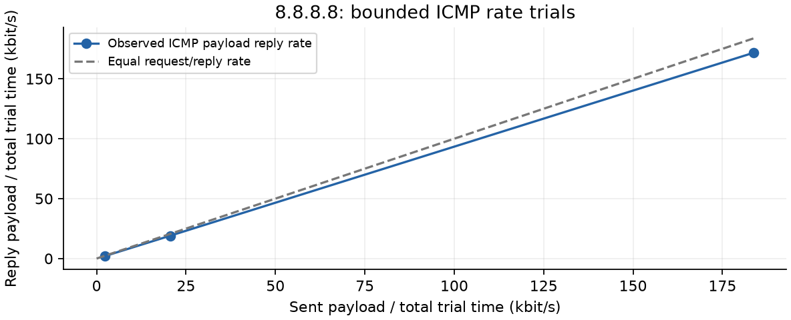

8.8.8.8 本次最大观测回复载荷速率为 171.716 kbit/s，对应 1200 字节、间隔 0.05 秒的配置；实际收到 100/107 个回复，总时长 5.591 秒。

# 短时速率实验与路径观察（续）

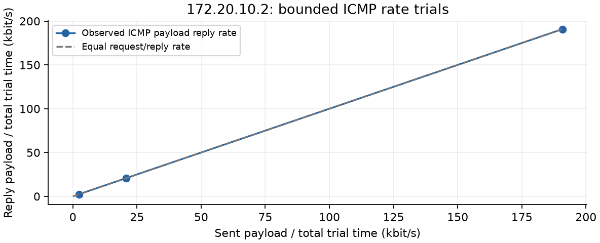

172.20.10.2 本次最大观测回复载荷速率为 190.852 kbit/s，对应 1200 字节、间隔 0.05 秒的配置；实际收到 100/100 个回复，总时长 5.030 秒。

这三档负载只能比较本次试验中的回复速率；即使没有平台期，也不能认定达到或测出了线路容量。较高回复速率是已测试配置的观测最大值，不是 TCP 吞吐或下载带宽。

本次 Windows tracert 原始输出保存在 writeups/check4-data/network2/routes。公网路径从 172.20.10.1 网关出发，中间可见部分公网跳点，同时有不回复 TTL 探测的跳点。仅凭这些数字地址不能还原完整地理路线，也不能确认经过的城市或国家；目标 IP 的服务商所在地不能代替实际路径地理证据。

本次同学路径经 Windows tracert 观察为一跳到达目标，与公网路径的输出明显不同。这一结果描述可观察的 IP 跳点，不表示中间没有交换机、无线设备或其他二层设施。

# 路径比较、复现与数据完整性

本次中位 RTT 最低的路径为 172.20.10.2。不同目标的差异包含出口、远端回复策略以及时段影响，不能只解释为物理距离差异。共享前段跳点和同机并行采集也意味着这些路径不是完全独立的重复实验。

采集脚本使用 Linux ping；分析和绘图需要 Python 与 matplotlib；PDF 额外需要 reportlab 和中文 TrueType 字体。在仓库根目录运行 python tools/check4/test_metrics.py 可验证统计口径。运行命令、字段含义和添加同学路径的方法见 tools/check4/README.md 与新手指南。

1.1.1.1 原始 ping.txt 的 SHA-256：8ee0b1dde16a778a065f7e938f07d930744d81a017f32d17ae7dab2f18afd336

- [逐探测数据](check4-results/cloudflare/probes.csv)；[统计 JSON](check4-results/cloudflare/statistics.json)；[条件概率及分母](check4-results/cloudflare/conditional.csv)

8.8.8.8 原始 ping.txt 的 SHA-256：c4b07621c4f5092c8ddfc9ed565d2c78ce3c5c96fda42e8a6229f5ce8987fc53

- [逐探测数据](check4-results/google/probes.csv)；[统计 JSON](check4-results/google/statistics.json)；[条件概率及分母](check4-results/google/conditional.csv)

172.20.10.2 原始 ping.txt 的 SHA-256：21fa1606d2a4c283c34f13a93d3700a619d46d6fac541e3bca4d42754f67ac47

- [逐探测数据](check4-results/classmate/probes.csv)；[统计 JSON](check4-results/classmate/statistics.json)；[条件概率及分母](check4-results/classmate/conditional.csv)

## 参考说明

课程要求与分析项目以官方 Checkpoint 4 说明为依据；命令参数以 iputils ping 手册为依据。本报告保留原始数据和方法边界，不补造无法从日志确认的地理路线或实验结果。

- [CS144 Checkpoint 4](https://cs144.github.io/assignments/check4.pdf)
- [ping 参数说明](https://man7.org/linux/man-pages/man8/ping.8.html)
- [PDF 报告](../output/pdf/check4-report.pdf)

## 实现、配置与代码截图

- [测量工具与复现命令](../tools/check4/README.md)
- [同学 Windows 主机配置记录](check4-peer-setup.md)
- [持续更新的新手指南](check0-4beginner-guide.md)
- [验证记录](check4-screenshots/validation.txt)

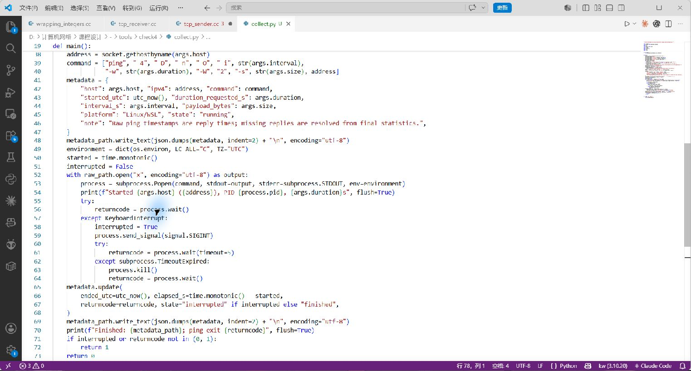

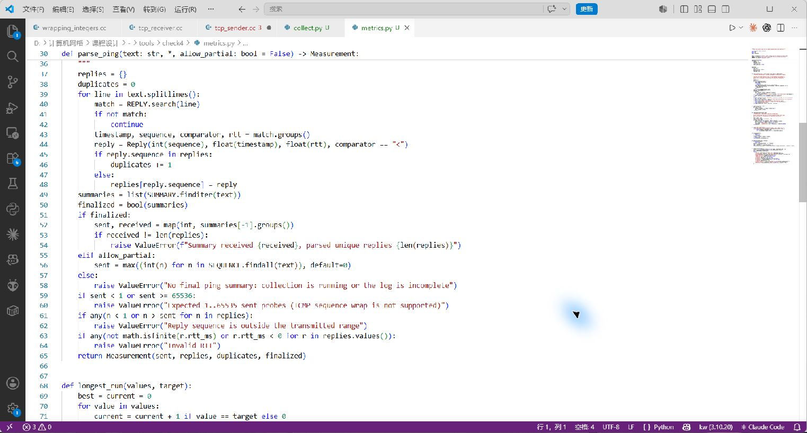

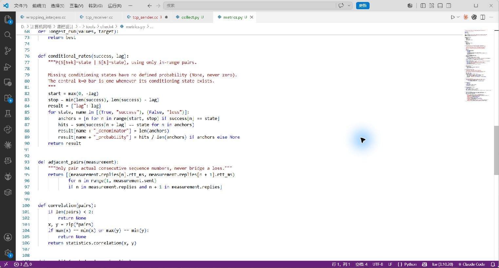
