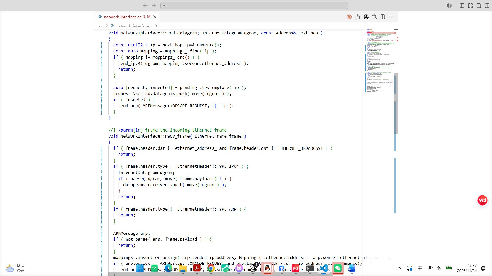
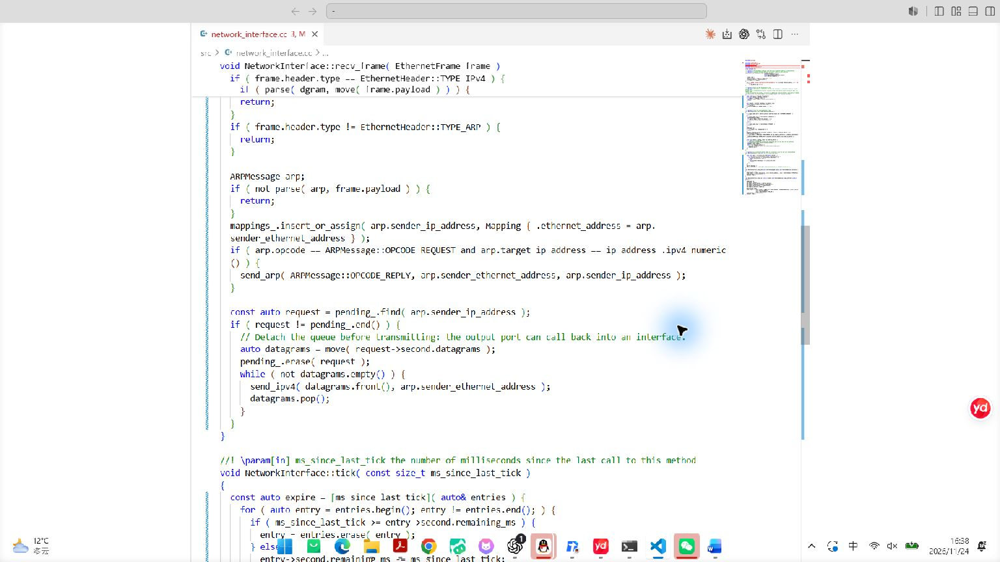
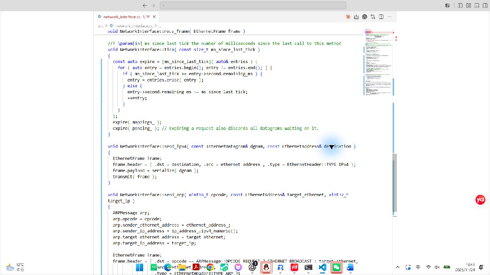
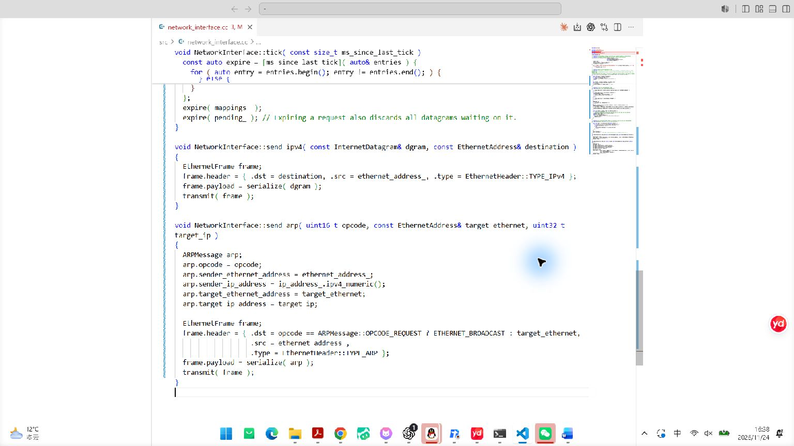

# Checkpoint 5 源码新手讲解：IP 怎样装进以太网帧

这一阶段写的是 `NetworkInterface`，即 IP 层与以太网之间的接口。
先读地址例子，再看发送、接收、计时三个入口，最后对照完整源码。
前面阶段仍见 [Checkpoint 0–4 源码指南](check0-check4-source-code-guide.md)，
操作步骤见[持续更新的实验指南](check0-4beginner-guide.md)。
要求依据：[官方 Checkpoint 5 指导书](https://cs144.github.io/assignments/check5.pdf)。

## 1 为什么有了 IP，还要找 MAC

IP 地址描述数据报在网络中要去哪里；MAC 地址供以太网这一跳投递使用。
假设本机访问 `8.8.8.8`，路由选择给出的下一跳是网关 `192.168.1.1`：

```text
IPv4 数据报：源 IP = 本机 IP，目的 IP = 8.8.8.8
    包装在
以太网帧：源 MAC = 本机 MAC，目的 MAC = 网关 MAC
    交给网关后，由网关继续转发
```

程序查询的是网关 MAC。ARP 广播只在相应链路传播，不由普通 IP 路由器跨网转发，
所以不能在本地链路广播询问远方服务器的 MAC。
最终目的主机就在同一链路时，下一跳可以直接是该主机。

`next_hop` 由调用者给出，本阶段不选择路由。
封装不改变最终目的 IP，也不递减 IP 的 TTL；后续路由器阶段再处理转发和 TTL。

## 2 这次修改了哪些源码

| 文件 | 来源及本阶段工作 |
|---|---|
| `src/network_interface.hh` | 官方框架上增加缓存、待发队列、期限和私有辅助函数 |
| `src/network_interface.cc` | 实现发送、接收、计时及 IPv4/ARP 帧封装 |
| `tests/net_interface.cc` | 原样合入官方测试，未改测试要求 |
| `tests/network_interface_test_harness.hh` | 原样合入官方测试框架 |
| `tests/CMakeLists.txt` | 原样合入官方分支的测试注册改动 |
| `writeups/check5-screenshots/boundary-validation.py` | 新增独立补充检查，未替换官方测试 |

官方已经提供 `InternetDatagram`、`EthernetFrame`、`ARPMessage`、`Address`，
以及 `serialize`、`parse` 等工具。我们实现如何组合、保存和调度这些对象，
没有重新手写 IP 校验和或 ARP 字节格式解析器。

## 3 头文件：先看保存了什么状态

原有 `ethernet_address_`、`ip_address_` 是本接口的 MAC 和 IP。
`port_` 指向输出端口，`transmit(frame)` 把帧交给端口。
`datagrams_received_` 保存已接收并解析成功的 IPv4 数据报，供上层取走。

新增的两张表各回答一个问题：

| 状态 | 键 | 值 | 问题 |
|---|---|---|---|
| `mappings_` | 下一跳 IP，`uint32_t` | `Mapping` | 这个 IP 对应哪个 MAC，还能用多久？ |
| `pending_` | 下一跳 IP，`uint32_t` | `PendingRequest` | 哪些数据报在等它，还等多久？ |

`Mapping` 保存 MAC 和 `remaining_ms`，初始寿命 `30'000` 毫秒。
`PendingRequest` 保存 `queue<InternetDatagram>` 和剩余期限，初始 `5'000` 毫秒。
C++ 数字中的单引号只是分组，`30'000` 就是 30000。

`std::map` 将键映射到值，`find` 找不到时返回 `end()`。
`std::queue` 先进先出：`push` 入队、`front` 看队头、`pop` 删除队头。
同一 IP 的数据报共用一个等待请求；不同 IP 分别计时。

有序映射的查找、插入为 O(log n)，每次 `tick` 遍历两表，为 O(m+p)。
等待队列没有额外容量上限，5 秒内大量入队仍会占用相应内存。

## 4 构造函数及框架接口

构造函数保存名字、输出端口、本机 MAC/IP；`notnull` 检查端口不能是空指针。
原来的调试打印保留，方便看到测试中各接口的身份。

`OutputPort` 是抽象接口，规定“如何交出一帧”的函数形状。
官方测试用模拟端口记录帧，因此验证本阶段不需要启用真实网卡。
未来可由其他端口实现将帧交给相应链路。

原有 `name()`、`output()`、`datagrams_received()` 是访问成员的入口。
本阶段没有改变公共函数签名，测试仍按原接口调用。

## 5 send_datagram：先找地址，再发送

调用者给本函数一个 IPv4 数据报和下一跳地址。

1. 用 `next_hop.ipv4_numeric()` 得到数值 IP，作为查表键。
2. 若缓存中存在映射，调用 `send_ipv4` 后返回。
3. 否则用 `pending_.try_emplace(ip)` 找到或新建等待项。
4. 把数据报移入这个等待项的队列。
5. 只有新建等待项时才广播 ARP 请求。

`auto [request, inserted]` 同时接收表中位置和“是否新插入”两个结果。
已有等待项时 `inserted` 为假，第二、第三个数据报只排队，不重复广播。
追加数据报不会重新开始这 5 秒，期限从请求创建时算起。

为什么先入队再广播？输出端口可能立即调用另一接口，而对方又立即应答。
先广播后入队，应答回来时可能找不到待发送的数据。
`move(dgram)` 允许把内部资源交给队列，减少不必要的复制。

缓存命中并发送不延长映射寿命；收到有效 ARP 才会刷新。



## 6 recv_frame：收到一帧后做什么

先看目的 MAC。只有发给本机或广播的帧继续处理。
广播 MAC 是 `ff:ff:ff:ff:ff:ff`，代码常量为 `ETHERNET_BROADCAST`。
再看 `EtherType`，它表示以太网载荷使用什么协议：

| 类型 | 数值 | 处理 |
|---|---|---|
| IPv4 | `0x0800` | 解析成功后放入接收队列 |
| ARP | `0x0806` | 解析后学习映射、按需应答及释放待发队列 |
| 其他 | 例如 IPv6 | 本阶段忽略 |

IPv4 分支调用 `parse(dgram, move(frame.payload))` 解析并校验，
成功才把 `dgram` 入队，之后返回，不再进入 ARP 分支。
这里不额外要求最终目的 IP 等于本接口 IP，因为接口也可服务于路由器，
发给路由器 MAC 的数据报可能需要继续转发。

ARP 分支先 `parse`。框架解析器检查硬件类型、协议类型、地址长度和操作码。
解析失败直接返回，不让非法数据污染映射表。

成功后根据 ARP 的发送者字段更新缓存：

```cpp
mappings_.insert_or_assign(
  arp.sender_ip_address,
  Mapping { .ethernet_address = arp.sender_ethernet_address } );
```

`insert_or_assign` 表示有则替换、无则插入。
未显式填写的 `remaining_ms` 使用头文件默认值 30000，
因此新 ARP 既能更新 MAC，也能刷新期限。
有效请求和应答都能提供发送者映射，学习不局限于给本机的应答。

消息是请求且询问本机 IP 时，单播应答给请求者。
请求问其他 IP 时只学习发送者，不代替别的主机回答。

最后查 `pending_` 有没有等待该发送者 IP 的队列。
有就先移出队列并删除等待项，再按先进先出顺序封装发送。
先删除能避免输出端口同步回调后继续使用失效的表项。
本实现先回应 ARP 请求，再释放对应待发数据报。



## 7 tick：怎样知道 5 秒和 30 秒到了

本函数不读电脑时钟；调用者告诉它“距离上次又过了多少毫秒”。
`tick(1000)` 让内部期限推进一秒，测试无需真的等待一秒。

`expire` 是 lambda，可理解为写在函数里的小函数。
`[ms_since_last_tick]` 让它记住这次增量，`auto& entries` 让它可处理两种表。
对每一项执行：

1. 过去时间大于或等于剩余时间，删除这一项。
2. 否则减去过去时间，再前进到下一项。

删除时用 `entry = entries.erase(entry)` 获取下一个有效位置，
不能删掉当前位置后继续使用原来的迭代器。
先比较再减避免无符号下溢，不累计绝对时钟也避免累计加法溢出。
补充测试传入 `SIZE_MAX`，验证极大时间增量仍可正确清理。

`expire(mappings_)` 删除到期映射。
`expire(pending_)` 删除到期请求，请求内的整个数据报队列随之销毁。
本实现精确在 5000/30000 毫秒边界过期。

`tick` 不自动再次广播。过期后又有新数据报时，`send_datagram` 会建立新请求。
原来已丢弃的数据报不会被后来到达的 ARP 救回来。



## 8 两个辅助函数怎样封装帧

`send_ipv4` 新建以太网帧：源 MAC 填本机、目的 MAC 填下一跳、类型填 IPv4，
`serialize(dgram)` 生成载荷，最后 `transmit(frame)`。
数据报通过常量引用传入，不把最终目的 IP 改成下一跳 IP。

`send_arp` 填写操作码、本机发送者 MAC/IP、目标 MAC/IP。
请求外层目的 MAC 使用广播，应答使用对方 MAC，以太网类型都填 ARP。
请求尚不知道目标 MAC，ARP 的目标硬件字段可以先填全零。
这个全零字段与外层以太网广播目的字段处于不同位置。

两函数集中封装步骤，让发送、接收分支不用重复构造帧。



## 9 自己手算两条流程

下表是教学推演，时间由 `tick` 推进，不是新增实网测量。

| 时间 | 事件 | 状态与输出 |
|---|---|---|
| 0 ms | 发 A 给未知下一跳 X | 队列 A，广播一次，等待截止 5000 ms |
| 1000 ms | 又发 B 给 X | 队列 A、B，不重复广播，截止时间不变 |
| 2000 ms | 收到 X 的有效 ARP | 缓存 MAC，依次发 A、B，删除等待项 |
| 3000 ms | 发 C 给 X | 命中缓存，立即发 C |
| 32000 ms | 自收到 ARP 后满 30 秒 | 映射过期，再有数据时重新解析地址 |

另一条流程若在 5000 ms 还没收到应答，A、B 就被丢弃。
6000 ms 才到的应答可以教会接口 MAC，但不能发出已删除的 A、B。
随后新来的数据报可以使用刚学到的映射正常发送。

## 10 我怎样验证它

CTest 的任务数不等于 ARP 用例个数，`net_interface` 一个任务中还有多个场景。

| 检查 | 实际结果 | 作用 |
|---|---|---|
| 官方 check5 | 3/3 任务通过 | 带检查器构建、网络接口场景、禁止跳过测试 |
| check3 回归 | 37/37 通过 | 确认先前 TCP 模块仍正常 |
| check0 回归 | 11/11 通过 | 另行检查 HTTP 等早期功能 |
| 补充 ASan/UBSan | 5/5 通过 | 精确边界、刷新、极大增量、非法帧、同步双接口 |
| clang-tidy | 通过 | 本项目源文件无最终诊断，命令退出成功 |
| clang-format | 通过 | 本阶段两份源文件符合格式配置 |

静态分析日志保留了系统头文件产生并被过滤的警告计数，
不能解读为本项目仍有相同数量的未处理诊断。
官方测试与 startercode 一致，补充检查保存在独立脚本中。
本次网络接口验证使用内存端口，未做真实网卡或 TAP 通信验证。

在 Ubuntu 中从仓库根目录复现：

```bash
cmake -S . -B build/wsl
CMAKE_BUILD_PARALLEL_LEVEL=4 cmake --build build/wsl --target check5
CMAKE_BUILD_PARALLEL_LEVEL=4 cmake --build build/wsl --target check3
CMAKE_BUILD_PARALLEL_LEVEL=4 cmake --build build/wsl --target check0
python3 writeups/check5-screenshots/boundary-validation.py
CMAKE_BUILD_PARALLEL_LEVEL=4 cmake --build build/wsl --target tidy
clang-format --dry-run --Werror src/network_interface.hh src/network_interface.cc
```

补充脚本依赖构建产生的 `build/wsl/util/libutil_sanitized.a`，
在临时目录编译 C++ 场景，完成后自动清理临时文件。
[验证摘要](check5-screenshots/validation.txt)列出原始日志。

## 11 检查自己是否理解

1. 去 `8.8.8.8` 的下一跳是网关，ARP 应该问谁？
2. 一秒内给未知下一跳发三个数据报，广播几次？
3. 第四秒追加的数据报，能把原截止时间推迟到第九秒吗？
4. 只收到 ARP 请求，能学习发送者 MAC 吗？什么时候应答？
5. 为什么 `tick(5000)` 后到来的应答不能恢复旧队列？
6. 为什么不只接收目的 IP 等于本机的数据报？

答案：下一跳网关；一次；不能；能，且只回答询问本机 IP 的请求；
旧队列已经删除；接口还可能服务于需要转发其他目的 IP 数据报的路由器。

## 12 本阶段完整源码快照

下面取自本阶段经过验证的两份源文件。后续若继续修改源码，
可用本次提交中的快照对照学习。实现、验证与文档由 Codex 按用户要求辅助完成。

<details>
<summary>src/network_interface.hh 完整源码</summary>

```cpp
#pragma once

#include "address.hh"
#include "ethernet_frame.hh"
#include "ipv4_datagram.hh"

#include <cstdint>
#include <map>
#include <memory>
#include <queue>

// A "network interface" that connects IP (the internet layer, or network layer)
// with Ethernet (the network access layer, or link layer).

// This module is the lowest layer of a TCP/IP stack
// (connecting IP with the lower-layer network protocol,
// e.g. Ethernet). But the same module is also used repeatedly
// as part of a router: a router generally has many network
// interfaces, and the router's job is to route Internet datagrams
// between the different interfaces.

// The network interface translates datagrams (coming from the
// "customer," e.g. a TCP/IP stack or router) into Ethernet
// frames. To fill in the Ethernet destination address, it looks up
// the Ethernet address of the next IP hop of each datagram, making
// requests with the [Address Resolution Protocol](\ref rfc::rfc826).
// In the opposite direction, the network interface accepts Ethernet
// frames, checks if they are intended for it, and if so, processes
// the the payload depending on its type. If it's an IPv4 datagram,
// the network interface passes it up the stack. If it's an ARP
// request or reply, the network interface processes the frame
// and learns or replies as necessary.
class NetworkInterface
{
public:
  // An abstraction for the physical output port where the NetworkInterface sends Ethernet frames
  class OutputPort
  {
  public:
    virtual void transmit( const NetworkInterface& sender, const EthernetFrame& frame ) = 0;
    virtual ~OutputPort() = default;
  };

  // Construct a network interface with given Ethernet (network-access-layer) and IP (internet-layer)
  // addresses
  NetworkInterface( std::string_view name,
                    std::shared_ptr<OutputPort> port,
                    const EthernetAddress& ethernet_address,
                    const Address& ip_address );

  // Sends an Internet datagram, encapsulated in an Ethernet frame (if it knows the Ethernet destination
  // address). Will need to use [ARP](\ref rfc::rfc826) to look up the Ethernet destination address for the next
  // hop. Sending is accomplished by calling `transmit()` (a member variable) on the frame.
  void send_datagram( InternetDatagram dgram, const Address& next_hop );

  // Receives an Ethernet frame and responds appropriately.
  // If type is IPv4, pushes the datagram to the datagrams_in queue.
  // If type is ARP request, learn a mapping from the "sender" fields, and send an ARP reply.
  // If type is ARP reply, learn a mapping from the "sender" fields.
  void recv_frame( EthernetFrame frame );

  // Called periodically when time elapses
  void tick( size_t ms_since_last_tick );

  // Accessors
  const std::string& name() const { return name_; }
  const OutputPort& output() const { return *port_; }
  OutputPort& output() { return *port_; }
  std::queue<InternetDatagram>& datagrams_received() { return datagrams_received_; }

private:
  // Human-readable name of the interface
  std::string name_;

  // The physical output port (+ a helper function `transmit` that uses it to send an Ethernet frame)
  std::shared_ptr<OutputPort> port_;
  void transmit( const EthernetFrame& frame ) const { port_->transmit( *this, frame ); }

  // Ethernet (known as hardware, network-access-layer, or link-layer) address of the interface
  EthernetAddress ethernet_address_;

  // IP (known as internet-layer or network-layer) address of the interface
  Address ip_address_;

  // Datagrams that have been received
  std::queue<InternetDatagram> datagrams_received_ {};

  static constexpr size_t CACHE_LIFETIME_MS = 30'000;
  static constexpr size_t REQUEST_LIFETIME_MS = 5'000;

  struct Mapping
  {
    EthernetAddress ethernet_address {};
    size_t remaining_ms { CACHE_LIFETIME_MS };
  };

  struct PendingRequest
  {
    std::queue<InternetDatagram> datagrams {};
    size_t remaining_ms { REQUEST_LIFETIME_MS };
  };

  std::map<uint32_t, Mapping> mappings_ {};
  std::map<uint32_t, PendingRequest> pending_ {};

  void send_ipv4( const InternetDatagram& dgram, const EthernetAddress& destination );
  void send_arp( uint16_t opcode, const EthernetAddress& target_ethernet, uint32_t target_ip );
};
```

</details>

<details>
<summary>src/network_interface.cc 完整源码</summary>

```cpp
#include <iostream>

#include "arp_message.hh"
#include "ethernet_frame.hh"
#include "exception.hh"
#include "helpers.hh"
#include "network_interface.hh"

using namespace std;

//! \param[in] ethernet_address Ethernet (what ARP calls "hardware") address of the interface
//! \param[in] ip_address IP (what ARP calls "protocol") address of the interface
NetworkInterface::NetworkInterface( string_view name,
                                    shared_ptr<OutputPort> port,
                                    const EthernetAddress& ethernet_address,
                                    const Address& ip_address )
  : name_( name )
  , port_( notnull( "OutputPort", move( port ) ) )
  , ethernet_address_( ethernet_address )
  , ip_address_( ip_address )
{
  cerr << "DEBUG: Network interface has Ethernet address " << to_string( ethernet_address_ ) << " and IP address "
       << ip_address.ip() << "\n";
}

//! \param[in] dgram the IPv4 datagram to be sent
//! \param[in] next_hop the IP address of the interface to send it to (typically a router or default gateway, but
//! may also be another host if directly connected to the same network as the destination) Note: the Address type
//! can be converted to a uint32_t (raw 32-bit IP address) by using the Address::ipv4_numeric() method.
void NetworkInterface::send_datagram( InternetDatagram dgram, const Address& next_hop )
{
  const uint32_t ip = next_hop.ipv4_numeric();
  const auto mapping = mappings_.find( ip );
  if ( mapping != mappings_.end() ) {
    send_ipv4( dgram, mapping->second.ethernet_address );
    return;
  }

  auto [request, inserted] = pending_.try_emplace( ip );
  request->second.datagrams.push( move( dgram ) );
  if ( inserted ) {
    send_arp( ARPMessage::OPCODE_REQUEST, {}, ip );
  }
}

//! \param[in] frame the incoming Ethernet frame
void NetworkInterface::recv_frame( EthernetFrame frame )
{
  if ( frame.header.dst != ethernet_address_ and frame.header.dst != ETHERNET_BROADCAST ) {
    return;
  }
  if ( frame.header.type == EthernetHeader::TYPE_IPv4 ) {
    InternetDatagram dgram;
    if ( parse( dgram, move( frame.payload ) ) ) {
      datagrams_received_.push( move( dgram ) );
    }
    return;
  }
  if ( frame.header.type != EthernetHeader::TYPE_ARP ) {
    return;
  }

  ARPMessage arp;
  if ( not parse( arp, frame.payload ) ) {
    return;
  }
  mappings_.insert_or_assign( arp.sender_ip_address, Mapping { .ethernet_address = arp.sender_ethernet_address } );
  if ( arp.opcode == ARPMessage::OPCODE_REQUEST and arp.target_ip_address == ip_address_.ipv4_numeric() ) {
    send_arp( ARPMessage::OPCODE_REPLY, arp.sender_ethernet_address, arp.sender_ip_address );
  }

  const auto request = pending_.find( arp.sender_ip_address );
  if ( request != pending_.end() ) {
    // Detach the queue before transmitting: the output port can call back into an interface.
    auto datagrams = move( request->second.datagrams );
    pending_.erase( request );
    while ( not datagrams.empty() ) {
      send_ipv4( datagrams.front(), arp.sender_ethernet_address );
      datagrams.pop();
    }
  }
}

//! \param[in] ms_since_last_tick the number of milliseconds since the last call to this method
void NetworkInterface::tick( const size_t ms_since_last_tick )
{
  const auto expire = [ms_since_last_tick]( auto& entries ) {
    for ( auto entry = entries.begin(); entry != entries.end(); ) {
      if ( ms_since_last_tick >= entry->second.remaining_ms ) {
        entry = entries.erase( entry );
      } else {
        entry->second.remaining_ms -= ms_since_last_tick;
        ++entry;
      }
    }
  };
  expire( mappings_ );
  expire( pending_ ); // Expiring a request also discards all datagrams waiting on it.
}

void NetworkInterface::send_ipv4( const InternetDatagram& dgram, const EthernetAddress& destination )
{
  EthernetFrame frame;
  frame.header = { .dst = destination, .src = ethernet_address_, .type = EthernetHeader::TYPE_IPv4 };
  frame.payload = serialize( dgram );
  transmit( frame );
}

void NetworkInterface::send_arp( uint16_t opcode, const EthernetAddress& target_ethernet, uint32_t target_ip )
{
  ARPMessage arp;
  arp.opcode = opcode;
  arp.sender_ethernet_address = ethernet_address_;
  arp.sender_ip_address = ip_address_.ipv4_numeric();
  arp.target_ethernet_address = target_ethernet;
  arp.target_ip_address = target_ip;

  EthernetFrame frame;
  frame.header = { .dst = opcode == ARPMessage::OPCODE_REQUEST ? ETHERNET_BROADCAST : target_ethernet,
                   .src = ethernet_address_,
                   .type = EthernetHeader::TYPE_ARP };
  frame.payload = serialize( arp );
  transmit( frame );
}
```

</details>
