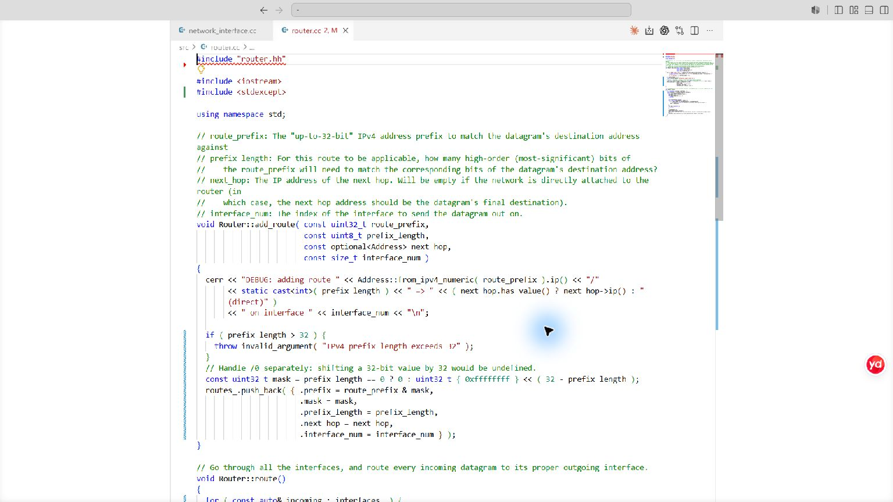
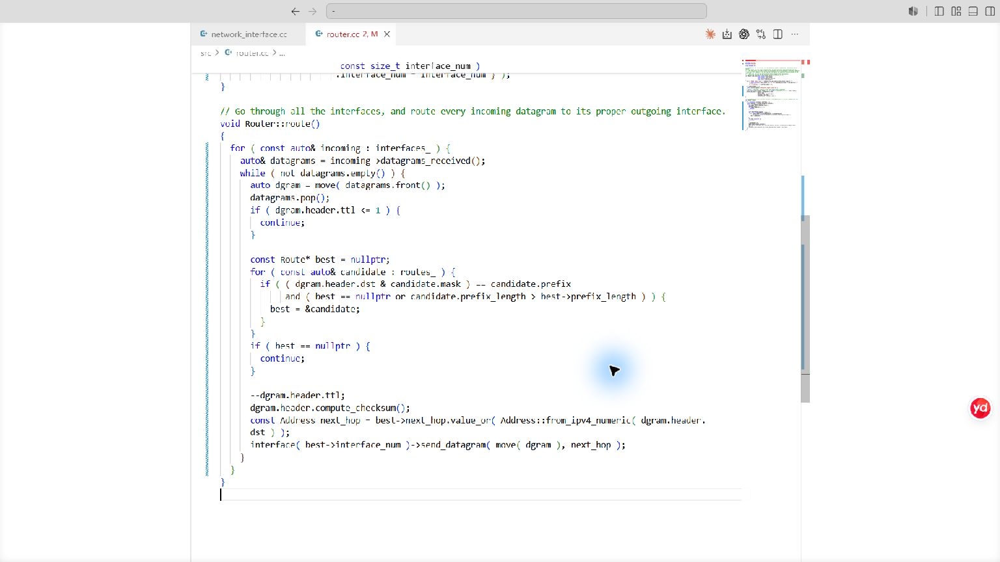

# Checkpoint 6 源码新手讲解：路由器怎样选择下一跳

完整的前后衔接见 [Point 0-7 统一源码教程](../guides/check0-7-source-code-guide.md#ipv4-router)，本篇保留为路由器阶段的单独讲解。

Point 5 解决“已知下一跳 IP，怎样发到它的 MAC”；
Point 6 解决“这个 IP 数据报该从哪个接口发给谁”。
本阶段主要编写 `src/router.hh` 和 `src/router.cc`。
要求依据：[官方 Checkpoint 6 指导书](https://cs144.github.io/assignments/check6.pdf)。
前置知识见 [Point 5 网络接口讲解](../check5/source-code-guide.md)，
配置和操作见[持续更新的新手指南](../guides/beginner-guide.md)。

## 1 路由器与网络接口怎样配合

```text
入口 NetworkInterface 收到以太网帧
    ↓ 过滤 MAC、解析 IPv4
入口的 datagrams_received 队列
    ↓ Router::route 读取
检查 TTL → 按目的 IP 查路由表 → 选择出口与下一跳
    ↓ TTL 减一、重算 IP 首部校验和
出口 NetworkInterface::send_datagram
    ↓ 复用 Point 5 的 ARP 与封装逻辑
发出以太网帧
```

路由器只需要理解 IP 数据报，不分析 TCP 字节或重新编写 ARP。
本次仍是内存模拟网络验证，代码不会把你的 Windows 电脑配置成真实路由器。

## 2 先认识一条路由

一条记录类似 `192.168.10.0/24 → 接口 2，直连`。

| 字段 | 含义 |
|---|---|
| `route_prefix` | 用来比较的 IPv4 地址高位 |
| `prefix_length` | 比较多少个最高位，合法范围 0–32 |
| `next_hop` | 可选网关；为空表示目的网络直连 |
| `interface_num` | 从哪个 NetworkInterface 发出 |

IPv4 共 32 位。`/24` 比较前 24 位，前面三个字节相同就属于该网络。
例如 `192.168.10.7` 匹配 `192.168.10.0/24`，但 `192.168.11.7` 不匹配。
`/32` 比较全部 32 位，针对一个地址；`/0` 不比较任何位，可以作为默认路由。

`optional<Address>` 表示“可能装着一个地址”：
有值时下一跳是该网关 IP；没有值时下一跳就是数据报最终目的 IP。
空值不会表示丢弃，也不会自动选择 Windows 的系统网关。

## 3 最长前缀匹配：多条都能用，选范围最小的

下面是教学用路由表，接口编号和地址不代表本机真实配置。

| 目的网络 | 下一跳 | 出口 |
|---|---|---|
| `0.0.0.0/0` | 网关 A | 0 |
| `10.0.0.0/8` | 网关 B | 1 |
| `10.1.0.0/16` | 网关 C | 2 |
| `10.1.2.0/24` | 直连 | 3 |
| `10.1.2.9/32` | 网关 D | 4 |

`10.1.2.9` 同时匹配五条，但 `/32` 最具体，所以走接口 4 的网关 D。
`10.1.2.8` 最长匹配 `/24`，走接口 3，直接寻找目的主机 MAC。
`10.1.7.8` 选 `/16`，`10.9.7.8` 选 `/8`，`8.8.8.8` 选 `/0`。
路由表不必按前缀长度排序，算法会扫描全部记录。

这个实验实现“执行已经给好的路由表”，不实现 OSPF、BGP 等生成路由表的协议。

## 4 router.hh 保存了什么

官方框架原有 `interfaces_`，保存多个网络接口的共享指针。
`add_interface` 加入接口并返回其编号，`interface(N)` 按编号取接口。
这些公共接口保持原样；`interface(N)` 内部用 `at`，错误编号会抛异常。

我们增加 `Route` 结构体，保存规范化前缀、掩码、长度、可选下一跳、接口编号，
再用 `vector<Route> routes_` 保存全部记录。
`vector` 可以理解为可增长的数组；这里追加和顺序遍历都很直接。

使用线性表是因为本阶段路由规模较小，容易验证选路规则。
有 R 条记录时，每个数据报查询 O(R)，存储为 O(R)；
若 D 个数据报分布于 I 个接口，一次 `route` 的选路工作为 O(I+D×R)。
真实大型路由器可用前缀树等结构优化，这次没有增加该复杂度。

## 5 add_route：先把规则准备好

框架原来的调试输出会打印新增规则，我们保留它。
新增部分按以下步骤执行：

1. 前缀长度大于 32 则抛 `invalid_argument`，在移位之前拒绝非法长度。
2. 计算网络掩码：前缀位为 1，主机位为 0。
3. 用 `route_prefix & mask` 清除不参与比较的主机位。
4. 把各字段追加到 `routes_`。

按位与 `&` 表示对应位都为 1，结果位才是 1。例如：

```text
前缀：192.168.10.87 = 11000000.10101000.00001010.01010111
/24 掩码           = 11111111.11111111.11111111.00000000
按位与以后         = 11000000.10101000.00001010.00000000
规范化为：192.168.10.0
```

因此即使调用者给 `128.30.76.255/16`，实际比较的是 `128.30.0.0/16`。
非前缀部分不是必须为零的输入前提。

代码中 `0xffffffff` 是全 1 的 32 位值，向左移动 `32-prefix_length` 位生成掩码。
`/0` 特别处理成零，因为 C++ 将 32 位数移动 32 位会产生未定义行为。
`/32` 则移动 0 位，保留全部 1。

```cpp
const uint32_t mask = prefix_length == 0 ? 0 : uint32_t { 0xffffffff } << ( 32 - prefix_length );
```

这里的 `? :` 只求值选中的分支，因此 `/0` 不会执行危险移位。
加入时预先计算掩码，之后每个数据报不用重新生成它。
调用者仍应提供已加入的有效出口编号；我们没有重新定义这个框架约定。



## 6 route 第一步：遍历并取出所有待处理数据报

外层 `for` 遍历 `interfaces_`，内层 `while` 处理该接口当前的接收队列。

```cpp
auto dgram = move( datagrams.front() );
datagrams.pop();
```

先移动出队头，再把队头删除。局部变量拥有数据报，后续逻辑无需引用已弹出的元素。
这样无论发送还是丢弃，队列都会前进，不会被一个坏数据报卡住。
多个接口的输入都要处理，不只是接口 0；重复调用空队列不会重复发送。
入口和出口也允许是同一个接口，本阶段不强制二者不同。

## 7 TTL：为什么数据不能无限兜圈

IP 数据报可能因错误路由反复转发，TTL 用来限制这种情况。
本实验将它按剩余跳数处理，每次成功转发减一。

| 收到时 TTL | 行为 |
|---|---|
| 0 | 直接丢弃 |
| 1 | 再转发会变成 0，直接丢弃 |
| 2 | 可转发，发出去的值是 1 |
| 64 | 可转发，发出去的值是 63 |

代码先检查 `ttl <= 1` 再递减，避免 0 在无符号算术中减成 255。
`continue` 表示丢弃当前数据报，继续内层循环处理下一份。

## 8 route 第二步：逐条找最长匹配

`const Route* best = nullptr` 表示暂时没有候选。
这是指向路由表记录的只读指针，无需复制整个规则。

每条规则需要满足：

```cpp
( dgram.header.dst & candidate.mask ) == candidate.prefix
```

目的 IP 用同样掩码清除主机位后，必须等于存好的前缀。
命中并且“之前没候选”或“这条前缀更长”时，就把 `best` 指向当前记录。
`or` 和 `and` 是 C++ 的 `||`、`&&` 的另一种写法，也会短路求值：
指针为空时不会继续读取 `best->prefix_length`。

扫描结束仍为 `nullptr` 就丢弃。有默认 `/0` 时，合法目的地址总能匹配它；
空路由表或没有相关规则又没有默认路由时，不会凭空选择一个出口。

同长度的匹配不会替换已有候选，所以保留先加入的那条。
这是本实现的确定性选择，没有实现等价多路径或负载均衡。

## 9 route 第三步：更新首部，交给出口

```cpp
--dgram.header.ttl;
dgram.header.compute_checksum();
const Address next_hop = best->next_hop.value_or( Address::from_ipv4_numeric( dgram.header.dst ) );
interface( best->interface_num )->send_datagram( move( dgram ), next_hop );
```

TTL 是 IPv4 首部的一部分，改变后必须重新计算首部校验和。
框架的序列化函数不会自动修复校验和，我们显式调用 `compute_checksum`。
该校验和针对 IP 首部，不等于重新计算 TCP 校验和。

`value_or` 表示有指定网关就用网关，否则用目的地址。
`Address::from_ipv4_numeric` 将整数形式 IPv4 转成网络接口需要的 `Address` 对象。

随后 Point 5 网络接口可能立即发 IPv4，也可能先发 ARP 并暂存数据报。
等待 ARP 时 TTL 不会随着秒数继续减少，缓存学习后也不会再减少一次。
路由器的这次转发只将 TTL 减一次。

源 IP、最终目的 IP、载荷保持原样；外层目的 MAC 可能是网关 MAC。
这没有实现 NAT，不把原始源 IP 换成路由器 IP。



## 10 一个跨网络的完整推演

本例用于教学，不是新采集的真实网络数据。

1. A 发来一份目的 `8.8.8.8`、TTL=64 的数据报，入口接口解析后入接收队列。
2. `route()` 取出它，发现 TTL 大于 1。
3. 最长匹配找到默认路由：接口 0，经网关 `192.168.1.1`。
4. TTL 变为 63，首部校验和重算，目的 IP 仍为 `8.8.8.8`。
5. 出口调用 Point 5；若未知网关 MAC，先广播询问 `192.168.1.1`。
6. 网关应答后，出口帧的目的 MAC 是网关 MAC，内部目的 IP 仍是 `8.8.8.8`。

直连规则则把第 5 步改为询问最终目的主机本身的 MAC。

## 11 实际测试了什么

| 检查 | 结果 | 说明 |
|---|---|---|
| 官方 check6 | 4/4 任务通过 | 构建检查、网络接口、路由模拟网络、禁止跳过 |
| check3 回归 | 37/37 | 早期 TCP 模块和相关性能任务 |
| check0 回归 | 11/11 | HTTP、字节流等 |
| 独立 ASan/UBSan | 5/5 场景 | 下列边界与交互验证 |
| clang-tidy、clang-format | 通过 | 项目静态检查、本阶段两份源码格式 |

补充检查包括：

- 全部 33 种长度 `/0` 到 `/32`，含主机位非零前缀及翻转前缀边界位的反例。
- 固定随机种子，128 条路由、512 个目的地址；用 64 位除法比较高位的独立算法作对照，
  不照抄实现中的按位掩码公式。
- TTL 0/1/2、空表、没有匹配路由、三个入口的队列排空及重复调用不重发。
- 直连查询目的主机、经网关查询网关；收到 ARP 后能发出校验和正确的数据报。
- 非法 `/33` 在移位前被拒绝。

补充脚本第一次运行暴露的是测试注入方法问题：序列化的载荷可以是借用引用，
框架解析器要求输入拥有缓冲区。脚本改为像官方测试一样先 `clone(frame)` 再注入，
重跑通过；生产代码无需因此修改。

官方测试与 startercode 对照保持原样。CTest 的 4 是任务数，
路由和网络接口任务内部包含多个场景，不能理解为只有四个网络用例。
静态日志中的系统头文件警告计数被过滤，项目源文件无最终诊断，命令退出成功。

在 Ubuntu 仓库根目录复现：

```bash
cmake -S . -B build/wsl
CMAKE_BUILD_PARALLEL_LEVEL=4 cmake --build build/wsl --target check6
CMAKE_BUILD_PARALLEL_LEVEL=4 cmake --build build/wsl --target check3
CMAKE_BUILD_PARALLEL_LEVEL=4 cmake --build build/wsl --target check0
python3 tools/check6/boundary-validation.py
CMAKE_BUILD_PARALLEL_LEVEL=4 cmake --build build/wsl --target tidy
clang-format --dry-run --Werror src/router.hh src/router.cc
```

补充脚本需要先构建生成 `build/wsl/util/libutil_sanitized.a`。
check6 已包含 Point 5 网络接口检查，不必为同样输入重复跑 check5；
它没有覆盖先前 TCP 模块，故另跑 check3 和 check0。
官方 PDF 第 4 节的测试命令仍写 check5，但本分支 CMake 注册及 PDF 提交节明确是 check6；
本项目使用实际包含 router 的 check6 目标。

完整记录见[验证摘要](logs/validation.txt)。
测试基于内存网络，没有实网路由、抓包或吞吐测量；丢弃时不额外生成 ICMP 错误，
这符合本阶段要求。

## 12 读完后自测

1. `/24` 和 `/16` 都匹配时选谁？如果 `/24` 比 `/16` 早加入会有区别吗？
2. 下一跳为空时，是丢弃还是直连？
3. TTL=0 为什么不能先减一再判断是否为零？
4. TTL 改了，为什么仍要主动重算 IP 校验和？
5. 路由器要不要亲自决定广播 ARP？

答案：选 `/24`，加入顺序不影响不同长度之间的选择；直连；无符号下溢会变成 255；
序列化不会替我们重算首部校验和；不需要，出口网络接口负责地址解析。

## 13 本阶段两份完整源码

快照取自本阶段实际通过验证的代码。后续改动应结合提交版本阅读。
代码、验证与文档由 Codex 按用户要求辅助完成。

<details>
<summary>src/router.hh 完整源码</summary>

```cpp
#pragma once

#include "exception.hh"
#include "network_interface.hh"

#include <optional>
#include <vector>

// \brief A router that has multiple network interfaces and
// performs longest-prefix-match routing between them.
class Router
{
public:
  // Add an interface to the router
  // \param[in] interface an already-constructed network interface
  // \returns The index of the interface after it has been added to the router
  size_t add_interface( std::shared_ptr<NetworkInterface> interface )
  {
    interfaces_.push_back( notnull( "add_interface", std::move( interface ) ) );
    return interfaces_.size() - 1;
  }

  // Access an interface by index
  std::shared_ptr<NetworkInterface> interface( const size_t N ) { return interfaces_.at( N ); }

  // Add a route (a forwarding rule)
  void add_route( uint32_t route_prefix,
                  uint8_t prefix_length,
                  std::optional<Address> next_hop,
                  size_t interface_num );

  // Route packets between the interfaces
  void route();

private:
  struct Route
  {
    uint32_t prefix;
    uint32_t mask;
    uint8_t prefix_length;
    std::optional<Address> next_hop;
    size_t interface_num;
  };

  std::vector<Route> routes_ {};

  // The router's collection of network interfaces
  std::vector<std::shared_ptr<NetworkInterface>> interfaces_ {};
};
```

</details>

<details>
<summary>src/router.cc 完整源码</summary>

```cpp
#include "router.hh"

#include <iostream>
#include <stdexcept>

using namespace std;

// route_prefix: The "up-to-32-bit" IPv4 address prefix to match the datagram's destination address against
// prefix_length: For this route to be applicable, how many high-order (most-significant) bits of
//    the route_prefix will need to match the corresponding bits of the datagram's destination address?
// next_hop: The IP address of the next hop. Will be empty if the network is directly attached to the router (in
//    which case, the next hop address should be the datagram's final destination).
// interface_num: The index of the interface to send the datagram out on.
void Router::add_route( const uint32_t route_prefix,
                        const uint8_t prefix_length,
                        const optional<Address> next_hop,
                        const size_t interface_num )
{
  cerr << "DEBUG: adding route " << Address::from_ipv4_numeric( route_prefix ).ip() << "/"
       << static_cast<int>( prefix_length ) << " => " << ( next_hop.has_value() ? next_hop->ip() : "(direct)" )
       << " on interface " << interface_num << "\n";

  if ( prefix_length > 32 ) {
    throw invalid_argument( "IPv4 prefix length exceeds 32" );
  }
  // Handle /0 separately: shifting a 32-bit value by 32 would be undefined.
  const uint32_t mask = prefix_length == 0 ? 0 : uint32_t { 0xffffffff } << ( 32 - prefix_length );
  routes_.push_back( { .prefix = route_prefix & mask,
                       .mask = mask,
                       .prefix_length = prefix_length,
                       .next_hop = next_hop,
                       .interface_num = interface_num } );
}

// Go through all the interfaces, and route every incoming datagram to its proper outgoing interface.
void Router::route()
{
  for ( const auto& incoming : interfaces_ ) {
    auto& datagrams = incoming->datagrams_received();
    while ( not datagrams.empty() ) {
      auto dgram = move( datagrams.front() );
      datagrams.pop();
      if ( dgram.header.ttl <= 1 ) {
        continue;
      }

      const Route* best = nullptr;
      for ( const auto& candidate : routes_ ) {
        if ( ( dgram.header.dst & candidate.mask ) == candidate.prefix
             and ( best == nullptr or candidate.prefix_length > best->prefix_length ) ) {
          best = &candidate;
        }
      }
      if ( best == nullptr ) {
        continue;
      }

      --dgram.header.ttl;
      dgram.header.compute_checksum();
      const Address next_hop = best->next_hop.value_or( Address::from_ipv4_numeric( dgram.header.dst ) );
      interface( best->interface_num )->send_datagram( move( dgram ), next_hop );
    }
  }
}
```

</details>
