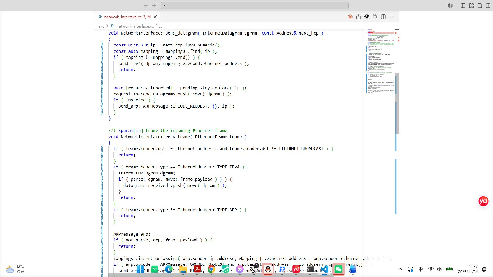
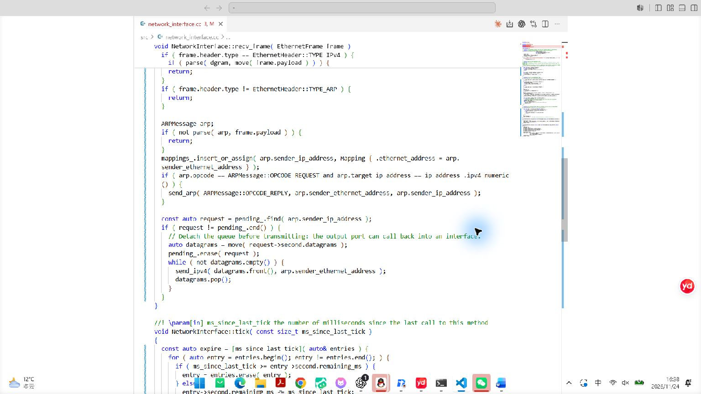
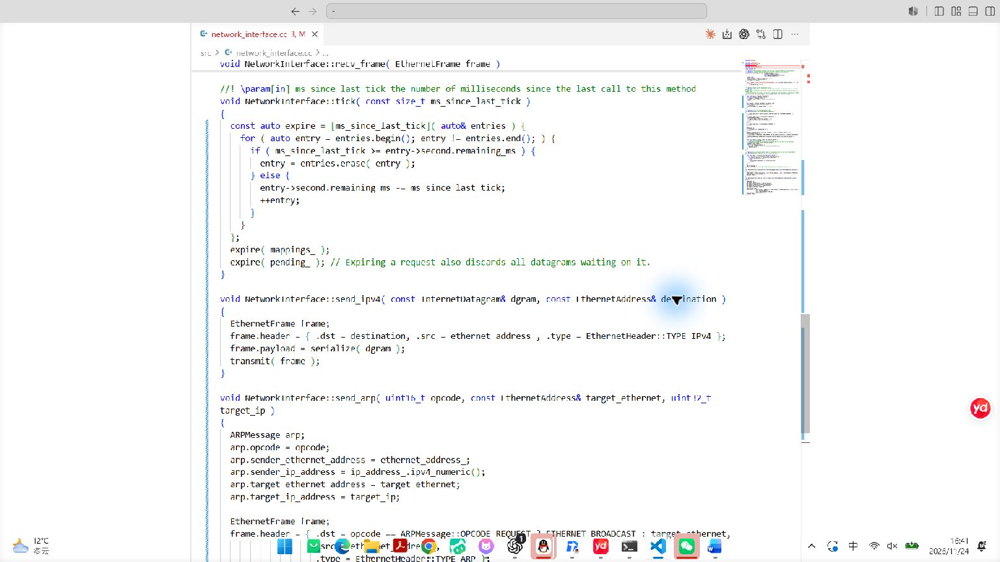
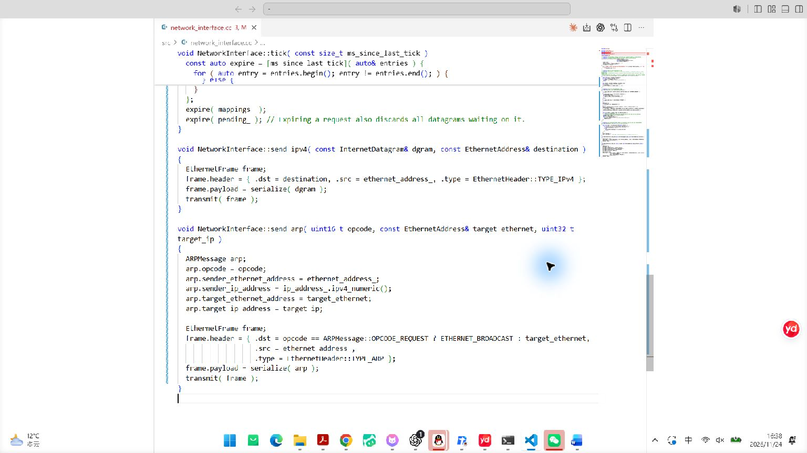
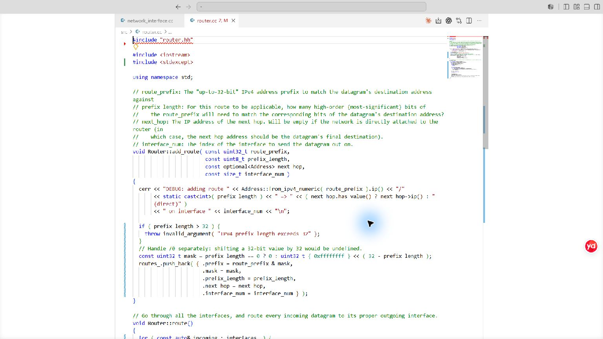
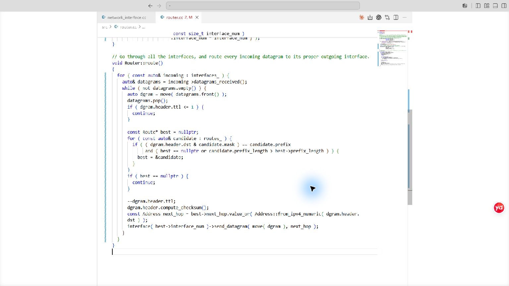

# Checkpoint 0 到 7 源码新手逐步讲解

这是一份从字节流一直读到三机聊天室的源码教程，面向计算机网络新手。
每一阶段先解释要解决的问题，再说明变量与函数怎样配合，最后用手算、测试和完整源码核对理解。

[环境配置与操作指南](beginner-guide.md)讲怎样安装、编译和运行；本篇讲每个文件在做什么、为什么这样写。
原来的 Point 0-4 教程已扩展为本篇，Point 5-7 的完整讲解也在同一份文件中；各实验的分篇仍保留供单独查阅。

版本说明：第 1-14 章及附录 A 沿用 `ce81ee4` 的 Point 0-4 讲解与历史源码；正文中的项目目录已按当前布局更新。
第 15-18 章衔接 Point 5-7，新增附录 B-D 的源码取自 `6f61fad`，包含 Point 7 整合时给 Route 字段增加的默认初始化。
历史源码快照里的旧路径、当时版本与现在的目录不同，运行命令应以正文和实际工具文件为准；对照见[目录说明](../directory-layout.md)。
本文中的手算是学习推演，不是新增的实测结果。讲解与实现由 Codex 按用户要求辅助完成。

建议分四遍阅读：先读第 1-9 章理解字节流和 TCP；再读第 10-14 章理解测量、测试与框架；
然后读第 15-17 章理解 ARP、路由和全栈应用；最后用第 18 章把所有模块连起来。
附录 A-D 是按需展开的完整源码，第一遍不用逐行背诵。

| 阅读部分 | 对应阶段 | 要弄懂的问题 |
|---|---|---|
| 第 1-2 章 | 总览与 C++ 入门 | 各模块怎样配合，常见 C++ 写法怎样读 |
| 第 3-4 章 | Point 0 | 应用怎样取网页，字节怎样进入和离开缓冲区 |
| 第 5 章 | Point 1 | 乱序与重复数据怎样变成连续字节 |
| 第 6-7 章 | Point 2 | 序号怎样换算，接收端怎样给出 ACK 与窗口 |
| 第 8-9 章 | Point 3 | 发送、确认、重传怎样配合 |
| 第 10-14 章 | Point 4 及验证 | ping 数据怎样采集和统计，框架与自己的实现怎样区分 |
| 第 15 章 | Point 5 | 下一跳 IP 怎样变成以太网目的 MAC |
| 第 16 章 | Point 6 | 路由器怎样选出口、下一跳并处理 TTL |
| 第 17 章 | Point 7 | 自己的 TCP 怎样支撑聊天与文件校验 |
| 第 18 章 | Point 0-7 串联 | 一条消息怎样穿过三个真实电脑，怎样判断它成功了 |

快速跳转：[整体关系](#overview) · [HTTP 客户端](#webget) · [字节流](#byte-stream) ·
[乱序重组](#reassembler) · [序号换算](#wrap32) · [接收端](#receiver) ·
[发送端](#sender) · [TCP 收发推演](#end-to-end) · [测量脚本](#measurement) ·
[网络接口与 ARP](#network-interface) · [IPv4 路由器](#ipv4-router) · [全栈与聊天室](#full-stack) ·
[三机消息推演](#full-stack-walkthrough) · [完整源码附录](#source-snapshots)

<a id="overview"></a>

## 1 先把整个项目放进脑子里

先分清四条路径：网页客户端和测量工具使用系统网络；自己的 TCP 部件通过 Point 5-7 组成独立的实验网络。

```text
路径 A：Checkpoint 0 的网页客户端
webget → 框架提供的 TCPSocket → Linux 内核 TCP → 网页服务器

路径 B：Checkpoint 0–3 逐步实现自己的 TCP 部件
应用待发送的字节
    ↓
发送侧 ByteStream → TCPSender → 消息/框架发送回调
                                      ↓
                           网络，或测试中的消息传递
                                      ↓
应用读取的字节 ← 接收侧 ByteStream ← Reassembler ← TCPReceiver
                                                      ↓
                                            ACK 与窗口反馈给发送端

路径 C：Checkpoint 4 的测量工具
Linux ping → 原始日志 → Python 统计 → CSV/JSON → 图表 → 中文报告

路径 D：Checkpoint 5–7 把自己的协议模块连起来
chat.py → tcp_eth_udp → 自己的 TCP → IPv4 → NetworkInterface/ARP
  → Ethernet 帧装进真实 UDP → fun_router/Router 转发 → 对端协议栈 → chat.py
```

路径 B 的发送侧和接收侧各有自己的 ByteStream，不是共享同一个缓冲区。
在 Point 0-3 时，路径 B 主要通过自动测试和内存消息传递验证；Point 7 已把它扩展为路径 D，完成独立进程与真实三机传输。
这里的真实三机使用同一份实验栈部署，Ethernet 帧通过系统 UDP 运送；它没有验证与外部操作系统 TCP 端点的互操作。
路径 C 调用操作系统提供的 ping，不会调用我们写的 TCPSender。

### 1.1 本文覆盖的代码文件

| 阶段 | 我们写或修改的文件 | 作用 |
|---|---|---|
| 0 | [apps/webget.cc](../../apps/webget.cc) | 填写 HTTP 获取函数 |
| 0 | [src/byte_stream.hh](../../src/byte_stream.hh)、[src/byte_stream.cc](../../src/byte_stream.cc) | 定义字节流状态并实现读写接口 |
| 1 | [src/reassembler.hh](../../src/reassembler.hh)、[src/reassembler.cc](../../src/reassembler.cc) | 暂存乱序数据、去重、交付连续字节 |
| 2 | [src/wrapping_integers.cc](../../src/wrapping_integers.cc) | 32 位和 64 位序号换算 |
| 2 | [src/tcp_receiver.hh](../../src/tcp_receiver.hh)、[src/tcp_receiver.cc](../../src/tcp_receiver.cc) | 接收 TCP 消息，生成 ACK、窗口与错误标志 |
| 3 | [src/tcp_sender.hh](../../src/tcp_sender.hh)、[src/tcp_sender.cc](../../src/tcp_sender.cc) | 按窗口发送，保存未确认消息并重传 |
| 4 | [collect.py](../../tools/check4/collect.py)、[status.py](../../tools/check4/status.py)、[burst.py](../../tools/check4/burst.py) | 长时采集、查看进度、短时速率试验 |
| 4 | [metrics.py](../../tools/check4/metrics.py)、[analyze.py](../../tools/check4/analyze.py)、[build_report.py](../../tools/check4/build_report.py) | 解析、统计、画图和生成报告 |
| 4 | [test_metrics.py](../../tools/check4/test_metrics.py)、[test_lifecycle.py](../../tools/check4/test_lifecycle.py) | 验证统计边界和进程中断 |
| 5 | [src/network_interface.hh](../../src/network_interface.hh)、[src/network_interface.cc](../../src/network_interface.cc) | ARP、缓存、待发队列和以太网封装 |
| 6 | [src/router.hh](../../src/router.hh)、[src/router.cc](../../src/router.cc) | 路由表、最长前缀匹配、TTL 和转发 |
| 7 | [tcp_eth_udp.cc](../../apps/tcp_eth_udp.cc)、[fun_router.cc](../../apps/fun_router.cc) | 合入官方全栈应用，串起之前实现的协议模块 |
| 7 | [chat.py](../../tools/check7/chat.py)、[lab.py](../../tools/check7/lab.py)、[udp_probe.py](../../tools/check7/udp_probe.py)、[udp-bridge.ps1](../../tools/check7/udp-bridge.ps1) | 应用协议、实验编排、连通预检与 Windows UDP 转发 |
| 7 整合修正 | [util/address.cc](../../util/address.cc)、[src/router.hh](../../src/router.hh)、[apps/fun_router.cc](../../apps/fun_router.cc) | 空地址拷贝、字段默认初始化和编译兼容性 |
| 补充验证 | [boundary-validation.py](../../tools/check2/boundary-validation.py)、[scenario-validation.py](../../tools/check3/scenario-validation.py) | 测试极大序号和收发端配合 |

`.hh` 主要声明“有哪些状态和操作”，`.cc` 主要定义“这些操作具体怎么做”。
官方测试、socket 封装、报文结构和构建脚手架中也有大量源码，很多是合入框架时得到的，
不代表都是我们编写的。第 12 节专门说明这些边界。

## 2 读 C++ 前先认识这些写法

| 写法 | 新手可以先这样理解 |
|---|---|
| `uint64_t` | 64 位无符号整数，适合累计字节数和内部序号 |
| `uint32_t` | 32 位无符号整数，TCP 线上序号使用这个宽度 |
| `uint16_t` | 16 位无符号整数，窗口字段最大为 65535 |
| `Class::method()` | 这是某个类的方法定义 |
| `const` | 这里不允许通过这个访问方式修改对象 |
| `auto& x = ...` | 给已有对象取引用，不复制整个对象 |
| `std::move(x)` | 允许接收方转移 x 的资源，常用于减少字符串复制 |
| `std::deque` | 可方便地在尾部加入、头部移除的队列容器 |
| `std::map` | 按键排序的映射，本项目用起始索引作为键 |
| `std::optional<T>` | 可能有一个 T，也可能还没有值 |
| `std::string_view` | 查看已有字符串的片段，不拥有那份字符存储 |
| `condition ? a : b` | 条件为真取 a，否则取 b |
| `and`、`or`、`not` | 分别对应 `&&`、`||`、`!` |
| `return {}` | 返回该返回类型的空值或默认值，不是固定返回数字零 |
| `[checkpoint](../...) { ... }` | 一个小函数，也叫 lambda，能使用捕获的 checkpoint |

`move` 不意味着以后还能继续把原对象当作原字符串使用；
`string_view` 也不能在底层字符串移除、销毁或改变后一直保留着读。
这些规则在我们减少复制时很重要。

文中区间统一用 `[a,b)`：包含 a，不包含 b。例如 `[2,5)` 代表索引 2、3、4。
这样区间长度直接等于 `b-a`，很适合表示字符串片段。

<a id="webget"></a>

## 3 Checkpoint 0 的 webget

### 3.1 我们具体改了哪里

文件中的参数检查、异常捕获和 `main()` 框架已经提供。
我们主要填写 `get_URL(host, path)`，让它真正连接服务器、发送请求和输出响应。

```cpp
TCPSocket socket;
socket.connect( Address { host, "http" } );
socket.write_all( "GET " + path + " HTTP/1.1\r\nHost: " + host
                  + "\r\nConnection: close\r\n\r\n" );
```

第一行创建框架封装的 TCP socket。第二行将主机名和服务名交给框架解析并连接。
第三行发送 HTTP 文本，`write_all` 负责把这份文本完整写出去。
这三行用的是操作系统 TCP，还没用到我们后来实现的 TCPSender。

### 3.2 为什么请求里有那么多 `\r\n`

以主机 `cs144.keithw.org`、路径 `/hello` 为例，发送的字节对应：

```http
GET /hello HTTP/1.1
Host: cs144.keithw.org
Connection: close

```

代码实际使用 CRLF，也就是 `\r\n`，作为每一行的结束。
最后的 `\r\n\r\n` 表示首部结束，其中有一个空行。
`Connection: close` 请求服务端在响应结束后关闭连接，便于客户端通过 EOF 判断读完。

### 3.3 为什么读取必须用循环

```cpp
string response;
while ( not socket.eof() ) {
  socket.read( response );
  cout << response;
}
socket.close();
```

一次 `read` 不保证返回完整网页，可能只拿到一部分响应，所以要继续读到 EOF。
这里的 `response` 是当前一次读到的内容，读到后立刻输出；程序不负责解析 HTML，
也没有把所有响应事先拼成一个大字符串。

`main()` 从命令行拿到 host 和 path 后调用这个函数；异常会交给已有的 `catch`，
打印错误并返回失败状态。理解这个流程就能看懂整个小客户端。

<a id="byte-stream"></a>

## 4 Checkpoint 0 的 ByteStream

### 4.1 它解决的不是网络问题，而是内存中的排队问题

写入方把字节放进去，读取方按原顺序拿出来。缓冲区容量有限，满了只能等读取方腾空间。
它不负责丢包重传，也不知道 TCP 报文是什么。

框架把同一个 ByteStream 的写入操作暴露为 Writer，读取操作暴露为 Reader。
`reader()`、`writer()` 的访问机制由官方辅助文件提供；我们把新增状态放在 ByteStream 基类，
没有给 Reader、Writer 分别放一份互不相干的缓冲区。

### 4.2 头文件里的每个变量

| 变量 | 含义 |
|---|---|
| `capacity_` | 最多允许多少个未读字节 |
| `buffer_` | 分块存放字符串的 deque |
| `front_offset_` | 队头字符串已经消费到哪个偏移 |
| `bytes_pushed_` | 从创建到现在总共成功写入多少字节 |
| `bytes_popped_` | 从创建到现在总共消费多少字节 |
| `closed_` | 写入方是否声明以后不再写入 |
| `error_` | 框架已有的错误状态 |

两个累计计数不会因为缓冲区读空而清零。它们的差才是当前未读数量：

```text
当前未读字节 = bytes_pushed_ - bytes_popped_
剩余容量     = capacity_ - 当前未读字节
```

### 4.3 构造函数和 Writer 的四类操作

构造函数只把用户传入的容量记到 `capacity_`；成员的 `{}` 初始化让计数和状态从零开始。

`Writer::push(data)` 按下面顺序做：

1. 已关闭就直接返回，不再接受新数据。
2. 用 `min(data.size(), available_capacity())` 计算实际能接收多少。
3. 能接收零字节就结束；只能接收前半段时，用 `substr` 留下允许部分。
4. 把字符串移动到队尾，累计写入量增加实际接收长度。

```cpp
const uint64_t length = min<uint64_t>( data.size(), available_capacity() );
buffer_.push_back( move( data ) );
bytes_pushed_ += length;
```

这段是关键逻辑摘录；完整函数还有前面说的关闭、空数据和截断判断。
**当前接口的 push 返回 void，不返回实际写入量。** 想判断接收了多少，
可以比较调用前后的 `bytes_pushed()`。

`close()` 将 `closed_` 设为 true；`is_closed()` 查询这个标志。
`available_capacity()` 使用前面的公式；`bytes_pushed()` 返回累计写入数。
`close()` 不会把已经缓存的数据删除。

### 4.4 Reader 的每个操作

`peek()`：队列为空返回空视图，否则返回队头字符串从 `front_offset_` 开始的视图。
它可能只展示第一块，而不是整个缓冲区；查看本身不会消费字节。

`pop(len)`：先把 len 限制到现有未读量以内，然后循环消费队头。
每一轮消费“不超过这块剩余字节数”的数量，同时更新偏移、累计消费量和剩余 len。
一块全部读完才 `pop_front()`，并将偏移归零。

这样不需要每读一个字节就把后面所有字符向前搬。

`bytes_buffered()` 返回写入减消费；`bytes_popped()` 返回累计消费数。
`is_finished()` 只有在“写端已关闭，而且缓存读空”时才为真。
空缓存和流结束不是一回事：写端还开着时，后面仍可能继续来数据。

### 4.5 手算一次

容量设为 5：

| 操作 | 实际未读内容 | pushed | popped | 未读量 | 可用容量 |
|---|---|---:|---:|---:|---:|
| 初始 | 空 | 0 | 0 | 0 | 5 |
| push("ABCD") | ABCD | 4 | 0 | 4 | 1 |
| pop(2) | CD | 4 | 2 | 2 | 3 |
| push("EFGH") | CDEFG | 7 | 2 | 5 | 0 |
| close() | CDEFG | 7 | 2 | 5 | 0 |
| pop(5) | 空 | 7 | 7 | 0 | 5 |

最后一次 pop 之后才 `is_finished()==true`。
在第二次写入后，底层可以是两块字符串，peek 首次只给你 CD，随后才能看到 EFG。

这里的容量约束是逻辑上的未读字节数，不是进程全部内存占用的精确上限。
容器元数据、字符串分配和尚未退役的队头前缀也会占用实际内存。

<a id="reassembler"></a>

## 5 Checkpoint 1 的 Reassembler

### 5.1 为什么有字节流了还要重组器

ByteStream 只接受顺序到来的数据。网络却可能先给你 DEF，再给你 ABC，
还可能把 CD 发两遍。Reassembler 根据数据携带的索引整理它们，
只把从当前位置开始已经连续的数据写入 ByteStream。

我们增加两个状态：

```cpp
std::map<uint64_t, std::string> pending_ {};
std::optional<uint64_t> end_index_ {};
```

`pending_[3]="DEF"` 表示缓存 `[3,6)` 的数据。
map 按起点排序，方便找到最前面的区间。
`end_index_` 记录整条流结束位置；没有值时表示还不知道 EOF 在哪里。
`optional` 很重要：结束位置可能就是 0，不能拿数字 0 同时表示“不知道”。

### 5.2 insert 的三个参数

```cpp
insert(first_index, data, is_last_substring)
```

例如 `insert(3,"DEF",true)` 的意思是：这串数据从流索引 3 开始，
而且整条流到索引 6 之前结束。它不意味着 ABC 已经收到。

### 5.3 第一步：记录 EOF，处理已经关闭的输出

如果输出已经关闭，直接忽略新的插入。
遇到最后一段，就尝试记录 `first_index + data.size()` 为结束位置。
加法前先检查不会超过 uint64_t 的最大值，避免本应很大的位置回绕成小数字。

记录 EOF 和交付数据是两件事：即使知道最后一个字节在哪里，前面的空洞仍要等。

### 5.4 第二步：算出允许接收的区间

```cpp
const uint64_t next_index = output.bytes_pushed();
```

这里的 next_index 是“下一字节应该写到流的哪个索引”，不是应用已经读到哪里。
可以接收的右边界由 next_index 与输出剩余容量决定，加法也做了溢出保护。
然后对输入做三个裁剪：

- 左边已经交付过的字节不要再次存。
- 右边超出当前接收窗口的字节暂时不要，等待后续重传。
- 已知 EOF 之后的字节不要存。

例如容量 5，累计写入 4，应用读走 2，则输出还缓存 2 字节，剩余容量 3。
重组器此时允许的索引窗口是 `[4,7)`，不是从 0 开始再收任意 5 字节。
输出缓存和乱序数据共享这个容量约束。

### 5.5 第三步：只保存原来没见过的字节

`lower_bound(first)` 找到第一个起点不小于 first 的已有区间。
如果前一个区间跨过了 first，就先把 cursor 推进到前一个区间末尾。
然后向右扫描，遇到空洞才保存输入中对应的片段；已有的字节直接跨过。

假设已有 `[2,4)="CD"`，新收到 `[1,5)="BCDE"`：

```text
原来：     C D
新来：   B C D E
新存：   B     E
```

CD 已有一份，不再存第二份。这份实现保证区间互不重叠，
**没有强制把相邻区间合成一个大字符串**；邻接的小块可在交付时连续处理。
整段都能直接保存时，代码用 move 转移字符串；只有需要裁剪时才构造子串。

### 5.6 第四步：把连续区间立刻交付

```cpp
while ( not pending_.empty()
        and pending_.begin()->first == output.bytes_pushed() ) {
  output.push( move( pending_.begin()->second ) );
  pending_.erase( pending_.begin() );
}
```

队头起点恰好等于下一期待索引，说明前面没有缺口，就能交付。
每写入一块，bytes_pushed 会前进，再检查下一块是否也接上了。
遇到空洞就停，不能跳过空洞把后面的字节塞进顺序流。

已知 EOF 且累计写入量恰好到达 end_index 时，调用 close。
`count_bytes_pending()` 则遍历 map，把暂存字符串长度相加。
它不包括已经交付到 ByteStream 但应用还没读的字节，也没有另存一个容易失配的计数器。

### 5.7 用 ABCDEF 从头推演

容量至少为 6，先调用 `insert(3,"DEF",true)`：
输出仍为空，pending 中有 DEF，结束位置为 6，暂存量为 3。

再调用 `insert(0,"ABC",false)`：
ABC 从 0 开始，先交付 ABC；下一期待位置变为 3，DEF 也能交付。
累计写入变为 6，正好到 EOF，写端关闭。
这时 Reader 仍有 ABCDEF 可以读，不能把“输出关闭”误解成“数据已被应用读完”。

<a id="wrap32"></a>

## 6 Checkpoint 2 的 Wrap32

### 6.1 先分清三种编号

设初始序号 ISN 为 100，数据为 ABC：

| 内容 | 线上 32 位序号 | 内部绝对序号 | 数据流索引 |
|---|---:|---:|---:|
| SYN | 100 | 0 | 无 |
| A | 101 | 1 | 0 |
| B | 102 | 2 | 1 |
| C | 103 | 3 | 2 |
| FIN | 104 | 4 | 无 |

TCP 的 32 位序号像会绕圈的表盘，超过 4294967295 会回到 0。
绝对序号用于内部跟踪转了多少圈；流索引只给数据字节编号，不包含 SYN、FIN。

### 6.2 wrap：从绝对位置得到线上序号

```cpp
return zero_point + static_cast<uint32_t>( n );
```

`static_cast<uint32_t>(n)` 留下绝对位置的低 32 位，再加 ISN 偏移。
效果相当于 `(ISN+n) mod 2^32`。
例如 ISN=4294967294，n=3，线上序号为 1。
这是序号设计需要的回绕，不是程序出错。

### 6.3 unwrap：表盘相同，可能已经转了很多圈

代码先计算线上值相对 ISN 的 32 位偏移 offset。
所有可能的绝对位置都形如：

```text
offset
offset + 2^32
offset + 2×2^32
……
```

所以还需要 checkpoint，表示“答案大概在什么位置附近”。
不要把这里的 checkpoint 参数和课程的 Checkpoint 实验阶段混为一谈。

### 6.4 为什么只看附近几圈

```cpp
constexpr uint64_t modulus = uint64_t { 1 } << 32;
uint64_t candidate = ( checkpoint & ~( modulus - 1 ) ) | offset;
```

`1 << 32` 的意思是 2 的 32 次方，左边先构造成 64 位整数，避免在 32 位宽度里移位 32 位。
`modulus-1` 的低 32 位全为 1。取反、按位与，保留 checkpoint 的高位圈数；
再用按位或填入 offset，得到同一圈的候选。

接着比较这一圈及相邻圈中可表示的候选与 checkpoint 的距离。
`distance` lambda 先比较大小，再用大的减小的，避免无符号减法下溢。
减一圈前检查 candidate 至少有一圈；加一圈前检查不会超过 uint64_t 上限。
距离相同时，当前实现选较小的候选。

学习推演：ISN=100，线上序号=105，checkpoint=2^32+7。
候选是 5、2^32+5、2×2^32+5；中间那个离参考位置最近，所以答案为 2^32+5。

<a id="receiver"></a>

## 7 Checkpoint 2 的 TCPReceiver

### 7.1 它是 TCP 标志与重组器之间的翻译层

重组器只认识“索引、数据、是否结束”。接收端还要认识序号、SYN、FIN、RST。
头文件增加 `optional<Wrap32> isn_`，在第一条有效 SYN 到来前，不知道对方 ISN。

发送方消息结构是官方提供的，定义在 util 目录：

| 字段 | 含义 |
|---|---|
| seqno | 这条消息占用的起始序号 |
| SYN | 开始标志，自己占一个序号 |
| payload | 数据字节 |
| FIN | 结束标志，自己占一个序号 |
| RST | 错误/复位标志，不占序号 |

### 7.2 receive 按什么顺序处理

1. 看到 RST，给输出流设置错误并返回。
2. 流已处于错误状态，也直接返回。
3. 尚无 ISN 时，只接受带 SYN 的消息，并保存该消息的 seqno 为 ISN。
4. 用 unwrap 把 seqno 换成绝对序号，参考位置为 `writer().bytes_pushed()+1`。
5. 不带 SYN 却落在绝对序号 0 的消息忽略，因为 0 是 SYN 的位置。
6. 将绝对序号换成数据流索引，移动 payload 到重组器，FIN 作为结束标记。

关键转换是：

```cpp
const uint64_t stream_index = absolute_seqno - ( message.SYN ? 0 : 1 );
reassembler_.insert( stream_index, move( message.payload ), message.FIN );
```

普通消息的首字节要减去 SYN 占据的一个位置。
带 SYN 的消息中，seqno 指向 SYN，payload 紧接其后，所以流索引直接等于 absolute_seqno。
例如首次 SYN+ABC 的 seqno=100，绝对序号为 0，ABC 应从流索引 0 开始。

### 7.3 send 为什么叫 send，却没调用 socket

`send()` 只构造一个 TCPReceiverMessage，实际发送由框架负责。
它生成三项信息：

- window_size：输出还可以容纳多少字节，最多填 65535。
- RST：当前流是否错误。
- ackno：如果已知 ISN，就计算下一期待序号；否则保持 optional 为空。

```cpp
const uint64_t next_seqno = writer().bytes_pushed() + 1
                            + ( writer().is_closed() ? 1 : 0 );
```

这里的 1 是 SYN；关闭后再加 1，是已经连续收齐的 FIN。
最后用 wrap 把绝对位置转换回线上序号。

例如 ISN=100，只收 SYN 时 ACK=101；连续收到 AB 时 ACK=103；
收齐 ABCDEF 和 FIN 后 ACK=108。
ACK=103 表示“序号小于 103 的内容已连续收到”，不是“我收到 103 这个字节”。

窗口根据应用是否读走输出而变化。它没有简单减去 pending 的字节数：
pending 本来就受相同索引窗口约束，不能把同一空间关系再扣一次。

<a id="sender"></a>

## 8 Checkpoint 3 的 TCPSender

### 8.1 为什么发出后还得保存一份

发送端把数据从 ByteStream 读走后，那份输入缓存已经被消费。
但网络可能丢包，所以尚未确认的消息必须另存，以便超时重传。

| 状态 | 用途 |
|---|---|
| input_ | 应用交给发送端的输入字节流 |
| isn_ | 本端发送流的初始序号 |
| initial_RTO_ms_ | 初始重传等待时间 |
| outstanding_ | 按发送顺序保存未完整确认的消息 |
| next_seqno_ | 下一次新发送的绝对位置 |
| acknowledged_seqno_ | 对方累计确认到的绝对位置 |
| window_size_ | 对方通告的真实窗口，初值为 1 |
| fin_sent_ | 是否已生成 FIN，防止再生成第二个 |
| RTO_ms_ | 当前等待时间，可能已经退避翻倍 |
| elapsed_ms_ | 这一轮已经等了多少毫秒 |
| consecutive_retransmissions_ | 自上次新确认后，非零窗口下连续超时次数 |

队列中的 OutstandingMessage 保存原消息和 `end_seqno`。
end_seqno 是“消息末尾再后一个位置”，不是最后一个数据字节的序号。
一条从绝对位置 1 开始、长度 4 的消息，end_seqno 为 5；ACK 到 5 才完整覆盖它。

构造函数保存输入、ISN 与初始 RTO；队列和累计序号初始为空/零，FIN 初始未发送。

### 8.2 两个查询函数

```cpp
sequence_numbers_in_flight() = next_seqno_ - acknowledged_seqno_;
```

“在途”表示已经发送而尚未确认的序号，不表示物理上仍在某根网线里的字节。
SYN、FIN 也占序号，所以不能只数 payload。
`consecutive_retransmissions()` 直接返回当前连续重传计数。

### 8.3 make_empty_message

生成 seqno 为 `wrap(next_seqno_,isn_)` 的消息，RST 来自输入流错误状态。
默认 SYN/FIN 为 false、payload 为空，所以序号长度为 0。
它不进入未确认队列，也不推进 next_seqno_。
空消息可供框架在需要反馈但没有数据时使用。

### 8.4 push 的第一关：还剩多少窗口

```cpp
const uint64_t effective_window = max<uint64_t>( window_size_, 1 );
if ( sequence_numbers_in_flight() >= effective_window ) {
  break;
}
const uint64_t space = effective_window - sequence_numbers_in_flight();
```

例如窗口为 8，已有 5 个序号未确认，还能新发 3 个。
在途数达到或超过窗口时停下，而不是用无符号数相减得到一个巨大的“剩余空间”。

真实窗口为 0 时，仅在计算本次发送限制时按 1 处理，允许一次探测。
保存在 window_size_ 里的值仍是 0，因为计时器要按真实窗口决定是否退避。
已有一个探测在途时，不会每次调用 push 都继续发一个新字节。

### 8.5 push 的第二关：装入 SYN、数据和 FIN

```cpp
message.SYN = next_seqno_ == 0;
read(reader(), min<uint64_t>(TCPConfig::MAX_PAYLOAD_SIZE,
                            space - (message.SYN ? 1 : 0)), message.payload);
message.FIN = reader().is_finished() and message.sequence_length() < space;
```

首次发送设置 SYN，先为它扣掉一个位置，再读取数据。
`read` 是官方辅助函数：循环 peek 和 pop，取出最多指定长度的数据放进字符串。
当前框架的 MAX_PAYLOAD_SIZE 是 1000，限制的是 payload 字节数。

如果应用已关闭输入、所有待发字节都取完，而且窗口还剩一个位置，就附上 FIN。
同一条消息可以带 SYN、payload、FIN，只要总序号长度不超窗口。
初始窗口只有 1 时，通常只能先发 SYN。

### 8.6 push 的第三关：先记账，再交给发送回调

序号长度为 0 时结束，不制造无意义的新发送。
原先没有在途消息时，把经过时间清零，表示为第一条未确认消息开始计时。
随后推进 next_seqno_、记录是否发过 FIN、保存消息，最后调用 transmit。

`transmit` 是框架传来的函数，不是写死的网卡操作。
测试时它可以只是把消息放进一个 vector；接入框架后，由外层完成封装和发送。

循环持续填充窗口，直到没有空间、没有新消息可发，或者 FIN 已经生成。
fin_sent_ 阻止的是再次生成新 FIN，不妨碍重传队列中已有的 FIN。

### 8.7 receive：收到 ACK 之后改什么

先处理 RST：把输入流标记为错误，交给框架观察这个状态。
其他消息若有 ACK，就用 unwrap 换成绝对位置，参考点为 next_seqno_；
若没有 ACK，就暂用当前累计确认位置，只处理合法窗口更新。

未来 ACK 超过 next_seqno_，说明它确认了根本没发过的内容，整条消息忽略。
否则先更新 window_size_，再判断是否有新确认：

```cpp
if ( ackno <= acknowledged_seqno_ ) {
  return;
}
```

重复/旧 ACK 可以带来窗口变化，但不会重启计时器。
ACK 真正前进后，更新累计确认位置，移除 end_seqno 不大于 ACK 的完整队头消息，
恢复初始 RTO，将 elapsed 和连续重传次数清零。

### 8.8 部分确认为什么还保留整条消息

假设 SYN 已确认，发送 abcd，从绝对位置 1 开始，end_seqno=5。
收到绝对 ACK=3，说明 a、b 已确认，c、d 仍未确认。
在途数现在是 `5-3=2`，但我们仍保存原来的整条 abcd 用于重传。
接收端和重组器会忽略已交付的重复字节。

本实现没有把报文裁成只剩 cd，也没有错误地把整条报文删掉。
这是当前框架允许的做法，要按实际源码理解，不要自行把它读成“收到任意 ACK 就出队”。

### 8.9 tick：时间到了怎么办

框架告诉 tick“又经过了多少毫秒”，发送端不读取电脑时间、不调用 sleep。
队列空，意味着计时器停止，直接返回。

```cpp
if ( ms_since_last_tick < RTO_ms_ - elapsed_ms_ ) {
  elapsed_ms_ += ms_since_last_tick;
  return;
}
```

先算剩余等待时间，再与本次经过时间比较，避免先相加溢出。
没到时间只累计；到时间就复制最早未确认消息，更新 RST 状态，清零经过时间并重传。
每次 tick 最多触发一次重传，即使参数给了很长的时间，也不会在函数内部连续补发很多次。

真实窗口非零时，重传计数加一，RTO 翻倍；达到 uint64_t 上限时停在最大值，
不允许整数回绕变成一个很小的超时。
真实窗口为零时，仍可重传探测消息，但不增加失败计数，不翻倍 RTO。

例如 RTO 初始为 10：tick(9) 不发；再 tick(1) 重传，RTO 变 20；
之后 tick(19) 不发，再 tick(1) 重传，RTO 变 40。
收到新的有效确认后，RTO 又回到 10。

这里没有实现拥塞控制、快速重传，也没有在发送端内部另加“重传次数过多自动断开”的策略。
计数通过接口提供给框架，不能把本模块理解为完整生产级 TCP 的全部行为。

<a id="end-to-end"></a>

## 9 把收发两端串起来推演

设 ISN=100，接收容量为 8，RTO=10 ms，应用写入 ABCDEF 并关闭输入。

| 步骤 | 发生什么 | 关键状态 |
|---|---|---|
| 1 | 发送端初始窗口为 1，发 SYN | seqno=100，在途 1 |
| 2 | 接收端保存 ISN，回 ACK=101、窗口 8 | SYN 被确认，在途归零 |
| 3 | 发送端发 ABCDEF+FIN | seqno=101，长度 7，在途 7 |
| 4 | 假设这条消息丢失 | 队列仍留着原消息 |
| 5 | tick 累计满 10 ms，重传 | 在途仍是 7，RTO 变 20 |
| 6 | 接收端换成流索引 0，重组器写入 6 字节并关闭输出 | 应用可读 ABCDEF |
| 7 | 接收端回 ACK=108 | 包含 SYN、6 个字节、FIN 的确认 |
| 8 | 发送端处理 ACK | 在途归零，队列清空，计时停止 |

重传不会推进 next_seqno_，因为它没有引入新的序号。
若第 7 步 ACK 丢了，发送端会再次重传，接收端仍只交付一份 ABCDEF。

再把第 3 步拆成两条消息：先到 DEF+FIN，后到 ABC。
接收端暂存 DEF 时 ACK 仍为 101；ABC 补齐空洞后，才一次推进到 108。
这就把“累计确认”和“乱序重组”的作用连起来了。

<a id="measurement"></a>

## 10 Checkpoint 4 的 Python 源码

这一阶段没有新增 TCP 核心代码，而是测量真实网络。
先理解调用关系，再分别读文件：

```text
collect.py ──→ ping.txt + metadata.json
     ↑                  ↓
status.py 查看进度    metrics.parse_ping
                        ↓
burst.py → trials.json → metrics.summarize
                        ↓
                    analyze.py
                        ↓
           probes.csv / statistics.json / 图表
                        ↓
                  build_report.py
                        ↓
              Markdown + 中文 PDF
```

图里的 status 实际会读取已有日志，调用同一个解析器，不会启动第二份正式采集。

### 10.1 collect.py：启动采集并记录真实过程

`utc_now()` 返回带 UTC 时区的时间文本，用于说明测量发生在什么时候。
`main()` 负责解析参数、检查环境、运行 ping、记录结束状态。

`argparse` 把命令行参数转成对象。例如：

```bash
python3 tools/check4/collect.py 1.1.1.1 --output build/my-sample --duration 3602
```

host 是目标，output 是输出目录，duration 是计划时长。
interval 默认 0.2 秒，size 默认 56 字节。
代码限制普通采集间隔不小于 0.2 秒，并拒绝单次会话跨越 16 位 ICMP 序号周期。
这里的 ICMP 探测序号和前面 TCP 的 32 位 seqno 不是同一种字段。

输出目录已有 metadata 或 ping 日志就拒绝覆盖。
`socket.gethostbyname` 把域名解析成一个 IPv4 地址，本次会话固定使用这个地址。
命令用字符串列表交给 subprocess，不是把用户输入拼成一条 shell 命令去执行。

| ping 参数 | 本脚本中的意思 |
|---|---|
| -4 | 使用 IPv4 |
| -D | 在输出中带 Unix 时间戳 |
| -n | 不对地址做反向名称解析 |
| -O | 发下一次前，报告上一次尚未回复的情况 |
| -i | 两次发送的计划间隔 |
| -w | 整次运行的截止秒数 |
| -W | ping 在相应等待情形下使用的响应等待参数，不是给每个包独立维护的计时器 |
| -s | ICMP 载荷字节数，不含 IP 和 ICMP 头部 |

`Popen` 启动子进程，stdout 和 stderr 一起写入原始日志。
`LC_ALL=C` 让输出语言固定，便于正则解析；`TZ=UTC` 统一时间环境。
用 `time.monotonic()` 的差值计算经过时间；用 UTC 时间记录起止时刻。
前者适合测量一段时间，后者方便人看日历与钟表。

Ctrl+C 会进入 KeyboardInterrupt 分支：先给 ping 发 SIGINT，让它输出汇总；
等不结束再停止它，并标记 interrupted。
最终状态还会区分 failed、ended_early、finished。
**退出码为 0 不等于已经采满一小时**，所以必须同时核对真实经过时间。

### 10.2 status.py：查看已有采集，不改变它

main 默认查看 `writeups/check4/data/network2`。
它找到每个目标的 metadata，计算已运行和剩余分钟数，再解析当前日志，
显示回复数、观测到的序号范围和最后一次回复距离现在多久。
已完成会话使用记录的 elapsed_s，而不是把结束后的等待也算进采集时长。

运行中的发送数只是根据目前日志得到的预览，最终发送数要以 ping 汇总为准。
日志暂时没完整数据时捕获 ValueError，显示状态，不把采集进程终止。

### 10.3 burst.py：每次只做短时速率试验

main 顺序执行三档 `(size, interval, count)`：

```python
[(56, 0.2, 25), (256, 0.1, 50), (1200, 0.05, 100)]
```

每档有 8 秒 ping 截止时间，外层 subprocess 还有 10 秒超时保护。
保存每档原始日志，用 parse_ping 得到实际收发数，再写进 trials.json。
同时使用 -c 和 -w 时，最终发送数可能不同于配置中的 count，所以不能拿计划数冒充实测数。

```text
实际回复载荷速率 = payload_bytes × 8 × received / elapsed_s
```

例如载荷 100 字节，5 秒收到 40 个回复，速率为 6400 bit/s，即 6.4 kbit/s。
这不是下载带宽，也没有算上报文头；三档小试验不保证已经测到线路容量。

### 10.4 metrics.py 的 Reply 与 Measurement

`@dataclass` 帮助定义保存数据的对象，不是网络协议栈。
Reply 保存一次唯一回复的序号、时间戳、RTT，以及 RTT 是否只是显示的上界。
Measurement 保存发送数、以序号为键的回复字典、重复次数和是否已有最终汇总。

例如 `replies[4]` 表示第 4 次探测的回复。字典按序号查找，避免把接收顺序当成发送顺序。

### 10.5 parse_ping：先找回复，再找最终总数

三个正则分别识别有效回复、最终统计、日志中的序号。
正则中的括号用于提取时间戳、icmp_seq、time 比较符和 RTT 数值。

```python
if reply.sequence in replies:
    duplicates += 1
else:
    replies[reply.sequence] = reply
```

同一序号多次回复只计一次，保留首次 RTT；重复次数另记。
没有 RTT 的“no answer yet”不会进入回复字典，但后来真的收到回复时照常计入。

有最终汇总时，用最后一份汇总的 transmitted 作为总发送数，
并核对 received 与解析到的唯一回复数是否一致。
没有汇总时，默认报错；只有显式允许预览，才用已观察的最大序号暂估范围。

代码还拒绝非法序号、未支持的序号回绕、负数或非有限 RTT。
`time<1` 不是精确测到 1 ms，程序记录数值上界并用 upper_bound 标注。

### 10.6 longest_run：算连续成功与连续丢失

维护 current 和 best：遇到目标结果就给 current 加一，否则 current 归零；
每次更新 best 为二者最大值。

对 `[成功,失败,失败,成功,成功]`，最长成功为 2，最长失败也为 2。
不能只看回复日志里连续出现了多少行，因为未回复的探测可能根本不打印成功行。

### 10.7 conditional_rates：分母也会随 k 改变

这里用从 0 开始的 Python 列表位置表示探测序列。

```python
start = max(0, -lag)
stop = min(len(success), len(success) - lag)
```

这两行保证 n 和 n+k 都在样本范围里。
随后分别以成功、失败为条件，找到符合条件的 anchors，计算其中多少个在 n+k 仍是同样结果。

上面的五次探测中，k=1：失败位置的下一次分别是失败和成功，
所以条件丢失概率为 1/2。无条件丢失率却是 2/5，它们不是同一个分母。
没有任何丢失样本时，这个条件概率是 None，即未定义，不是 0。
k=0 时，有条件样本的概率必然为 1，也不能据此证明有突发性。

### 10.8 adjacent_pairs、correlation、quantile

`adjacent_pairs` 只配对真实序号 n 和 n+1 均成功的 RTT，不能跳过缺失序号配对。
若只收到 1、3、4，只有 3→4 是有效相邻对。

`correlation` 计算这些点的 Pearson 相关系数；不足两个点，或某个坐标完全不变时返回 None。
相关性描述样本一起变化的程度，不直接证明网络问题的原因。

`quantile` 接收已经排序的数列，以 `(样本数-1)×fraction` 找到分位位置，
落在两个位置之间时线性插值。例如 `[10,20,30,40]` 的 50% 分位数为 25。
这是实现选定的一种分位数口径；不同软件可能选择其他口径。

### 10.9 summarize：把各项结果装进一个字典

先对完整的 `1..sent` 范围标记是否成功，再计算交付率、最长连续结果、
RTT 最小/最大/平均/中位/95% 分位、相邻相关性，以及 -10 到 10 的条件概率。
全部未回复时，交付率为 0，但 RTT 最小值等返回 None，不能拿 0 ms 替代缺失测量。

### 10.10 analyze.py：将统计变成文件和图表

| 函数 | 具体职责 |
|---|---|
| save_figure | 同一图保存 PNG 和 PDF，然后关闭图对象释放资源 |
| plot_path | 绘制时间图、经验 CDF、条件成功/失败概率、相邻 RTT 散点 |
| plot_rates | 绘制实际发送/回复载荷速率与相等速率参考线 |
| main | 读取日志和元数据、调用统计、计算哈希、写出 CSV/JSON、调用画图 |

`matplotlib.use("Agg")` 表示不用弹出图形窗口也能在后台出图。
图中用 UTC+8 显示真实回复时刻，不把丢失样本的 RTT 填成零。
CDF 先将成功 RTT 排序，第 i 个样本对应累计比例 i/样本数。
条件概率图把 None 留空，并画出无条件概率的虚线作为比较基线。

main 先以 bytes 读取 ping.txt，计算 SHA-256，再解码文本进行解析。
哈希相当于数据指纹，可以检查后续拿到的文件是否仍与分析时相同。
它不能证明数据来源绝对真实，也不能替代正确的统计逻辑。

probes.csv 为每个发出的序号写一行，未回复的时间戳和 RTT 留空。
conditional.csv 除概率外，还写出每个 k 的分母。
statistics.json 保存汇总和来源指纹，使用 `allow_nan=False` 拒绝输出非标准 NaN 数值。

`--preview` 允许临时分析未完成日志，图中显示 PREVIEW。
普通分析要求会话状态 finished；**完整一小时的硬检查还在报告生成器中执行**，
因此“能生成分析图”和“可以当作最终报告”也不是同一回事。

### 10.11 build_report.py：不重新测量，只组织已有结果

| 函数或局部函数 | 作用 |
|---|---|
| number | 格式化数字；None 显示为“未定义” |
| local_time | 将 UTC 文本转换为 UTC+8 显示 |
| relative_link | 生成 Markdown 与结果文件之间的相对链接 |
| main | 读多个 statistics.json，检查完成状态，组织报告与 PDF |
| h | 同时添加 Markdown 标题与 PDF 标题 |
| p | 同时添加正文段落 |
| table | 同一份数据生成 Markdown 表格与 PDF 表格 |
| figure | 插入已有图像和说明文字 |
| footer | 在 PDF 每页绘制页码和页脚 |

正式报告会拒绝未 finalized、状态不是 finished 或实际时长小于 3600 秒的结果。
`--peer` 指定哪个现有结果属于同学主机；若结果里没有该目标，直接报错，不能凭参数生成数据。

Markdown 用字符串列表积累内容；PDF 用 ReportLab 的 Paragraph、Table、Image 等对象排版。
`escape` 将普通文字中的特殊字符转义，避免被 PDF 段落的标记解析器误解。
中文 TrueType 字体用于实际显示汉字；PageBreak 控制分节，KeepTogether 尽量让图片与说明相邻。

报告从统计结果取数，配上解释性文字；它不会重新运行 ping。
其中网关与路径描述包含本次实验的具体背景，换一套网络再复用时要核对，
不能以为脚本会自动从 IP 推断城市或国家。

### 10.12 test_metrics.py：10 项统计检查

`log()` 生成明确标注的人工测试日志；MetricsTest 里的 10 个方法分别核对：
首尾和内部丢失、重复与乱序、迟到回复、无丢失时条件概率、lag 边界分母、
不能跨丢失配对、全部丢失或单个成功、不完整或矛盾日志、显式预览、RTT 上界。
最后用 unittest.main 执行这些测试。

这是对统计工具的检查，不是给实测图表填入人工数据。

### 10.13 test_lifecycle.py：真实启动进程再中断

main 在 Ubuntu 中启动一个只对 127.0.0.1 探测的临时采集进程。
从启动输出拿到它创建的 ping PID，检查父子进程关系，然后分别测试：

- 停掉 ping 子进程，采集器应标为 ended_early。
- 中断采集器进程，采集器应标为 interrupted。

`try/finally` 确保测试失败时也清理自己启动的进程。
临时目录结束后自动移除，这些回环数据没有混入正式测量。

## 11 另外两份补充验证脚本

### 11.1 Checkpoint 2 的 boundary-validation.py

Python 的 main 找到仓库根目录，在临时目录中写入内嵌 C++ SOURCE，
用 g++ 编译，开启 AddressSanitizer 与 UndefinedBehaviorSanitizer，再执行。

C++ 中的 check 小函数验证条件，失败就抛异常。
10 项检查集中覆盖 Wrap32 在 UINT64_MAX、相邻圈、非零 ISN 和等距候选附近的行为。
因此它不只是重复普通小整数例子，而是检查溢出和候选边界。

### 11.2 Checkpoint 3 的 scenario-validation.py

它同样由 Python 生成临时 C++ 程序、链接当前模块并运行检测器。
C++ 的 require 用于检查条件；Link 保存一个发送端、已发消息的 vector 和 transmit 回调，
connect 辅助完成 SYN 与确认，让每个场景从容易理解的状态开始。

| 场景函数 | 验证什么 |
|---|---|
| loss_and_lost_ack | 丢数据和丢 ACK 后重传，应用最终只读到一份数据 |
| zero_window | 零窗口只允许探测，重传不退避，窗口打开后继续 |
| partial_and_duplicate_ack | 部分确认保留原消息，重复 ACK 不推迟重传 |
| large_timer | 极大 tick 参数和 RTO 翻倍不会回绕 |
| impossible_ack | 未发数据的未来 ACK 不得释放在途数据或打开窗口 |
| wrap_and_reorder | 2500 个二进制字节跨 32 位回绕并倒序交付仍正确 |

这些场景直接传递消息对象，不是跨互联网的真实 TCP 互操作测试。
理解它们时，重点看“消息放进 vector 后，是交给接收端，还是故意丢掉”，
这就是代码里模拟丢包的方法。

## 12 官方框架、工程配置和我们的改动边界

### 12.1 哪些关键源码是框架提供的

| 文件或目录 | 为什么项目里有它 |
|---|---|
| src/byte_stream_helpers.cc | 提供 read 辅助函数和 Reader/Writer 访问机制 |
| src/wrapping_integers.hh | 提供 Wrap32 公开接口，我们填写对应 .cc |
| util/tcp_sender_message.hh、tcp_receiver_message.hh | 定义收发消息字段和序号长度 |
| util/tcp_peer.hh | 将发送端、接收端及反馈消息组合起来 |
| util/socket.hh 等 | 操作系统 socket、地址、文件描述符等封装 |
| apps/tcp_ipv4.cc | Checkpoint 3 框架带来的演示程序 |
| src/tcp_imp_socket.cc | 框架提供的 socket 模板实例化 |
| tests 中的官方 C++ 用例 | 各阶段合入的自动验证框架 |
| apps/ip_raw.cc | 当前仍为官方空模板，不属于已经完成的功能 |

例如 tcp_imp_socket.cc 中的 `template class ...` 是让编译器生成指定模板实例，
不是我们在这个文件里又写了一遍 TCP 协议。
框架合并会让 Git 显示“新增很多文件”，但其中只有前面列出的学生实现区由我们填写。

### 12.2 .gitignore 为什么也改了

我们让构建目录和编辑器缓存不进入 Git，例如 /build、/.vs、/out。
这些是可再生成的本地文件，不是协议实现源码。
这不表示 Git 会自动删除目录，只表示通常不把它们加入新提交。

### 12.3 .gitattributes 为什么关系到实验数据

| 规则 | 原因 |
|---|---|
| `*.sh text eol=lf` | Linux 脚本使用 LF，避免 CRLF 导致解释器找不到 |
| `writeups/check4/data/** -text -whitespace` | 保存原始测量字节和工具输出空白，避免换行转换影响 SHA-256 |
| `*.pdf binary` | PDF 有字节偏移信息，不能按普通文本转换换行 |

原始 tracert 输出末尾有空格，是工具自身的格式；不能为了通过空白检查随意改写原始记录。

### 12.4 requirements.txt

它记录本次绘图与报告实际使用的 matplotlib、reportlab 版本。
它不是网络协议参数，也不会改变前面 C++ 的行为。
metrics、collect、status 等主要使用 Python 标准库；绘图与 PDF 才需要这些额外包。

实验报告、截图、日志、CSV 和 PDF 是说明与验证材料，不是额外的 TCP 算法源码。
清理旧网络未完成日志后，完整实测数据保存在 `writeups/check4/data/network2`。

## 13 新手可以怎样亲手读一遍

按下面顺序，每次只理解一个问题：

1. 打开 webget.cc：请求为什么以空行结束，为什么读取要循环。
2. 打开 byte_stream.hh/.cc：用容量 5 的例子手算计数、偏移和关闭。
3. 打开 reassembler.hh/.cc：画出 DEF 先到、ABC 后到时的 map 和输出。
4. 打开 wrapping_integers.cc：把 2^32 暂时想成一圈，计算最近候选。
5. 打开 tcp_receiver.cc：每收到一段，先算流索引，再算 ACK。
6. 打开 tcp_sender.hh/.cc：画出队列、窗口和计时器，不只盯着单个 if。
7. 打开 metrics.py：用五次探测的小例子手算统计，再读采集、绘图和报告脚本。

可以用这些已有测试验证阅读结果，不需要重新采一小时：

在 Ubuntu 的项目根目录：

```bash
CMAKE_BUILD_PARALLEL_LEVEL=4 cmake --build build/wsl --target check3
python3 tools/check2/boundary-validation.py
python3 tools/check3/scenario-validation.py
python3 tools/check4/test_metrics.py
python3 tools/check4/test_lifecycle.py
```

在 Windows PowerShell 的项目根目录，可以查看已经完成的测量状态：

```powershell
python tools/check4/status.py
```

这些命令的用途不同：check3 检查自己的 C++ 模块，边界/场景脚本做补充验证，
统计测试检查 Python 的算法，status 则只读现有数据。
没有 check4 构建任务，也不要为了读文档就再次运行长时 collect 或短时 burst。

<a id="quiz"></a>

## 14 读懂之后应该能回答的问题

| 自测问题 | 可以用来检查自己的答案 |
|---|---|
| ByteStream 空了，是否表示结束 | 还要看写端有没有 close |
| peek 是否会让 popped 增加 | 不会，pop 才消费 |
| 收到 DEF+FIN 为什么还不能关闭输出 | ABC 空洞还没补齐，尚未连续到 EOF |
| ACK=108 是收到编号 108 吗 | 表示下一期待 108，此前内容已连续收到 |
| 重传为什么不能推进 next_seqno_ | 没有引入新序号，只是再次发送旧消息 |
| 为什么重复 ACK 不能重置计时器 | 否则不断重复的确认可能一直延后重传 |
| 为什么零窗口字段不能直接改成 1 | 发送探测时临时按 1 计算，计时退避仍要知道真实窗口是 0 |
| 完全没丢失时条件丢失概率是多少 | 未定义，没有条件样本，不是 0 |
| 只收到序号 1、3、4，RTT 能组成几对相邻样本 | 只有 3→4 一对 |
| ping 与网页客户端是否验证了自己的 TCP | 当前都使用系统网络能力，不能代替自建 TCP 实网互操作 |

继续阅读第 15-17 章，把已经理解的 TCP 部件接上网络接口、路由器和应用；第 18 章再完整走一遍三机消息。
需要查看完整函数时，可以直接跳到后面的附录 A-D。

<a id="network-interface"></a>

## 15 Checkpoint 5：网络接口与 ARP

前面已经能生成 TCP 消息和 IPv4 数据报。这一章实现 `NetworkInterface`：已知下一跳 IP 后，查出它的 MAC，再把 IP 数据报装进以太网帧。
先理解 IP 与 MAC 的分工，再看发送、接收、计时三个入口；完整实现见附录 B。

### 15.1 为什么有了 IP，还要找 MAC

IP 地址描述数据报在网络中要去哪里；MAC 地址供以太网这一跳投递使用。
假设本机访问 `8.8.8.8`，路由选择给出的下一跳是网关 `192.168.1.1`：

```text
IPv4 数据报：源 IP = 本机 IP，目的 IP = 8.8.8.8
    包装在
以太网帧：源 MAC = 本机 MAC，目的 MAC = 网关 MAC
    交给网关后，由网关继续转发
```

程序查询的是网关 MAC。ARP 广播只在相应链路传播，不由普通 IP 路由器跨网转发，
所以不能在本地链路广播询问远方服务器的 MAC。
最终目的主机就在同一链路时，下一跳可以直接是该主机。

`next_hop` 由调用者给出，本阶段不选择路由。
封装不改变最终目的 IP，也不递减 IP 的 TTL；后续路由器阶段再处理转发和 TTL。

### 15.2 这次修改了哪些源码

| 文件 | 来源及本阶段工作 |
|---|---|
| `src/network_interface.hh` | 官方框架上增加缓存、待发队列、期限和私有辅助函数 |
| `src/network_interface.cc` | 实现发送、接收、计时及 IPv4/ARP 帧封装 |
| `tests/net_interface.cc` | 原样合入官方测试，未改测试要求 |
| `tests/network_interface_test_harness.hh` | 原样合入官方测试框架 |
| `tests/CMakeLists.txt` | 原样合入官方分支的测试注册改动 |
| `tools/check5/boundary-validation.py` | 新增独立补充检查，未替换官方测试 |

官方已经提供 `InternetDatagram`、`EthernetFrame`、`ARPMessage`、`Address`，
以及 `serialize`、`parse` 等工具。我们实现如何组合、保存和调度这些对象，
没有重新手写 IP 校验和或 ARP 字节格式解析器。

### 15.3 头文件：先看保存了什么状态

原有 `ethernet_address_`、`ip_address_` 是本接口的 MAC 和 IP。
`port_` 指向输出端口，`transmit(frame)` 把帧交给端口。
`datagrams_received_` 保存已接收并解析成功的 IPv4 数据报，供上层取走。

新增的两张表各回答一个问题：

| 状态 | 键 | 值 | 问题 |
|---|---|---|---|
| `mappings_` | 下一跳 IP，`uint32_t` | `Mapping` | 这个 IP 对应哪个 MAC，还能用多久？ |
| `pending_` | 下一跳 IP，`uint32_t` | `PendingRequest` | 哪些数据报在等它，还等多久？ |

`Mapping` 保存 MAC 和 `remaining_ms`，初始寿命 `30'000` 毫秒。
`PendingRequest` 保存 `queue<InternetDatagram>` 和剩余期限，初始 `5'000` 毫秒。
C++ 数字中的单引号只是分组，`30'000` 就是 30000。

`std::map` 将键映射到值，`find` 找不到时返回 `end()`。
`std::queue` 先进先出：`push` 入队、`front` 看队头、`pop` 删除队头。
同一 IP 的数据报共用一个等待请求；不同 IP 分别计时。

有序映射的查找、插入为 O(log n)，每次 `tick` 遍历两表，为 O(m+p)。
等待队列没有额外容量上限，5 秒内大量入队仍会占用相应内存。

### 15.4 构造函数及框架接口

构造函数保存名字、输出端口、本机 MAC/IP；`notnull` 检查端口不能是空指针。
原来的调试打印保留，方便看到测试中各接口的身份。

`OutputPort` 是抽象接口，规定“如何交出一帧”的函数形状。
官方测试用模拟端口记录帧，因此验证本阶段不需要启用真实网卡。
未来可由其他端口实现将帧交给相应链路。

原有 `name()`、`output()`、`datagrams_received()` 是访问成员的入口。
本阶段没有改变公共函数签名，测试仍按原接口调用。

### 15.5 send_datagram：先找地址，再发送

调用者给本函数一个 IPv4 数据报和下一跳地址。

1. 用 `next_hop.ipv4_numeric()` 得到数值 IP，作为查表键。
2. 若缓存中存在映射，调用 `send_ipv4` 后返回。
3. 否则用 `pending_.try_emplace(ip)` 找到或新建等待项。
4. 把数据报移入这个等待项的队列。
5. 只有新建等待项时才广播 ARP 请求。

`auto [request, inserted]` 同时接收表中位置和“是否新插入”两个结果。
已有等待项时 `inserted` 为假，第二、第三个数据报只排队，不重复广播。
追加数据报不会重新开始这 5 秒，期限从请求创建时算起。

为什么先入队再广播？输出端口可能立即调用另一接口，而对方又立即应答。
先广播后入队，应答回来时可能找不到待发送的数据。
`move(dgram)` 允许把内部资源交给队列，减少不必要的复制。

缓存命中并发送不延长映射寿命；收到有效 ARP 才会刷新。



### 15.6 recv_frame：收到一帧后做什么

先看目的 MAC。只有发给本机或广播的帧继续处理。
广播 MAC 是 `ff:ff:ff:ff:ff:ff`，代码常量为 `ETHERNET_BROADCAST`。
再看 `EtherType`，它表示以太网载荷使用什么协议：

| 类型 | 数值 | 处理 |
|---|---|---|
| IPv4 | `0x0800` | 解析成功后放入接收队列 |
| ARP | `0x0806` | 解析后学习映射、按需应答及释放待发队列 |
| 其他 | 例如 IPv6 | 本阶段忽略 |

IPv4 分支调用 `parse(dgram, move(frame.payload))` 解析并校验，
成功才把 `dgram` 入队，之后返回，不再进入 ARP 分支。
这里不额外要求最终目的 IP 等于本接口 IP，因为接口也可服务于路由器，
发给路由器 MAC 的数据报可能需要继续转发。

ARP 分支先 `parse`。框架解析器检查硬件类型、协议类型、地址长度和操作码。
解析失败直接返回，不让非法数据污染映射表。

成功后根据 ARP 的发送者字段更新缓存：

```cpp
mappings_.insert_or_assign(
  arp.sender_ip_address,
  Mapping { .ethernet_address = arp.sender_ethernet_address } );
```

`insert_or_assign` 表示有则替换、无则插入。
未显式填写的 `remaining_ms` 使用头文件默认值 30000，
因此新 ARP 既能更新 MAC，也能刷新期限。
有效请求和应答都能提供发送者映射，学习不局限于给本机的应答。

消息是请求且询问本机 IP 时，单播应答给请求者。
请求问其他 IP 时只学习发送者，不代替别的主机回答。

最后查 `pending_` 有没有等待该发送者 IP 的队列。
有就先移出队列并删除等待项，再按先进先出顺序封装发送。
先删除能避免输出端口同步回调后继续使用失效的表项。
本实现先回应 ARP 请求，再释放对应待发数据报。



### 15.7 tick：怎样知道 5 秒和 30 秒到了

本函数不读电脑时钟；调用者告诉它“距离上次又过了多少毫秒”。
`tick(1000)` 让内部期限推进一秒，测试无需真的等待一秒。

`expire` 是 lambda，可理解为写在函数里的小函数。
`[ms_since_last_tick]` 让它记住这次增量，`auto& entries` 让它可处理两种表。
对每一项执行：

1. 过去时间大于或等于剩余时间，删除这一项。
2. 否则减去过去时间，再前进到下一项。

删除时用 `entry = entries.erase(entry)` 获取下一个有效位置，
不能删掉当前位置后继续使用原来的迭代器。
先比较再减避免无符号下溢，不累计绝对时钟也避免累计加法溢出。
补充测试传入 `SIZE_MAX`，验证极大时间增量仍可正确清理。

`expire(mappings_)` 删除到期映射。
`expire(pending_)` 删除到期请求，请求内的整个数据报队列随之销毁。
本实现精确在 5000/30000 毫秒边界过期。

`tick` 不自动再次广播。过期后又有新数据报时，`send_datagram` 会建立新请求。
原来已丢弃的数据报不会被后来到达的 ARP 救回来。



### 15.8 两个辅助函数怎样封装帧

`send_ipv4` 新建以太网帧：源 MAC 填本机、目的 MAC 填下一跳、类型填 IPv4，
`serialize(dgram)` 生成载荷，最后 `transmit(frame)`。
数据报通过常量引用传入，不把最终目的 IP 改成下一跳 IP。

`send_arp` 填写操作码、本机发送者 MAC/IP、目标 MAC/IP。
请求外层目的 MAC 使用广播，应答使用对方 MAC，以太网类型都填 ARP。
请求尚不知道目标 MAC，ARP 的目标硬件字段可以先填全零。
这个全零字段与外层以太网广播目的字段处于不同位置。

两函数集中封装步骤，让发送、接收分支不用重复构造帧。



### 15.9 自己手算两条流程

下表是教学推演，时间由 `tick` 推进，不是新增实网测量。

| 时间 | 事件 | 状态与输出 |
|---|---|---|
| 0 ms | 发 A 给未知下一跳 X | 队列 A，广播一次，等待截止 5000 ms |
| 1000 ms | 又发 B 给 X | 队列 A、B，不重复广播，截止时间不变 |
| 2000 ms | 收到 X 的有效 ARP | 缓存 MAC，依次发 A、B，删除等待项 |
| 3000 ms | 发 C 给 X | 命中缓存，立即发 C |
| 32000 ms | 自收到 ARP 后满 30 秒 | 映射过期，再有数据时重新解析地址 |

另一条流程若在 5000 ms 还没收到应答，A、B 就被丢弃。
6000 ms 才到的应答可以教会接口 MAC，但不能发出已删除的 A、B。
随后新来的数据报可以使用刚学到的映射正常发送。

### 15.10 我怎样验证它

CTest 的任务数不等于 ARP 用例个数，`net_interface` 一个任务中还有多个场景。

| 检查 | 实际结果 | 作用 |
|---|---|---|
| 官方 check5 | 3/3 任务通过 | 带检查器构建、网络接口场景、禁止跳过测试 |
| check3 回归 | 37/37 通过 | 确认先前 TCP 模块仍正常 |
| check0 回归 | 11/11 通过 | 另行检查 HTTP 等早期功能 |
| 补充 ASan/UBSan | 5/5 通过 | 精确边界、刷新、极大增量、非法帧、同步双接口 |
| clang-tidy | 通过 | 本项目源文件无最终诊断，命令退出成功 |
| clang-format | 通过 | 本阶段两份源文件符合格式配置 |

静态分析日志保留了系统头文件产生并被过滤的警告计数，
不能解读为本项目仍有相同数量的未处理诊断。
官方测试与 startercode 一致，补充检查保存在独立脚本中。
本次网络接口验证使用内存端口，未做真实网卡或 TAP 通信验证。

在 Ubuntu 中从仓库根目录复现：

```bash
cmake -S . -B build/wsl
CMAKE_BUILD_PARALLEL_LEVEL=4 cmake --build build/wsl --target check5
CMAKE_BUILD_PARALLEL_LEVEL=4 cmake --build build/wsl --target check3
CMAKE_BUILD_PARALLEL_LEVEL=4 cmake --build build/wsl --target check0
python3 tools/check5/boundary-validation.py
CMAKE_BUILD_PARALLEL_LEVEL=4 cmake --build build/wsl --target tidy
clang-format --dry-run --Werror src/network_interface.hh src/network_interface.cc
```

补充脚本依赖构建产生的 `build/wsl/util/libutil_sanitized.a`，
在临时目录编译 C++ 场景，完成后自动清理临时文件。
[验证摘要](../check5/logs/validation.txt)列出原始日志。

### 15.11 检查自己是否理解

1. 去 `8.8.8.8` 的下一跳是网关，ARP 应该问谁？
2. 一秒内给未知下一跳发三个数据报，广播几次？
3. 第四秒追加的数据报，能把原截止时间推迟到第九秒吗？
4. 只收到 ARP 请求，能学习发送者 MAC 吗？什么时候应答？
5. 为什么 `tick(5000)` 后到来的应答不能恢复旧队列？
6. 为什么不只接收目的 IP 等于本机的数据报？

答案：下一跳网关；一次；不能；能，且只回答询问本机 IP 的请求；
旧队列已经删除；接口还可能服务于需要转发其他目的 IP 数据报的路由器。

<a id="ipv4-router"></a>

## 16 Checkpoint 6：IPv4 路由器怎样选下一跳

上一章解决一跳内怎样投递；这一章实现 `Router`，决定数据报从哪个接口发给哪个下一跳。
路由器复用网络接口完成 ARP 和发帧，本章重点是最长前缀匹配、TTL 与首部校验和；完整实现见附录 C。

### 16.1 路由器与网络接口怎样配合

```text
入口 NetworkInterface 收到以太网帧
    ↓ 过滤 MAC、解析 IPv4
入口的 datagrams_received 队列
    ↓ Router::route 读取
检查 TTL → 按目的 IP 查路由表 → 选择出口与下一跳
    ↓ TTL 减一、重算 IP 首部校验和
出口 NetworkInterface::send_datagram
    ↓ 复用 Point 5 的 ARP 与封装逻辑
发出以太网帧
```

路由器只需要理解 IP 数据报，不分析 TCP 字节或重新编写 ARP。
本次仍是内存模拟网络验证，代码不会把你的 Windows 电脑配置成真实路由器。

### 16.2 先认识一条路由

一条记录类似 `192.168.10.0/24 → 接口 2，直连`。

| 字段 | 含义 |
|---|---|
| `route_prefix` | 用来比较的 IPv4 地址高位 |
| `prefix_length` | 比较多少个最高位，合法范围 0–32 |
| `next_hop` | 可选网关；为空表示目的网络直连 |
| `interface_num` | 从哪个 NetworkInterface 发出 |

IPv4 共 32 位。`/24` 比较前 24 位，前面三个字节相同就属于该网络。
例如 `192.168.10.7` 匹配 `192.168.10.0/24`，但 `192.168.11.7` 不匹配。
`/32` 比较全部 32 位，针对一个地址；`/0` 不比较任何位，可以作为默认路由。

`optional<Address>` 表示“可能装着一个地址”：
有值时下一跳是该网关 IP；没有值时下一跳就是数据报最终目的 IP。
空值不会表示丢弃，也不会自动选择 Windows 的系统网关。

### 16.3 最长前缀匹配：多条都能用，选范围最小的

下面是教学用路由表，接口编号和地址不代表本机真实配置。

| 目的网络 | 下一跳 | 出口 |
|---|---|---|
| `0.0.0.0/0` | 网关 A | 0 |
| `10.0.0.0/8` | 网关 B | 1 |
| `10.1.0.0/16` | 网关 C | 2 |
| `10.1.2.0/24` | 直连 | 3 |
| `10.1.2.9/32` | 网关 D | 4 |

`10.1.2.9` 同时匹配五条，但 `/32` 最具体，所以走接口 4 的网关 D。
`10.1.2.8` 最长匹配 `/24`，走接口 3，直接寻找目的主机 MAC。
`10.1.7.8` 选 `/16`，`10.9.7.8` 选 `/8`，`8.8.8.8` 选 `/0`。
路由表不必按前缀长度排序，算法会扫描全部记录。

这个实验实现“执行已经给好的路由表”，不实现 OSPF、BGP 等生成路由表的协议。

### 16.4 router.hh 保存了什么

官方框架原有 `interfaces_`，保存多个网络接口的共享指针。
`add_interface` 加入接口并返回其编号，`interface(N)` 按编号取接口。
这些公共接口保持原样；`interface(N)` 内部用 `at`，错误编号会抛异常。

我们增加 `Route` 结构体，保存规范化前缀、掩码、长度、可选下一跳、接口编号，
再用 `vector<Route> routes_` 保存全部记录。
`vector` 可以理解为可增长的数组；这里追加和顺序遍历都很直接。

使用线性表是因为本阶段路由规模较小，容易验证选路规则。
有 R 条记录时，每个数据报查询 O(R)，存储为 O(R)；
若 D 个数据报分布于 I 个接口，一次 `route` 的选路工作为 O(I+D×R)。
真实大型路由器可用前缀树等结构优化，这次没有增加该复杂度。

### 16.5 add_route：先把规则准备好

框架原来的调试输出会打印新增规则，我们保留它。
新增部分按以下步骤执行：

1. 前缀长度大于 32 则抛 `invalid_argument`，在移位之前拒绝非法长度。
2. 计算网络掩码：前缀位为 1，主机位为 0。
3. 用 `route_prefix & mask` 清除不参与比较的主机位。
4. 把各字段追加到 `routes_`。

按位与 `&` 表示对应位都为 1，结果位才是 1。例如：

```text
前缀：192.168.10.87 = 11000000.10101000.00001010.01010111
/24 掩码           = 11111111.11111111.11111111.00000000
按位与以后         = 11000000.10101000.00001010.00000000
规范化为：192.168.10.0
```

因此即使调用者给 `128.30.76.255/16`，实际比较的是 `128.30.0.0/16`。
非前缀部分不是必须为零的输入前提。

代码中 `0xffffffff` 是全 1 的 32 位值，向左移动 `32-prefix_length` 位生成掩码。
`/0` 特别处理成零，因为 C++ 将 32 位数移动 32 位会产生未定义行为。
`/32` 则移动 0 位，保留全部 1。

```cpp
const uint32_t mask = prefix_length == 0 ? 0 : uint32_t { 0xffffffff } << ( 32 - prefix_length );
```

这里的 `? :` 只求值选中的分支，因此 `/0` 不会执行危险移位。
加入时预先计算掩码，之后每个数据报不用重新生成它。
调用者仍应提供已加入的有效出口编号；我们没有重新定义这个框架约定。



### 16.6 route 第一步：遍历并取出所有待处理数据报

外层 `for` 遍历 `interfaces_`，内层 `while` 处理该接口当前的接收队列。

```cpp
auto dgram = move( datagrams.front() );
datagrams.pop();
```

先移动出队头，再把队头删除。局部变量拥有数据报，后续逻辑无需引用已弹出的元素。
这样无论发送还是丢弃，队列都会前进，不会被一个坏数据报卡住。
多个接口的输入都要处理，不只是接口 0；重复调用空队列不会重复发送。
入口和出口也允许是同一个接口，本阶段不强制二者不同。

### 16.7 TTL：为什么数据不能无限兜圈

IP 数据报可能因错误路由反复转发，TTL 用来限制这种情况。
本实验将它按剩余跳数处理，每次成功转发减一。

| 收到时 TTL | 行为 |
|---|---|
| 0 | 直接丢弃 |
| 1 | 再转发会变成 0，直接丢弃 |
| 2 | 可转发，发出去的值是 1 |
| 64 | 可转发，发出去的值是 63 |

代码先检查 `ttl <= 1` 再递减，避免 0 在无符号算术中减成 255。
`continue` 表示丢弃当前数据报，继续内层循环处理下一份。

### 16.8 route 第二步：逐条找最长匹配

`const Route* best = nullptr` 表示暂时没有候选。
这是指向路由表记录的只读指针，无需复制整个规则。

每条规则需要满足：

```cpp
( dgram.header.dst & candidate.mask ) == candidate.prefix
```

目的 IP 用同样掩码清除主机位后，必须等于存好的前缀。
命中并且“之前没候选”或“这条前缀更长”时，就把 `best` 指向当前记录。
`or` 和 `and` 是 C++ 的 `||`、`&&` 的另一种写法，也会短路求值：
指针为空时不会继续读取 `best->prefix_length`。

扫描结束仍为 `nullptr` 就丢弃。有默认 `/0` 时，合法目的地址总能匹配它；
空路由表或没有相关规则又没有默认路由时，不会凭空选择一个出口。

同长度的匹配不会替换已有候选，所以保留先加入的那条。
这是本实现的确定性选择，没有实现等价多路径或负载均衡。

### 16.9 route 第三步：更新首部，交给出口

```cpp
--dgram.header.ttl;
dgram.header.compute_checksum();
const Address next_hop = best->next_hop.value_or( Address::from_ipv4_numeric( dgram.header.dst ) );
interface( best->interface_num )->send_datagram( move( dgram ), next_hop );
```

TTL 是 IPv4 首部的一部分，改变后必须重新计算首部校验和。
框架的序列化函数不会自动修复校验和，我们显式调用 `compute_checksum`。
该校验和针对 IP 首部，不等于重新计算 TCP 校验和。

`value_or` 表示有指定网关就用网关，否则用目的地址。
`Address::from_ipv4_numeric` 将整数形式 IPv4 转成网络接口需要的 `Address` 对象。

随后 Point 5 网络接口可能立即发 IPv4，也可能先发 ARP 并暂存数据报。
等待 ARP 时 TTL 不会随着秒数继续减少，缓存学习后也不会再减少一次。
路由器的这次转发只将 TTL 减一次。

源 IP、最终目的 IP、载荷保持原样；外层目的 MAC 可能是网关 MAC。
这没有实现 NAT，不把原始源 IP 换成路由器 IP。



### 16.10 一个跨网络的完整推演

本例用于教学，不是新采集的真实网络数据。

1. A 发来一份目的 `8.8.8.8`、TTL=64 的数据报，入口接口解析后入接收队列。
2. `route()` 取出它，发现 TTL 大于 1。
3. 最长匹配找到默认路由：接口 0，经网关 `192.168.1.1`。
4. TTL 变为 63，首部校验和重算，目的 IP 仍为 `8.8.8.8`。
5. 出口调用 Point 5；若未知网关 MAC，先广播询问 `192.168.1.1`。
6. 网关应答后，出口帧的目的 MAC 是网关 MAC，内部目的 IP 仍是 `8.8.8.8`。

直连规则则把第 5 步改为询问最终目的主机本身的 MAC。

### 16.11 实际测试了什么

| 检查 | 结果 | 说明 |
|---|---|---|
| 官方 check6 | 4/4 任务通过 | 构建检查、网络接口、路由模拟网络、禁止跳过 |
| check3 回归 | 37/37 | 早期 TCP 模块和相关性能任务 |
| check0 回归 | 11/11 | HTTP、字节流等 |
| 独立 ASan/UBSan | 5/5 场景 | 下列边界与交互验证 |
| clang-tidy、clang-format | 通过 | 项目静态检查、本阶段两份源码格式 |

补充检查包括：

- 全部 33 种长度 `/0` 到 `/32`，含主机位非零前缀及翻转前缀边界位的反例。
- 固定随机种子，128 条路由、512 个目的地址；用 64 位除法比较高位的独立算法作对照，
  不照抄实现中的按位掩码公式。
- TTL 0/1/2、空表、没有匹配路由、三个入口的队列排空及重复调用不重发。
- 直连查询目的主机、经网关查询网关；收到 ARP 后能发出校验和正确的数据报。
- 非法 `/33` 在移位前被拒绝。

补充脚本第一次运行暴露的是测试注入方法问题：序列化的载荷可以是借用引用，
框架解析器要求输入拥有缓冲区。脚本改为像官方测试一样先 `clone(frame)` 再注入，
重跑通过；生产代码无需因此修改。

官方测试与 startercode 对照保持原样。CTest 的 4 是任务数，
路由和网络接口任务内部包含多个场景，不能理解为只有四个网络用例。
静态日志中的系统头文件警告计数被过滤，项目源文件无最终诊断，命令退出成功。

在 Ubuntu 仓库根目录复现：

```bash
cmake -S . -B build/wsl
CMAKE_BUILD_PARALLEL_LEVEL=4 cmake --build build/wsl --target check6
CMAKE_BUILD_PARALLEL_LEVEL=4 cmake --build build/wsl --target check3
CMAKE_BUILD_PARALLEL_LEVEL=4 cmake --build build/wsl --target check0
python3 tools/check6/boundary-validation.py
CMAKE_BUILD_PARALLEL_LEVEL=4 cmake --build build/wsl --target tidy
clang-format --dry-run --Werror src/router.hh src/router.cc
```

补充脚本需要先构建生成 `build/wsl/util/libutil_sanitized.a`。
check6 已包含 Point 5 网络接口检查，不必为同样输入重复跑 check5；
它没有覆盖先前 TCP 模块，故另跑 check3 和 check0。
官方 PDF 第 4 节的测试命令仍写 check5，但本分支 CMake 注册及 PDF 提交节明确是 check6；
本项目使用实际包含 router 的 check6 目标。

完整记录见[验证摘要](../check6/logs/validation.txt)。
测试基于内存网络，没有实网路由、抓包或吞吐测量；丢弃时不额外生成 ICMP 错误，
这符合本阶段要求。

### 16.12 读完后自测

1. `/24` 和 `/16` 都匹配时选谁？如果 `/24` 比 `/16` 早加入会有区别吗？
2. 下一跳为空时，是丢弃还是直连？
3. TTL=0 为什么不能先减一再判断是否为零？
4. TTL 改了，为什么仍要主动重算 IP 校验和？
5. 路由器要不要亲自决定广播 ARP？

答案：选 `/24`，加入顺序不影响不同长度之间的选择；直连；无符号下溢会变成 255；
序列化不会替我们重算首部校验和；不需要，出口网络接口负责地址解析。

<a id="full-stack"></a>

## 17 Checkpoint 7：把自己的协议栈接成网络与聊天室

这一阶段把已有 TCP、网络接口和路由器放进独立 C++ 程序，再用 Python 应用交换文字和校验文件。
本机实验与 2026-11-25 的真实三机实验均已有通过记录；三台电脑使用同一份实验栈，不是三份独立实现。
先分清内外层网络，再读应用协议和验证证据；八份应用、测量和验证工具的完整代码见附录 D。

### 17.1 两层 IP 地址不要混淆

```text
应用文字或文件
  → 自己实现的 TCP 消息
    → 内层 IPv4 数据报（实验虚拟地址）
      → 内层以太网帧（ARP 查询实验下一跳 MAC）
        → Linux UDP（通过真实电脑的地址和端口运送以太网帧）
          → 外层 IP（真实 Wi-Fi、WSL 或虚拟机网络）
```

例如内层客户端仍可叫 `80.6.5.4`，内层服务端叫 `50.9.8.7:80`。
这些地址只在实验程序封装的数据里，不需要写入 Windows 网卡。
外层才使用本次实际的 `10.200.*`、`172.18.*` 和虚拟机内部地址。
换 Wi-Fi 主要改变外层配置，不要求把内层实验网络重新设计一遍。

本机版本用 `127.0.0.1` 代替外层跨机网络。三机版本需要真正让 UDP 穿过各台电脑。
Linux UDP 是传送实验帧的载体，可靠传输仍由我们之前实现的 TCP 完成。

### 17.2 官方新增的两个应用

| 文件 | 做什么 | 本阶段来源 |
|---|---|---|
| `apps/tcp_eth_udp.cc` | TCP 端点，完成 TCP/IP/Ethernet/UDP 的封装与拆包 | 官方框架 |
| `apps/fun_router.cc` | 读取接口和路由配置，驱动 NetworkInterface 与 Router | 官方框架，附一处编译兼容修正 |
| `apps/CMakeLists.txt` | 注册两个应用及带检查器的版本 | 官方框架 |

`tcp_eth_udp` 的 client 模式主动建立内层 TCP 连接；server 模式监听内层地址。
它通过 `TCPImpSocket` 使用之前的 TCPSender、TCPReceiver 和 ByteStream。
适配器收到 UDP 载荷后解析 Ethernet，把帧交给 NetworkInterface，
再把解析好的 IPv4/TCP 交给 TCPPeer。发送方向按相反顺序封装。

端点的虚拟默认网关用于查询 MAC。物理地址则告诉 UDP 套接字该把一帧发到哪里。
服务端尚未知道外层应答地址时，会从收到的第一份帧学习这个物理来源。

`fun_router` 将 `interface:...` 转成网络接口，将 `route:...` 加入路由表。
事件循环收 UDP、解析帧、调用接口接收，再调用 Point 6 的 `route()`。
它不重新实现最长前缀匹配，也不直接替 TCP 重传数据。

### 17.3 这次为什么修改三处已有 C++ 代码

| 位置 | 实际问题与修正 |
|---|---|
| `apps/fun_router.cc` | GCC 13 对原范围适配表达式报悬空引用诊断；改为 `args.subspan(1)` 跳过程序名 |
| `util/address.cc` | 默认空地址传入 nullptr 和零长度；UBSan 仍拒绝 memcpy 的空源指针，故零长度时跳过调用 |
| `src/router.hh` | 应用层静态检查要求 Route 字段有显式默认初始化，增加 `{}` |

这三处不改变路由选择或 TCP 收发规则。Point 6 分篇中的快照保留当时版本；本篇附录 C 使用包含默认初始化的最终整合版本。
首次默认空地址失败的原始记录保留在 `writeups/check7/data/tiny`，正式通过记录另用新目录。
修复后重新编译带 ASan/UBSan 的应用，完整官方 CTest 40 个任务通过。

对新手来说，可以把这三处修正分别理解为“怎样遍历参数”“什么时候允许拷贝”“新对象最初是什么状态”：

- `fun_router` 的 `args` 是命令行参数的连续视图，`args[0]` 是程序名。`args.subspan(1)` 返回后面的参数视图，仍然逐项读取接口和路由配置，避开了原范围适配表达式在 GCC 13 下的诊断。
- `Address` 默认构造会用到空指针和零长度。只检查“拷贝长度为零”还不够，应在没有内容可拷贝时直接不调用 `memcpy`；有内容时才走原拷贝逻辑：

```cpp
if ( size != 0 ) {
  memcpy( &address_.storage, addr, size );
}
```

- `Route` 中的 `uint32_t prefix {};`、`uint8_t prefix_length {};` 等写法，明确给新字段一个初始值。数值从零开始，`optional<Address>` 从“没有下一跳”开始，避免遗漏初始化；添加实际路由时仍会填写每个字段。

第一处位于官方应用，第二处位于框架地址工具，第三处位于自己的路由器头文件。这说明整合时除了协议算法，还要检查模块连接后才会走到的初始化和运行路径。

### 17.4 lab.py：怎样自动运行本机实验

`run()` 先构造拓扑，启动真正的 C++ 路由器与端点进程，最后核对结果并清理自己启动的进程。
不是在 Python 里模拟一个假的 TCP 收发器。

| 主要部分 | 作用 |
|---|---|
| `allocate_ports` | 临时分配当前可用的本地 UDP 端口 |
| `link` | 为两个节点建立外层 UDP 隧道代理，登记实际接口参数 |
| `start` | 启动官方应用，分开保存标准错误日志 |
| `exchange` | 双向喂入测试字节、读取接收字节，比较原文及 SHA-256 |
| `finally` 清理 | 停止本次启动的子进程，关闭套接字，保存成功或失败状态 |

单路由拓扑包含两个端点。更大拓扑是 R1-R2-R3 串联，
C1、C2 在左端，S1、S2 在右端，两条 TCP 同时双向传输。
每方向默认 1,048,576 字节，也就是 1 MiB，不是十进制 1,000,000 字节。

测试文件由固定标签的 SHAKE-256 生成，可重复得到相同原文。
实际接收内容必须逐字节相等、哈希相等且进程成功退出，才记为通过。
每次指定的新输出目录必须不存在，防止覆盖旧实验结果。

### 17.5 Tunnel：为什么能抓帧、丢帧

代理在一个 UDP 端口接收两个已知节点的帧，根据实际来源把它转给另一端。
它不会查看 TCP 确认号来帮忙补发，也不会修改路由器选出的下一跳。

`packet_info` 只解读证据需要的 Ethernet、ARP、IPv4 和 TCP 首部。
`Tunnel.forward` 记录计数和 TTL，再按配置决定是否丢弃第一个带数据的帧。
以后同序号数据范围再次出现，代理可以记录到；真正的重传由 C++ TCP 发送端触发。

抓帧写为标准 Ethernet pcap，每帧只保留前 96 字节，同时记录原始长度。
它足够检查标准 ARP、IP/TCP 首部，不能用来还原完整的传输文件。
文件完整性证据来自应用真正接收到的字节，不从截短的抓帧推算。

一次定点丢帧不等于长期固定百分比丢包实验。
本机正常运行也可能因调度和超时出现重复数据范围，不能声称未注入丢包就没有重传。

### 17.6 chat.py：应用怎样使用我们自己的 TCP

主程序启动传入的 `tcp_eth_udp` 命令，用子进程标准输入输出承载应用字节。
Python 没有另外用系统 TCP 偷建一条文件传输连接。

本地输入分三种：普通文字发聊天消息，`/send 路径` 发文件，`/quit` 结束本端发送。
对端可继续发送，双方都关闭后，程序保存 `receipts.json`。
一个线程接收对方消息，主线程接受本地输入，因此两个方向可以同时工作。

协议以换行分隔 JSON 对象，TCP 本身只保证字节顺序，不知道“每一句话”的边界。
`emit` 用 JSON 编码后加换行，接收端用有长度上限的 `readline` 取出完整消息。
聊天内容支持 UTF-8；显示时转义控制字符，避免把收到的文字当终端控制命令。

### 17.7 文件为什么分三种消息

| 消息 | 主要字段 | 意义 |
|---|---|---|
| `file-start` | 唯一 id、文件名、大小、SHA-256 | 声明要接收什么 |
| `file-chunk` | id、Base64 数据 | 逐块运送字节 |
| `file-end` | id | 要求检查完整性并发布文件 |

`send_file` 先读取一份有大小上限的快照，让计算哈希和实际发送看到相同内容。
每块 12 KiB，Base64 使任意二进制字节可以放入 JSON 文本。
Base64 不是加密，也不负责可靠性；可靠性来自 TCP，完整性还要核对哈希。

`Receiver.pending` 按传输 id 保存临时文件、已收字节数、期望大小和增量哈希。
每收到一块，就检查是否超过声明长度，再写临时文件并更新哈希。
收到结束消息后，实际大小和 SHA-256 都相同才接受。

限制包括：单文件最多 16 MiB、最多 4 个在途文件、单消息行长度限制。
文件名不能带路径分隔符或 `..` 目录，临时文件用 `xb` 独占创建。
验证通过后用同目录硬链接发布，目标已存在就失败，不覆盖旧文件。
失败或半途断开时清理自己的未完成临时文件。

**FILE SENT 只表示发送程序已写出协议字节，不证明对方接收成功。**
验收要看接收端 FILE VERIFIED、实际保存文件和收据，再对照发送原文哈希。

### 17.8 Windows 转发与 UDP 预检

`udp-bridge.ps1` 在两个预先指定的 IP:端口之间原样转发 UDP。
一端是本机 Ubuntu，另一端是同学 Windows；不符合这两个端点的来源被忽略。
NAT/虚拟机内部地址不直接暴露给远处电脑，Windows 接收到外层包后转给本机 Ubuntu。

本机有两侧路由接口，因此有两个 Windows 转发进程。
每位同学一个端点，对应一个转发进程；IP 和端口必须与启动参数一致。
脚本显示 READY 只说明端口已经绑定，不证明另一台电脑收到数据。

`udp_probe.py` 是 11 月 25 日增加的预检，不运行 TCP。
listen 回显带实验标记的小消息；send 发送随机标识的探测并要求匹配应答。
三次都成功才通过，否则非零退出；Windows 收到无监听端点的 ICMP 复位也会明确记失败。
这能先检查外层通路，避免直接等待复杂 TCP 连接再猜哪里断了。
预检结束要关闭监听程序，释放端口，再启动正式 C++ 应用。

### 17.9 怎么阅读真实记录

- `writeups/check7/data/tiny-final`：一台路由器的双向 1 MiB，通过。
- `writeups/check7/data/bigger`：三台路由器、两条并发 TCP、四个方向各 1 MiB，通过。
- `writeups/check7/data/loss`：定点丢一帧后的双向文件恢复，通过。
- `writeups/check7/data/chat`：聊天和校验文件的本机全栈实验，通过。
- `writeups/check7/data/three-host-2026-11-25`：真实三机 UDP 往返、双向数据及两份 1 MiB 接收验证，通过。

`results.json` 保存命令、端口、路由、退出码及收发哈希。
`stderr.log` 是官方程序实际输出，不能把调试文字混进二进制文件的数据流。
聊天收据记录文件大小、哈希和最终文件名；正式副本不重复提交生成的原始大文件。

`validate.py` 核对保存记录中的 pcap 格式、首部校验和、计数、SYN/FIN、TTL 和哈希，
再核对真实三机回传与路由器日志，输出原始证据的 SHA-256 清单。它检查记录一致性，不能替代重新跨机传输。
`build_report.py` 从指定已通过的 JSON 生成 Markdown/PDF；未验证的三机结果必须保留待验证状态。

### 17.10 从头复现与本次三机命令

本机构建和实验见 [工具说明](../../tools/check7/README.md)。
实际三机配置见 [启动与复现说明](../check7/peer-setup.md)。
新网络状态见 [11 月 25 日联调记录](../check7/sessions/2026-11-25.md)。
本次三机步骤已经验证；换网后应重新核对实际地址，不套用旧命令。

### 17.11 测试与报告脚本也各有分工

这些文件帮助验证与解释实现，不在正式聊天的数据通路里：

| 文件 | 读什么、做什么 | 结果应该怎样理解 |
|---|---|---|
| [test_chat.py](../../tools/check7/test_chat.py) | 在临时目录和内存字节流中调用 `send_file`、`Receiver.accept` | 8 项协议与落盘检查，不是跨机 TCP 测试 |
| [verify_bridge.py](../../tools/check7/verify_bridge.py) | 在 Windows 回环地址启动自己的 UDP 套接字和 PowerShell 转发进程 | 检查双向字节、忽略陌生来源和空闲超时后继续工作；不证明同学网络可达 |
| [validate.py](../../tools/check7/validate.py) | 读取保存的 JSON、pcap、测试日志和三机回传片段 | 核对已有记录的一致性，再写数据哈希清单，不重新开展三机实验 |
| [build_report.py](../../tools/check7/build_report.py) | 读取上述实验结果、配置与接收验证 | 生成 Markdown/PDF；声明通过必须先有对应记录支撑 |

`test_chat.py` 的八项检查分别是二进制往返、空文件、中文聊天、拒绝路径穿越、文件大小上限、拒绝损坏文件、遵守声明长度、拒绝覆盖已有文件。测试先准备临时文件和消息，再把消息送进接收器，最后检查实际文件与返回状态。

`verify_bridge.py` 会创建四个临时套接字，分别扮演本地 Ubuntu、同学、待绑定端口的探针和未配置来源。它验证转发的两端仍然只能是预先指定的 IP:端口；`finally` 中停止自己启动的进程、关闭套接字，避免测试留下监听。

`validate.py` 的 `read_capture()` 先读 pcap 全局头，再一条条读抓帧记录。对 IPv4 首部按 16 位字求和并回卷进位，检查校验和；主流程再检查 SYN/FIN、TTL、帧数、文件大小与哈希。三机部分使用用户回传片段与本机路由器日志，不假装自动读取了同学硬盘。

`build_report.py` 的 `h()`、`p()`、`table()` 把同一份内容分别送进 Markdown 列表和 ReportLab 页面对象，最后输出报告。它先确认指定实验结果是通过状态，再排版；排版成功本身不能证明实验成功。

仓库整理后新增的 [validate_layout.py](../../tools/validate_layout.py) 另外检查文档链接、截图分类和证据哈希，属于项目维护工具。它不修改 TCP、ARP 或路由算法。

<a id="full-stack-walkthrough"></a>

## 18 把 Point 0-7 连起来：一条消息到底经过了什么

### 18.1 先认清哪些模块处理哪一层

| 模块 | 处理的东西 | 不负责的事情 |
|---|---|---|
| `chat.py` | UTF-8 文字、JSON 消息、文件块、SHA-256 | 不决定 IP 路由，不代替 TCP 重传 |
| `ByteStream` | 应用按顺序写入或读取的字节 | 不识别聊天消息，也不认识 IP |
| `TCPSender` | 序号、发送窗口、在途消息、重传计时器 | 不解析 ARP 或选择路由 |
| `TCPReceiver` 与 `Reassembler` | 接收序号、乱序重组、ACK 与接收窗口 | 不验证文件 SHA-256 |
| `TCPPeer` 与官方适配器 | 组合 TCP 收发与反馈，并连接 IPv4/以太网 | 框架已有连接逻辑由它们提供，不是重新手写一套 TCP |
| `NetworkInterface` | 下一跳 IP 到 MAC 的解析、发帧、收帧与缓存 | 不做最长前缀匹配 |
| `Router` | 查路由、选出口、递减 TTL、重算 IP 首部校验和 | 不理解聊天协议或文件名 |
| `udp-bridge.ps1` 与系统 UDP | 在真实主机之间运送实验以太网帧 | 不提供内层 TCP 的可靠传输 |

Point 4 的 ping 采集和统计是另一条学习路线：它训练你测量真实网络，仍使用系统的 ICMP，不参与这张自建 TCP 网络的数据传送。

### 18.2 用 A 发给 B 一句话作推演

以下是理解调用顺序的示例，不是从抓包恢复出来的完整时序。沿用已验证的内层地址：A 为 `80.6.5.4`，B 为 `50.9.8.7:80`，中间路由器两侧为 `80.0.0.1` 和 `50.0.0.1`。

1. 先跑 UDP 预检，确认真实电脑之间可以往返；关闭预检监听后再启动正式端点，避免端口被占用。
2. A 的 `tcp_eth_udp` 客户端建立内层 TCP 连接。`TCPSender` 生成 SYN，占用一个序号；框架将其封装成 TCP/IP 数据。
3. A 的网络接口要把它交给虚拟网关 `80.0.0.1`。如果还没有网关 MAC，就暂存数据报并广播 ARP；不是去查询远端 B 的 MAC。
4. ARP 帧作为 UDP 的载荷经过真实网络到路由器。路由器接口回应 ARP 后，A 学到映射，把排队的数据报装进以太网帧发送。
5. 路由器接口解析出 IP 数据报，`Router::route()` 查目的地址 `50.9.8.7`，选中 `50/8` 的出口。若入口 TTL 为 128，转发时变成 127，并重算首部校验和。
6. 路由器出口需要 B 的 MAC，必要时再做一次 ARP。发出的帧使用这一跳的 MAC 地址，IP 目的地址仍是 `50.9.8.7`。
7. B 收到 SYN 后，由自己的 TCP 栈生成 SYN/ACK；A 回 ACK。握手报文也经过相同的接口、路由和反向链路，随后应用可以交换数据。
8. A 在聊天窗口输入文字。`chat.py` 的 `emit()` 把它写成 UTF-8 JSON 加换行，通过子进程管道交给 C++ 端点，再进入自己的 TCP 字节流。
9. TCP 按可用窗口发送字节。发生丢包时，发送端计时重传；发生乱序时，接收端先交给 `Reassembler`，只把连续部分交给应用。
10. B 的 Python 接收端读到完整一行，解析 JSON 后显示文字。一次聊天消息可能跨多个 TCP 段，一个 TCP 段也可能包含多条消息的字节，所以必须由应用自己划分消息边界。

“你好”本身是 6 个 UTF-8 字节，但 TCP 运送的还有 JSON 字段、标点和换行，不能直接把这 6 个字节当成整条协议消息的长度。管道负责连接 Python 和 C++ 进程；真正跨机器的内容仍通过实验 TCP/IP 栈传送。

### 18.3 换成发送文件，增加了哪几步

`/send 路径` 会先读取有大小上限的文件快照，计算大小与 SHA-256，然后发送 `file-start`、若干 `file-chunk`、`file-end`。每块二进制先转成 Base64，接收端解码后写入临时文件并增量计算哈希。

TCP 负责让字节按序到达，应用仍要检查收到的是不是声明的那个文件：大小与哈希都相同才发布最终文件并打印 `FILE VERIFIED`。`FILE SENT` 只说明发送程序已把协议字节写出。SHA-256 在这里用于完整性核对，不是加密或身份认证。

本次真实三机的两份接收端回传均为 1,048,576 字节，哈希一致；本机路由器日志同时记录了两个方向的 TCP 数据。两份原始片段未单独标注 A/B，完整 `receipts.json` 没有回传，因此保留原片段顺序，不虚构文件名与方向的一一对应。

### 18.4 按证据回答“到底完成了哪一步”

| 看到的结果 | 能说明什么 |
|---|---|
| Windows 转发窗口显示 `READY` | 本地 UDP 端口已绑定 |
| UDP 探测三次均收到匹配应答 | 本次外层 UDP 往返可达，尚不是 TCP 验证 |
| C++ 路由器记录到两个方向的 TCP 数据 | 内层数据确实经过自己的路由器，不能单独证明文件完整 |
| 接收端 `FILE VERIFIED` 且大小、哈希匹配 | 应用收到了与期望一致的文件内容 |
| 官方与补充测试通过 | 指定测试与边界场景通过，不能替代现场联网证据 |

### 18.5 最后用这些问题自测

1. IP 地址、MAC 地址、TCP 序号分别帮助解决什么问题？
2. 路由器能否只凭文件名决定把一个包发到哪里？
3. 为什么 ARP 超时后丢弃排队数据，TCP 仍可能恢复传输？
4. `Receiver.pending` 与 `NetworkInterface::pending_` 保存的是同一类东西吗？
5. 外层 UDP 能送包，为什么还需要内层 TCP？
6. 修改 Wi-Fi 后，应该先改内层 `80/8`、`50/8`，还是核对真实主机的 IP 和端口？

答案：IP 用于跨网络寻址与选路，MAC 用于以太网当前一跳投递，TCP 序号用于字节排序和确认；路由器查看 IP 目的地址及路由表；ARP 丢弃等待项后，TCP 可以在自己的计时器到期时再次发送消息，接口再发起地址解析；前者保存应用文件接收状态，后者保存等待下一跳 MAC 的 IP 数据报；UDP 不承诺可靠、有序交付，内层 TCP 的重传和重组正是自己的实现；先核对真实主机地址、虚拟机地址与端口，实验内层拓扑可保持不变。

按顺序读完后，可以回到每章对应函数，在纸上写下“输入是什么、改变了哪些状态、输出给谁”，再展开下列源码核对。这样理解的是数据怎样流动，而不仅是记住函数名称。

<a id="source-snapshots"></a>

## 附录 A：Point 0-4 历史完整源码

以下快照直接从提交 ce81ee4 读取。保留原代码，未为了讲解更改实现。
每个文件单独折叠，避免初次阅读时被大量代码打断。

### A.1 apps/webget.cc

源码文件：[apps/webget.cc](../../apps/webget.cc)。

<details>
<summary>展开完整源码</summary>

```cpp
#include "socket.hh"

#include <cstdlib>
#include <iostream>
#include <span>
#include <string>

using namespace std;

namespace {
void get_URL( const string& host, const string& path )
{
  TCPSocket socket;
  socket.connect( Address { host, "http" } );
  socket.write_all( "GET " + path + " HTTP/1.1\r\nHost: " + host + "\r\nConnection: close\r\n\r\n" );

  string response;
  while ( not socket.eof() ) {
    socket.read( response );
    cout << response;
  }
  socket.close();
}
} // namespace

int main( int argc, char* argv[] )
{
  try {
    if ( argc <= 0 ) {
      abort(); // For sticklers: don't try to access argv[0] if argc <= 0.
    }

    auto args = span( argv, argc );

    // The program takes two command-line arguments: the hostname and "path" part of the URL.
    // Print the usage message unless there are these two arguments (plus the program name
    // itself, so arg count = 3 in total).
    if ( argc != 3 ) {
      cerr << "Usage: " << args.front() << " HOST PATH\n";
      cerr << "\tExample: " << args.front() << " stanford.edu /class/cs144\n";
      return EXIT_FAILURE;
    }

    // Get the command-line arguments.
    const string host { args[1] };
    const string path { args[2] };

    // Call the student-written function.
    get_URL( host, path );
  } catch ( const exception& e ) {
    cerr << e.what() << "\n";
    return EXIT_FAILURE;
  }

  return EXIT_SUCCESS;
}
```

</details>

### A.2 src/byte_stream.hh

源码文件：[src/byte_stream.hh](../../src/byte_stream.hh)。

<details>
<summary>展开完整源码</summary>

```cpp
#pragma once

#include <cstdint>
#include <deque>
#include <string>
#include <string_view>

class Reader;
class Writer;

class ByteStream
{
public:
  explicit ByteStream( uint64_t capacity );

  // Helper functions (provided) to access the ByteStream's Reader and Writer interfaces
  Reader& reader();
  const Reader& reader() const;
  Writer& writer();
  const Writer& writer() const;

  void set_error() { error_ = true; };       // Signal that the stream suffered an error.
  bool has_error() const { return error_; }; // Has the stream had an error?

protected:
  // Please add any additional state to the ByteStream here, and not to the Writer and Reader interfaces.
  uint64_t capacity_;
  bool error_ {};
  std::deque<std::string> buffer_ {};
  uint64_t front_offset_ {};
  uint64_t bytes_pushed_ {};
  uint64_t bytes_popped_ {};
  bool closed_ {};
};

class Writer : public ByteStream
{
public:
  void push( std::string data ); // Push data to stream, but only as much as available capacity allows.
  void close();                  // Signal that the stream has reached its ending. Nothing more will be written.

  bool is_closed() const;              // Has the stream been closed?
  uint64_t available_capacity() const; // How many bytes can be pushed to the stream right now?
  uint64_t bytes_pushed() const;       // Total number of bytes cumulatively pushed to the stream
};

class Reader : public ByteStream
{
public:
  std::string_view peek() const; // Peek at the next bytes in the buffer -- ideally as many as possible.
  void pop( uint64_t len );      // Remove `len` bytes from the buffer.

  bool is_finished() const;        // Is the stream finished (closed and fully popped)?
  uint64_t bytes_buffered() const; // Number of bytes currently buffered (pushed and not popped)
  uint64_t bytes_popped() const;   // Total number of bytes cumulatively popped from stream
};

/*
 * read: A (provided) helper function thats peeks and pops up to `max_len` bytes
 * from a ByteStream Reader into a string;
 */
void read( Reader& reader, uint64_t max_len, std::string& out );
```

</details>

### A.3 src/byte_stream.cc

源码文件：[src/byte_stream.cc](../../src/byte_stream.cc)。

<details>
<summary>展开完整源码</summary>

```cpp
#include "byte_stream.hh"

#include <algorithm>
#include <utility>

using namespace std;

ByteStream::ByteStream( uint64_t capacity ) : capacity_( capacity ) {}

// Push data to stream, but only as much as available capacity allows.
void Writer::push( string data )
{
  if ( closed_ ) {
    return;
  }

  const uint64_t length = min<uint64_t>( data.size(), available_capacity() );
  if ( length == 0 ) {
    return;
  }

  if ( length < data.size() ) {
    data = data.substr( 0, length );
  }
  buffer_.push_back( move( data ) );
  bytes_pushed_ += length;
}

// Signal that the stream has reached its ending. Nothing more will be written.
void Writer::close()
{
  closed_ = true;
}

// Has the stream been closed?
bool Writer::is_closed() const
{
  return closed_;
}

// How many bytes can be pushed to the stream right now?
uint64_t Writer::available_capacity() const
{
  return capacity_ - ( bytes_pushed_ - bytes_popped_ );
}

// Total number of bytes cumulatively pushed to the stream
uint64_t Writer::bytes_pushed() const
{
  return bytes_pushed_;
}

// Peek at the next bytes in the buffer -- ideally as many as possible.
// It's not required to return a string_view of the *whole* buffer, but
// if the peeked string_view is only one byte at a time, it will probably force
// the caller to do a lot of extra work.
string_view Reader::peek() const
{
  if ( buffer_.empty() ) {
    return {};
  }
  return string_view { buffer_.front() }.substr( front_offset_ );
}

// Remove `len` bytes from the buffer.
void Reader::pop( uint64_t len )
{
  len = min( len, bytes_buffered() );
  while ( len > 0 ) {
    const uint64_t length = min<uint64_t>( len, buffer_.front().size() - front_offset_ );
    front_offset_ += length;
    bytes_popped_ += length;
    len -= length;

    // Retire complete chunks without copying the unread bytes after each pop.
    if ( front_offset_ == buffer_.front().size() ) {
      buffer_.pop_front();
      front_offset_ = 0;
    }
  }
}

// Is the stream finished (closed and fully popped)?
bool Reader::is_finished() const
{
  return closed_ and bytes_buffered() == 0;
}

// Number of bytes currently buffered (pushed and not popped)
uint64_t Reader::bytes_buffered() const
{
  return bytes_pushed_ - bytes_popped_;
}

// Total number of bytes cumulatively popped from stream
uint64_t Reader::bytes_popped() const
{
  return bytes_popped_;
}
```

</details>

### A.4 src/reassembler.hh

源码文件：[src/reassembler.hh](../../src/reassembler.hh)。

<details>
<summary>展开完整源码</summary>

```cpp
#pragma once

#include "byte_stream.hh"

#include <map>
#include <optional>
#include <utility>

class Reassembler
{
public:
  // Construct Reassembler to write into given ByteStream.
  explicit Reassembler( ByteStream&& output ) : output_( std::move( output ) ) {}

  /*
   * Insert a new substring to be reassembled into a ByteStream.
   *   `first_index`: the index of the first byte of the substring
   *   `data`: the substring itself
   *   `is_last_substring`: this substring represents the end of the stream
   *   `output`: a mutable reference to the Writer
   *
   * The Reassembler's job is to reassemble the indexed substrings (possibly out-of-order
   * and possibly overlapping) back into the original ByteStream. As soon as the Reassembler
   * learns the next byte in the stream, it should write it to the output.
   *
   * If the Reassembler learns about bytes that fit within the stream's available capacity
   * but can't yet be written (because earlier bytes remain unknown), it should store them
   * internally until the gaps are filled in.
   *
   * The Reassembler should discard any bytes that lie beyond the stream's available capacity
   * (i.e., bytes that couldn't be written even if earlier gaps get filled in).
   *
   * The Reassembler should close the stream after writing the last byte.
   */
  void insert( uint64_t first_index, std::string data, bool is_last_substring );

  // How many bytes are stored in the Reassembler itself?
  // This function is for testing only; don't add extra state to support it.
  uint64_t count_bytes_pending() const;

  // Access output stream reader
  Reader& reader() { return output_.reader(); }
  const Reader& reader() const { return output_.reader(); }

  // Access output stream writer, but const-only (can't write from outside)
  const Writer& writer() const { return output_.writer(); }

private:
  ByteStream output_;
  // Disjoint byte ranges; overlapping retransmissions never occupy storage twice.
  std::map<uint64_t, std::string> pending_ {};
  std::optional<uint64_t> end_index_ {};
};
```

</details>

### A.5 src/reassembler.cc

源码文件：[src/reassembler.cc](../../src/reassembler.cc)。

<details>
<summary>展开完整源码</summary>

```cpp
#include "reassembler.hh"

#include <algorithm>
#include <iterator>
#include <limits>

using namespace std;

void Reassembler::insert( uint64_t first_index, string data, bool is_last_substring )
{
  auto& output = output_.writer();
  if ( output.is_closed() ) {
    return;
  }

  const uint64_t max_index = numeric_limits<uint64_t>::max();
  if ( is_last_substring and data.size() <= max_index - first_index ) {
    end_index_ = first_index + data.size();
  }

  // Unread output and pending bytes share one capacity-limited index window.
  const uint64_t next_index = output.bytes_pushed();
  const uint64_t window_end = next_index + min( output.available_capacity(), max_index - next_index );
  const uint64_t first = max( first_index, next_index );
  uint64_t last = min( window_end, end_index_.value_or( window_end ) );

  if ( first < last and first - first_index < data.size() ) {
    last = first + min<uint64_t>( data.size() - ( first - first_index ), last - first );
    auto next = pending_.lower_bound( first );
    uint64_t cursor = first;
    if ( next != pending_.begin() ) {
      const auto previous = prev( next );
      cursor = max<uint64_t>( cursor, previous->first + previous->second.size() );
    }

    // Store only gaps between existing ranges, preserving just one copy per byte.
    while ( cursor < last ) {
      if ( next == pending_.end() or next->first >= last ) {
        const bool whole_substring = cursor == first_index and last - cursor == data.size();
        pending_.emplace_hint(
          next, cursor, whole_substring ? move( data ) : data.substr( cursor - first_index, last - cursor ) );
        break;
      }
      if ( cursor < next->first ) {
        pending_.emplace_hint( next, cursor, data.substr( cursor - first_index, next->first - cursor ) );
      }
      cursor = max<uint64_t>( cursor, next->first + next->second.size() );
      ++next;
    }
  }

  // Deliver every contiguous range immediately; leave later ranges behind a gap.
  while ( not pending_.empty() and pending_.begin()->first == output.bytes_pushed() ) {
    output.push( move( pending_.begin()->second ) );
    pending_.erase( pending_.begin() );
  }
  if ( end_index_.has_value() and output.bytes_pushed() == end_index_.value() ) {
    output.close();
  }
}

// How many bytes are stored in the Reassembler itself?
// This function is for testing only; don't add extra state to support it.
uint64_t Reassembler::count_bytes_pending() const
{
  uint64_t total = 0;
  for ( const auto& [index, bytes] : pending_ ) {
    total += bytes.size();
  }
  return total;
}
```

</details>

### A.6 src/wrapping_integers.cc

源码文件：[src/wrapping_integers.cc](../../src/wrapping_integers.cc)。

<details>
<summary>展开完整源码</summary>

```cpp
#include "wrapping_integers.hh"

#include <limits>

using namespace std;

Wrap32 Wrap32::wrap( uint64_t n, Wrap32 zero_point )
{
  return zero_point + static_cast<uint32_t>( n );
}

uint64_t Wrap32::unwrap( Wrap32 zero_point, uint64_t checkpoint ) const
{
  constexpr uint64_t modulus = uint64_t { 1 } << 32;
  const uint64_t offset = static_cast<uint32_t>( raw_value_ - zero_point.raw_value_ );
  uint64_t candidate = ( checkpoint & ~( modulus - 1 ) ) | offset;
  const auto distance
    = [checkpoint]( uint64_t value ) { return value > checkpoint ? value - checkpoint : checkpoint - value; };

  // Inspect neighboring cycles without underflowing or overflowing uint64_t.
  if ( candidate >= modulus and distance( candidate - modulus ) <= distance( candidate ) ) {
    candidate -= modulus;
  }
  if ( candidate <= numeric_limits<uint64_t>::max() - modulus
       and distance( candidate + modulus ) < distance( candidate ) ) {
    candidate += modulus;
  }
  return candidate;
}
```

</details>

### A.7 src/tcp_receiver.hh

源码文件：[src/tcp_receiver.hh](../../src/tcp_receiver.hh)。

<details>
<summary>展开完整源码</summary>

```cpp
#pragma once

#include "reassembler.hh"
#include "tcp_receiver_message.hh"
#include "tcp_sender_message.hh"

#include <optional>
#include <utility>

class TCPReceiver
{
public:
  // Construct with given Reassembler
  explicit TCPReceiver( Reassembler&& reassembler ) : reassembler_( std::move( reassembler ) ) {}

  /*
   * The TCPReceiver receives TCPSenderMessages, inserting their payload into the Reassembler
   * at the correct stream index.
   */
  void receive( TCPSenderMessage message );

  // The TCPReceiver sends TCPReceiverMessages to the peer's TCPSender.
  TCPReceiverMessage send() const;

  // Access the output
  const Reassembler& reassembler() const { return reassembler_; }
  Reader& reader() { return reassembler_.reader(); }
  const Reader& reader() const { return reassembler_.reader(); }
  const Writer& writer() const { return reassembler_.writer(); }

private:
  Reassembler reassembler_;
  std::optional<Wrap32> isn_ {};
};
```

</details>

### A.8 src/tcp_receiver.cc

源码文件：[src/tcp_receiver.cc](../../src/tcp_receiver.cc)。

<details>
<summary>展开完整源码</summary>

```cpp
#include "tcp_receiver.hh"

#include <algorithm>
#include <limits>
#include <utility>

using namespace std;

void TCPReceiver::receive( TCPSenderMessage message )
{
  if ( message.RST ) {
    reader().set_error();
    return;
  }
  if ( reader().has_error() ) {
    return;
  }

  if ( not isn_.has_value() ) {
    if ( not message.SYN ) {
      return;
    }
    isn_ = message.seqno;
  }

  const uint64_t absolute_seqno = message.seqno.unwrap( isn_.value(), writer().bytes_pushed() + 1 );
  if ( absolute_seqno == 0 and not message.SYN ) {
    return; // Sequence zero belongs to SYN, not to a byte of payload.
  }
  const uint64_t stream_index = absolute_seqno - ( message.SYN ? 0 : 1 );
  reassembler_.insert( stream_index, move( message.payload ), message.FIN );
}

TCPReceiverMessage TCPReceiver::send() const
{
  TCPReceiverMessage message;
  message.window_size
    = static_cast<uint16_t>( min<uint64_t>( writer().available_capacity(), numeric_limits<uint16_t>::max() ) );
  message.RST = reader().has_error();
  if ( isn_.has_value() ) {
    // SYN and the fully reassembled FIN each consume one sequence number.
    const uint64_t next_seqno = writer().bytes_pushed() + 1 + ( writer().is_closed() ? 1 : 0 );
    message.ackno = Wrap32::wrap( next_seqno, isn_.value() );
  }
  return message;
}
```

</details>

### A.9 src/tcp_sender.hh

源码文件：[src/tcp_sender.hh](../../src/tcp_sender.hh)。

<details>
<summary>展开完整源码</summary>

```cpp
#pragma once

#include "byte_stream.hh"
#include "tcp_receiver_message.hh"
#include "tcp_sender_message.hh"

#include <deque>
#include <functional>
#include <utility>

class TCPSender
{
public:
  /* Construct TCP sender with given default Retransmission Timeout and possible ISN */
  TCPSender( ByteStream&& input, Wrap32 isn, uint64_t initial_RTO_ms )
    : input_( std::move( input ) ), isn_( isn ), initial_RTO_ms_( initial_RTO_ms )
  {}

  /* Generate an empty TCPSenderMessage */
  TCPSenderMessage make_empty_message() const;

  /* Receive and process a TCPReceiverMessage from the peer's receiver */
  void receive( const TCPReceiverMessage& msg );

  /* Type of the `transmit` function that the push and tick methods can use to send messages */
  using TransmitFunction = std::function<void( const TCPSenderMessage& )>;

  /* Push bytes from the outbound stream */
  void push( const TransmitFunction& transmit );

  /* Time has passed by the given # of milliseconds since the last time the tick() method was called */
  void tick( uint64_t ms_since_last_tick, const TransmitFunction& transmit );

  // Accessors
  uint64_t sequence_numbers_in_flight() const;  // How many sequence numbers are outstanding?
  uint64_t consecutive_retransmissions() const; // How many consecutive retransmissions have happened?
  const Writer& writer() const { return input_.writer(); }
  const Reader& reader() const { return input_.reader(); }
  Writer& writer() { return input_.writer(); }

private:
  Reader& reader() { return input_.reader(); }

  ByteStream input_;
  Wrap32 isn_;
  uint64_t initial_RTO_ms_;

  struct OutstandingMessage
  {
    uint64_t end_seqno {};
    TCPSenderMessage message {};
  };

  std::deque<OutstandingMessage> outstanding_ {};
  uint64_t next_seqno_ {};
  uint64_t acknowledged_seqno_ {};
  uint16_t window_size_ { 1 };
  bool fin_sent_ {};
  uint64_t RTO_ms_ { initial_RTO_ms_ };
  uint64_t elapsed_ms_ {};
  uint64_t consecutive_retransmissions_ {};
};
```

</details>

### A.10 src/tcp_sender.cc

源码文件：[src/tcp_sender.cc](../../src/tcp_sender.cc)。

<details>
<summary>展开完整源码</summary>

```cpp
#include "tcp_sender.hh"
#include "tcp_config.hh"

#include <algorithm>
#include <limits>

using namespace std;

// How many sequence numbers are outstanding?
uint64_t TCPSender::sequence_numbers_in_flight() const
{
  return next_seqno_ - acknowledged_seqno_;
}

// How many consecutive retransmissions have happened?
uint64_t TCPSender::consecutive_retransmissions() const
{
  return consecutive_retransmissions_;
}

void TCPSender::push( const TransmitFunction& transmit )
{
  while ( not fin_sent_ ) {
    // A zero window allows one probe, but its real value is kept for the timer.
    const uint64_t effective_window = max<uint64_t>( window_size_, 1 );
    if ( sequence_numbers_in_flight() >= effective_window ) {
      break;
    }
    const uint64_t space = effective_window - sequence_numbers_in_flight();
    auto message = make_empty_message();
    message.SYN = next_seqno_ == 0;
    read(
      reader(), min<uint64_t>( TCPConfig::MAX_PAYLOAD_SIZE, space - ( message.SYN ? 1 : 0 ) ), message.payload );
    message.FIN = reader().is_finished() and message.sequence_length() < space;
    const uint64_t length = message.sequence_length();
    if ( length == 0 ) {
      break;
    }

    if ( outstanding_.empty() ) {
      elapsed_ms_ = 0; // Start the timer only when the first outstanding message appears.
    }
    next_seqno_ += length;
    fin_sent_ = message.FIN;
    outstanding_.push_back( { next_seqno_, message } );
    transmit( message );
  }
}

TCPSenderMessage TCPSender::make_empty_message() const
{
  return { .seqno = Wrap32::wrap( next_seqno_, isn_ ), .RST = input_.has_error() };
}

void TCPSender::receive( const TCPReceiverMessage& msg )
{
  if ( msg.RST ) {
    writer().set_error();
    return;
  }
  const uint64_t ackno = msg.ackno.has_value() ? msg.ackno->unwrap( isn_, next_seqno_ ) : acknowledged_seqno_;
  if ( ackno > next_seqno_ ) {
    return; // An acknowledgment cannot cover sequence numbers that have not been sent.
  }
  window_size_ = msg.window_size;
  if ( ackno <= acknowledged_seqno_ ) {
    return;
  }

  acknowledged_seqno_ = ackno;
  while ( not outstanding_.empty() and outstanding_.front().end_seqno <= ackno ) {
    outstanding_.pop_front();
  }
  // Partly acknowledged messages remain intact for retransmission.
  RTO_ms_ = initial_RTO_ms_;
  elapsed_ms_ = 0;
  consecutive_retransmissions_ = 0;
}

void TCPSender::tick( uint64_t ms_since_last_tick, const TransmitFunction& transmit )
{
  if ( outstanding_.empty() ) {
    return; // An empty outstanding queue also means that the timer is stopped.
  }
  if ( ms_since_last_tick < RTO_ms_ - elapsed_ms_ ) {
    elapsed_ms_ += ms_since_last_tick;
    return;
  }

  auto message = outstanding_.front().message;
  message.RST = input_.has_error();
  elapsed_ms_ = 0;
  if ( window_size_ != 0 ) {
    ++consecutive_retransmissions_;
    const uint64_t maximum = numeric_limits<uint64_t>::max();
    RTO_ms_ = RTO_ms_ > maximum / 2 ? maximum : RTO_ms_ * 2;
  }
  transmit( message );
}
```

</details>

### A.11 tools/check4/collect.py

源码文件：[tools/check4/collect.py](../../tools/check4/collect.py)。

<details>
<summary>展开完整源码</summary>

```python
"""Collect timestamped Linux ping output without changing network configuration."""

import argparse
from datetime import datetime, timezone
import json
import os
from pathlib import Path
import signal
import socket
import subprocess
import sys
import time


def utc_now():
    return datetime.now(timezone.utc).isoformat()


def main():
    parser = argparse.ArgumentParser(description=__doc__)
    parser.add_argument("host")
    parser.add_argument("--output", type=Path, required=True)
    parser.add_argument("--duration", type=int, default=3602)
    parser.add_argument("--interval", type=float, default=0.2)
    parser.add_argument("--size", type=int, default=56)
    args = parser.parse_args()
    if sys.platform != "linux":
        parser.error("Run this collector inside Ubuntu/WSL (Linux iputils ping required).")
    if args.duration < 1 or args.interval < 0.2 or not 0 <= args.size <= 1400:
        parser.error("Use duration >= 1, interval >= 0.2 seconds, and size in [0, 1400].")
    if args.duration / args.interval >= 65535:
        parser.error("Split the measurement into sessions shorter than the 16-bit ICMP sequence cycle.")
    args.output.mkdir(parents=True, exist_ok=True)
    metadata_path = args.output / "metadata.json"
    raw_path = args.output / "ping.txt"
    if metadata_path.exists() or raw_path.exists():
        parser.error("Output already contains a measurement; choose a new directory.")
    address = socket.gethostbyname(args.host)
    command = ["ping", "-4", "-D", "-n", "-O", "-i", str(args.interval),
               "-w", str(args.duration), "-W", "2", "-s", str(args.size), address]
    metadata = {
        "host": args.host, "ipv4": address, "command": command,
        "started_utc": utc_now(), "duration_requested_s": args.duration,
        "interval_s": args.interval, "payload_bytes": args.size,
        "platform": "Linux/WSL", "state": "running",
        "note": "Raw ping timestamps are reply times; missing replies are resolved from final statistics.",
    }
    metadata_path.write_text(json.dumps(metadata, indent=2) + "\n", encoding="utf-8")
    environment = dict(os.environ, LC_ALL="C", TZ="UTC")
    started = time.monotonic()
    interrupted = False
    with raw_path.open("x", encoding="utf-8") as output:
        process = subprocess.Popen(command, stdout=output, stderr=subprocess.STDOUT, env=environment)
        print(f"Started {args.host} ({address}), PID {process.pid}, {args.duration}s", flush=True)
        try:
            returncode = process.wait()
        except KeyboardInterrupt:
            interrupted = True
            process.send_signal(signal.SIGINT)
            try:
                returncode = process.wait(timeout=5)
            except subprocess.TimeoutExpired:
                process.kill()
                returncode = process.wait()
    elapsed = time.monotonic() - started
    state = "finished"
    if interrupted:
        state = "interrupted"
    elif returncode not in (0, 1):
        state = "failed"
    elif elapsed < args.duration - 0.5:
        state = "ended_early"
    metadata.update(ended_utc=utc_now(), elapsed_s=elapsed,
                    returncode=returncode, state=state)
    metadata_path.write_text(json.dumps(metadata, indent=2) + "\n", encoding="utf-8")
    print(f"Finished: {metadata_path}; ping exit {returncode}", flush=True)
    if state != "finished":
        return 1
    return 0


if __name__ == "__main__":
    raise SystemExit(main())
```

</details>

### A.12 tools/check4/status.py

源码文件：[tools/check4/status.py](../../tools/check4/status.py)。

<details>
<summary>展开完整源码</summary>

```python
"""Show the state of collected paths without stopping or altering any measurement."""

import argparse
from datetime import datetime, timezone
import json
from pathlib import Path

from metrics import parse_ping


def main():
    parser = argparse.ArgumentParser(description=__doc__)
    parser.add_argument("--root", type=Path, default=Path("writeups/check4-data/network2"))
    args = parser.parse_args()
    now = datetime.now(timezone.utc)
    paths = sorted(args.root.glob("*/metadata.json"))
    if not paths:
        parser.error("No metadata.json found beneath the data root")
    for path in paths:
        metadata = json.loads(path.read_text(encoding="utf-8"))
        age = (now - datetime.fromisoformat(metadata["started_utc"])).total_seconds()
        elapsed = metadata.get("elapsed_s", age)
        remaining = max(0, metadata["duration_requested_s"] - elapsed)
        raw = (path.parent / "ping.txt").read_text(encoding="utf-8")
        try:
            measurement = parse_ping(raw, allow_partial=True)
            latest = max((r.timestamp for r in measurement.replies.values()), default=None)
            reply_age = (f"{max(0, datetime.now(timezone.utc).timestamp() - latest):.1f}s ago"
                         if latest else "none observed")
            print(f"{metadata['host']}: {metadata['state']}, "
                  f"elapsed {elapsed / 60:.1f}min, remaining {remaining / 60:.1f}min, "
                  f"{len(measurement.replies)}/{measurement.sent} replies/sequences, latest reply {reply_age}")
        except ValueError as error:
            print(f"{metadata['host']}: {metadata['state']}, data not ready: {error}")


if __name__ == "__main__":
    main()
```

</details>

### A.13 tools/check4/burst.py

源码文件：[tools/check4/burst.py](../../tools/check4/burst.py)。

<details>
<summary>展开完整源码</summary>

```python
"""Run three bounded ICMP rate trials (each <=8 seconds, payload <=1200 bytes)."""

import argparse
from datetime import datetime, timezone
import json
import os
from pathlib import Path
import socket
import subprocess
import sys
import time

from metrics import parse_ping


def main():
    parser = argparse.ArgumentParser(description=__doc__)
    parser.add_argument("host")
    parser.add_argument("--output", type=Path, required=True)
    args = parser.parse_args()
    if sys.platform != "linux":
        parser.error("Run inside Ubuntu/WSL.")
    args.output.mkdir(parents=True, exist_ok=False)
    address = socket.gethostbyname(args.host)
    trials = []
    for size, interval, count in [(56, 0.2, 25), (256, 0.1, 50), (1200, 0.05, 100)]:
        command = ["ping", "-4", "-D", "-n", "-i", str(interval), "-s", str(size),
                   "-c", str(count), "-w", "8", "-W", "1", address]
        start_utc = datetime.now(timezone.utc).isoformat()
        start = time.monotonic()
        result = subprocess.run(command, capture_output=True, text=True,
                                env=dict(os.environ, LC_ALL="C", TZ="UTC"), timeout=10)
        elapsed = time.monotonic() - start
        name = f"ping-{size}bytes-{interval}s.txt"
        (args.output / name).write_text(result.stdout + result.stderr, encoding="utf-8")
        measurement = parse_ping(result.stdout)
        trial = {
            "host": args.host, "ipv4": address, "started_utc": start_utc,
            "payload_bytes": size, "interval_s": interval, "count_requested": count,
            "sent": measurement.sent, "received": len(measurement.replies),
            "elapsed_s": elapsed, "returncode": result.returncode, "command": command,
            "nominal_request_payload_bps": size * 8 / interval,
            "observed_request_payload_bps": size * 8 * measurement.sent / elapsed,
            "observed_reply_payload_bps": size * 8 * len(measurement.replies) / elapsed,
            "raw_log": name,
        }
        trials.append(trial)
        (args.output / "trials.json").write_text(json.dumps(trials, indent=2) + "\n", encoding="utf-8")
        print(f"{args.host}: {size} bytes/{interval}s, "
              f"{len(measurement.replies)}/{measurement.sent} replies, {elapsed:.3f}s", flush=True)


if __name__ == "__main__":
    main()
```

</details>

### A.14 tools/check4/metrics.py

源码文件：[tools/check4/metrics.py](../../tools/check4/metrics.py)。

<details>
<summary>展开完整源码</summary>

```python
"""Parse Linux iputils ping logs and compute sequence-aware path statistics."""

from dataclasses import dataclass
import math
import re
import statistics


REPLY = re.compile(r"^\[(\d+(?:\.\d+)?)\].*?icmp_seq=(\d+).*?time([=<])([\d.]+)\s*ms")
SUMMARY = re.compile(r"(\d+) packets transmitted,\s*(\d+)(?: packets)? received")
SEQUENCE = re.compile(r"icmp_seq[= ](\d+)")


@dataclass(frozen=True)
class Reply:
    sequence: int
    timestamp: float
    rtt_ms: float
    upper_bound: bool = False


@dataclass
class Measurement:
    sent: int
    replies: dict[int, Reply]
    duplicates: int
    finalized: bool


def parse_ping(text: str, *, allow_partial: bool = False) -> Measurement:
    """Use the final sent count, including leading and trailing missing replies.

    A delayed reply supersedes an earlier '-O' outstanding notice. Duplicate
    replies do not inflate delivery; the first observed reply supplies the RTT.
    A time< value is retained as an upper bound and explicitly counted later.
    """
    replies = {}
    duplicates = 0
    for line in text.splitlines():
        match = REPLY.search(line)
        if not match:
            continue
        timestamp, sequence, comparator, rtt = match.groups()
        reply = Reply(int(sequence), float(timestamp), float(rtt), comparator == "<")
        if reply.sequence in replies:
            duplicates += 1
        else:
            replies[reply.sequence] = reply
    summaries = list(SUMMARY.finditer(text))
    finalized = bool(summaries)
    if finalized:
        sent, received = map(int, summaries[-1].groups())
        if received != len(replies):
            raise ValueError(f"Summary received {received}, parsed unique replies {len(replies)}")
    elif allow_partial:
        sent = max((int(n) for n in SEQUENCE.findall(text)), default=0)
    else:
        raise ValueError("No final ping summary: collection is running or the log is incomplete")
    if sent < 1 or sent >= 65536:
        raise ValueError("Expected 1..65535 sent probes (ICMP sequence wrap is not supported)")
    if any(n < 1 or n > sent for n in replies):
        raise ValueError("Reply sequence is outside the transmitted range")
    if any(not math.isfinite(r.rtt_ms) or r.rtt_ms < 0 for r in replies.values()):
        raise ValueError("Invalid RTT")
    return Measurement(sent, replies, duplicates, finalized)


def longest_run(values, target):
    best = current = 0
    for value in values:
        current = current + 1 if value == target else 0
        best = max(best, current)
    return best


def conditional_rates(success, lag):
    """P(S[N+k]=state | S[N]=state), using only in-range pairs.

    Missing conditioning states have no defined probability (None, never zero).
    The central k=0 bar is one whenever its conditioning state exists.
    """
    start = max(0, -lag)
    stop = min(len(success), len(success) - lag)
    result = {"lag": lag}
    for state, name in [(True, "success"), (False, "loss")]:
        anchors = [n for n in range(start, stop) if success[n] == state]
        hits = sum(success[n + lag] == state for n in anchors)
        result[name + "_denominator"] = len(anchors)
        result[name + "_probability"] = hits / len(anchors) if anchors else None
    return result


def adjacent_pairs(measurement):
    """Only pair actual consecutive sequence numbers, never bridge a loss."""
    return [(measurement.replies[n].rtt_ms, measurement.replies[n + 1].rtt_ms)
            for n in range(1, measurement.sent)
            if n in measurement.replies and n + 1 in measurement.replies]


def correlation(pairs):
    if len(pairs) < 2:
        return None
    x, y = zip(*pairs)
    if max(x) == min(x) or max(y) == min(y):
        return None
    return statistics.correlation(x, y)


def quantile(sorted_values, fraction):
    if not sorted_values:
        return None
    position = (len(sorted_values) - 1) * fraction
    lower = int(position)
    upper = min(lower + 1, len(sorted_values) - 1)
    return sorted_values[lower] + (sorted_values[upper] - sorted_values[lower]) * (position - lower)


def summarize(measurement):
    success = [n in measurement.replies for n in range(1, measurement.sent + 1)]
    rtts = sorted(reply.rtt_ms for reply in measurement.replies.values())
    pairs = adjacent_pairs(measurement)
    return {
        "finalized": measurement.finalized, "sent": measurement.sent,
        "received_unique": len(rtts), "duplicates": measurement.duplicates,
        "lost": measurement.sent - len(rtts), "delivery_rate": len(rtts) / measurement.sent,
        "longest_success_run": longest_run(success, True),
        "longest_loss_run": longest_run(success, False),
        "rtt_min_ms": min(rtts) if rtts else None,
        "rtt_max_ms": max(rtts) if rtts else None,
        "rtt_mean_ms": statistics.mean(rtts) if rtts else None,
        "rtt_median_ms": statistics.median(rtts) if rtts else None,
        "rtt_p95_ms": quantile(rtts, 0.95),
        "rtt_upper_bound_count": sum(r.upper_bound for r in measurement.replies.values()),
        "adjacent_rtt_pairs": len(pairs), "adjacent_rtt_pearson": correlation(pairs),
        "conditional": [conditional_rates(success, lag) for lag in range(-10, 11)],
    }
```

</details>

### A.15 tools/check4/analyze.py

源码文件：[tools/check4/analyze.py](../../tools/check4/analyze.py)。

<details>
<summary>展开完整源码</summary>

```python
"""Export sequence-aware metrics, CSV and figures from one collected ping path."""

import argparse
import csv
from datetime import datetime, timedelta, timezone
import hashlib
import json
from pathlib import Path
import textwrap

import matplotlib
matplotlib.use("Agg")
import matplotlib.dates as mdates
import matplotlib.pyplot as plt

from metrics import adjacent_pairs, parse_ping, summarize


LOCAL_TIME = timezone(timedelta(hours=8))
BLUE, ORANGE = "#2463a6", "#be592b"
plt.rcParams.update({"font.family": "DejaVu Sans", "font.size": 10,
                     "axes.spines.top": False, "axes.spines.right": False,
                     "pdf.fonttype": 42, "savefig.dpi": 160})


def save_figure(fig, output, name):
    fig.savefig(output / f"{name}.png", dpi=160)
    fig.savefig(output / f"{name}.pdf")
    plt.close(fig)


def plot_path(measurement, stats, metadata, output):
    title = metadata["host"] + (" - PREVIEW (collection running)" if not stats["finalized"] else "")
    replies = sorted(measurement.replies.values(), key=lambda reply: reply.sequence)
    rtts = sorted(reply.rtt_ms for reply in replies)

    fig, ax = plt.subplots(figsize=(7.4, 2.9), layout="constrained")
    times = [datetime.fromtimestamp(reply.timestamp, LOCAL_TIME) for reply in replies]
    ax.scatter(times, [r.rtt_ms for r in replies], s=3, alpha=0.5, color=BLUE, rasterized=True)
    ax.set(title=f"{title}: RTT over time", xlabel="Reply time (UTC+08:00)", ylabel="RTT (ms)")
    ax.xaxis.set_major_formatter(mdates.DateFormatter("%H:%M", tz=LOCAL_TIME))
    ax.grid(alpha=0.2)
    if not replies:
        ax.text(0.5, 0.5, "No replies: RTT is unavailable", ha="center", transform=ax.transAxes)
    save_figure(fig, output, "rtt-time")

    fig, ax = plt.subplots(figsize=(7.4, 2.9), layout="constrained")
    if rtts:
        # Include the zero-height left edge, so the first empirical jump is visible.
        ax.step([rtts[0]] + rtts, [0] + [(n + 1) / len(rtts) for n in range(len(rtts))],
                where="post", color=BLUE)
    else:
        ax.text(0.5, 0.5, "No replies: empirical CDF is undefined", ha="center", transform=ax.transAxes)
    ax.set(title=f"{title}: empirical RTT CDF", xlabel="RTT (ms)", ylabel="Fraction <= RTT", ylim=(0, 1.02))
    ax.grid(alpha=0.2)
    save_figure(fig, output, "rtt-cdf")

    fig, axes = plt.subplots(2, 1, figsize=(7.4, 4.4), sharex=True, sharey=True, layout="constrained")
    for ax, state, color, baseline in zip(axes, ["success", "loss"], [BLUE, ORANGE],
                                        [stats["delivery_rate"], 1 - stats["delivery_rate"]]):
        rows = stats["conditional"]
        valid = [row for row in rows if row[state + "_probability"] is not None]
        ax.bar([row["lag"] for row in valid], [row[state + "_probability"] for row in valid], color=color)
        ax.axhline(baseline, color="#303b4b", linestyle="--", linewidth=1,
                   label=f"Unconditional {state}: {baseline:.2%}")
        ax.set(ylabel=f"P({state} N+k | {state} N)", ylim=(0, 1.06))
        ax.legend(loc="lower right" if state == "success" else "upper right", fontsize=8)
        if not valid:
            ax.text(0.5, 0.5, f"No {state} anchors: conditional probability undefined",
                    ha="center", fontsize=9, transform=ax.transAxes)
    axes[0].set_title(f"{title}: conditional delivery and loss")
    axes[1].set(xlabel="Sequence offset k (one step is approximately 0.2 seconds)", xticks=list(range(-10, 11, 2)))
    save_figure(fig, output, "conditional")

    pairs = adjacent_pairs(measurement)
    fig, ax = plt.subplots(figsize=(7.4, 3.5), layout="constrained")
    if pairs:
        ax.scatter(*zip(*pairs), s=5, alpha=0.3, color=BLUE, rasterized=True)
    pearson = stats["adjacent_rtt_pearson"]
    label = f"Pearson r = {pearson:.3f}" if pearson is not None else "Pearson r undefined"
    ax.set(title=textwrap.fill(f"{title}: consecutive successful probes ({label})", width=75),
           xlabel="RTT of sequence N (ms)", ylabel="RTT of sequence N+1 (ms)")
    ax.grid(alpha=0.2)
    save_figure(fig, output, "adjacent-rtt")


def plot_rates(trials, title, output):
    fig, ax = plt.subplots(figsize=(7.4, 3.0), layout="constrained")
    x = [trial["observed_request_payload_bps"] / 1000 for trial in trials]
    y = [trial["observed_reply_payload_bps"] / 1000 for trial in trials]
    ax.plot(x, y, "o-", color=BLUE, label="Observed ICMP payload reply rate")
    maximum = max(x, default=1)
    ax.plot([0, maximum], [0, maximum], "--", color="#777777", label="Equal request/reply rate")
    ax.set(title=f"{title}: bounded ICMP rate trials", xlabel="Sent payload / total trial time (kbit/s)",
           ylabel="Reply payload / total trial time (kbit/s)")
    ax.legend(fontsize=8)
    ax.grid(alpha=0.2)
    save_figure(fig, output, "rate-trials")


def main():
    parser = argparse.ArgumentParser(description=__doc__)
    parser.add_argument("data", type=Path)
    parser.add_argument("--output", type=Path, required=True)
    parser.add_argument("--preview", action="store_true", help="Explicitly allow incomplete logs; results are provisional")
    args = parser.parse_args()
    raw = (args.data / "ping.txt").read_bytes()
    metadata = json.loads((args.data / "metadata.json").read_text(encoding="utf-8"))
    measurement = parse_ping(raw.decode("utf-8"), allow_partial=args.preview)
    if not args.preview and metadata["state"] != "finished":
        raise ValueError("Metadata is not finished; do not publish a final report yet")
    stats = summarize(measurement)
    stats.update(host=metadata["host"], source_sha256=hashlib.sha256(raw).hexdigest(),
                 started_utc=metadata["started_utc"], ended_utc=metadata.get("ended_utc"),
                 elapsed_s=metadata.get("elapsed_s"), interval_s=metadata["interval_s"],
                 payload_bytes=metadata["payload_bytes"], collection_state=metadata["state"])
    burst_path = args.data / "bursts/trials.json"
    stats["burst_trials"] = json.loads(burst_path.read_text(encoding="utf-8")) if burst_path.exists() else []
    args.output.mkdir(parents=True, exist_ok=True)
    (args.output / "statistics.json").write_text(json.dumps(stats, indent=2, allow_nan=False) + "\n", encoding="utf-8")
    with (args.output / "probes.csv").open("w", newline="", encoding="utf-8") as stream:
        writer = csv.writer(stream)
        writer.writerow(["sequence", "received", "reply_unix_seconds", "rtt_ms", "rtt_is_upper_bound"])
        for sequence in range(1, measurement.sent + 1):
            reply = measurement.replies.get(sequence)
            writer.writerow([sequence, int(reply is not None), reply.timestamp if reply else "",
                             reply.rtt_ms if reply else "", int(reply.upper_bound) if reply else ""])
    with (args.output / "conditional.csv").open("w", newline="", encoding="utf-8") as stream:
        writer = csv.DictWriter(stream, fieldnames=list(stats["conditional"][0]))
        writer.writeheader()
        writer.writerows(stats["conditional"])
    plot_path(measurement, stats, metadata, args.output)
    if stats["burst_trials"]:
        plot_rates(stats["burst_trials"], metadata["host"], args.output)
    print(json.dumps({key: value for key, value in stats.items() if key not in ("conditional", "burst_trials")}, indent=2))


if __name__ == "__main__":
    main()
```

</details>

### A.16 tools/check4/build_report.py

源码文件：[tools/check4/build_report.py](../../tools/check4/build_report.py)。

<details>
<summary>展开完整源码</summary>

```python
"""Build a source-backed Chinese Markdown and PDF report from analyzed paths."""

import argparse
from datetime import datetime, timedelta, timezone
from html import escape
import json
import os
from pathlib import Path

from reportlab.lib import colors
from reportlab.lib.pagesizes import A4
from reportlab.lib.styles import ParagraphStyle
from reportlab.lib.units import mm
from reportlab.pdfbase import pdfmetrics
from reportlab.pdfbase.ttfonts import TTFont
from reportlab.platypus import (Image, KeepTogether, PageBreak, Paragraph, SimpleDocTemplate,
                               Spacer, Table, TableStyle)


SOURCE_URL = "https://cs144.github.io/assignments/check4.pdf"
PING_URL = "https://man7.org/linux/man-pages/man8/ping.8.html"
LOCAL_TIME = timezone(timedelta(hours=8))


def number(value, digits=3):
    return "未定义" if value is None else f"{value:.{digits}f}"


def local_time(value):
    return datetime.fromisoformat(value).astimezone(LOCAL_TIME).strftime("%Y-%m-%d %H:%M:%S") if value else "采集中"


def relative_link(path, markdown):
    return Path(os.path.relpath(path, markdown.parent)).as_posix()


def main():
    parser = argparse.ArgumentParser(description=__doc__)
    parser.add_argument("results", nargs="+", type=Path)
    parser.add_argument("--output", type=Path, default=Path("writeups/check4.md"))
    parser.add_argument("--pdf", type=Path, default=Path("output/pdf/check4-report.pdf"))
    parser.add_argument("--font", type=Path)
    parser.add_argument("--peer", help="Exact host/IP of the measured classmate path")
    parser.add_argument("--routes", type=Path, default=Path("writeups/check4-data/network2/routes"))
    parser.add_argument("--preview", action="store_true")
    args = parser.parse_args()
    rows = [(path, json.loads((path / "statistics.json").read_text(encoding="utf-8"))) for path in args.results]
    if not args.preview and any(not stats["finalized"] or stats["collection_state"] != "finished"
                                or stats["elapsed_s"] < 3600 for _, stats in rows):
        raise ValueError("A final report requires finished measurements lasting at least one hour")
    if args.peer and not any(stats["host"] == args.peer for _, stats in rows):
        raise ValueError("The declared classmate path must be present in the analyzed results")
    has_peer = args.peer is not None
    args.output.parent.mkdir(parents=True, exist_ok=True)
    args.pdf.parent.mkdir(parents=True, exist_ok=True)
    candidates = ([args.font] if args.font else []) + [
        Path("C:/Windows/Fonts/simhei.ttf"), Path("C:/Windows/Fonts/msyh.ttc"),
        Path("/usr/share/fonts/truetype/wqy/wqy-zenhei.ttc"),
    ]
    font = next((path for path in candidates if path and path.exists()), None)
    if font is None:
        raise ValueError("Provide --font pointing to a Chinese TrueType font (for example simhei.ttf)")
    pdfmetrics.registerFont(TTFont("ReportCJK", str(font)))
    body = ParagraphStyle("CJKBody", fontName="ReportCJK", fontSize=10, leading=16,
                          wordWrap="CJK", spaceAfter=7)
    title_style = ParagraphStyle("CJKTitle", parent=body, fontSize=20, leading=28,
                                 textColor=colors.HexColor("#183c61"), spaceAfter=16)
    heading = ParagraphStyle("CJKHeading", parent=body, fontSize=13, leading=20,
                             textColor=colors.HexColor("#183c61"), spaceBefore=8, spaceAfter=8)
    small = ParagraphStyle("CJKSmall", parent=body, fontSize=8, leading=12)
    markdown = []
    story = []

    def h(text, level=2):
        markdown.append("#" * level + " " + text + "\n")
        story.append(Paragraph(escape(text), title_style if level == 1 else heading))

    def p(text):
        markdown.append(text + "\n")
        story.append(Paragraph(escape(text), body))

    def table(headers, values, widths=None):
        markdown.extend(["| " + " | ".join(headers) + " |", "|" + "---|" * len(headers)])
        markdown.extend("| " + " | ".join(map(str, row)) + " |" for row in values)
        markdown.append("")
        cells = [[Paragraph(escape(str(cell)), small) for cell in row] for row in [headers] + values]
        t = Table(cells, colWidths=widths, repeatRows=1, hAlign="LEFT")
        t.setStyle(TableStyle([
            ("BACKGROUND", (0, 0), (-1, 0), colors.HexColor("#e6eff7")),
            ("VALIGN", (0, 0), (-1, -1), "TOP"),
            ("LINEBELOW", (0, 0), (-1, 0), 0.6, colors.HexColor("#527491")),
            ("LINEBELOW", (0, -1), (-1, -1), 0.4, colors.HexColor("#aab8c4")),
            ("LEFTPADDING", (0, 0), (-1, -1), 6), ("RIGHTPADDING", (0, 0), (-1, -1), 6),
            ("TOPPADDING", (0, 0), (-1, -1), 6), ("BOTTOMPADDING", (0, 0), (-1, -1), 5),
        ]))
        story.extend([t, Spacer(1, 8)])

    def figure(path, caption, height):
        markdown.append(f"})\n")
        story.append(KeepTogether([Image(str(path), width=170 * mm, height=height * mm),
                                   Paragraph(escape(caption), small), Spacer(1, 7)]))

    label = "（采集中预览，不能作为最终结果）" if args.preview else ""
    h("Checkpoint 4：真实网络路径测量" + label, 1)
    p("本阶段测量 ICMP Echo 的交付与往返时间，不修改前面完成的 TCP 源码。"
      "实验、分析脚本和文档由 Codex 按用户请求辅助完成，原始数据随报告保留。")
    if has_peer:
        p(f"测量范围：{len(rows)} 条路径，其中同学主机路径为 {args.peer}。"
          "这条路径采用实际可达的网络环境，与课程 CS144 专用私网不同。")
    else:
        p("当前范围为公网路径测量。同学主机路径尚未完成，因此本报告不声称满足官方第二条路径要求。"
          "已保留追加同学路径的采集、分析及报告接口。")
    p("采集位置为本机 WSL2 Ubuntu，普通测量每 0.2 秒发送一个 56 字节 ICMP 载荷。"
      "图中时间为 UTC+08:00；原始时间戳与元数据使用 UTC。")
    table(["目标", "开始时间（UTC+8）", "采集时长（秒）", "已发 / 已收"],
          [[s["host"], local_time(s["started_utc"]), number(s["elapsed_s"], 2),
            f'{s["sent"]} / {s["received_unique"]}'] for _, s in rows],
          [30 * mm, 65 * mm, 35 * mm, 40 * mm])
    h("统计口径")
    p("交付率使用唯一回复数除以最终发送数；首部、内部和末尾没有回复的序号均计入。"
      "这里的丢失表示测量截止时没有观察到 Echo Reply，可能包含过滤、限速和截止时尚在途的探测，"
      "不能直接等同于 TCP 丢包率。-O 的暂未回复提示不作为最终丢失判据。")
    p("RTT 使用每个成功序号首次收到的回复。相邻 RTT 只配对原始序号 N 与 N+1，"
      "不会跨越丢包拼接。条件概率只使用两端均在样本范围内的序号对，分母同时导出；"
      "条件事件没有样本时记为未定义。k=0 的条件概率为 1，不代表时间相关性证据。")
    p("逐探测 RTT 的精度受 ping 输出位数限制，补齐的小数位不表示测量精度提高。"
      "原始汇总可能保留更多小数位；time<1 之类的记录按显示上界纳入，并单独记录数量。")
    p("每秒 5 次、一小时的理论探测数为 18,000；实际次数以 ping 汇总为准，"
      "会受调度和实际间隔影响。官方说明中的 3,600 次与其给出的频率不相符。")
    table(["目标", "交付率", "最长连续成功 / 失败", "RTT 最小 / 中位 / 最大（ms）"],
          [[s["host"], f'{s["delivery_rate"]:.3%}',
            f'{s["longest_success_run"]} / {s["longest_loss_run"]}',
            f'{number(s["rtt_min_ms"], 1)} / {number(s["rtt_median_ms"], 1)} / {number(s["rtt_max_ms"], 1)}']
           for _, s in rows], [30 * mm, 28 * mm, 46 * mm, 66 * mm])

    for directory, stats in rows:
        story.append(PageBreak())
        h(f'{stats["host"]}：RTT 的时间变化与分布', 1)
        p(f'平均 RTT 为 {number(stats["rtt_mean_ms"])} ms，95% 分位数为 {number(stats["rtt_p95_ms"])} ms。'
          f'最小值 {number(stats["rtt_min_ms"])} ms 是本次样本的最小往返时间，不等于精确传播时延。')
        figure(directory / "rtt-time.png", "RTT 随回复时刻的变化；缺失回复没有 RTT，未填成零。", 66.6)
        figure(directory / "rtt-cdf.png", "经验累计分布：横轴给定 RTT，纵轴是 RTT 不超过它的成功样本比例。", 66.6)
        if stats["rtt_p95_ms"] is not None and stats["rtt_max_ms"] > stats["rtt_p95_ms"] * 1.5:
            p("最大 RTT 明显高于 95% 分位数，说明主体样本之外存在较高时延的右尾。"
              "仅凭 ping 不能把这些尖峰归因于某一个路由器或某一种排队机制。")
        story.append(PageBreak())
        h(f'{stats["host"]}：丢失与 RTT 的相关性', 1)
        figure(directory / "conditional.png", "k 从 -10 到 10；虚线是无条件概率，柱高使用各自有效样本分母。", 101)
        figure(directory / "adjacent-rtt.png", "仅使用连续两个探测均成功的序号对绘制散点。", 80.4)
        loss_next = stats["conditional"][11]
        p(f'P(下一次仍丢失 | 本次丢失) = {number(loss_next["loss_probability"])}，'
          f'分母为 {loss_next["loss_denominator"]}；无条件丢失率为 {1 - stats["delivery_rate"]:.3%}。'
          '有限样本中条件概率高于基线可提示损失聚集，不据此宣称统计显著。')

    story.append(PageBreak())
    h("短时速率实验与路径观察", 1)
    p("每条路径分别进行 56 字节/0.2 秒、256 字节/0.1 秒和 1200 字节/0.05 秒的短时试验。"
      "每组设置 8 秒截止时间。图中速率只计算 ICMP 载荷，不含 IP、ICMP 和链路层头部，"
      "请求和回复均除以该组相同的实际总时长。短时试验与长时采集有重叠，时间记录在 trials.json。")
    for index, (directory, stats) in enumerate(rows):
        rate = directory / "rate-trials.png"
        if index and index % 2 == 0:
            story.append(PageBreak())
            h("短时速率实验与路径观察（续）", 1)
        if rate.exists():
            figure(rate, f'{stats["host"]}：有限三档探测负载下的收发速率。', 62)
        trials = stats.get("burst_trials", [])
        if trials:
            best = max(trials, key=lambda trial: trial["observed_reply_payload_bps"])
            p(f'{stats["host"]} 本次最大观测回复载荷速率为 '
              f'{best["observed_reply_payload_bps"] / 1000:.3f} kbit/s，'
              f'对应 {best["payload_bytes"]} 字节、间隔 {best["interval_s"]} 秒的配置；'
              f'实际收到 {best["received"]}/{best["sent"]} 个回复，总时长 {best["elapsed_s"]:.3f} 秒。')
    p("这三档负载只能比较本次试验中的回复速率；即使没有平台期，也不能认定达到或测出了线路容量。"
      "较高回复速率是已测试配置的观测最大值，不是 TCP 吞吐或下载带宽。")
    p(f"本次 Windows tracert 原始输出保存在 {args.routes.as_posix()}。公网路径从 172.20.10.1 网关出发，"
      "中间可见部分公网跳点，同时有不回复 TTL 探测的跳点。仅凭这些数字地址不能还原完整地理路线，"
      "也不能确认经过的城市或国家；目标 IP 的服务商所在地不能代替实际路径地理证据。")
    if has_peer:
        p("本次同学路径经 Windows tracert 观察为一跳到达目标，与公网路径的输出明显不同。"
          "这一结果描述可观察的 IP 跳点，不表示中间没有交换机、无线设备或其他二层设施。")
    story.append(PageBreak())
    h("路径比较、复现与数据完整性", 1)
    ordered = sorted(rows, key=lambda item: item[1]["rtt_median_ms"] if item[1]["rtt_median_ms"] is not None else float("inf"))
    if len(ordered) > 1:
        p(f'本次中位 RTT 最低的路径为 {ordered[0][1]["host"]}。'
          '不同目标的差异包含出口、远端回复策略以及时段影响，不能只解释为物理距离差异。'
          '共享前段跳点和同机并行采集也意味着这些路径不是完全独立的重复实验。')
    p("采集脚本使用 Linux ping；分析和绘图需要 Python 与 matplotlib；PDF 额外需要 reportlab 和中文 TrueType 字体。"
      "在仓库根目录运行 python tools/check4/test_metrics.py 可验证统计口径。"
      "运行命令、字段含义和添加同学路径的方法见 tools/check4/README.md 与新手指南。")
    for directory, stats in rows:
        p(f'{stats["host"]} 原始 ping.txt 的 SHA-256：{stats["source_sha256"]}')
        markdown.append(f'- [逐探测数据]({relative_link(directory / "probes.csv", args.output)})；'
                        f'[统计 JSON]({relative_link(directory / "statistics.json", args.output)})；'
                        f'[条件概率及分母]({relative_link(directory / "conditional.csv", args.output)})\n')
    h("参考说明")
    p("课程要求与分析项目以官方 Checkpoint 4 说明为依据；命令参数以 iputils ping 手册为依据。"
      "本报告保留原始数据和方法边界，不补造无法从日志确认的地理路线或实验结果。")
    story.append(Paragraph(f'<link href="{SOURCE_URL}" color="#2463a6">CS144 Checkpoint 4</link>', small))
    story.append(Paragraph(f'<link href="{PING_URL}" color="#2463a6">iputils ping manual</link>', small))
    markdown.extend([f'- [CS144 Checkpoint 4]({SOURCE_URL})', f'- [ping 参数说明]({PING_URL})',
                     f'- [PDF 报告]({relative_link(args.pdf, args.output)})', ""])
    markdown.extend([
        '## 实现、配置与代码截图\n',
        '- [测量工具与复现命令](../tools/check4/README.md)',
        '- [同学 Windows 主机配置记录](check4-peer-setup.md)',
        '- [持续更新的新手指南](check0-check1-beginner-guide.md)',
        '- [验证记录](check4-screenshots/validation.txt)\n',
        '\n',
        '\n',
        '\n',
    ])
    args.output.write_text("\n".join(markdown), encoding="utf-8")

    def footer(canvas, doc):
        canvas.saveState()
        canvas.setFont("ReportCJK", 8)
        canvas.setFillColor(colors.HexColor("#526574"))
        canvas.drawString(20 * mm, 12 * mm, "CS144 / Checkpoint 4 / 实测数据报告" + (" / 预览" if args.preview else ""))
        canvas.drawRightString(190 * mm, 12 * mm, str(doc.page))
        canvas.restoreState()

    document = SimpleDocTemplate(str(args.pdf), pagesize=A4, rightMargin=20 * mm, leftMargin=20 * mm,
                                 topMargin=18 * mm, bottomMargin=20 * mm,
                                 title="CS144 Checkpoint 4 网络测量报告", author="Codex-assisted course project")
    document.build(story, onFirstPage=footer, onLaterPages=footer)
    print(f"Wrote {args.output} and {args.pdf}")


if __name__ == "__main__":
    main()
```

</details>

### A.17 tools/check4/test_metrics.py

源码文件：[tools/check4/test_metrics.py](../../tools/check4/test_metrics.py)。

<details>
<summary>展开完整源码</summary>

```python
"""Deterministic parser/statistics regression tests; not measured experiment data."""

import unittest

from metrics import adjacent_pairs, conditional_rates, parse_ping, summarize


def log(sequences, sent, *, received=None):
    lines = [f"[1700000000.{n:06d}] 64 bytes from 192.0.2.1: icmp_seq={n} ttl=64 time={n}.0 ms"
             for n in sequences]
    received = len(set(sequences)) if received is None else received
    return "\n".join(lines + [f"{sent} packets transmitted, {received} received, 0% packet loss"])


class MetricsTest(unittest.TestCase):
    def test_leading_internal_and_trailing_losses(self):
        m = parse_ping(log([2, 3, 6], 8))
        s = summarize(m)
        self.assertEqual((s["sent"], s["lost"], s["longest_success_run"], s["longest_loss_run"]),
                         (8, 5, 2, 2))
        self.assertEqual(s["delivery_rate"], 3 / 8)

    def test_duplicates_and_reordering(self):
        m = parse_ping(log([3, 1, 3, 2], 3))
        self.assertEqual((len(m.replies), m.duplicates), (3, 1))
        self.assertEqual(summarize(m)["lost"], 0)

    def test_outstanding_notice_is_not_final_loss(self):
        m = parse_ping("[1700000000.0] no answer yet for icmp_seq=1\n" + log([1, 2], 2))
        self.assertEqual(summarize(m)["delivery_rate"], 1)

    def test_no_loss_condition_is_undefined(self):
        c = conditional_rates([True] * 5, 0)
        self.assertEqual(c["success_probability"], 1)
        self.assertIsNone(c["loss_probability"])
        self.assertEqual(c["loss_denominator"], 0)

    def test_lag_edges_and_denominators(self):
        flags = [True, False, False, True]
        plus, minus = conditional_rates(flags, 1), conditional_rates(flags, -1)
        self.assertEqual(plus["loss_probability"], 0.5)
        self.assertEqual(minus["loss_probability"], 0.5)
        self.assertEqual(plus["success_denominator"], 1)
        self.assertIsNone(conditional_rates(flags, 10)["success_probability"])

    def test_no_pair_across_missing_sequence(self):
        self.assertEqual(adjacent_pairs(parse_ping(log([1, 3, 4], 4))), [(3.0, 4.0)])

    def test_all_loss_and_single_success(self):
        s = summarize(parse_ping(log([], 4)))
        self.assertEqual(s["longest_loss_run"], 4)
        self.assertIsNone(s["rtt_min_ms"])
        self.assertIsNone(s["adjacent_rtt_pearson"])
        self.assertIsNone(summarize(parse_ping(log([2], 4)))["adjacent_rtt_pearson"])

    def test_incomplete_and_inconsistent_log_rejected(self):
        with self.assertRaises(ValueError):
            parse_ping("[1700000000.0] no answer yet for icmp_seq=3")
        with self.assertRaises(ValueError):
            parse_ping(log([1], 4, received=2))
        with self.assertRaises(ValueError):
            parse_ping(log([5], 4))

    def test_preview_is_explicitly_nonfinal(self):
        m = parse_ping("[1700000000.0] no answer yet for icmp_seq=3", allow_partial=True)
        self.assertFalse(m.finalized)
        self.assertEqual(m.sent, 3)

    def test_less_than_one_ms_is_labelled_upper_bound(self):
        text = "[1700000000.0] 64 bytes from 192.0.2.1: icmp_seq=1 ttl=64 time<1 ms\n"
        text += "1 packets transmitted, 1 received, 0% packet loss"
        s = summarize(parse_ping(text))
        self.assertEqual(s["rtt_upper_bound_count"], 1)


if __name__ == "__main__":
    unittest.main(verbosity=2)
```

</details>

### A.18 tools/check4/test_lifecycle.py

源码文件：[tools/check4/test_lifecycle.py](../../tools/check4/test_lifecycle.py)。

<details>
<summary>展开完整源码</summary>

```python
"""Exercise real collector interruption on loopback in Ubuntu; no experiment data is synthesized."""

import json, os, re, signal, subprocess, sys, tempfile, time
from pathlib import Path

def main():
    if sys.platform != "linux":
        raise SystemExit("Run this lifecycle check inside Ubuntu/WSL.")
    collector=Path("tools/check4/collect.py").resolve()
    for mode, expected in [("child", "ended_early"), ("parent", "interrupted")]:
        with tempfile.TemporaryDirectory(prefix="check4-lifecycle-") as directory:
            proc=subprocess.Popen([sys.executable,str(collector),"127.0.0.1","--duration","30","--output",directory],stdout=subprocess.PIPE,text=True)
            try:
                line=proc.stdout.readline()
                child=int(re.search(r"PID (\d+)",line).group(1))
                time.sleep(0.5)
                target=child if mode=="child" else proc.pid
                if mode=="child":
                    status=Path(f"/proc/{child}/status").read_text()
                    assert int(re.search(r"PPid:\s*(\d+)",status).group(1))==proc.pid
                os.kill(target,signal.SIGINT)
                proc.communicate(timeout=8)
                meta=json.loads((Path(directory)/"metadata.json").read_text())
                assert meta["state"]==expected and proc.returncode==1,meta
                print(f"[PASS] {mode} signal -> {expected}; incomplete session cannot count as finished")
            finally:
                if proc.poll() is None:
                    proc.send_signal(signal.SIGINT)
                    proc.communicate(timeout=8)


if __name__ == "__main__":
    main()
```

</details>

### A.19 tools/check2/boundary-validation.py

源码文件：[writeups/check2-screenshots/boundary-validation.py](../../tools/check2/boundary-validation.py)。

<details>
<summary>展开完整源码</summary>

```python
"""Run extra Wrap32 uint64 boundary checks in Ubuntu without changing official tests."""

from pathlib import Path
import subprocess
import tempfile


SOURCE = r'''
#include "wrapping_integers.hh"

#include <cstdint>
#include <iostream>
#include <limits>
#include <stdexcept>
#include <string>
#include <string_view>

int main()
{
  try {
    constexpr uint64_t modulus = uint64_t { 1 } << 32;
    constexpr uint64_t maximum = std::numeric_limits<uint64_t>::max();
    constexpr uint32_t raw_maximum = std::numeric_limits<uint32_t>::max();
    constexpr uint64_t last_cycle = maximum - raw_maximum;
    unsigned int passed = 0;
    const auto check = [&passed]( bool condition, std::string_view label ) {
      if ( not condition ) {
        throw std::runtime_error( std::string( label ) );
      }
      ++passed;
    };

    check( Wrap32::wrap( maximum, Wrap32 { 1 } ) == Wrap32 { 0 }, "wrap UINT64_MAX with ISN=1" );
    check( Wrap32 { raw_maximum }.unwrap( Wrap32 { 0 }, maximum ) == maximum, "unwrap exact UINT64_MAX" );
    check( Wrap32 { 0 }.unwrap( Wrap32 { 0 }, maximum ) == last_cycle, "last representable cycle" );
    check( Wrap32 { 0 }.unwrap( Wrap32 { raw_maximum }, maximum ) == last_cycle + 1,
           "nonzero ISN near UINT64_MAX" );
    check( Wrap32 { raw_maximum }.unwrap( Wrap32 { 0 }, 0 ) == raw_maximum,
           "negative absolute candidate must be excluded" );
    check( Wrap32 { 0 }.unwrap( Wrap32 { 0 }, modulus / 2 ) == 0, "lower candidate on a tie" );
    check( Wrap32 { 0 }.unwrap( Wrap32 { 0 }, last_cycle + modulus / 2 ) == last_cycle,
           "candidate above UINT64_MAX must be excluded" );
    check( Wrap32 { raw_maximum }.unwrap( Wrap32 { 0 }, maximum - modulus / 2 ) == maximum - modulus,
           "lower tie near uint64 upper boundary" );
    check( Wrap32 { 17 }.unwrap( Wrap32 { 18 }, maximum ) == maximum,
           "nonzero ISN exact uint64 upper boundary" );
    check( Wrap32::wrap( modulus, Wrap32 { 57 } ) == Wrap32 { 57 }, "one whole sequence cycle" );

    std::cout << passed << " supplementary Wrap32 boundary checks passed with ASan/UBSan.\n";
  } catch ( const std::exception& error ) {
    std::cerr << "Boundary check failed: " << error.what() << '\n';
    return 1;
  }
  return 0;
}
'''


def main():
    root = Path(__file__).resolve().parents[2]
    with tempfile.TemporaryDirectory(prefix="check2-boundary-") as directory:
        scratch = Path(directory)
        source = scratch / "boundaries.cc"
        binary = scratch / "boundaries"
        source.write_text(SOURCE, encoding="utf-8")
        subprocess.run(
            [
                "g++", "-std=c++23", "-O1", "-fsanitize=address,undefined",
                "-fno-sanitize-recover=all", "-I", str(root / "src"),
                str(source), str(root / "src/wrapping_integers.cc"),
                "-o", str(binary),
            ],
            check=True,
        )
        subprocess.run([str(binary)], check=True)


if __name__ == "__main__":
    main()
```

</details>

### A.20 tools/check3/scenario-validation.py

源码文件：[writeups/check3-screenshots/scenario-validation.py](../../tools/check3/scenario-validation.py)。

<details>
<summary>展开完整源码</summary>

```python
"""Run deterministic sender/receiver scenarios with ASan and UBSan in Ubuntu."""

from pathlib import Path
import subprocess
import tempfile


SOURCE = r'''
#include "tcp_sender.hh"
#include "tcp_receiver.hh"

#include <iostream>
#include <limits>
#include <stdexcept>
#include <string>
#include <vector>

using namespace std;

void require(bool value, const string& label)
{
  if (!value) throw runtime_error(label);
}

struct Link {
  TCPSender sender {ByteStream {8192}, Wrap32 {100}, 10};
  vector<TCPSenderMessage> packets {};
  TCPSender::TransmitFunction transmit = [this](const TCPSenderMessage& message) {
    packets.push_back(message);
  };
  void connect(uint16_t window) {
    sender.push(transmit);
    require(packets.size() == 1 && packets[0].SYN, "initial SYN");
    sender.receive({Wrap32 {101}, window, false});
    packets.clear();
  }
};

void loss_and_lost_ack()
{
  Link link;
  TCPReceiver receiver {Reassembler {ByteStream {8}}};
  link.sender.writer().push("ABCDEF");
  link.sender.writer().close();
  link.sender.push(link.transmit);
  receiver.receive(link.packets.back());
  link.sender.receive(receiver.send());
  link.packets.clear();
  link.sender.push(link.transmit);
  require(link.packets.size() == 1 && link.packets[0].FIN, "data plus FIN");
  link.sender.tick(9, link.transmit);
  require(link.packets.size() == 1, "no early retransmission");
  // Drop the first data packet, then deliver its retransmission.
  link.sender.tick(1, link.transmit);
  require(link.packets.size() == 2, "retransmit after lost data");
  receiver.receive(link.packets.back());
  // Drop the receiver's ACK; the duplicate must not duplicate output.
  link.sender.tick(20, link.transmit);
  require(link.packets.size() == 3, "backoff retransmission after lost ACK");
  receiver.receive(link.packets.back());
  require(receiver.send().ackno == Wrap32 {108}, "cumulative ACK including FIN");
  string output;
  read(receiver.reader(), 6, output);
  require(output == "ABCDEF" && receiver.reader().is_finished(), "exactly-once delivery");
  link.sender.receive(receiver.send());
  require(link.sender.sequence_numbers_in_flight() == 0, "ACK clears flight");
  link.sender.tick(1000, link.transmit);
  require(link.packets.size() == 3, "timer stops after ACK");
}

void zero_window()
{
  Link link;
  link.connect(0);
  link.sender.writer().push("AB");
  link.sender.writer().close();
  link.sender.push(link.transmit);
  require(link.packets.size() == 1 && link.packets[0].payload == "A", "one-byte probe");
  for (size_t i = 0; i < 3; ++i) {
    link.sender.tick(9, link.transmit);
    require(link.packets.size() == i + 1, "zero-window timer not early");
    link.sender.tick(1, link.transmit);
    require(link.packets.size() == i + 2, "zero-window constant RTO");
    require(link.sender.consecutive_retransmissions() == 0, "probes do not count as failures");
  }
  link.sender.receive({Wrap32 {102}, 2, false});
  link.sender.push(link.transmit);
  require(link.packets.back().payload == "B" && link.packets.back().FIN, "window reopens");
  link.sender.receive({Wrap32 {104}, 2, false});
  require(link.sender.sequence_numbers_in_flight() == 0, "probe recovery completes");
}

void partial_and_duplicate_ack()
{
  Link link;
  link.connect(4);
  link.sender.writer().push("abcd");
  link.sender.push(link.transmit);
  link.sender.receive({Wrap32 {103}, 4, false});
  require(link.sender.sequence_numbers_in_flight() == 2, "partial ACK advances flight");
  link.sender.tick(5, link.transmit);
  link.sender.receive({Wrap32 {103}, 4, false});
  link.sender.tick(5, link.transmit);
  require(link.packets.size() == 2 && link.packets.back().payload == "abcd"
          && link.packets.back().seqno == Wrap32 {101}, "duplicate ACK does not delay intact retransmission");
  link.sender.receive({Wrap32 {105}, 4, false});
  link.sender.tick(1000, link.transmit);
  require(link.packets.size() == 2 && link.sender.consecutive_retransmissions() == 0,
          "valid ACK resets retry counter and stops timer");
}

void large_timer()
{
  constexpr uint64_t maximum = numeric_limits<uint64_t>::max();
  TCPSender sender {ByteStream {1}, Wrap32 {0}, maximum - 1};
  vector<TCPSenderMessage> packets;
  auto transmit = [&](const TCPSenderMessage& message) { packets.push_back(message); };
  sender.push(transmit);
  sender.tick(maximum - 2, transmit);
  require(packets.size() == 1, "large timer before expiry");
  sender.tick(1, transmit);
  require(packets.size() == 2, "large first expiry");
  sender.tick(maximum - 1, transmit);
  require(packets.size() == 2, "saturated RTO does not wrap");
  sender.tick(1, transmit);
  require(packets.size() == 3 && sender.consecutive_retransmissions() == 2, "large second expiry");
}

void impossible_ack()
{
  Link link;
  link.connect(4);
  link.sender.writer().push("abcdefgh");
  link.sender.push(link.transmit);
  link.sender.tick(10, link.transmit);
  link.sender.receive({Wrap32 {200}, 65535, false});
  link.sender.push(link.transmit);
  require(link.packets.size() == 2 && link.sender.sequence_numbers_in_flight() == 4,
          "future ACK cannot open window or discard data");
  link.sender.tick(19, link.transmit);
  require(link.packets.size() == 2, "future ACK cannot change backed-off RTO");
  link.sender.tick(1, link.transmit);
  require(link.packets.size() == 3 && link.packets.back().payload == "abcd"
          && link.sender.consecutive_retransmissions() == 2, "future ACK cannot reset retry counter");
}

void wrap_and_reorder()
{
  const Wrap32 isn {numeric_limits<uint32_t>::max() - 1};
  TCPSender sender {ByteStream {4096}, isn, 10};
  TCPReceiver receiver {Reassembler {ByteStream {4096}}};
  vector<TCPSenderMessage> packets;
  auto transmit = [&](const TCPSenderMessage& message) { packets.push_back(message); };
  string input;
  for (size_t i = 0; i < 2500; ++i) input.push_back(static_cast<char>(i % 256));
  sender.writer().push(input);
  sender.writer().close();
  sender.push(transmit);
  receiver.receive(packets.back());
  sender.receive(receiver.send());
  packets.clear();
  sender.push(transmit);
  require(packets.size() == 3 && packets[0].payload.size() == 1000
          && packets[1].payload.size() == 1000 && packets[2].payload.size() == 500
          && packets[2].FIN, "payload segmentation");
  receiver.receive(packets[2]);
  receiver.receive(packets[1]);
  require(receiver.send().ackno == isn + 1, "out-of-order FIN waits for gap");
  receiver.receive(packets[0]);
  require(receiver.send().ackno == Wrap32 {2500}, "ACK wraps across 32-bit boundary");
  sender.receive(receiver.send());
  string output;
  read(receiver.reader(), input.size(), output);
  require(output == input && receiver.reader().is_finished()
          && sender.sequence_numbers_in_flight() == 0, "binary stream delivered after reorder");
}

int main()
{
  try {
    loss_and_lost_ack(); cout << "[PASS] lost data and lost ACK: exactly-once delivery\n";
    zero_window(); cout << "[PASS] zero-window probes and window reopening\n";
    partial_and_duplicate_ack(); cout << "[PASS] partial ACK and duplicate ACK timing\n";
    large_timer(); cout << "[PASS] UINT64 timer boundary and saturated backoff\n";
    impossible_ack(); cout << "[PASS] impossible future ACK rejected\n";
    wrap_and_reorder(); cout << "[PASS] 2500 binary bytes, sequence wrap and reverse delivery\n";
    cout << "6 supplementary scenarios passed with ASan/UBSan.\n";
  } catch (const exception& error) {
    cerr << "[FAIL] " << error.what() << '\n';
    return 1;
  }
}
'''


def main():
    root = Path(__file__).resolve().parents[2]
    with tempfile.TemporaryDirectory(prefix="check3-scenarios-") as directory:
        source = Path(directory) / "scenarios.cc"
        binary = Path(directory) / "scenarios"
        source.write_text(SOURCE, encoding="utf-8")
        sources = ["byte_stream.cc", "byte_stream_helpers.cc", "reassembler.cc",
                   "wrapping_integers.cc", "tcp_receiver.cc", "tcp_sender.cc"]
        subprocess.run(
            ["g++", "-std=c++23", "-O1", "-fsanitize=address,undefined",
             "-fno-sanitize-recover=all", "-I", str(root / "src"), "-I", str(root / "util"),
             str(source), *(str(root / "src" / name) for name in sources), "-o", str(binary)],
            check=True,
        )
        subprocess.run([str(binary)], check=True)


if __name__ == "__main__":
    main()
```

</details>

### A.21 .gitignore

源码文件：[.gitignore](../../.gitignore)。

<details>
<summary>展开完整源码</summary>

```text
/build
/.ccls-cache
/.vscode
*.swp
/.cache
/.vs
/out
```

</details>

### A.22 .gitattributes

源码文件：[.gitattributes](../../.gitattributes)。

<details>
<summary>展开完整源码</summary>

```text
*.sh text eol=lf

# Preserve raw measurement bytes and tool-generated whitespace for SHA-256 verification.
writeups/check4-data/** -text -whitespace

# PDFs contain byte offsets and must never undergo text conversion.
*.pdf binary
```

</details>

### A.23 tools/check4/requirements.txt

源码文件：[tools/check4/requirements.txt](../../tools/check4/requirements.txt)。

<details>
<summary>展开完整源码</summary>

```text
matplotlib==3.11.0
reportlab==4.5.1
```

</details>


## 附录 B：Point 5 网络接口完整源码

源码版本：`6f61fad`。代码块直接从该提交读取，保留真实实现。

### B.1 src/network_interface.hh

源码文件：[src/network_interface.hh](../../src/network_interface.hh)。

<details>
<summary>src/network_interface.hh 完整源码</summary>

```cpp
#pragma once

#include "address.hh"
#include "ethernet_frame.hh"
#include "ipv4_datagram.hh"

#include <cstdint>
#include <map>
#include <memory>
#include <queue>

// A "network interface" that connects IP (the internet layer, or network layer)
// with Ethernet (the network access layer, or link layer).

// This module is the lowest layer of a TCP/IP stack
// (connecting IP with the lower-layer network protocol,
// e.g. Ethernet). But the same module is also used repeatedly
// as part of a router: a router generally has many network
// interfaces, and the router's job is to route Internet datagrams
// between the different interfaces.

// The network interface translates datagrams (coming from the
// "customer," e.g. a TCP/IP stack or router) into Ethernet
// frames. To fill in the Ethernet destination address, it looks up
// the Ethernet address of the next IP hop of each datagram, making
// requests with the [Address Resolution Protocol](\ref rfc::rfc826).
// In the opposite direction, the network interface accepts Ethernet
// frames, checks if they are intended for it, and if so, processes
// the the payload depending on its type. If it's an IPv4 datagram,
// the network interface passes it up the stack. If it's an ARP
// request or reply, the network interface processes the frame
// and learns or replies as necessary.
class NetworkInterface
{
public:
  // An abstraction for the physical output port where the NetworkInterface sends Ethernet frames
  class OutputPort
  {
  public:
    virtual void transmit( const NetworkInterface& sender, const EthernetFrame& frame ) = 0;
    virtual ~OutputPort() = default;
  };

  // Construct a network interface with given Ethernet (network-access-layer) and IP (internet-layer)
  // addresses
  NetworkInterface( std::string_view name,
                    std::shared_ptr<OutputPort> port,
                    const EthernetAddress& ethernet_address,
                    const Address& ip_address );

  // Sends an Internet datagram, encapsulated in an Ethernet frame (if it knows the Ethernet destination
  // address). Will need to use [ARP](\ref rfc::rfc826) to look up the Ethernet destination address for the next
  // hop. Sending is accomplished by calling `transmit()` (a member variable) on the frame.
  void send_datagram( InternetDatagram dgram, const Address& next_hop );

  // Receives an Ethernet frame and responds appropriately.
  // If type is IPv4, pushes the datagram to the datagrams_in queue.
  // If type is ARP request, learn a mapping from the "sender" fields, and send an ARP reply.
  // If type is ARP reply, learn a mapping from the "sender" fields.
  void recv_frame( EthernetFrame frame );

  // Called periodically when time elapses
  void tick( size_t ms_since_last_tick );

  // Accessors
  const std::string& name() const { return name_; }
  const OutputPort& output() const { return *port_; }
  OutputPort& output() { return *port_; }
  std::queue<InternetDatagram>& datagrams_received() { return datagrams_received_; }

private:
  // Human-readable name of the interface
  std::string name_;

  // The physical output port (+ a helper function `transmit` that uses it to send an Ethernet frame)
  std::shared_ptr<OutputPort> port_;
  void transmit( const EthernetFrame& frame ) const { port_->transmit( *this, frame ); }

  // Ethernet (known as hardware, network-access-layer, or link-layer) address of the interface
  EthernetAddress ethernet_address_;

  // IP (known as internet-layer or network-layer) address of the interface
  Address ip_address_;

  // Datagrams that have been received
  std::queue<InternetDatagram> datagrams_received_ {};

  static constexpr size_t CACHE_LIFETIME_MS = 30'000;
  static constexpr size_t REQUEST_LIFETIME_MS = 5'000;

  struct Mapping
  {
    EthernetAddress ethernet_address {};
    size_t remaining_ms { CACHE_LIFETIME_MS };
  };

  struct PendingRequest
  {
    std::queue<InternetDatagram> datagrams {};
    size_t remaining_ms { REQUEST_LIFETIME_MS };
  };

  std::map<uint32_t, Mapping> mappings_ {};
  std::map<uint32_t, PendingRequest> pending_ {};

  void send_ipv4( const InternetDatagram& dgram, const EthernetAddress& destination );
  void send_arp( uint16_t opcode, const EthernetAddress& target_ethernet, uint32_t target_ip );
};
```

</details>

### B.2 src/network_interface.cc

源码文件：[src/network_interface.cc](../../src/network_interface.cc)。

<details>
<summary>src/network_interface.cc 完整源码</summary>

```cpp
#include <iostream>

#include "arp_message.hh"
#include "ethernet_frame.hh"
#include "exception.hh"
#include "helpers.hh"
#include "network_interface.hh"

using namespace std;

//! \param[in] ethernet_address Ethernet (what ARP calls "hardware") address of the interface
//! \param[in] ip_address IP (what ARP calls "protocol") address of the interface
NetworkInterface::NetworkInterface( string_view name,
                                    shared_ptr<OutputPort> port,
                                    const EthernetAddress& ethernet_address,
                                    const Address& ip_address )
  : name_( name )
  , port_( notnull( "OutputPort", move( port ) ) )
  , ethernet_address_( ethernet_address )
  , ip_address_( ip_address )
{
  cerr << "DEBUG: Network interface has Ethernet address " << to_string( ethernet_address_ ) << " and IP address "
       << ip_address.ip() << "\n";
}

//! \param[in] dgram the IPv4 datagram to be sent
//! \param[in] next_hop the IP address of the interface to send it to (typically a router or default gateway, but
//! may also be another host if directly connected to the same network as the destination) Note: the Address type
//! can be converted to a uint32_t (raw 32-bit IP address) by using the Address::ipv4_numeric() method.
void NetworkInterface::send_datagram( InternetDatagram dgram, const Address& next_hop )
{
  const uint32_t ip = next_hop.ipv4_numeric();
  const auto mapping = mappings_.find( ip );
  if ( mapping != mappings_.end() ) {
    send_ipv4( dgram, mapping->second.ethernet_address );
    return;
  }

  auto [request, inserted] = pending_.try_emplace( ip );
  request->second.datagrams.push( move( dgram ) );
  if ( inserted ) {
    send_arp( ARPMessage::OPCODE_REQUEST, {}, ip );
  }
}

//! \param[in] frame the incoming Ethernet frame
void NetworkInterface::recv_frame( EthernetFrame frame )
{
  if ( frame.header.dst != ethernet_address_ and frame.header.dst != ETHERNET_BROADCAST ) {
    return;
  }
  if ( frame.header.type == EthernetHeader::TYPE_IPv4 ) {
    InternetDatagram dgram;
    if ( parse( dgram, move( frame.payload ) ) ) {
      datagrams_received_.push( move( dgram ) );
    }
    return;
  }
  if ( frame.header.type != EthernetHeader::TYPE_ARP ) {
    return;
  }

  ARPMessage arp;
  if ( not parse( arp, frame.payload ) ) {
    return;
  }
  mappings_.insert_or_assign( arp.sender_ip_address, Mapping { .ethernet_address = arp.sender_ethernet_address } );
  if ( arp.opcode == ARPMessage::OPCODE_REQUEST and arp.target_ip_address == ip_address_.ipv4_numeric() ) {
    send_arp( ARPMessage::OPCODE_REPLY, arp.sender_ethernet_address, arp.sender_ip_address );
  }

  const auto request = pending_.find( arp.sender_ip_address );
  if ( request != pending_.end() ) {
    // Detach the queue before transmitting: the output port can call back into an interface.
    auto datagrams = move( request->second.datagrams );
    pending_.erase( request );
    while ( not datagrams.empty() ) {
      send_ipv4( datagrams.front(), arp.sender_ethernet_address );
      datagrams.pop();
    }
  }
}

//! \param[in] ms_since_last_tick the number of milliseconds since the last call to this method
void NetworkInterface::tick( const size_t ms_since_last_tick )
{
  const auto expire = [ms_since_last_tick]( auto& entries ) {
    for ( auto entry = entries.begin(); entry != entries.end(); ) {
      if ( ms_since_last_tick >= entry->second.remaining_ms ) {
        entry = entries.erase( entry );
      } else {
        entry->second.remaining_ms -= ms_since_last_tick;
        ++entry;
      }
    }
  };
  expire( mappings_ );
  expire( pending_ ); // Expiring a request also discards all datagrams waiting on it.
}

void NetworkInterface::send_ipv4( const InternetDatagram& dgram, const EthernetAddress& destination )
{
  EthernetFrame frame;
  frame.header = { .dst = destination, .src = ethernet_address_, .type = EthernetHeader::TYPE_IPv4 };
  frame.payload = serialize( dgram );
  transmit( frame );
}

void NetworkInterface::send_arp( uint16_t opcode, const EthernetAddress& target_ethernet, uint32_t target_ip )
{
  ARPMessage arp;
  arp.opcode = opcode;
  arp.sender_ethernet_address = ethernet_address_;
  arp.sender_ip_address = ip_address_.ipv4_numeric();
  arp.target_ethernet_address = target_ethernet;
  arp.target_ip_address = target_ip;

  EthernetFrame frame;
  frame.header = { .dst = opcode == ARPMessage::OPCODE_REQUEST ? ETHERNET_BROADCAST : target_ethernet,
                   .src = ethernet_address_,
                   .type = EthernetHeader::TYPE_ARP };
  frame.payload = serialize( arp );
  transmit( frame );
}
```

</details>

## 附录 C：Point 6 路由器最终整合版源码

源码版本：`6f61fad`。代码块直接从该提交读取，保留真实实现。

### C.1 src/router.hh

源码文件：[src/router.hh](../../src/router.hh)。

<details>
<summary>src/router.hh 完整源码</summary>

```cpp
#pragma once

#include "exception.hh"
#include "network_interface.hh"

#include <optional>
#include <vector>

// \brief A router that has multiple network interfaces and
// performs longest-prefix-match routing between them.
class Router
{
public:
  // Add an interface to the router
  // \param[in] interface an already-constructed network interface
  // \returns The index of the interface after it has been added to the router
  size_t add_interface( std::shared_ptr<NetworkInterface> interface )
  {
    interfaces_.push_back( notnull( "add_interface", std::move( interface ) ) );
    return interfaces_.size() - 1;
  }

  // Access an interface by index
  std::shared_ptr<NetworkInterface> interface( const size_t N ) { return interfaces_.at( N ); }

  // Add a route (a forwarding rule)
  void add_route( uint32_t route_prefix,
                  uint8_t prefix_length,
                  std::optional<Address> next_hop,
                  size_t interface_num );

  // Route packets between the interfaces
  void route();

private:
  struct Route
  {
    uint32_t prefix {};
    uint32_t mask {};
    uint8_t prefix_length {};
    std::optional<Address> next_hop {};
    size_t interface_num {};
  };

  std::vector<Route> routes_ {};

  // The router's collection of network interfaces
  std::vector<std::shared_ptr<NetworkInterface>> interfaces_ {};
};
```

</details>

### C.2 src/router.cc

源码文件：[src/router.cc](../../src/router.cc)。

<details>
<summary>src/router.cc 完整源码</summary>

```cpp
#include "router.hh"

#include <iostream>
#include <stdexcept>

using namespace std;

// route_prefix: The "up-to-32-bit" IPv4 address prefix to match the datagram's destination address against
// prefix_length: For this route to be applicable, how many high-order (most-significant) bits of
//    the route_prefix will need to match the corresponding bits of the datagram's destination address?
// next_hop: The IP address of the next hop. Will be empty if the network is directly attached to the router (in
//    which case, the next hop address should be the datagram's final destination).
// interface_num: The index of the interface to send the datagram out on.
void Router::add_route( const uint32_t route_prefix,
                        const uint8_t prefix_length,
                        const optional<Address> next_hop,
                        const size_t interface_num )
{
  cerr << "DEBUG: adding route " << Address::from_ipv4_numeric( route_prefix ).ip() << "/"
       << static_cast<int>( prefix_length ) << " => " << ( next_hop.has_value() ? next_hop->ip() : "(direct)" )
       << " on interface " << interface_num << "\n";

  if ( prefix_length > 32 ) {
    throw invalid_argument( "IPv4 prefix length exceeds 32" );
  }
  // Handle /0 separately: shifting a 32-bit value by 32 would be undefined.
  const uint32_t mask = prefix_length == 0 ? 0 : uint32_t { 0xffffffff } << ( 32 - prefix_length );
  routes_.push_back( { .prefix = route_prefix & mask,
                       .mask = mask,
                       .prefix_length = prefix_length,
                       .next_hop = next_hop,
                       .interface_num = interface_num } );
}

// Go through all the interfaces, and route every incoming datagram to its proper outgoing interface.
void Router::route()
{
  for ( const auto& incoming : interfaces_ ) {
    auto& datagrams = incoming->datagrams_received();
    while ( not datagrams.empty() ) {
      auto dgram = move( datagrams.front() );
      datagrams.pop();
      if ( dgram.header.ttl <= 1 ) {
        continue;
      }

      const Route* best = nullptr;
      for ( const auto& candidate : routes_ ) {
        if ( ( dgram.header.dst & candidate.mask ) == candidate.prefix
             and ( best == nullptr or candidate.prefix_length > best->prefix_length ) ) {
          best = &candidate;
        }
      }
      if ( best == nullptr ) {
        continue;
      }

      --dgram.header.ttl;
      dgram.header.compute_checksum();
      const Address next_hop = best->next_hop.value_or( Address::from_ipv4_numeric( dgram.header.dst ) );
      interface( best->interface_num )->send_datagram( move( dgram ), next_hop );
    }
  }
}
```

</details>

## 附录 D：Point 7 应用、实验与验证工具

源码版本：`6f61fad`。代码块直接从该提交读取，保留真实实现。

### D.1 tools/check7/chat.py

源码文件：[tools/check7/chat.py](../../tools/check7/chat.py)。

<details>
<summary>tools/check7/chat.py 完整源码</summary>

```python
"""A two-person chat and checked file transfer over the project's tcp_eth_udp byte stream."""

import argparse
import base64
import hashlib
import json
import os
from pathlib import Path
import re
import subprocess
import sys
import threading
import uuid


MAX_FILE = 16 * 1024 * 1024
MAX_LINE = 32 * 1024
CHUNK = 12 * 1024


def emit(stream, message):
    data = json.dumps(message, ensure_ascii=False, separators=(",", ":")).encode("utf-8") + b"\n"
    if len(data) > MAX_LINE:
        raise ValueError("message exceeds protocol line limit")
    stream.write(data)
    stream.flush()


def send_file(stream, path):
    path = Path(path)
    # Snapshot the bounded file once: hashing and transmission see identical contents.
    with path.open("rb") as source:
        data = source.read(MAX_FILE + 1)
    if len(data) > MAX_FILE:
        raise ValueError("file exceeds 16 MiB limit")
    transfer = uuid.uuid4().hex
    digest = hashlib.sha256(data).hexdigest()
    emit(stream, {"kind": "file-start", "id": transfer, "name": path.name,
                  "size": len(data), "sha256": digest})
    for offset in range(0, len(data), CHUNK):
        emit(stream, {"kind": "file-chunk", "id": transfer,
                      "data": base64.b64encode(data[offset:offset + CHUNK]).decode("ascii")})
    emit(stream, {"kind": "file-end", "id": transfer})
    return digest


class Receiver:
    def __init__(self, downloads, notify=print):
        self.downloads = Path(downloads)
        self.downloads.mkdir(parents=True, exist_ok=True)
        self.notify = notify
        self.pending = {}
        self.receipts = []
        self.chats = []

    def accept(self, message):
        if not isinstance(message, dict):
            raise ValueError("expected JSON object")
        kind = message.get("kind")
        if kind == "chat":
            name, text = message.get("from"), message.get("text")
            if not isinstance(name, str) or len(name) > 80 or not isinstance(text, str) or len(text) > 2000:
                raise ValueError("invalid chat message")
            self.chats.append({"from": name, "text": text})
            # JSON escaping prevents terminal control sequences from being executed as display controls.
            self.notify("CHAT " + json.dumps({"from": name, "text": text}, ensure_ascii=True))
            return
        transfer = message.get("id", "")
        if not isinstance(transfer, str) or not re.fullmatch(r"[0-9a-f]{32}", transfer):
            raise ValueError("invalid transfer identifier")
        if kind == "file-start":
            name, size, digest = message.get("name"), message.get("size"), message.get("sha256")
            if (not isinstance(name, str) or not name or len(name) > 120 or name in (".", "..")
                    or "/" in name or "\\" in name or any(ord(ch) < 32 for ch in name)):
                raise ValueError("invalid file name")
            if type(size) is not int or not 0 <= size <= MAX_FILE:
                raise ValueError("invalid file size")
            if not isinstance(digest, str) or not re.fullmatch(r"[0-9a-f]{64}", digest):
                raise ValueError("invalid SHA-256")
            if transfer in self.pending or len(self.pending) >= 4:
                raise ValueError("duplicate transfer or too many open files")
            temporary = self.downloads / (transfer + ".part")
            self.pending[transfer] = {"name": name, "size": size, "sha256": digest,
                                      "file": temporary.open("xb"), "temporary": temporary,
                                      "hash": hashlib.sha256(), "received": 0}
            return
        if transfer not in self.pending:
            raise ValueError("transfer has not started")
        state = self.pending[transfer]
        if kind == "file-chunk":
            encoded = message.get("data")
            if not isinstance(encoded, str) or len(encoded) > CHUNK * 4 // 3:
                raise ValueError("invalid chunk size")
            data = base64.b64decode(encoded, validate=True)
            if state["received"] + len(data) > state["size"]:
                raise ValueError("file exceeds declared size")
            state["file"].write(data)
            state["hash"].update(data)
            state["received"] += len(data)
            return
        if kind == "file-end":
            state["file"].close()
            if state["received"] != state["size"] or state["hash"].hexdigest() != state["sha256"]:
                raise ValueError("file length or SHA-256 mismatch")
            destination = self.downloads / (transfer + "-" + state["name"])
            # Hard-link publication fails if the destination already exists; never overwrite a user file.
            os.link(state["temporary"], destination)
            state["temporary"].unlink()
            receipt = {"name": state["name"], "size": state["received"], "sha256": state["sha256"],
                       "saved_as": destination.name}
            self.receipts.append(receipt)
            del self.pending[transfer]
            self.notify("FILE VERIFIED " + json.dumps(receipt, ensure_ascii=True))
            return
        raise ValueError("unknown protocol message")

    def cleanup(self):
        for state in self.pending.values():
            state["file"].close()
            state["temporary"].unlink(missing_ok=True)
        self.pending.clear()


def main():
    parser = argparse.ArgumentParser(description=__doc__)
    parser.add_argument("--name", required=True)
    parser.add_argument("--downloads", type=Path, required=True)
    parser.add_argument("transport", nargs=argparse.REMAINDER, help="-- path/to/tcp_eth_udp client/server ...")
    args = parser.parse_args()
    command = args.transport[1:] if args.transport[:1] == ["--"] else args.transport
    if not command or not 0 < len(args.name) <= 80:
        parser.error("provide a name of 1-80 characters and a transport command")
    receiver = Receiver(args.downloads, lambda text: print(text, flush=True))
    errors = []
    process = subprocess.Popen(command, stdin=subprocess.PIPE, stdout=subprocess.PIPE)

    def read_peer():
        try:
            while line := process.stdout.readline(MAX_LINE + 1):
                if len(line) > MAX_LINE or not line.endswith(b"\n"):
                    raise ValueError("oversized or incomplete protocol line")
                receiver.accept(json.loads(line))
            if receiver.pending:
                raise ValueError("peer closed during a file transfer")
        except Exception as error:
            errors.append(str(error))
            process.terminate()
        finally:
            receiver.cleanup()

    thread = threading.Thread(target=read_peer, daemon=True)
    thread.start()
    print("READY: type a message, /send PATH, /quit (EOF also closes your send direction)", flush=True)
    try:
        for line in sys.stdin:
            text = line.rstrip("\r\n")
            if text == "/quit":
                break
            if text.startswith("/send "):
                digest = send_file(process.stdin, text[6:])
                print("FILE SENT sha256=" + digest, flush=True)
            elif text:
                if len(text) > 2000:
                    raise ValueError("chat text exceeds 2000 characters")
                emit(process.stdin, {"kind": "chat", "from": args.name, "text": text})
        process.stdin.close()
        thread.join(timeout=120)
        if thread.is_alive():
            raise TimeoutError("peer did not finish within 120 seconds")
        returncode = process.wait(timeout=15)
        if errors or returncode:
            raise RuntimeError(f"transport={returncode}, protocol={errors}")
        (args.downloads / "receipts.json").write_text(
            json.dumps({"chats": receiver.chats, "files": receiver.receipts}, ensure_ascii=False, indent=2) + "\n",
            encoding="utf-8")
    finally:
        if process.poll() is None:
            process.terminate()
        try:
            process.wait(timeout=3)
        except subprocess.TimeoutExpired:
            process.kill()
            process.wait()
        thread.join(timeout=3)
        if not thread.is_alive():
            receiver.cleanup()


if __name__ == "__main__":
    main()
```

</details>

### D.2 tools/check7/lab.py

源码文件：[tools/check7/lab.py](../../tools/check7/lab.py)。

<details>
<summary>tools/check7/lab.py 完整源码</summary>

```python
"""Run the real CS144 endpoints and routers over loopback UDP; retain honest evidence."""

import argparse
from concurrent.futures import ThreadPoolExecutor, as_completed
from datetime import datetime, timezone
import hashlib
import json
from pathlib import Path
import selectors
import socket
import struct
import subprocess
import sys
import threading
import time


def packet_info(frame):
    """Decode only headers needed for evidence; the C++ stack handles the protocol."""
    info = {"bytes": len(frame)}
    if len(frame) < 14:
        return info
    kind = struct.unpack_from("!H", frame, 12)[0]
    info["type"] = {0x0806: "ARP", 0x0800: "IPv4"}.get(kind, hex(kind))
    if kind == 0x0806 and len(frame) >= 42:
        info.update(opcode=struct.unpack_from("!H", frame, 20)[0],
                    sender=socket.inet_ntoa(frame[28:32]), target=socket.inet_ntoa(frame[38:42]))
    if kind == 0x0800 and len(frame) >= 34:
        ihl = (frame[14] & 15) * 4
        total = struct.unpack_from("!H", frame, 16)[0]
        info.update(src=socket.inet_ntoa(frame[26:30]), dst=socket.inet_ntoa(frame[30:34]), ttl=frame[22])
        start = 14 + ihl
        if frame[23] == 6 and len(frame) >= start + 20:
            source, dest, seq, ack = struct.unpack_from("!HHII", frame, start)
            tcp_len = (frame[start + 12] >> 4) * 4
            info.update(sport=source, dport=dest, seq=seq, ack=ack, flags=frame[start + 13],
                        payload_bytes=max(0, total - ihl - tcp_len))
    return info


class Tunnel:
    """A UDP relay observes Ethernet frames without implementing TCP or IP routing."""

    def __init__(self, name, left, right, output, drop_first_data=False):
        self.name, self.left, self.right = name, left, right
        self.socket = socket.socket(socket.AF_INET, socket.SOCK_DGRAM)
        self.socket.bind(("127.0.0.1", 0))
        self.port = self.socket.getsockname()[1]
        self.drop_first_data = drop_first_data
        self.dropped = 0
        self.count = 0
        self.types = {}
        self.ttls = {}
        self.events = []
        self.seen_data = set()
        self.repeated_data = 0
        self.capture = (output / (name + ".pcap")).open("wb")
        # Classic pcap, little endian, Ethernet link type, first 96 bytes of each frame.
        self.capture.write(struct.pack("<IHHIIII", 0xA1B2C3D4, 2, 4, 0, 0, 96, 1))

    def forward(self):
        frame, address = self.socket.recvfrom(65535)
        if address[0] != "127.0.0.1" or address[1] not in (self.left, self.right):
            raise RuntimeError("unexpected relay sender")
        direction = "left-to-right" if address[1] == self.left else "right-to-left"
        peer = self.right if address[1] == self.left else self.left
        info = packet_info(frame)
        self.count += 1
        key = info.get("type", "unknown")
        self.types[key] = self.types.get(key, 0) + 1
        if "ttl" in info:
            key = str(info["ttl"])
            self.ttls[key] = self.ttls.get(key, 0) + 1
        if info.get("payload_bytes", 0):
            key = (direction, info["sport"], info["dport"], info["seq"], info["payload_bytes"])
            if key in self.seen_data:
                self.repeated_data += 1
            self.seen_data.add(key)
        dropped = bool(self.drop_first_data and not self.dropped and info.get("payload_bytes", 0))
        if dropped:
            self.dropped += 1
        now = time.time_ns()
        snap = frame[:96]
        self.capture.write(struct.pack("<IIII", now // 1_000_000_000, now % 1_000_000_000 // 1000,
                                       len(snap), len(frame)) + snap)
        if len(self.events) < 24 or dropped:
            self.events.append({"direction": direction, "dropped": dropped, **info})
        if not dropped:
            self.socket.sendto(frame, ("127.0.0.1", peer))

    def summary(self):
        return {"name": self.name, "proxy_port": self.port, "left_port": self.left,
                "right_port": self.right, "frames": self.count, "types": self.types,
                "ttls": self.ttls, "dropped_data_frames": self.dropped,
                "repeated_data_ranges": self.repeated_data, "first_events": self.events,
                "capture": self.name + ".pcap", "snaplen": 96}

    def close(self):
        self.capture.close()
        self.socket.close()


def allocate_ports(count):
    held = []
    try:
        for _ in range(count):
            sock = socket.socket(socket.AF_INET, socket.SOCK_DGRAM)
            sock.bind(("127.0.0.1", 0))
            held.append(sock)
        return [sock.getsockname()[1] for sock in held]
    finally:
        for sock in held:
            sock.close()


def run(args):
    root = Path(__file__).resolve().parents[2]
    output = args.output.resolve()
    output.mkdir(parents=True, exist_ok=False)
    build = (root / args.build).resolve()
    suffix = "_sanitized" if args.sanitized else ""
    endpoint = build / "apps" / ("tcp_eth_udp" + suffix)
    router_app = build / "apps" / ("fun_router" + suffix)
    for program in (endpoint, router_app):
        if not program.is_file():
            raise FileNotFoundError(program)
    ports = iter(allocate_ports(20))
    tunnels, routers, endpoints = [], {}, {}

    def router(name):
        routers[name] = {"interfaces": [], "routes": []}

    def link(name, left, right):
        """Ends are router/interface/IP triples, or endpoint/IP/gateway triples."""
        lp, rp = next(ports), next(ports)
        tunnel = Tunnel(name, lp, rp, output, args.drop_first_data and not tunnels)
        tunnels.append(tunnel)
        for end, local in ((left, lp), (right, rp)):
            node, interface, address = end
            if node in routers:
                routers[node]["interfaces"].append(
                    f"interface:{interface}:{address}:{local}:127.0.0.1:{tunnel.port}")
            else:
                endpoints[node] = {"port": local, "proxy": tunnel.port, "ip": interface, "gateway": address}

    if args.topology == "tiny":
        router("R1")
        link("stanford", ("S1", "50.9.8.7", "50.0.0.1"), ("R1", "stanford", "50.0.0.1"))
        link("ucla", ("C1", "80.6.5.4", "80.0.0.1"), ("R1", "ucla", "80.0.0.1"))
        routers["R1"]["routes"] = ["route:50.0.0.0:8:stanford", "route:80.0.0.0:8:ucla"]
        flows = [("C1", "S1")]
    else:
        for name in ("R1", "R2", "R3"):
            router(name)
        link("client1", ("C1", "80.6.5.4", "80.0.0.1"), ("R1", "client1", "80.0.0.1"))
        link("client2", ("C2", "81.6.5.4", "81.0.0.1"), ("R1", "client2", "81.0.0.1"))
        link("r1-r2", ("R1", "east", "10.0.12.1"), ("R2", "west", "10.0.12.2"))
        link("r2-r3", ("R2", "east", "10.0.23.2"), ("R3", "west", "10.0.23.3"))
        link("server1", ("S1", "50.9.8.7", "50.0.0.1"), ("R3", "server1", "50.0.0.1"))
        link("server2", ("S2", "51.9.8.7", "51.0.0.1"), ("R3", "server2", "51.0.0.1"))
        routers["R1"]["routes"] = ["route:80.0.0.0:8:client1", "route:81.0.0.0:8:client2"] + [
            f"route:{net}.0.0.0:8:east:10.0.12.2" for net in (50, 51)]
        routers["R2"]["routes"] = [f"route:{net}.0.0.0:8:west:10.0.12.1" for net in (80, 81)] + [
            f"route:{net}.0.0.0:8:east:10.0.23.3" for net in (50, 51)]
        routers["R3"]["routes"] = ["route:50.0.0.0:8:server1", "route:51.0.0.0:8:server2"] + [
            f"route:{net}.0.0.0:8:west:10.0.23.2" for net in (80, 81)]
        flows = [("C1", "S1"), ("C2", "S2")]

    stop = threading.Event()
    relay_errors = []

    def relay_loop():
        try:
            with selectors.DefaultSelector() as selector:
                for tunnel in tunnels:
                    selector.register(tunnel.socket, selectors.EVENT_READ, tunnel)
                while not stop.is_set():
                    for item, _ in selector.select(0.05):
                        item.data.forward()
        except Exception as error:
            relay_errors.append(str(error))

    thread = threading.Thread(target=relay_loop, daemon=True)
    processes, streams, commands, results = [], [], {}, []
    started = time.monotonic()
    report = {"status": "failed", "started_utc": datetime.now(timezone.utc).isoformat(),
              "scope": "single WSL instance; real UDP sockets and separate C++ processes",
              "topology": args.topology, "sanitized": args.sanitized, "bytes_per_direction": args.size,
              "routers": routers, "endpoints": endpoints, "flows": flows}

    def start(name, command, piped=False):
        if args.chat and piped:
            command = [sys.executable, root / "tools/check7/chat.py", "--name", name,
                       "--downloads", output / (name + "-downloads"), "--", *command]
        log = (output / (name + ".stderr.log")).open("wb")
        streams.append(log)
        process = subprocess.Popen([str(item) for item in command], cwd=root,
                                   stdin=subprocess.PIPE if piped else subprocess.DEVNULL,
                                   stdout=subprocess.PIPE if piped else subprocess.DEVNULL, stderr=log)
        processes.append((name, process))
        commands[name] = [str(item) for item in command]
        return process

    def exchange(name, process, data, expected):
        chat_expected = None
        if args.chat:
            attachment = output / (name + ".sent.bin")
            attachment.write_bytes(data)
            data = ("Hello from " + name + "\n/send " + str(attachment) + "\n/quit\n").encode()
            chat_expected = hashlib.sha256(expected).hexdigest()
        received, _ = process.communicate(data, timeout=args.timeout)
        if args.chat:
            (output / (name + ".chat.log")).write_bytes(received)
            receipts = json.loads((output / (name + "-downloads/receipts.json")).read_text(encoding="utf-8"))
            files = receipts["files"]
            peer = next(server if name == client else client for client, server in flows if name in (client, server))
            matched_chat = receipts["chats"] == [{"from": peer, "text": "Hello from " + peer}]
            matched_file = len(files) == 1 and files[0]["sha256"] == chat_expected and files[0]["size"] == len(expected)
            if matched_file:
                path = output / (name + "-downloads") / files[0]["saved_as"]
                matched_file = path.read_bytes() == expected
            return {"node": name, "returncode": process.returncode, "received_bytes": len(expected),
                    "expected_bytes": len(expected), "sha256": files[0]["sha256"] if files else None,
                    "expected_sha256": chat_expected, "chat_match": matched_chat,
                    "match": process.returncode == 0 and matched_chat and matched_file}
        actual_hash = hashlib.sha256(received).hexdigest()
        expected_hash = hashlib.sha256(expected).hexdigest()
        result = {"node": name, "returncode": process.returncode, "received_bytes": len(received),
                  "expected_bytes": len(expected), "sha256": actual_hash, "expected_sha256": expected_hash,
                  "match": process.returncode == 0 and received == expected}
        if args.save_payloads:
            (output / (name + ".received.bin")).write_bytes(received)
        return result

    try:
        thread.start()
        for name, config in routers.items():
            start(name, [router_app, *config["interfaces"], *config["routes"]])
        time.sleep(0.15)
        jobs = []
        for client, server in flows:
            c, s = endpoints[client], endpoints[server]
            to_server = hashlib.shake_256((client + " to " + server).encode()).digest(args.size)
            to_client = hashlib.shake_256((server + " to " + client).encode()).digest(args.size)
            sp = start(server, [endpoint, "server", s["port"], s["gateway"], s["ip"] + ":80"], True)
            time.sleep(0.1)
            cp = start(client, [endpoint, "client", c["port"], f"127.0.0.1:{c['proxy']}",
                                c["gateway"], c["ip"], s["ip"] + ":80"], True)
            jobs.extend([(server, sp, to_client, to_server), (client, cp, to_server, to_client)])
        with ThreadPoolExecutor(max_workers=len(jobs)) as pool:
            futures = [pool.submit(exchange, *job) for job in jobs]
            try:
                for future in as_completed(futures):
                    result = future.result()
                    results.append(result)
                    print(json.dumps(result), flush=True)
            except Exception:
                for _, process in processes:
                    if process.poll() is None:
                        process.kill()
                raise
        if relay_errors:
            raise RuntimeError(relay_errors)
        if not all(result["match"] for result in results):
            raise RuntimeError("payload or process verification failed")
        if args.drop_first_data and not any(tunnel.dropped and tunnel.repeated_data for tunnel in tunnels):
            raise RuntimeError("loss experiment did not observe a repeated data range")
        for name, process in processes:
            if name in routers and process.poll() is not None:
                raise RuntimeError("router exited unexpectedly: " + name)
        report["status"] = "passed"
    except Exception as error:
        report["error"] = str(error)
        raise
    finally:
        for _, process in processes:
            if process.poll() is None:
                process.terminate()
        for _, process in processes:
            try:
                process.wait(timeout=3)
            except subprocess.TimeoutExpired:
                process.kill()
                process.wait()
        stop.set()
        thread.join(timeout=2)
        for stream in streams:
            stream.close()
        report.update(elapsed_s=time.monotonic() - started, transfers=results, commands=commands,
                      links=[tunnel.summary() for tunnel in tunnels], relay_errors=relay_errors)
        for tunnel in tunnels:
            tunnel.close()
        (output / "results.json").write_text(json.dumps(report, ensure_ascii=False, indent=2) + "\n", encoding="utf-8")


def main():
    parser = argparse.ArgumentParser(description=__doc__)
    parser.add_argument("--output", type=Path, required=True, help="new directory, never overwrite an earlier run")
    parser.add_argument("--topology", choices=["tiny", "bigger"], default="tiny")
    parser.add_argument("--build", type=Path, default=Path("build/wsl"))
    parser.add_argument("--sanitized", action="store_true")
    parser.add_argument("--drop-first-data", action="store_true")
    parser.add_argument("--size", type=int, default=1_048_576)
    parser.add_argument("--timeout", type=float, default=90)
    parser.add_argument("--save-payloads", action="store_true")
    parser.add_argument("--chat", action="store_true", help="wrap transport in the creative chat/file application")
    args = parser.parse_args()
    if args.size <= 0 or args.timeout <= 0:
        parser.error("size and timeout must be positive")
    run(args)


if __name__ == "__main__":
    main()
```

</details>

### D.3 tools/check7/udp_probe.py

源码文件：[tools/check7/udp_probe.py](../../tools/check7/udp_probe.py)。

<details>
<summary>tools/check7/udp_probe.py 完整源码</summary>

```python
"""Check the physical UDP path before starting the TCP/IP endpoints. No TCP is implemented here."""

import argparse
from datetime import datetime, timezone
import json
from pathlib import Path
import secrets
import socket
import time


MAGIC = b"CS144-POINT7-PROBE-v1 "


def listen(args):
    deadline = time.monotonic() + args.duration
    received = 0
    with socket.socket(socket.AF_INET, socket.SOCK_DGRAM) as sock:
        sock.bind((args.bind, args.port))
        sock.settimeout(0.5)
        print(f"READY probe UDP {args.bind}:{args.port}; Ctrl+C to stop", flush=True)
        while time.monotonic() < deadline:
            try:
                payload, source = sock.recvfrom(1024)
            except (socket.timeout, ConnectionResetError):
                continue
            if len(payload) > 256 or not payload.startswith(MAGIC):
                continue
            sock.sendto(payload, source)
            received += 1
            print(json.dumps({"echo": received, "source": list(source), "bytes": len(payload)}), flush=True)
    return {"mode": "listen", "echoed": received, "status": "finished"}


def send(args):
    nonce = secrets.token_hex(16).encode("ascii")
    target = (args.peer, args.peer_port)
    results = []
    with socket.socket(socket.AF_INET, socket.SOCK_DGRAM) as sock:
        sock.bind((args.bind, args.port))
        for index in range(args.count):
            payload = MAGIC + nonce + b" " + str(index).encode("ascii")
            started = time.monotonic()
            deadline = started + args.timeout
            sock.sendto(payload, target)
            result = {"attempt": index + 1, "reply": False}
            while time.monotonic() < deadline:
                sock.settimeout(max(0.001, deadline - time.monotonic()))
                try:
                    received, source = sock.recvfrom(1024)
                except socket.timeout:
                    break
                except ConnectionResetError as error:
                    result["error"] = str(error)
                    break
                if received == payload:
                    result.update(reply=True, rtt_ms=(time.monotonic() - started) * 1000,
                                  source=list(source))
                    break
            results.append(result)
            print(json.dumps(result), flush=True)
    return {"mode": "send", "status": "passed" if all(item["reply"] for item in results) else "failed",
            "local_port": args.port, "target": list(target), "attempts": results,
            "scope": "UDP connectivity only; not TCP, chat or file verification"}


def main():
    parser = argparse.ArgumentParser(description=__doc__)
    parser.add_argument("mode", choices=["listen", "send"])
    parser.add_argument("--bind", default="0.0.0.0")
    parser.add_argument("--port", type=int, required=True, help="local UDP port of the eventual endpoint/router")
    parser.add_argument("--peer", help="physical IPv4 address of the bridge or direct peer")
    parser.add_argument("--peer-port", type=int)
    parser.add_argument("--count", type=int, default=3)
    parser.add_argument("--timeout", type=float, default=2)
    parser.add_argument("--duration", type=float, default=300)
    parser.add_argument("--output", type=Path)
    args = parser.parse_args()
    if not 1 <= args.port <= 65535 or args.count < 1 or args.timeout <= 0 or args.duration <= 0:
        parser.error("invalid port/count/time limit")
    if args.mode == "send":
        if args.peer is None or args.peer_port is None or not 1 <= args.peer_port <= 65535:
            parser.error("send requires --peer and --peer-port")
        try:
            socket.inet_pton(socket.AF_INET, args.peer)
        except OSError:
            parser.error("--peer must be a numeric IPv4 address")
    if args.output and args.output.exists():
        parser.error("output file already exists; use a new filename")
    result = listen(args) if args.mode == "listen" else send(args)
    result["recorded_utc"] = datetime.now(timezone.utc).isoformat()
    if args.output:
        args.output.parent.mkdir(parents=True, exist_ok=True)
        with args.output.open("x", encoding="utf-8") as stream:
            json.dump(result, stream, indent=2)
            stream.write("\n")
    print(json.dumps(result), flush=True)
    if result["status"] == "failed":
        raise SystemExit(1)


if __name__ == "__main__":
    main()
```

</details>

### D.4 tools/check7/udp-bridge.ps1

源码文件：[tools/check7/udp-bridge.ps1](../../tools/check7/udp-bridge.ps1)。

<details>
<summary>tools/check7/udp-bridge.ps1 完整源码</summary>

```powershell
param(
    [Parameter(Mandatory=$true)][string]$LocalUbuntuIP,
    [Parameter(Mandatory=$true)][int]$LocalPort,
    [Parameter(Mandatory=$true)][int]$ListenPort,
    [Parameter(Mandatory=$true)][string]$PeerIP,
    [Parameter(Mandatory=$true)][int]$PeerPort
)

$ErrorActionPreference = 'Stop'
$localAddress = [System.Net.IPAddress]::Parse($LocalUbuntuIP)
$peerAddress = [System.Net.IPAddress]::Parse($PeerIP)
if ($localAddress.AddressFamily -ne [System.Net.Sockets.AddressFamily]::InterNetwork -or
    $peerAddress.AddressFamily -ne [System.Net.Sockets.AddressFamily]::InterNetwork) {
    throw 'IPv4 addresses are required.'
}
foreach ($number in @($LocalPort, $ListenPort, $PeerPort)) {
    if ($number -lt 1 -or $number -gt 65535) { throw 'Ports must be in 1..65535.' }
}
if ($LocalUbuntuIP -eq $PeerIP -and $LocalPort -eq $PeerPort) {
    throw 'The two endpoints must be different.'
}

$udp = [System.Net.Sockets.UdpClient]::new($ListenPort)
$udp.Client.ReceiveTimeout = 1000
$localTarget = [System.Net.IPEndPoint]::new($localAddress, $LocalPort)
$peerTarget = [System.Net.IPEndPoint]::new($peerAddress, $PeerPort)
$sentLocal = 0
$sentPeer = 0
Write-Output "READY UDP :$ListenPort Ubuntu=$localTarget peer=$peerTarget (Ctrl+C to stop)"
try {
    while ($true) {
        $source = [System.Net.IPEndPoint]::new([System.Net.IPAddress]::Any, 0)
        try { $payload = $udp.Receive([ref]$source) }
        catch [System.Net.Sockets.SocketException] {
            if ($_.Exception.SocketErrorCode -eq [System.Net.Sockets.SocketError]::TimedOut) { continue }
            throw
        }
        if ($source.Address.Equals($localAddress) -and $source.Port -eq $LocalPort) {
            [void]$udp.Send($payload, $payload.Length, $peerTarget)
            $sentPeer++
        } elseif ($source.Address.Equals($peerAddress) -and $source.Port -eq $PeerPort) {
            [void]$udp.Send($payload, $payload.Length, $localTarget)
            $sentLocal++
        } else {
            Write-Output "IGNORED unexpected sender $source"
            continue
        }
        if (($sentPeer + $sentLocal) -le 4 -or ($sentPeer + $sentLocal) % 500 -eq 0) {
            Write-Output "FORWARDED to-peer=$sentPeer to-Ubuntu=$sentLocal"
        }
    }
} finally {
    $udp.Dispose()
    Write-Output "STOPPED to-peer=$sentPeer to-Ubuntu=$sentLocal"
}
```

</details>

### D.5 tools/check7/test_chat.py

源码文件：[tools/check7/test_chat.py](../../tools/check7/test_chat.py)。

<details>
<summary>tools/check7/test_chat.py 完整源码</summary>

```python
"""Protocol and file publication checks, independent of the C++ transport."""

import base64
import hashlib
import io
import json
from pathlib import Path
import tempfile
import unittest

from chat import MAX_FILE, Receiver, send_file


class ProtocolTests(unittest.TestCase):
    def setUp(self):
        self.temporary = tempfile.TemporaryDirectory()
        self.root = Path(self.temporary.name)
        self.receiver = Receiver(self.root / "received", lambda _: None)
        self.transfer = "a" * 32

    def tearDown(self):
        self.receiver.cleanup()
        self.temporary.cleanup()

    def start(self, data=b"abc", **overrides):
        message = {"kind": "file-start", "id": self.transfer, "name": "sample.bin",
                   "size": len(data), "sha256": hashlib.sha256(data).hexdigest()}
        self.receiver.accept({**message, **overrides})

    def chunk(self, data=b"abc"):
        self.receiver.accept({"kind": "file-chunk", "id": self.transfer,
                              "data": base64.b64encode(data).decode()})

    def finish(self):
        self.receiver.accept({"kind": "file-end", "id": self.transfer})

    def test_binary_roundtrip(self):
        data = hashlib.shake_256(b"binary fixture").digest(200_123)
        source = self.root / "binary.bin"
        source.write_bytes(data)
        wire = io.BytesIO()
        digest = send_file(wire, source)
        for line in wire.getvalue().splitlines():
            self.receiver.accept(json.loads(line))
        receipt = self.receiver.receipts[0]
        self.assertEqual((self.receiver.downloads / receipt["saved_as"]).read_bytes(), data)
        self.assertEqual(digest, receipt["sha256"])

    def test_empty_file(self):
        self.start(b"")
        self.finish()
        self.assertEqual(self.receiver.receipts[0]["size"], 0)

    def test_unicode_chat(self):
        self.receiver.accept({"kind": "chat", "from": "同学甲", "text": "网络实验，你好！"})
        self.assertEqual(self.receiver.chats[0]["text"], "网络实验，你好！")

    def test_path_traversal_rejected(self):
        with self.assertRaises(ValueError):
            self.start(name="../outside.bin")
        self.assertEqual(list(self.receiver.downloads.iterdir()), [])

    def test_size_limit_rejected(self):
        with self.assertRaises(ValueError):
            self.start(size=MAX_FILE + 1)

    def test_corruption_not_published(self):
        self.start()
        self.chunk(b"abd")
        with self.assertRaises(ValueError):
            self.finish()
        self.receiver.cleanup()
        self.assertEqual(list(self.receiver.downloads.iterdir()), [])

    def test_declared_size_enforced(self):
        self.start(size=2)
        with self.assertRaises(ValueError):
            self.chunk()

    def test_existing_destination_not_overwritten(self):
        self.start()
        self.chunk()
        destination = self.receiver.downloads / (self.transfer + "-sample.bin")
        destination.write_bytes(b"keep original")
        with self.assertRaises(FileExistsError):
            self.finish()
        self.assertEqual(destination.read_bytes(), b"keep original")


if __name__ == "__main__":
    unittest.main(verbosity=2)
```

</details>

### D.6 tools/check7/verify_bridge.py

源码文件：[tools/check7/verify_bridge.py](../../tools/check7/verify_bridge.py)。

<details>
<summary>tools/check7/verify_bridge.py 完整源码</summary>

```python
"""Windows-only loopback verification of the fixed-peer PowerShell UDP bridge."""

import json
from pathlib import Path
import queue
import shutil
import socket
import subprocess
import threading
import time


def main():
    powershell = shutil.which("powershell.exe")
    if not powershell:
        raise RuntimeError("run this check in Windows Python")
    sockets = [socket.socket(socket.AF_INET, socket.SOCK_DGRAM) for _ in range(4)]
    for sock in sockets:
        sock.bind(("127.0.0.1", 0))
        sock.settimeout(2)
    local, peer, probe, unwanted = sockets
    local_port, peer_port, bridge_port = [sock.getsockname()[1] for sock in (local, peer, probe)]
    probe.close()
    script = Path(__file__).with_name("udp-bridge.ps1")
    process = subprocess.Popen([
        powershell, "-NoProfile", "-File", str(script), "-LocalUbuntuIP", "127.0.0.1",
        "-LocalPort", str(local_port), "-ListenPort", str(bridge_port), "-PeerIP", "127.0.0.1",
        "-PeerPort", str(peer_port),
    ], stdout=subprocess.PIPE, stderr=subprocess.STDOUT, text=True,
        creationflags=subprocess.CREATE_NO_WINDOW)
    lines = queue.Queue()
    thread = threading.Thread(target=lambda: [lines.put(line.strip()) for line in process.stdout], daemon=True)
    thread.start()
    try:
        deadline = time.monotonic() + 10
        while True:
            line = lines.get(timeout=max(0.01, deadline - time.monotonic()))
            if line.startswith("READY"):
                break
            if time.monotonic() >= deadline:
                raise RuntimeError("bridge did not become ready")
        local.sendto(b"ubuntu to peer", ("127.0.0.1", bridge_port))
        assert peer.recv(1024) == b"ubuntu to peer"
        peer.sendto(b"peer to ubuntu", ("127.0.0.1", bridge_port))
        assert local.recv(1024) == b"peer to ubuntu"
        unwanted.sendto(b"unexpected source", ("127.0.0.1", bridge_port))
        for sock in (local, peer):
            sock.settimeout(0.15)
            try:
                sock.recv(1024)
            except socket.timeout:
                pass
            else:
                raise AssertionError("unconfigured sender was forwarded")
        time.sleep(1.2)
        assert process.poll() is None, "idle receive timeout should not stop the bridge"
        print(json.dumps({"status": "passed", "checks": ["local-to-peer exact bytes", "peer-to-local exact bytes",
              "unexpected sender ignored", "idle timeout continues"], "scope": "one Windows host, loopback UDP"}))
    finally:
        process.terminate()
        process.wait(timeout=5)
        for sock in sockets:
            sock.close()


if __name__ == "__main__":
    main()
```

</details>

### D.7 tools/check7/validate.py

源码文件：[tools/check7/validate.py](../../tools/check7/validate.py)。

<details>
<summary>tools/check7/validate.py 完整源码</summary>

```python
"""Validate saved successful runs and packet headers; write a raw-evidence hash manifest."""

import hashlib
import json
from pathlib import Path
import struct

from lab import packet_info


ROOT = Path(__file__).resolve().parents[2]


def read_capture(path):
    frames = []
    with path.open("rb") as source:
        header = source.read(24)
        assert struct.unpack("<IHHIIII", header) == (0xA1B2C3D4, 2, 4, 0, 0, 96, 1), path
        while record := source.read(16):
            seconds, microseconds, captured, original = struct.unpack("<IIII", record)
            assert seconds > 0 and microseconds < 1_000_000 and captured <= 96 and original >= captured, path
            data = source.read(captured)
            assert len(data) == captured, path
            info = packet_info(data)
            if info.get("type") == "IPv4":
                ihl = (data[14] & 15) * 4
                header_bytes = data[14:14 + ihl]
                words = struct.unpack("!" + "H" * (len(header_bytes) // 2), header_bytes)
                total = sum(words)
                while total >> 16:
                    total = (total & 0xffff) + (total >> 16)
                assert total == 0xffff, (path, "invalid IPv4 header checksum")
            frames.append(info)
    return frames


def main():
    report = []
    for name in ("tiny-final", "bigger", "loss", "chat"):
        directory = ROOT / "writeups/check7/data" / name
        run = json.loads((directory / "results.json").read_text(encoding="utf-8"))
        assert run["status"] == "passed" and not run["relay_errors"], name
        assert len(run["transfers"]) == (4 if name == "bigger" else 2), name
        for transfer in run["transfers"]:
            assert transfer["returncode"] == 0 and transfer["match"], (name, transfer)
            assert transfer["received_bytes"] == transfer["expected_bytes"] == 1_048_576
            assert transfer["sha256"] == transfer["expected_sha256"]
        ttl_values = set()
        for link in run["links"]:
            frames = read_capture(directory / link["capture"])
            assert len(frames) == link["frames"], (name, link["name"])
            assert any(frame.get("type") == "ARP" for frame in frames)
            assert any(frame.get("flags", 0) & 2 for frame in frames), "SYN absent"
            assert any(frame.get("flags", 0) & 1 for frame in frames), "FIN absent"
            ttl_values.update(frame["ttl"] for frame in frames if "ttl" in frame)
        assert (125 if name == "bigger" else 127) in ttl_values
        if name == "loss":
            assert sum(link["dropped_data_frames"] for link in run["links"]) == 1
            assert any(link["dropped_data_frames"] and link["repeated_data_ranges"] for link in run["links"])
        if name == "chat":
            assert all(transfer["chat_match"] for transfer in run["transfers"])
            for node in ("C1", "S1"):
                receipts = json.loads((directory / (node + "-downloads/receipts.json")).read_text(encoding="utf-8"))
                assert len(receipts["files"]) == 1 and len(receipts["chats"]) == 1
        report.append({"run": name, "status": "passed", "directions": len(run["transfers"]),
                       "capture_frames": sum(link["frames"] for link in run["links"]),
                       "observed_ttls": sorted(ttl_values)})
    log = (ROOT / "writeups/check7/logs/all-ctest.log").read_text(encoding="utf-8")
    assert log.count("Test Passed.") == 40 and "Test Failed." not in log
    log = (ROOT / "writeups/check7/logs/chat-protocol-tests.log").read_text(encoding="utf-8")
    assert "Ran 8 tests" in log and "\nOK" in log
    peer_directory = ROOT / "writeups/check7/data/three-host-2026-11-25/attempt-01"
    peer_config = json.loads((peer_directory / "config.json").read_text(encoding="utf-8"))
    assert peer_config.get("three_host_verified"), "Real three-host results still pending"
    peer_result = json.loads((peer_directory / peer_config["verification_file"]).read_text(encoding="utf-8"))
    assert peer_result["status"] == "passed"
    expected_hash = hashlib.sha256(hashlib.shake_256(b"CS144 peer test").digest(1_048_576)).hexdigest()
    received_files = peer_result["received_file_verifications"]
    assert len(received_files) == 2 and len({item["saved_as"] for item in received_files}) == 2
    assert all(item["size"] == 1_048_576 and item["sha256"] == expected_hash for item in received_files)
    for peer, logname in [("A", "probe-A-listener.log"), ("B", "probe-B-listener-02.log")]:
        probe = json.loads((peer_directory / ("probe-" + peer + "-user-reported-passed.json")).read_text(encoding="utf-8"))
        assert probe["status"] == "passed" and len(probe["attempts"]) == 3
        assert all(item["reply"] for item in probe["attempts"])
        assert (peer_directory / logname).read_text(encoding="utf-8-sig").count('"echo":') >= 3
    router_log = (peer_directory / "router-fullstack.stderr.log").read_text(encoding="utf-8")
    assert "src=80.6.5.4 dst=50.9.8.7" in router_log and "src=50.9.8.7 dst=80.6.5.4" in router_log
    assert "runtime error:" not in router_log and "ERROR: AddressSanitizer" not in router_log
    for peer in ["A", "B"]:
        path = peer_directory / ("receipts-" + peer + "-user-reported.json")
        if path.exists():
            receipt = json.loads(path.read_text(encoding="utf-8"))
            assert len(receipt["files"]) == 1
            assert receipt["files"][0]["size"] == 1_048_576 and receipt["files"][0]["sha256"] == expected_hash
    manifest = {}
    for path in sorted((ROOT / "writeups/check7/data").rglob("*")):
        if path.is_file() and path.name != "sha256-manifest.json" and path.suffix != ".pid":
            manifest[path.relative_to(ROOT).as_posix()] = hashlib.sha256(path.read_bytes()).hexdigest()
    (ROOT / "writeups/check7/data/sha256-manifest.json").write_text(
        json.dumps(manifest, indent=2) + "\n", encoding="utf-8")
    print(json.dumps({"status": "passed", "runs": report, "official_tasks": 40,
                      "chat_protocol_tests": 8, "three_host": {"udp_replies": "A 3/3, B 3/3",
                          "received_files": 2, "bytes_each": 1_048_576, "sha256": expected_hash,
                          "provenance": "User-reported endpoint verifications plus local router logs"},
                      "manifest_files": len(manifest)}, indent=2))


if __name__ == "__main__":
    main()
```

</details>

### D.8 tools/check7/build_report.py

源码文件：[tools/check7/build_report.py](../../tools/check7/build_report.py)。

<details>
<summary>tools/check7/build_report.py 完整源码</summary>

```python
"""Build the Point 7 report from saved experiment results, without inventing peer outcomes."""

import argparse
from html import escape
import json
from pathlib import Path
import subprocess

from reportlab.graphics.shapes import Drawing, Line, Rect, String
from reportlab.lib import colors
from reportlab.lib.pagesizes import A4
from reportlab.lib.styles import ParagraphStyle
from reportlab.lib.units import mm
from reportlab.pdfbase import pdfmetrics
from reportlab.pdfbase.ttfonts import TTFont
from reportlab.platypus import PageBreak, Paragraph, SimpleDocTemplate, Spacer, Table, TableStyle


ROOT = Path(__file__).resolve().parents[2]


def main():
    parser = argparse.ArgumentParser(description=__doc__)
    parser.add_argument("--pdf", type=Path, default=ROOT / "output/check7/report.pdf")
    parser.add_argument("--markdown", type=Path, default=ROOT / "writeups/check7/report.md")
    parser.add_argument("--font", type=Path, default=Path("C:/Windows/Fonts/simhei.ttf"))
    parser.add_argument("--peer-config", type=Path,
                        default=ROOT / "writeups/check7/data/three-host-2026-11-25/attempt-01/config.json")
    args = parser.parse_args()
    peer_config = json.loads(args.peer_config.read_text(encoding="utf-8"))
    peer_result = None
    if peer_config.get("three_host_verified"):
        peer_result = json.loads((args.peer_config.parent / peer_config["verification_file"]).read_text(encoding="utf-8"))
        received = peer_result["received_file_verifications"]
        if (peer_result["status"] != "passed" or len(received) != 2
                or not all(item["size"] == 1_048_576 and item["sha256"] == peer_result["expected_sha256"]
                           for item in received)
                or len({item["saved_as"] for item in received}) != 2):
            raise ValueError("Three-host receipt evidence does not support a pass")
    names = ["tiny-final", "bigger", "loss", "chat"]
    runs = {name: json.loads((ROOT / "writeups/check7/data" / name / "results.json").read_text(encoding="utf-8"))
            for name in names}
    for name, run in runs.items():
        if run["status"] != "passed" or not run["transfers"] or not all(t["match"] for t in run["transfers"]):
            raise ValueError("Cannot report this experiment as passed: " + name)
    pdfmetrics.registerFont(TTFont("CJK", str(args.font)))
    body = ParagraphStyle("Body", fontName="CJK", fontSize=10, leading=16, wordWrap="CJK", spaceAfter=9)
    heading = ParagraphStyle("Heading", parent=body, fontSize=14, leading=21, spaceBefore=12,
                             textColor=colors.HexColor("#174b70"), keepWithNext=True)
    title = ParagraphStyle("Title", parent=heading, fontSize=23, leading=31, spaceAfter=16)
    small = ParagraphStyle("Small", parent=body, fontSize=8, leading=12)
    mono = ParagraphStyle("Code", parent=small, fontName="Courier", fontSize=7, leading=11,
                          backColor=colors.HexColor("#f0f4f8"), borderPadding=7, spaceAfter=10)
    story, markdown = [], []

    def h(text, level=2):
        markdown.append("#" * level + " " + text + "\n")
        story.append(Paragraph(escape(text), title if level == 1 else heading))

    def p(text):
        markdown.append(text + "\n")
        story.append(Paragraph(escape(text), body))

    def table(headers, rows, widths):
        markdown.extend(["| " + " | ".join(headers) + " |", "|" + "---|" * len(headers)])
        markdown.extend("| " + " | ".join(map(str, row)) + " |" for row in rows)
        markdown.append("")
        cells = [[Paragraph(escape(str(cell)), small) for cell in row] for row in [headers, *rows]]
        grid = Table(cells, colWidths=widths, repeatRows=1, hAlign="LEFT")
        grid.setStyle(TableStyle([
            ("BACKGROUND", (0, 0), (-1, 0), colors.HexColor("#e5eef5")),
            ("VALIGN", (0, 0), (-1, -1), "TOP"),
            ("LINEBELOW", (0, 0), (-1, 0), 0.6, colors.HexColor("#527491")),
            ("BOTTOMPADDING", (0, 0), (-1, -1), 7), ("TOPPADDING", (0, 0), (-1, -1), 7),
        ]))
        story.extend([grid, Spacer(1, 8)])

    def topology():
        drawing = Drawing(490, 145)
        positions = {"C1": (10, 90), "C2": (10, 20), "R1": (115, 55), "R2": (220, 55),
                     "R3": (325, 55), "S1": (420, 90), "S2": (420, 20)}
        for left, right in [("C1", "R1"), ("C2", "R1"), ("R1", "R2"), ("R2", "R3"), ("R3", "S1"), ("R3", "S2")]:
            x1, y1 = positions[left]; x2, y2 = positions[right]
            drawing.add(Line(x1 + 24, y1 + 15, x2 + 24, y2 + 15, strokeColor=colors.HexColor("#6487a3")))
        for label, (x, y) in positions.items():
            drawing.add(Rect(x, y, 48, 30, fillColor=colors.HexColor("#e5eef5"), strokeColor=colors.HexColor("#174b70")))
            drawing.add(String(x + 24, y + 10, label, fontName="Helvetica-Bold", fontSize=11, textAnchor="middle"))
        drawing.add(String(160, 112, "10.0.12.0/24", fontName="Helvetica", fontSize=9))
        drawing.add(String(269, 112, "10.0.23.0/24", fontName="Helvetica", fontSize=9))
        story.append(drawing)
        markdown.extend(["```text", "C1 (80/8) -- R1 -- R2 -- R3 -- S1 (50/8)",
                         "C2 (81/8) --/             \\-- S2 (51/8)", "```\n"])

    h("Checkpoint 7：全栈网络与迷你聊天室", 1)
    p("本机实验证据与三机联调记录 | " + peer_config["client_date"])
    p("当前状态：本机全栈、多路由并发、定点丢包恢复及创意应用已验证；三台真实电脑之间的 UDP、双向 TCP 数据与各 1 MiB 接收文件校验通过。" if peer_result else
      "当前状态：已完成本机全栈、多路由并发、定点丢包恢复和创意应用；跨三台电脑的互通仍在验证，尚未记录通过。")
    h("1. 范围与证据")
    p("官方 Point 7 要求端点与路由器整合、三人联网、更大拓扑及创意项目。本机使用官方 tcp_eth_udp/fun_router，运行独立 C++ 进程和真实 Linux UDP 套接字；外层物理网络仅为 127.0.0.1。它比模块模拟进一步，但不等同于三位同学跨电脑互通。")
    starter = subprocess.check_output(["git", "rev-parse", "upstream/check7-startercode"], cwd=ROOT, text=True).strip()
    p("官方框架提交：" + starter + "。应用使用 ASan/UBSan；未新增名为 check7 的空测试目标。")
    result_rows = [
        ["一台路由器", "1 条 TCP / 2 方向", runs["tiny-final"]["bytes_per_direction"], "SHA-256 与逐字节均一致"],
        ["三台路由器", "2 条并发 TCP / 4 方向", runs["bigger"]["bytes_per_direction"], "全部一致"],
        ["定点丢包", "丢 1 个带数据以太网帧", runs["loss"]["bytes_per_direction"], "重传后双向一致"],
        ["聊天室", "双向消息及文件", runs["chat"]["bytes_per_direction"], "消息、接收文件及校验均一致"],
    ]
    if peer_result:
        result_rows.append(["三台电脑实测", "1 条 TCP / 2 方向", 1_048_576, "两个接收端大小及 SHA-256 均一致"])
    table(["实验", "连接/方向", "每方向字节", "数据校验"], result_rows, [105, 120, 90, 160])
    p("1 MiB = 1,048,576 字节。四次本机自动实验各约 30 秒，含连接与关闭等待，不作为网络吞吐基准；不将这些时长套用到三机实测。初次失败记录也保留，成功表格只引用核对通过的记录。")
    story.append(PageBreak())
    h("2. 本机更大拓扑与路由")
    topology()
    p("所有节点运行在同一 WSL 中。四个端点是 C1=80.6.5.4、C2=81.6.5.4、S1=50.9.8.7、S2=51.9.8.7。C1 <-> S1 与 C2 <-> S2 同时传输。R1-R2 的接口为 10.0.12.1/10.0.12.2，R2-R3 为 10.0.23.2/10.0.23.3。")
    table(["节点", "直连路由", "其他目标的下一跳"], [
        ["R1", "80/8→client1；81/8→client2", "50/8、51/8→east，经 10.0.12.2"],
        ["R2", "中间转发", "80/8、81/8→west，经 10.0.12.1；50/8、51/8→east，经 10.0.23.3"],
        ["R3", "50/8→server1；51/8→server2", "80/8、81/8→west，经 10.0.23.2"],
    ], [45, 160, 270])
    p("端点分别以各自所在网络的 .0.0.1 为默认虚拟网关。每条路由及动态分配的物理 UDP 端口都完整记录在 bigger/results.json 的 routers、endpoints、commands 和 links 中。")
    p("帧记录显示源端 TTL=128，经过三台路由器后抵达端点的 TTL=125。中间两段链路观测到 127 与 126，符合逐跳减一。该结果来自代理实际收到的数据，不是手填的示意值。")
    h("3. 双向文件完整性")
    for transfer in sorted(runs["tiny-final"]["transfers"], key=lambda item: item["node"]):
        p(transfer["node"] + " 接收 " + str(transfer["received_bytes"]) + " 字节，SHA-256：")
        story.append(Paragraph(transfer["sha256"], mono))
        markdown.append("```text\n" + transfer["sha256"] + "\n```\n")
    story.append(PageBreak())
    h("4. 抓帧与丢包恢复")
    p("为避免抓系统网卡权限依赖，本机实验在外层 UDP 隧道代理处记录内层以太网帧，写入标准 Ethernet pcap。每帧最多保存 96 字节，原始帧长度也保留；这可检查 ARP、IP/TCP 首部，不能用来重建完整文件。")
    loss_link = next(link for link in runs["loss"]["links"] if link["dropped_data_frames"])
    p("定点丢包位置：" + loss_link["name"] + " 链路，主动丢弃 " + str(loss_link["dropped_data_frames"]) +
      " 帧。该链路观测到重复的数据序号范围 " + str(loss_link["repeated_data_ranges"]) +
      " 次，随后两个接收文件都与预期一致。这里只主动丢一次，不把它描述为固定百分比丢包实验。")
    p("正常回环运行也可见个别重复序号范围；它们可能对应本机调度和超时重传，不能将未注入丢包解释为绝无重传。实验工具没有代替 TCP 补发数据。")
    h("5. 创意项目：聊天与校验文件")
    p("chat.py 启动官方 tcp_eth_udp 子进程，将应用消息写入其标准输入，并从标准输出接收对方数据。应用字节实际经过自己的 ByteStream、TCP、NetworkInterface 与 Router；Python 没有改用系统 TCP 建立另一条数据连接。")
    p("应用用一行 JSON 定义一条消息，支持 UTF-8 聊天。文件通过 file-start、Base64 分块、file-end 三种消息传送；接收方逐块计算 SHA-256，核对字节数后才发布文件。")
    story.append(Paragraph("if (state['received'] != state['size'] or<br/>"
                           "&nbsp;&nbsp;&nbsp;state['hash'].hexdigest() != state['sha256']):<br/>"
                           "&nbsp;&nbsp;&nbsp;raise ValueError('file length or SHA-256 mismatch')", mono))
    markdown.append("```python\nif (state['received'] != state['size'] or\n    state['hash'].hexdigest() != state['sha256']):\n    raise ValueError('file length or SHA-256 mismatch')\n```\n")
    p("最多 16 MiB/文件、4 个在途文件，限制单行长度；拒绝路径穿越，使用独立 .part 临时文件，验证后发布且不覆盖已有文件。8 项协议检查覆盖二进制、空文件、中文、损坏、路径和大小边界。")
    p("本机聊天室两个方向均收到 Hello 消息，并各接收 1 MiB 文件，收据、实际文件和哈希一致。接收文件原始内容留在 build/check7-chat-final，提交的证据保留聊天日志、收据、哈希和首部抓帧。")
    story.append(PageBreak())
    h("6. 已定位的整合问题")
    table(["问题", "修正与验证"], [
        ["GCC 13 范围遍历诊断", "fun_router 使用 args.subspan(1)，保留跳过程序名的行为。"],
        ["默认 Address 的 UBSan 诊断", "空地址长度为零时跳过 memcpy，避免向库函数传空源指针。初次失败日志保留在 tiny。"],
        ["应用层静态检查", "Route 字段显式默认初始化。没有改变 Point 6 的选路规则。"],
    ], [150, 325])
    p("最终完整 CTest 40/40 通过；项目源文件、改动的 fun_router 与 address 静态检查通过，格式检查通过。Windows UDP 转发脚本在一台 Windows 回环中通过双向字节、未知来源过滤、空闲超时继续运行共 4 项检查。")
    h("三机联调中解决的问题")
    table(["实际现象", "处理与结果"], [
        ["A 的转发目标端口写成 1908", "改为 19080；保留原始 READY 与修正记录。"],
        ["A 的来源被 NAT 改成 Wi-Fi IP 与临时端口", "Ubuntu 改连宿主机 VMnet8 192.168.226.1；不扩大转发来源过滤，随后三次往返通过。"],
        ["B 下载脚本等待、文件未签名", "直接传文件；对该文件使用 Unblock-File，未改全局执行策略。"],
        ["同学机器克隆失败", "发离线源码与已编译端点包，校验 ZIP/文件哈希、权限及 Ubuntu 启动；两位在 Ubuntu 主目录运行。"],
    ], [150, 325])
    physical_drawing = Drawing(490, 120)
    for x1, x2 in [(122, 186), (296, 360)]:
        physical_drawing.add(Line(x1, 69, x2, 69, strokeColor=colors.HexColor("#6487a3")))
    for x, label, virtual, physical in [
        (12, "同学 A / 客户端", "80.6.5.4", "Windows 10.200.54.254"),
        (186, "本机用户 / 路由器", "80.0.0.1 / 50.0.0.1", "Windows 10.200.49.154"),
        (360, "同学 B / 服务端", "50.9.8.7:80", "Windows 10.200.93.187"),
    ]:
        physical_drawing.add(Rect(x, 42, 110, 54, fillColor=colors.HexColor("#e5eef5"),
                                  strokeColor=colors.HexColor("#174b70")))
        physical_drawing.add(String(x + 55, 76, label, fontName="CJK", fontSize=9, textAnchor="middle"))
        physical_drawing.add(String(x + 55, 57, virtual, fontName="Helvetica", fontSize=8, textAnchor="middle"))
        physical_drawing.add(String(x + 55, 23, physical, fontName="Helvetica", fontSize=8, textAnchor="middle"))
    story.append(physical_drawing)
    markdown.append("```text\nA (80.6.5.4) -- Router (80.0.0.1 / 50.0.0.1) -- B (50.9.8.7:80)\nWindows 10.200.54.254 -- Windows 10.200.49.154 -- Windows 10.200.93.187\n```\n")
    story.append(PageBreak())
    h("7. 三台电脑实测" if peer_result else "7. 三机实验：配置完成，结果待验证")
    peer_rows = []
    for key, role in [("router", "本机路由器"), ("client_A", "同学 A 客户端"), ("server_B", "同学 B 服务端")]:
        node = peer_config[key]
        kind = "虚拟机" if node["kind"] == "VM" else node["kind"]
        peer_rows.append([role, node["windows"], node["ubuntu"] + " / " + kind])
    table(["角色", "Windows 地址", "Ubuntu 内部地址"], peer_rows, [115, 150, 210])
    p("以上为真实外层地址。A 的 VMnet8 为 192.168.226.1，B 为 192.168.105.1；本机 WSL 使用 Windows 侧 172.18.80.1。所有程序使用同一份项目实现，参与者用 A、B 和本机用户代称，不声称三人独立协议栈互操作。未提供姓名或 SUNet ID，未虚构。")
    table(["位置", "本地 UDP", "物理发送目标"], [
        ["A Ubuntu 端点", "2080", "192.168.226.1:12080（自己的 Windows）"],
        ["A Windows 转发", "12080", "本机路由器 Windows 10.200.49.154:19080"],
        ["本机 Windows 两侧转发", "19080 / 19050", "WSL 172.18.80.5:9080 / :9050，另一端为 A/B Windows"],
        ["B Windows 转发", "12050", "本机路由器 Windows 10.200.49.154:19050"],
        ["B Ubuntu 端点", "2050", "由首个收到的帧学习本机 Windows 应答地址"],
    ], [135, 80, 260])
    p("内层拓扑为 A(80.6.5.4) - 路由器(80.0.0.1 / 50.0.0.1) - B(50.9.8.7:80)。路由器将 80/8 直连到 ucla 接口，50/8 直连到 stanford 接口。外层 Windows 转发只搬运 UDP，不替代中间 C++ 路由器的 IP 选路。")
    if peer_result:
        p("A 和 B 的 UDP 预检各 3/3 通过，控制台回传与本机应答日志相互吻合。正式路由器随后记录两个方向的 TCP 数据。两份接收端 FILE VERIFIED 均为 1,048,576 字节，SHA-256 与确定生成的原文件一致：")
        story.append(Paragraph(peer_result["expected_sha256"], mono))
        markdown.append("```text\n" + peer_result["expected_sha256"] + "\n```\n")
        for index, item in enumerate(peer_result["received_file_verifications"], 1):
            p("接收记录 " + str(index) + "：" + item["saved_as"])
        p("两份原始控制台片段未单独标注 A/B，证据文件保留原顺序，没有强行给文件名分配方向；路由器双向数据记录与用户按两个端点回传的结果共同支持双向传输结论。记录分为用户回传和本机直接采集两类，不将回传写成远程自动读取。")
        p("本次没有从缺少完整载荷的日志推算文件哈希，也不把日志中含 ACK、首部和重传的字节和当成有效吞吐。三路由器和并发多连接实验仍属于前述本机拓扑，三台电脑实际使用的是一个路由器、两个端点。")
    else:
        p("实际跨机聊天、双向文件及收据尚待核对，当前配置不作为已完成三人联网的证明。")
    p("当前三机配置、实际错误与验证顺序见 writeups/check7/sessions/2026-11-25.md；旧 11 月 24 日地址已标注不可复用。")
    h("8. 体会、复现与来源")
    p("从模块检查走到进程间实跑，主要学习点是区分两层 IP 地址、理解选路与 ARP 的分工，以及保留可检查的文件与报文证据。后续可加入拥塞控制和实时应用，比较吞吐、时延与丢包恢复之间的取舍；本次未开展这些测量。")
    p("源码、验证与本文由 Codex 按用户要求辅助完成，未虚构独立完成或到课情况。实验数据只取自保存的 JSON、日志、收据和 pcap，拓扑图对应实际启动配置。")
    p("复现：tools/check7/lab.py --sanitized --output 新目录；更大拓扑加 --topology bigger，定点丢包加 --drop-first-data，聊天室加 --chat。先按 tools/check7/README.md 构建。")
    p("来源：CS144 官方 Checkpoint 7 指导书：https://cs144.github.io/assignments/check7.pdf；本地官方应用 apps/tcp_eth_udp.cc、apps/fun_router.cc；原始实验记录 writeups/check7/data。")
    markdown.append("\n学习入口：[源码新手讲解](source-code-guide.md) · [三机启动说明](peer-setup.md) · [验证摘要](logs/validation.txt)\n")
    shots = [ROOT / "writeups/check7/screenshots/01-chat-send.jpg", ROOT / "writeups/check7/screenshots/02-chat-receive.jpg"]
    if all(path.is_file() for path in shots):
        markdown.append("实际代码截图：[文件发送](screenshots/01-chat-send.jpg) · [校验发布](screenshots/02-chat-receive.jpg)\n")
    else:
        markdown.append("实际桌面代码截图尚待补齐。\n")
    args.pdf.parent.mkdir(parents=True, exist_ok=True)
    args.markdown.write_text("\n".join(markdown).rstrip() + "\n", encoding="utf-8")

    def page_number(canvas, doc):
        canvas.setFont("CJK", 8)
        canvas.setFillColor(colors.HexColor("#526779"))
        canvas.drawString(18 * mm, 12 * mm, "CS144 / Point 7 / 本机与三机实测已验证" if peer_result else "CS144 / Point 7 / 本机已验证 · 三机待验证")
        canvas.drawRightString(A4[0] - 18 * mm, 12 * mm, str(doc.page))

    SimpleDocTemplate(str(args.pdf), pagesize=A4, rightMargin=18 * mm, leftMargin=18 * mm,
                      topMargin=17 * mm, bottomMargin=20 * mm,
                      title="Checkpoint 7 全栈网络与迷你聊天室", author="项目实验记录 / Codex 辅助").build(
                          story, onFirstPage=page_number, onLaterPages=page_number)
    print(args.pdf)


if __name__ == "__main__":
    main()
```

</details>
